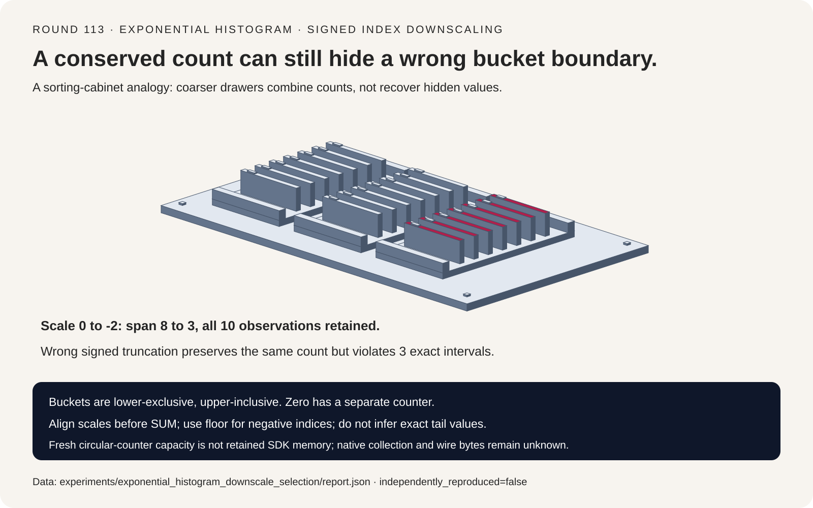
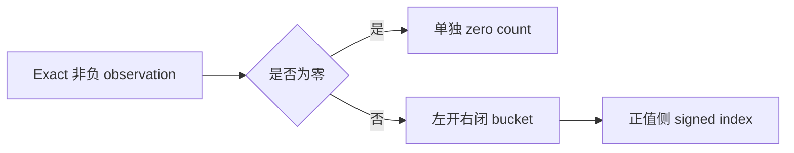
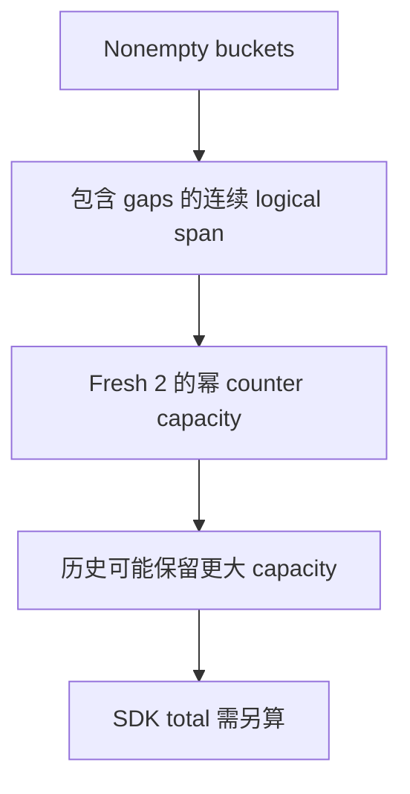

# 指数直方图 FAQ：Signed Index、Downscale 与 Retained Capacity

> **语言**：中文 | [English](exponential-histogram-signed-index-downscale-selection-faq.en.md)
>
> **Round 113 · 2026-11-14（11 月 13 日夜班第 22 轮）** · [高清 SVG](../../assets/svg/exponential-histogram-signed-index-downscale-selection-faq-summary.svg) · [七卡报告](../reports/exponential-histogram-signed-index-downscale-selection-cards.html) · [H5 工作台](../reports/exponential-histogram-signed-index-downscale-sizer.html) · [封存数据](../../experiments/exponential_histogram_downscale_selection/report.json)
>
> **Synthetic，`independently_reproduced=false`。** 只实测原创 exact-rational Python merge/replay；不包含 native OpenTelemetry SDK、collector、并发采集、OTLP 编码或生产内存测量。



## 一、先看结论：Count 守恒不证明桶边界正确

固定检查 OpenTelemetry Go **2026-11-09** 的正/负桶逻辑去重与
**10 月 30 日** fixed-position circular storage 重构。它们是近期实现变化，
不意味着指数直方图是新发明，也不声称取得每日热度排名。

Exact observations 为 `[0,1/4,1/2,1,2,3,4,8,16,32]`。
限制最大 logical span=4，scale **0→−2**，span **8→3**，
保留 **10 counts**。错误 signed division 也保留十个计数，
却让 **3 条 observation 落在错误 interval 里**。

| 契约 | 必须保留 | 不能推断 |
| :--- | :--- | :--- |
| Value boundaries | 左开右闭 | 2 的整数幂属于下一个桶 |
| Signed coarsening | 数学 floor | Toward-zero truncation 等价 |
| Quantiles | 包含目标 rank 的 value interval | Counts 能恢复原始 tail value |
| Capacity | Logical span、allocation、retained history | Occupied buckets 等于 SDK 内存 |

原创模型只含非负整数/Fraction、scale −10..0、zero threshold=0，不是完整 SDK。

## 二、架构师 Q&A：Downscale 与 Merge 到底保留了什么？

### Q1：精确 2 的幂该放在哪一个桶？

Scale=s 时 base=`2^(2^−s)`，index=i 对应
`(base^i,base^(i+1)]`，即左开右闭。Scale=0 时，1→index −1，
2→0，4→1。边界分配到后一桶，即使总数不变，也违反 interval。

原创实现用整数 bit length 和 Fraction 精确比较求 `ceil(log2(value))`，
不计算 floating logarithm，不声称 positive-scale rounding 与 native 一致。
Zero 单独计数，不分配 positive bucket index。

**Positive buckets 的负 index** 表示选定单位下较小的正数，
不是 native negative-observation side。负观测值与非零 zero threshold 均不实现。

### Q2：为什么降低 Scale 必须用 Floor？

降 delta 级时，`new_index=floor(old_index/2^delta)`，再累加 counts。
例如 −1÷2 必须映射 −1，而不是 0。旧桶在单位边界下方，
truncation 却把它移入 lower edge 已经等于 1 的桶。

样例 scale −2 fit 的 nonempty indices 为 −1、0、1：
`(1/16,1]`、`(1,16]`、`(16,256]`，另有一个 zero count，共十条。
错误 truncation 仍为十条，却错放 1/4、1/2、1：
十条 observation 的 containment agreement **下降 30 个百分点**。

所以 count conservation 只是必要条件。还必须检查
`lower < observation <= upper`；zero singleton 单独处理。

### Q3：不同 Scale 能合并吗？之后可以升回去吗？

先对齐到不比任何输入更细的共同 scale，再 SUM 同桶与 zero counts。
样例两分片分别 scale=0/−1，加一个 empty state，在共同 −2 下与直接
构造完全相同。Associativity 也在明确共同 target scale 下验证。

降精度后，桶内细分已经丢失。原创模型拒绝 upscale，不臆造更细 counts。
Empty state 是共同 scale 下的 identity；随意声明更粗空状态仍可能降低目标分辨率。

Native merge 有锁、要求另一状态 idle，且可能修改对齐后的输入。
原创 immutable Python 不复现 hot/cold collection、并发、mutation，
也不实现 DELTA/CUMULATIVE 的 timestamp/reset 语义。

### Q4：Count 精确，p99 就精确吗？

不是。十条观测的 nearest-rank p99 是第十条，exact value=**32**；
scale −2 的 counters 只确定它属于 **(16,256]**。
本样例 p50/p90 都落在 `(1,16]`，exact values 分别为 2/16。

原型返回 interval，不伪造 midpoint、插值或 calibrated confidence。
Native 若另存 min/max，部分边界可以收紧；本模型刻意不保存 extrema。
若桶跨过 SLO threshold，仅凭 counts 无法认证所有 SLO 决策。

Empty quantile 明确报错。Max span=1 也无法在支持的 scale 范围容纳
同时位于单位边界上下的观测；原创 fit 抛错且不丢 observation，
不声称与 native underflow/error-handler 完全等价。

### Q5：Logical Span 与实际占用内存有何区别？

固定 circular storage 用 2 的幂 uint64 capacity。
选定 fresh positive span=**160** 向上取 **256** slots；
negative span=**17** 取 **32** slots，再加一个选定 uint64 zero counter：

| 选定 Counter 口径 | 字节 |
| :--- | ---: |
| Logical spans＋zero | 1,424 |
| Fresh rounded capacities＋zero | **2,312** |
| 10,000 streams×两份选定 live states | **46,240,000** |

这不是 SDK total 或 heap 实测。Live states/stream 是用户预算假设，
不声称两张 native maps 永远都满。Logical span 包含 zero-count gaps，
不等于 sparse nonempty bucket 数。

Clear/downscale 后可能保留旧的大 capacity。Attributes、maps、sum/extrema、
exemplars、snapshots、allocator overhead 与 OTLP encoding 均未计。
Retained capacity、total memory、wire bytes、native collection latency 保持 null。

## 三、三张架构图：精确边界、Scale 对齐与 Capacity






## 四、选型矩阵：先选 Interval 正确性，再谈容量

| 方案 | 适合 | 上线 Gate |
| :--- | :--- | :--- |
| Aligned exponential counts | 可合并分布摘要 | 同一 boundary/scale/zero 语义 |
| 更粗 bounded span | 更宽动态范围 | Interval 不可逆变宽 |
| Exact raw values | 精确 order statistics | Retention/sort/storage 成本 |
| Fresh counter model | 初始选定 payload 规划 | 排除 history 与 non-counter fields |
| Signed truncation | **不安全** | 单位以下 interval 错位 |
| Counters 冒充 exact p99 | **不成立** | 明确 interval 或 estimator |

## 五、动手证据：精确 Interval Oracle，CPU 边界单列

```powershell
python -m experiments.exponential_histogram_downscale_selection.run --check
python -m unittest discover -s tests -p test_exponential_histogram_downscale_selection.py -q
```

8 项 focused tests 覆盖独立 interval search、exact boundaries、downscale
containment、repartition/empty/associative merge、短数据 quantile 穷举、
非法状态、infeasible fit、输入 immutable 与 Node.js/Python capacity 一致性。

实测比较八个预构造状态的 alignment/merge，与共同 scale 下逐条 raw replay；
两条路径的完整 bucket states 相同：

| Total observations | Align/merge（ms） | Raw replay（ms） |
| :--- | ---: | ---: |
| 256 | 0.031467 | 0.799700 |
| 1024 | 0.034267 | 3.292700 |
| 4096 | 0.037833 | 14.574567 |
| 16384 | 0.035667 | 57.258233 |

2 warmups、7 次交替 repeats、每 sample 3 次操作，报告 repeat means 的 median。
不计初始 per-shard histogram 构造，因此不是 ingestion speedup。
不执行 native atomics、circular buffer、并发、collector、encoding/network。
未做浏览器视觉验收，遵守此前拒绝。

## 六、来源、许可、溯源与 Readiness

- [固定实现](https://github.com/open-telemetry/opentelemetry-go/blob/63c5f44275f152fa0a9629463db43474fe7214e2/sdk/metric/internal/aggregate/exponential_histogram.go)：signed scale change、merge alignment、circular capacity 与 retained storage。
- [Public Bucket Contract](https://github.com/open-telemetry/opentelemetry-go/blob/63c5f44275f152fa0a9629463db43474fe7214e2/sdk/metric/metricdata/data.go)：`Offset+i` 与左开右闭。
- [Aggregation Configuration](https://github.com/open-telemetry/opentelemetry-go/blob/63c5f44275f152fa0a9629463db43474fe7214e2/sdk/metric/aggregation.go)：native max-size/max-scale 与可选 extrema。
- [11 月 9 日重构](https://github.com/open-telemetry/opentelemetry-go/commit/63c5f44275f152fa0a9629463db43474fe7214e2)、[10 月 30 日 circular storage](https://github.com/open-telemetry/opentelemetry-go/commit/54b94d57bbe92612969951f3a8f6c5246bbdf49e)：核验时间线，不称已测上游 speedup。
- [Apache-2.0 LICENSE](https://github.com/open-telemetry/opentelemetry-go/blob/63c5f44275f152fa0a9629463db43474fe7214e2/LICENSE)：上游权利保留。

Exact-rational mapping、immutable state、interval oracle、synthetic fixtures、
预算与视觉资产均原创，未复制上游实现、私有观测或数据集。
Report 标 synthetic、`independently_reproduced=false`；原创 CPU 记录单独标 measured。
