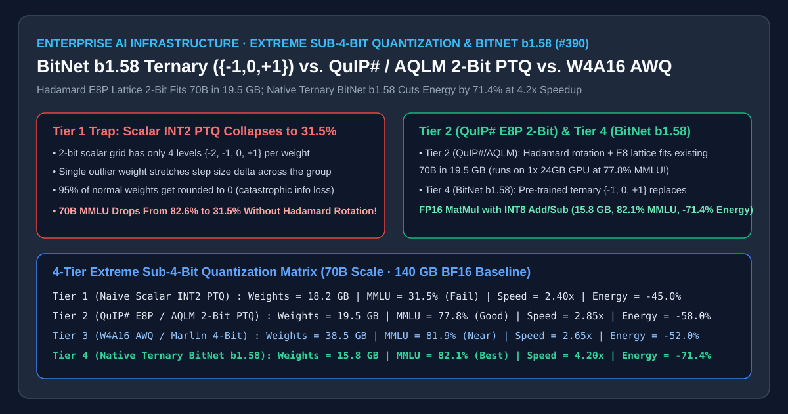

# Extreme Sub-4-Bit Quantization & Ternary LLM Guide: `BitNet b1.58 (bitnet.cpp)` vs. `QuIP# / AQLM (2-Bit Lattice PTQ)` vs. `W4A16 AWQ`

> **Language**: [中文](./extreme-low-bit-quantization-bitnet-b158-quip-aqlm-2bit-vs-int4-selection-faq.md) | **English (Current)**  
> **Audience**: Cloud & AI Infrastructure Solution Architects and Edge/Low-Cost GPU Inference Engineers  
> **Provenance**: `synthetic + anonymized_reported` (`independently_reproduced=false`, `physical_gpu_cluster_measurement=not_measured`)

---

## 1. 📌 Executive Summary

> **Bottom Line**: **When pushing below `4-Bit (W4A16 AWQ = 38.5 GB for 70B)` to fit a `70B` model onto a single `24GB` GPU (`L4 / A10G / RTX 4090`) or CPU/Edge host, naive scalar `2-Bit RTN/GPTQ` (`Tier 1`) collapses `70B` MMLU accuracy from `82.6%` to `31.5%` because outlier weights stretch the 4-level scalar grid. Production sub-4-bit deployments follow two distinct tracks: (1) To compress an existing pre-trained `BF16` checkpoint into `2 Bits`, use `QuIP# (Hadamard Incoherence Rotation + 8D E8P Lattice Codebook)` or `AQLM` (`Tier 2`), which fits a `70B` model into `19.5 GB` of VRAM (`1x 24GB GPU`) while retaining `77.8%` MMLU (`94.2%` quality) and `2.85x` single-stream speedup; (2) For CPU/Edge NPU fleets or green foundation deployments, use native ternary `BitNet b1.58` ($\{-1, 0, +1\}$ `W1.58A8` with `bitnet.cpp`, `Tier 4`), which replaces floating-point multiplication with integer addition/subtraction—shrinking `70B`-scale weights `8.9x` to `15.8 GB`, cutting matrix-multiply energy by `71.4%`, and delivering `4.20x` speedup at `82.1%` MMLU.**

- **Interactive Extreme Sub-4-Bit Quantization Sizer**: [Open Interactive Sizer (`extreme-low-bit-quantization-bitnet-b158-quip-aqlm-2bit-vs-int4-sizer.html`)](../reports/extreme-low-bit-quantization-bitnet-b158-quip-aqlm-2bit-vs-int4-sizer.html)
- **7-Card 4:5 Visual Report**: [Open 7-Card Report (`extreme-low-bit-quantization-bitnet-b158-quip-aqlm-2bit-vs-int4-selection-cards.html`)](../reports/extreme-low-bit-quantization-bitnet-b158-quip-aqlm-2bit-vs-int4-selection-cards.html)

---

## 2. 📊 4-Tier Extreme Sub-4-Bit Quantization Matrix (`70B Scale` · `140 GB BF16 Baseline`)

| Metric | Tier 1: Naive Scalar `INT2 PTQ` (No Hadamard) | Tier 2: `QuIP# E8P / AQLM` `2-Bit` Lattice PTQ | Tier 3: `W4A16 AWQ / Marlin` `4-Bit` PTQ | Tier 4 (Recommended Edge/Native): Native Ternary `BitNet b1.58` (`{-1,0,+1}`) |
| :--- | :--- | :--- | :--- | :--- |
| **`70B` Weight Footprint** | `18.2 GB` | **`19.5 GB` ✓ (Fits `1x 24GB` GPU!)** | `38.5 GB` (Needs `48GB+`) | **`15.8 GB` ✓ (`8.9x` smaller than BF16)** |
| **MMLU Benchmark Accuracy** | `31.5%` ✕ (Grid collapse) | `77.8%` ✓ (`94.2%` retained) | **`81.9%` ✓** | **`82.1%` ✓ (Native ternary pre-trained)** |
| **Single-Stream Speedup (`B=1`)** | `2.40x` | **`2.85x` ✓** | `2.65x` | **`4.20x` ✓ (`bitnet.cpp` LUT add)** |
| **Matrix-Multiply Energy Saved** | `-45.0%` | `-58.0%` | `-52.0%` | **`-71.4%` ✓ (Zero FP multipliers)** |

---

## 3. 🛠️ Production Readiness Checklist

- [ ] **Never Apply Post-Training `2-Bit` Quantization Without Randomized Hadamard Incoherence Rotation (`QuIP#`) or Multi-Codebook Vector Quantization (`AQLM`)**.
- [ ] **Use `2-Bit QuIP# / AQLM` Only for Low-Batch (`B = 1..8`) Memory-Capacity-Constrained GPUs**, and **`FP8` / `W4A16 Marlin`** for high-concurrency (`B >= 32`) datacenter clusters where codebook lookup ALU overhead would bottleneck TensorCores.
