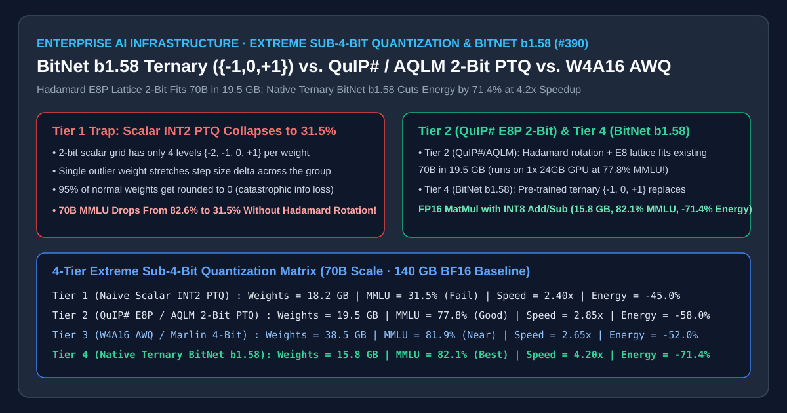
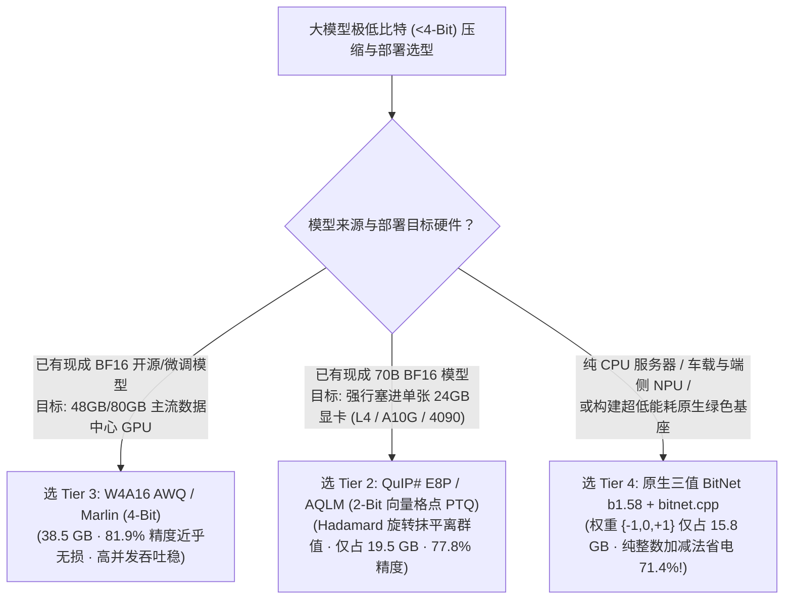

# 大模型极低比特量化与三值网络（1.58-Bit / 2-Bit）选型：`BitNet b1.58 (bitnet.cpp)` vs. `QuIP# / AQLM (Hadamard E8 格点量化)` vs. `W4A16 AWQ` 显存、能效与精度边界指南

> **语言 / Language**: **中文 (当前)** | [English](./extreme-low-bit-quantization-bitnet-b158-quip-aqlm-2bit-vs-int4-selection-faq.en.md)  
> **定位**：面向 Cloud & AI Infrastructure Solution Architect 与边缘/低成本 GPU 部署架构师的 `<4-Bit` 极低比特量化选型（原生三值预训练 `BitNet b1.58 {-1, 0, +1}`、训练后 2-Bit 向量/格点量化 `QuIP# E8P / AQLM` vs. 标准 `W4A16 AWQ/Marlin`）、讲清“如何把 `70B` 大模型塞进单张 `24GB` 显卡（`19.5 GB`）”以及“为什么 2-Bit 必须加 Hadamard 正交旋转才能避免精度崩盘”的白皮书  
> **合规与来源声明**：`synthetic + anonymized_reported`（`independently_reproduced=false`，`physical_gpu_cluster_measurement=not_measured`；完全面向通用企业级低成本 GPU 单卡部署与高能效 CPU/边缘推理选型设计）

---

## 1. 📌 核心选型结论速览（Executive Summary）

> **一句话结论**：**当企业试图突破 `4-Bit (W4A16 AWQ，70B 需 38.5 GB 显存，单张 24GB 显卡放不下)` 的极限向 `1.58-Bit / 2-Bit` 进军时，绝对不能直接对现有模型跑标量逐元素 `2-Bit RTN / GPTQ`（Tier 1）——因为 2-Bit 只有 4 个离散刻度 $\{-2, -1, 0, +1\}$，通道内的一个离群值（Outlier）就会把步长撑大，使 95% 的正常权重全部归零，导致 `70B` 模型的 MMLU 精度从 `82.6%` 崩盘至 **`31.5%`（彻底变傻）**！生产环境必须严守两条截然不同的技术路线：① **要把现有开源 `70B` BF16 大模型塞进单张 `24GB` 显卡（如单卡 `A10G / L4 / RTX 4090`）**：必选带 **Hadamard 非相干正交旋转 + 8 维格点/多码本向量量化** 的 **`QuIP# (E8P Lattice)` 或 `AQLM`（Tier 2）**——将权重显存从 `140 GB` 压至 **`19.5 GB`（留出 `4.5 GB` 跑 KV Cache）**，同时保住 **`77.8%` MMLU（`94.2%` 原生精度）** 与 **`2.85 倍`** 单流提速；② **要在无独显的纯 CPU 服务器、工控边缘网关或追求极致绿色能效的场景落地**：必选从头以三值权重 $W \in \{-1, 0, +1\}$ 预训练的 **`BitNet b1.58 (W1.58A8 + bitnet.cpp)`（Tier 4）**——彻底消灭浮点乘法器（矩阵乘退化为纯整数加减法！），将 `70B` 等效权重压至 **`15.8 GB`（缩小 `8.9 倍`）**、能耗暴降 **`71.4%`**、单流提速 **`4.20 倍`** 且精度高达 **`82.1%`**！**

- **交互式极低比特量化（BitNet b1.58 / QuIP# / AWQ）容量计算器**：[打开交互式计算器 (`extreme-low-bit-quantization-bitnet-b158-quip-aqlm-2bit-vs-int4-sizer.html`)](../reports/extreme-low-bit-quantization-bitnet-b158-quip-aqlm-2bit-vs-int4-sizer.html)
- **7-Card 4:5 视觉评测报告**：[打开 7-Card 报告 (`extreme-low-bit-quantization-bitnet-b158-quip-aqlm-2bit-vs-int4-selection-cards.html`)](../reports/extreme-low-bit-quantization-bitnet-b158-quip-aqlm-2bit-vs-int4-selection-cards.html)

---

## 2. 🎯 客户与架构师灵魂拷问 Q&A（Deep-Dive Architecture FAQ）

### Q1：为什么同样是训练后压到 `2-Bit`，普通标量量化（Tier 1）只有 `31.5%` 精度，而 `QuIP#`（Hadamard 旋转 + $E_8$ 格点码本，Tier 2）却能救回到 `77.8%`？
1. **第一步：快速 Walsh-Hadamard 正交旋转（抹平离群尖峰）**：
   - 大模型权重矩阵中存在少数绝对值比平均值大 `20~100 倍` 的离群值（Outliers）。`QuIP#` 利用正交矩阵性质 $x W = (x H) (H^T W)$，在量化前对权重乘以随机正交 **Hadamard 矩阵 $H$**（复杂度仅 $O(d \log d)$，推理时几乎零开销），把尖锐的离群值均匀摊平为极其规整的标准高斯分布（Incoherence Processing）！
2. **第二步：8 维 $E_8$ 最密球堆积格点量化（Lattice Vector Quantization）**：
   - 标量量化是把每个权重单独画方格子；而在 8 维空间中，数学上球体堆积密度最高的是著名的 **$E_8$ 格点（`E8P Codebook`）**！把连续 8 个权重看作一个 8 维向量联合查表量化（共占用 $8 \times 2 = 16\text{ bits}$），其量化均方误差比标量 2-Bit 降低了整整一个数量级！

### Q2：能不能直接把现有的 `Llama-3-70B` 或 `Qwen2.5-72B` 通过训练后量化（PTQ）转成 `BitNet b1.58`？
- **绝对不能（架构师选型避坑红线）！**
  - `BitNet b1.58`（每個权重仅取 $\{-1, 0, +1\}$ 三个值，$\log_2(3) \approx 1.58\text{ bits}$）之所以能达到与 FP16 平起平坐的精度，是因为它**从预训练第 1 个 Token 开始就采用直通估计器（STE）在三值约束下学习特征表示**（或是至少经过上百亿 Token 的量化感知继续预训练 QAT）！
  - 因此：**存量开源模型压 `2-Bit` 选 `QuIP# / AQLM`（Tier 2），压 `4-Bit` 选 `W4A16 AWQ/Marlin`（Tier 3）；原生三值推理选原生 `BitNet b1.58` 模型 + `bitnet.cpp`（Tier 4）**！

---

## 3. 🧭 直观可视化图解（Mermaid `<4-Bit` 极低比特量化与三值网络选型决策树）

---

## 4. 📊 架构师四级 `<4-Bit` 量化选型决策矩阵（`70B` 参数规模 · BF16 基线 `140 GB` / `82.6%` MMLU）

| 评估维度 | Tier 1：朴素标量 `INT2 PTQ`（无 Hadamard 旋转） | Tier 2：`QuIP# E8P / AQLM` 2-Bit 格点/多码本 PTQ | Tier 3：`W4A16 AWQ / Marlin` 4-Bit 标准 PTQ | Tier 4（推荐端侧/原生）：原生三值 `BitNet b1.58` (`{-1,0,+1}` `W1.58A8`) |
| :--- | :--- | :--- | :--- | :--- |
| **`70B` 权重显存占用 (`Weight Memory`)** | `18.2 GB` | **`19.5 GB` ✓（单张 `24GB` 卡完美装下！）** | `38.5 GB`（需 2 张 24GB 或 1 张 48GB+） | **`15.8 GB` ✓（比 BF16 缩小 `8.9 倍`！）** |
| **MMLU 基准评测准确率** | `31.5%` ✕（离群值撑爆网格，完全不可用） | `77.8%` ✓（保住 `94.2%` 原生能力） | **`81.9%` ✓（`<1%` 极微损）** | **`82.1%` ✓（原生三值预训练零坍塌）** |
| **单流解码加速比 (`Batch=1 Speedup`)** | `2.40x` | **`2.85x` ✓** | `2.65x` | **`4.20x` ✓（LUT 查表纯整数加减法）** |
| **矩阵乘运算能耗削减 (`Energy Saved`)** | `-45.0%` | `-58.0%` | `-52.0%` | **`-71.4%` ✓（彻底消灭浮点乘法器）** |

---

## 5. 🛠️ 架构评审与生产落地 Checklist

- [ ] **注意 `2-Bit Vector PTQ (QuIP# / AQLM)` 的 Batch Size 拐点**：在单并发/小并发（`Batch = 1..8`）下，由于瓶颈完全在显存带宽，`QuIP#` 凭借減半的权重读取量比 `4-Bit AWQ` 更快（`2.85x vs 2.65x`）；但在大并发（`Batch >= 64`）下，码本查表反量化（Codebook Lookup ALU）会成为计算瓶颈，高并发云端集群仍应优先选 `FP8` 或 `W4A16 Marlin`。
- [ ] **在 x86 (`AVX-512`) 与 ARM (`NEON / Apple Silicon`) CPU 上部署 `BitNet b1.58` 时必用官方 `bitnet.cpp`（基于 `TL1 / TL2` 预计算查找表内核）**：避免退回通用 `llama.cpp` 浮点反量化路径。
