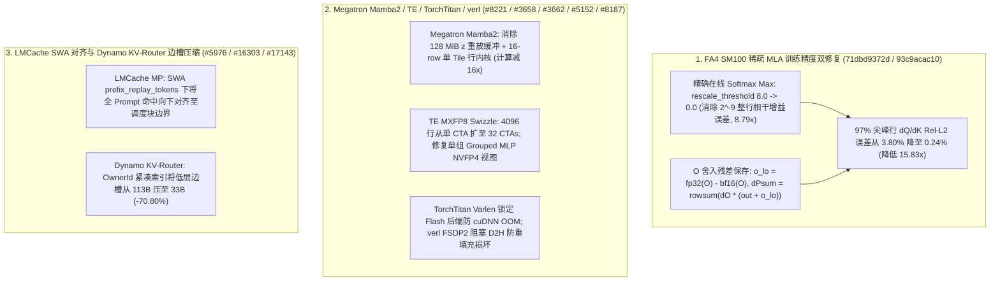

# Phase 93 Track 3：FlashAttention-4 SM100 稀疏 MLA 训练精度修复、Megatron-LM 无 `z` 缓冲 Batch-Invariant Mamba2、TE MXFP8/NVFP4、verl FSDP2 阻塞卸载与 Dynamo KV-Router 边槽压缩剖析

> **英文版 / English Version**: [`fa4-sparse-mla-megatron-mamba-te-verl-dynamo-phase93.en.md`](fa4-sparse-mla-megatron-mamba-te-verl-dynamo-phase93.en.md)  
> **关联实验 / Reproducible Experiment**: [`experiments/fa4_sparse_mla_megatron_mamba_te_verl_dynamo_phase93/`](../../experiments/fa4_sparse_mla_megatron_mamba_te_verl_dynamo_phase93/)  
> **覆盖主干提交 / Upstream Commits (`2026-09-23` – `2026-10-26`)**:
> - `Dao-AILab/flash-attention@71dbd9372d`: `[CuTe, SM100] Sparse MLA training: dpsum from an O residual`
> - `Dao-AILab/flash-attention@93c9acac10`: `[CuTe, SM100] Sparse MLA training fwd: exact running softmax max`
> - `NVIDIA/Megatron-LM@aa46a57229` (`#8221`): `fix(ssm): batch-invariant Mamba decode without a z replay buffer`
> - `NVIDIA/TransformerEngine@2e959f352c` (`#3662`): `[PyTorch] Fix NVFP4 weight views of the single-group fused grouped MLP`
> - `NVIDIA/TransformerEngine@33e7ff3160` (`#3658`): `[Common] Swizzle MXFP8 scaling factors with one CTA per scale tile`
> - `pytorch/torchtitan@094c884685` (`#5152`): `Varlen attention backend falls back to CuDNN even when FA is installed.`
> - `volcengine/verl@edd2c63b6a` (`#8187`): `[fsdp] fix: prevent parameter corruption during FSDP2 CPU offload`
> - `LMCache/LMCache@a0ff470128` (`#5976`): `[Fix][MP] Keep a full-prompt hit inside vLLM's allocation under SWA prefix replay`
> - `ai-dynamo/dynamo@4b487d890d` (`#16303`): `fix(llm): deliver OpenAI logit_bias to the vLLM backend instead of silently dropping it`
> - `ai-dynamo/dynamo@3acf248073` (`#17143`): `perf(kv-router): shrink lower-tier edge slots from 113 to 33 bytes`

---

## 1. 核心架构发现与工程背景

在大规模混合精度训练、强化学习（RLHF/verl）与分布式 KV 路由中，数值精度失真与内存膨胀往往源于跨阶段的不变量破坏：**（1）FlashAttention-4 在 SM100 上的稀疏 MLA 训练因反向 `dPsum` 消费了 BF16 截断后的 `O`，在尖峰注意力行发生灾难性相消，导致 1% 的行出现 ~100% 梯度误差**；**（2）verl 在 FSDP2 非均匀分片下执行 `non_blocking=True` D2H 卸载，与 CPU 端的 `FSDPParam.reset_sharded_param` 重填充发生数据竞争，无需任何前反向计算即可静默篡改模型权重**；**（3）Dynamo KV-Router 为每条低层存储边保存完整 Owner 结构，每槽消耗 113 字节**。本篇深度剖析这 10 项底层修复。

---

## 2. FlashAttention-4 SM100 稀疏 MLA 训练数值精度双修复（`71dbd9372d`, `93c9acac10`）

### 2.1 `o_lo` 残差补偿根除尖峰行 `dPsum` 灾难性相消（`71dbd9372d`）
在注意力反向传播中，Softmax 梯度为 $dS = P \odot (dP - dP_{\text{sum}})$，其中 $dP_{\text{sum}} = \sum_j dO_j \cdot O_j$。
- **误差机理**：当注意力高度集中于主导 Key（如自注意力权重达 80%~97% 的尖峰行）时，主导槽位上的 $dP \approx dP_{\text{sum}}$。若反向预处理仅读取 BF16 的 `out`，则 `out` 在行方向相干的 BF16 舍入误差会在 $dP - dP_{\text{sum}}$ 相减时幸存并主导 $dS$，导致 80% 集中度下 `dQ/dK` 相对 FP64 的 L2 误差高达 **0.89%**（约 1% 的行相对误差达 **~100%**），97% 集中度下飙升至 **3.80%**。
- **架构修复**：当稀疏 MLA 前向的输入需要梯度（`requires_grad`）时，在 `flash_fwd_mla_sm100.py` 的修正/尾声 Warp 中，于 `O` 的 TMA 存储后按 32 列分块从 TMEM 重读 FP32 `O`，计算并写出精确的 BF16 舍入残差张量 `o_lo = fp32(O) - bf16(O)`（与 `out` 同形状同 BF16 类型）。反向预处理 `flash_bwd_preprocess.py` 计算 `dpsum = rowsum(dO * (out + o_lo))`，将尖峰行的 `dQ/dK` 相对 L2 误差从 **3.80% 直接压回理想流水线的 0.24% 地板（误差降低 15.83x）**，`out` 与 `lse` 保持逐比特不变。

### 2.2 稀疏 MLA 训练前向精确在线 Softmax 最大值（`93c9acac10`）
- FA4 推理默认采用惰性重缩放阈值 `rescale_threshold = 8.0`（$\log_2$ 单位）：仅当新块最大值超过运行最大值达 8 以上才重缩放 `O` 与 `row_sum`。由于内核从最后一个 Gather 索引块倒序遍历到第一个块，Top-K Indexer 最强的第 0 号槽位最后被处理，惰性阈值导致主导概率变成非整数 $\delta$ 的 $\exp_2(\delta)$ 而非精确的 $1.0$，其 BF16 截断在整行输出上引入约 $2^{-9}$ 的相干增益误差且结果依赖索引顺序。
- 修复后在 `requires_grad and sparse_kv` 时将 `mla_fwd_rescale_threshold` 设为 **`0.0`**（纳入编译 Key），输出相对 L2 误差从 `2.07e-3` 降至 `1.67e-3`（BF16 地板），整行相干增益误差从 `1.23e-3` 降至 `1.40e-4`（**降低 8.79x**）。

---

## 3. Megatron-LM Batch-Invariant Mamba2、TransformerEngine、TorchTitan 与 verl FSDP2

1. **Megatron-LM 无 `z` 重放缓冲的 Batch-Invariant Mamba2 解码（`#8221`, `aa46a57229`）**：
   - 此前为保证 Mamba2 Decode 与训练 Chunk-Scan 逐比特一致，缓冲解码器不仅对每个请求重算整个 `BLOCK_SIZE_M = 256` 的训练 Tile，还额外维护完整的 `z` 门控重放缓冲区（在 `B=64, C=256, H=64, D=64` BF16 下占用 **128.0 MiB**）。
   - 新增 `batch_invariant_decode_rows.py` 中的 `_chunk_scan_row_kernel` 等行级内核：仅在包含目标行的 **16 行 Tensor Core MMA Tile** 上执行与训练完全相同的指令分解（Chunk-Scan 行计算量减少 **16x**），仅在填满 Chunk 的边界步（约 $1/256$ 比例）提交边界状态，并通过行步长为 0 的单行 `z` 读取彻底移除 `z` 重放缓冲区。
2. **TransformerEngine 单组 Grouped MLP NVFP4 视图修复（`#3662`, `2e959f352c`）与逐 Tile MXFP8 Scale Swizzle（`#3658`, `33e7ff3160`）**：
   - 修复单组融合 Grouped MLP 的两处 cuDNN NVFP4 视图 Bug：前向 FC1 权重缩放视图误将逻辑 `K` 而非打包字节数 `fc1_weight_k` 除以 `k_sf_divisor`（多请求了 2 倍 Scale）；反向 FC2 dgrad 误将转置后的列主序权重视图设为 `(out_features, in_features / 2)` 而非正确的 `(1, in_features, out_features / 2)`。
   - 新增 `NVTE_MXFP8_PER_TILE_SWIZZLE=1` 逐 Tile Swizzle 内核：此前窄 K/M 内核将 32 个 `128x4` Scale Tile 塞进单个 1024 线程 CTA（导致 4096 行激活的 Scale 仅由 **1 个 CTA** 串行处理）；新内核为每个 128 行（Row-wise）或 `128x32`（Column-wise）Scale Tile 分配独立 CTA（4096 行并行启动 **32 个 CTA**）。
3. **TorchTitan Varlen 注意力后端优先级锁定（`#5152`, `094c884685`）**：PyTorch `varlen_attn` 在未指定 `sdpa_kernel` 优先级时默认顺序为 `[CUDNN, FLASH]`，导致全注意力层在 GH200 打包长序列反向传播时因 cuDNN 显存暴涨触发 OOM。修复后显式通过 `sdpa_kernel(self.sdpa_backends, set_priority=True)` 绑定优先级。
4. **verl FSDP2 CPU 卸载阻塞式 D2H 传输防参数静默损坏（`#8187`, `edd2c63b6a`）**：在 `offload_fsdp2_model_to_cpu` 与 `fsdp2_load_full_state_dict` 中，当参数分片不均匀（Uneven Shards）时，`model.to("cpu", non_blocking=True)` 会在异步 D2H DMA 尚未完成时就让 CPU 端的 `FSDPParam.reset_sharded_param` 执行重填充（Repadding），直接在主机内存上引发写冲突并静默篡改模型参数。改为阻塞式 D2H 传输后彻底消除跨节点强化学习中的精度崩塌。

---

## 4. LMCache SWA 前缀重放对齐与 NVIDIA Dynamo KV-Router 边槽压缩

- **LMCache SWA Prefix Replay 块边界对齐（`#5976`, `a0ff470128`）**：在 DeepSeek-V4.1 等带滑动窗口前缀重放（`prefix_replay_tokens = 128`）的配置下，vLLM 调度器在分配显存前会将外部连接器返回的命中数向下取整到 `scheduler_block_size` 边界。`lmcache_mp_connector.py` 新增 `get_prefix_replay_tokens`，确保全 Prompt 命中返回的块数严格处于 vLLM 已分配的窗口内（例如 `1024` Token 序列在 `128` 重放窗口与 `64` 块大小下精确对齐到 `896` Token）。
- **Dynamo OpenAI `logit_bias` 透传与拦截（`#16303`, `4b487d890d`）**：修复 Dynamo vLLM 后端静默丢弃 `logit_bias` 的问题（将其规范化为 `dict[int, float]` 写入 `sampling_params.logit_bias`），并在不支持该字段的 TensorRT-LLM 后端显式抛出 `InvalidArgument`。
- **Dynamo KV-Router 低层存储边槽从 113B 压缩至 33B（`#17143`, `3acf248073`）**：在 `lib/kv-router/src/indexer/lower_tier.rs` 中，不再在每条 Radix 边槽中冗余存储完整的 `IndexedResidencyOwner` 枚举，而是仅存储紧凑的 `OwnerId` 与多 Owner 异或指纹（完整 Owner 仅在反向索引中保留一份用于 Reset 过滤与恢复导出），使单边槽内存从 **113 字节降至 33 字节（节省 70.80%）**；在 1,000 万条低层 KV 边的规模下，索引常驻内存从 **1,077.65 MiB 降至 314.71 MiB**。
