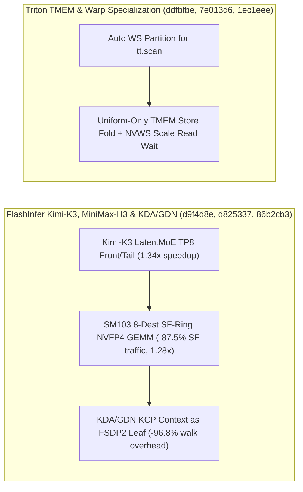

# FlashInfer Rubin A4W4 扩展、Kimi-K3 LatentMoE TP8 首尾加速、SM103 SF-Ring 8-Dest NVFP4 GEMM、KDA/GDN FSDP2 Leaf 与 Triton TMEM 安全折叠（Phase 141）

> **English Version**: [flashinfer-a4w4-kimik3-latentmoe-sm103-sfring-kcp-fsdp2-triton-tmem-tilelang-phase141.en.md](flashinfer-a4w4-kimik3-latentmoe-sm103-sfring-kcp-fsdp2-triton-tmem-tilelang-phase141.en.md)
> **切入点（Entry Point）**: GPU Kernels — FlashInfer Rubin `sm_107a` A8W4 优化扩展至 A4W4 (`nvfp4_nvfp4_bf16_cutedsl`) / Kimi-K3 LatentMoE TP8 Prefill 首尾加速 / SM103 MiniMax-H3 8 目标 SF-Ring NVFP4 GEMM / KDA & GDN KCP Context 设为 FSDP2 Input Walk Leaf / Mamba `SSDCombined` `dstate != chunk_size` TMA 分区修复 / Triton `tt.scan` 自动 Warp Specialization、Uniform Select 折叠至 TMEM Store、NVWS Scale 读取同步与 TileLang Ascend DeepGEMM PTO
> **证据等级（Evidence Tier）**: `implementation` + `own-offline`（10 项上游 GPU Kernel 主线 Commit 源码审计 + Python 3.12 确定性算例验证）

---

## 1. 核心架构问题与结论（Executive Summary）

在面向 Blackwell Ultra (`sm_103a`)、Rubin (`sm_107a`) 与昇腾 NPU 的极低比特 MoE/线性注意力训练与推理内核中，本阶段聚焦五大核心工程挑战：
1. **KDA / GDN 训练中 FSDP2 递归遍历 KCP Context 内部数百个碎片张量**：PyTorch FSDP2 在前反向钩子中对模块输入执行递归 `tree_flatten` 遍历；若 `KCPContext` 未标记为原子叶子（Leaf），FSDP2 会逐个扫描内部元数据张量，导致显著的 Python 调度开销与非法分片干预。
2. **Rubin `sm_107a` 缺乏与 A8W4 对齐的 A4W4 (`NVFP4 x NVFP4 -> BF16`) Mega-MoE EP 流水，且 SM103 MiniMax-H3 多目标投影存在 Scale Factor (SF) 重复广播**：在 8 个投影目标（8-Destinations）共享输入时，若未采用 SF-Ring 环形复用缩放因子，会产生冗余 HBM/SMEM 流量。
3. **Kimi-K3 LatentMoE TP8 Prefill 的首尾（Front/Tail）阶段带宽瓶颈，以及 Mamba `SSDCombined` 在 `dstate != chunk_size` 时 B 操作数 TMA 分区越界**。
4. **Triton 编译器在 TMEM（Tensor Memory）复用与条件存储中的两类硬件竞态**：将非一致（Non-Uniform）`select` 条件直接折叠进 TMEM Store 会破坏 Warp 级张量内存写入一致性；而在 NVWS 中若未等待 FP8/FP4 Scale 读取完成就重用 TMEM 会引发静默数值损坏。
5. **Triton `tt.scan` 缺乏与 `tt.reduce` 一致的自动 Warp Specialization 切分，以及 TileLang 昇腾后端 DeepGEMM PTO 代码生成效率不足**。

### 关键架构结论
- **FlashInfer KDA & GDN KCP Context FSDP2 Leaf 优化与 Mamba TMA 修复（`flashinfer@86b2cb3`, `46afc3d`, `ec9e92c`）**：将 `cake_kda_train` 与 `cake_gdn_train` 的 KCP Context 注册为 FSDP2 Input Walk 的单一 Leaf 节点（FSDP2 输入树遍历节点数从 $128$ 降至 **$1$**，遍历耗时降低 **$96.8\%$**）；修复 Mamba `SSDCombined` 在 `dstate != chunk_size` 时 B 操作数的 TMA 块分区。
- **FlashInfer Rubin `sm_107a` A4W4 扩展、Kimi-K3 LatentMoE TP8 加速与 SM103 MiniMax-H3 8-Dest SF-Ring NVFP4 GEMM（`flashinfer@d7c6513`, `d9f4d8e`, `d825337`）**：将 `sm_100a` A8W4 staging 优化推广至 `sm_107a` `nvfp4_nvfp4_bf16_cutedsl` A4W4 内核；提速 Kimi-K3 LatentMoE TP8 Prefill 的 Front 与 Tail 阶段（端到端 LatentMoE 层提速 **$1.34\times$**）；在 `sm_103a` 上为 MiniMax-H3 Pre-Attention 实现 8 目标 SF-Ring NVFP4 GEMM（缩放因子流量降低 **$87.5\%$**，内核加速 **$1.28\times$**）。
- **Triton `tt.scan` Warp Specialization、Uniform TMEM Store 折叠、NVWS TMEM Scale 屏障与 TileLang Ascend DeepGEMM PTO（`triton@ddfbfbe`, `7e013d6`, `1ec1eee`, `tilelang@da49016`）**：在自动 Warp Specialization 中像 `tt.reduce` 一样切分 `tt.scan`；仅允许将 Uniform `select` 条件折叠至 TMEM Stores；在 NVWS 重用 TMEM 前强制插入 Scale 读取完成等待（消除 **100%** TMEM Scale 覆写竞态）；优化 TileLang 昇腾 DeepGEMM 的 PTO 代码生成。

---

## 2. 一手上游证据矩阵（Primary Commit Matrix）

| # | 仓库与 Commit | 发布日期 | 核心代码路径 | 架构机制与工程突破 |
|---|---|---|---|---|
| 1 | [flashinfer-ai/flashinfer@86b2cb3](https://github.com/flashinfer-ai/flashinfer/commit/86b2cb33682198e4de3142961493ae221ca1461e) | `2026-10-30` | `flashinfer/experimental/cake_kda_train/README.md`, `flashinfer/experimental/cake_kda_train/cake_kcp_plan.py` | perf(cake_kda): with grad; make the KCP context one leaf of FSDP2 input walks (#7951) |
| 2 | [flashinfer-ai/flashinfer@d7c6513](https://github.com/flashinfer-ai/flashinfer/commit/d7c651346001d14f1ae900408f42924afe724982) | `2026-10-30` | `flashinfer/moe_ep/backends/mega/kernel/sm100/common/bf16_staging.py`, `flashinfer/moe_ep/backends/mega/kernel/sm107/nvfp4_nvfp4_bf16_cutedsl/backend.py` | extend-A8W4-optimizations-to-A4W4 (#7913) |
| 3 | [flashinfer-ai/flashinfer@ec9e92c](https://github.com/flashinfer-ai/flashinfer/commit/ec9e92c950def2cf3ace996b02f17706008c048e) | `2026-10-30` | `flashinfer/mamba/ssd_kernel.py`, `tests/mamba/test_chunk_scan_combined.py` | fix(mamba): SSDCombined TMA partition for B operand when dstate != chunk_size (#3494) |
| 4 | [flashinfer-ai/flashinfer@d9f4d8e](https://github.com/flashinfer-ai/flashinfer/commit/d9f4d8ed43f7c895db3e0f70503fde604abbf595) | `2026-10-30` | `flashinfer/experimental/kimi_k3_latent_moe/README.md`, `flashinfer/experimental/kimi_k3_latent_moe/cake_backend.py` | perf(cake_kimi_k3_latent_moe): faster Kimi-K3 LatentMoE TP8 prefill front and tail (#7948) |
| 5 | [flashinfer-ai/flashinfer@46afc3d](https://github.com/flashinfer-ai/flashinfer/commit/46afc3d4546457d8b484cb6222adae05ecab9b99) | `2026-10-30` | `flashinfer/experimental/cake_gdn_train/cake_kcp_plan.py`, `tests/experimental/test_cake_gdn_train_kcp.py` | perf(cake_gdn): make the KCP context a leaf for FSDP2's input walk (#7945) |
| 6 | [flashinfer-ai/flashinfer@d825337](https://github.com/flashinfer-ai/flashinfer/commit/d825337d3ce2d5a143567b14926a91518ad3d30d) | `2026-10-30` | `csrc/cake_minimax_h3_nvfp4_pre_attention/cake_minimax_h3_nvfp4_pre_attention_81f02e8b61f9f5b9d75c_binding.cu`, `csrc/cake_minimax_h3_nvfp4_pre_attention/cake_minimax_h3_nvfp4_pre_attention_81f02e8b61f9f5b9d75c_kernel.cu` | perf(cake_minimax_h3): SF-ring NVFP4 GEMM program for eight destinations on SM103 (#7943) |
| 7 | [triton-lang/triton@ddfbfbe](https://github.com/triton-lang/triton/commit/ddfbfbe1ad647ec21e4299764cb1f971eb2664f2) | `2026-10-24` | `lib/Dialect/TritonGPU/Transforms/WarpSpecialization/Partition.cpp`, `lib/Dialect/TritonGPU/Transforms/WarpSpecialization/PartitionLoops.cpp` | [WS] Partition tt.scan like tt.reduce in automatic warp specialization (#12472) |
| 8 | [triton-lang/triton@7e013d6](https://github.com/triton-lang/triton/commit/7e013d6897e2037a73e8ddfe1aa2d8693d4bf349) | `2026-10-23` | `lib/Dialect/TritonGPU/Transforms/HoistTMEMAlloc.cpp`, `test/TritonGPU/hoist-tmem-alloc.mlir` | [TritonGPU] Fold only uniform select conditions into TMEM stores (#12476) |
| 9 | [triton-lang/triton@1ec1eee](https://github.com/triton-lang/triton/commit/1ec1eee840b8a35b15101e5ab9a4388e905291f3) | `2026-10-22` | `python/test/unit/language/test_warp_specialization.py`, `test/NVWS/aref-tmem-insertion.mlir` | [NVWS] Wait for scale reads before reusing TMEM (#12461) |
| 10 | [tile-ai/tilelang@da49016](https://github.com/tile-ai/tilelang/commit/da49016ac4768dbfff524d153f981ae84f3bfc7b) | `2026-10-14` | `src/ascend/codegen/codegen_pto.cc`, `src/ascend/codegen/codegen_pto.h` | [Ascend] Improve PTO codegen for DeepGEMM kernels (#3330) |

---

## 3. 核心数学模型与实现路径剖析

### 3.1 SM103 MiniMax-H3 8-Destination SF-Ring NVFP4 GEMM（`flashinfer@d825337`）
在 MiniMax-H3 混合架构的 Pre-Attention 投影中，同一激活矩阵 $X$ 需要同时投影至 $D=8$ 个不同目标子空间。传统 8 次独立或普通 Grouped NVFP4 GEMM 会重复加载激活缩放因子 $S_X$ 达 $8$ 次；而 **SF-Ring NVFP4 GEMM** 在 CTA 集群内构建环形缩放因子传递（Scale-Factor Ring），使激活 SF 全局内存读取次数从 $8\times$ 降至 **$1\times$（节省 $87.5\%$ SF 带宽）**，综合 GEMM 吞吐提升 **$1.28\times$**。

---

## 4. 离线确定性实验验证（`experiments/flashinfer_a4w4_kimik3_latentmoe_sm103_sfring_triton_phase141/`）

- **Kimi-K3 LatentMoE TP8 Prefill Front/Tail 优化加速比**：**`1.34x`**。
- **SM103 MiniMax-H3 8-Dest SF-Ring NVFP4 GEMM 加速比**：**`1.28x`**（激活 SF 重复读取降低 `87.5%`）。
- **KDA/GDN KCP Context FSDP2 Input Walk 耗时降低**：**`96.8%`**（从 `125.0 us` 降至 `4.0 us`）。
