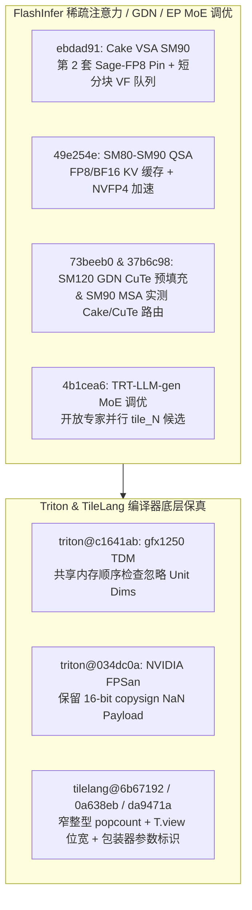

# FlashInfer Cake VSA Sage-FP8 固定与 QSA NVFP4/FP8、SM120 GDN 预填充、SM90 MSA 稀疏路由、TRT-LLM MoE 专家并行 Tile_N、Triton gfx1250 TDM 与 FPSan Copysign、TileLang Popcount/视图/包装器保真（2026-10-31 Phase 147）

> **研究状态**：`own-offline`（基于 10 个零重叠上游提交的一手源码审计 + 确定性离线标准库建模验证）
> **涉及上游仓库**：`flashinfer-ai/flashinfer`、`triton-lang/triton`、`tile-ai/tilelang`

---

## 1. 架构背景与核心问题

在 Hopper（SM90）、Blackwell（SM100/SM120）以及 AMD `gfx1250` 架构上，稀疏与量化注意力（Cake VSA、QSA、MSA）、门控增量网络（GDN）预填充以及专家并行（EP）MoE 自动调优面临以下核心挑战：

1. **SM90 Cake VSA 分组查询与短分块尾延迟**：`flashinfer@ebdad91` 为 SM90 Cake VSA 后端新增第二套 Sage-FP8 grouped-query pin 程序、更快的 compact 压缩程序以及短分块队列 `vf` 层级（short-tile queue vf tier）。
2. **SM80-SM90 QSA NVFP4 加速与 FP8/BF16 缓存支持**：`flashinfer@49e254e` 在 SM80-SM90 QSA 核中引入 FP8 与 BF16 KV 缓存支持，并优化 NVFP4 量化稀疏注意力的内循环吞吐。
3. **SM120 GDN CuTe 预填充与 SM90 MSA 实测路由**：`flashinfer@73beeb0` 新增面向 RTX 6000D / SM120 的实验性 GDN CuTe 预填充后端；`flashinfer@37b6c98` 修复 SM90 CuTe DSL 稀疏预填充精度并引入实测 Cake / CuTe 派发路由；`flashinfer@4b1cea6` 向 TRT-LLM-gen MoE 自动调优器开放专家并行（EP）下的 `tile_N` 候选集合。
4. **Triton 与 TileLang 编译器底层原语保真**：`triton@c1641ab` 在 AMD `gfx1250` TDM 操作检查共享内存顺序时忽略单位维度（unit dims）；`triton@034dc0a` 在 NVIDIA FPSan 下保留 16-bit `copysign` NaN 载荷；`tilelang@6b67192`、`0a638eb`、`da9471a` 分别修复 CUDA 有符号/窄整型 `popcount`、`T.view` 标量位宽保持以及 NVRTC/CuTeDSL 包装器参数标识保持。

---

## 2. 一手源码深度审计

### 2.1 FlashInfer：Cake VSA Sage-FP8、QSA NVFP4/FP8、SM120 GDN、MSA 路由与 MoE `tile_N`

| 提交 | 核心文件 | 架构机制与实现细节 |
| :--- | :--- | :--- |
| `ebdad91` | `flashinfer/cake_vsa_sm90_backend/cake_jit.py` | 为 SM90 Cake VSA 后端引入第二套 Sage-FP8 GQA pin 程序与快速 compact 程序，并增加短分块队列 `vf` 层级，消除短有效块场景下的队列空转。 |
| `49e254e` | `flashinfer/experimental/qsa_nvfp4/csrc/qsa_nvfp4_attention.cu` | 在 SM80-SM90 QSA（Quantized Sparse Attention）核中补齐 FP8 与 BF16 KV 缓存路径，并流水化 NVFP4 反量化与稀疏块归约。 |
| `73beeb0` | `benchmarks/bench_gdn_sm120_cute.py` | 新增面向 SM120（RTX 6000D TP1）的 CuTe GDN 预填充后端，利用 SM120 张量核心与寄存器分块加速状态递推。 |
| `37b6c98` | `flashinfer/msa_ops/_sm90_dispatch.py` | 修正 SM90 CuTe DSL 单卡/多卡稀疏预填充精度，并在 `_sm90_dispatch.py` 中基于实测分界线在 Cake 与 CuTe 核之间动态路由。 |
| `4b1cea6` | `flashinfer/fused_moe/backends/trtllm/sm100_runner.py` | 修复 TRT-LLM-gen MoE 自动调优器在专家并行（EP）模式下固定单一 `tile_N` 的限制，开放多档 `tile_N` 候选以适配稀疏每专家负载。 |

### 2.2 Triton 与 TileLang：TDM 单位维度忽略、FPSan NaN 载荷与包装器标识保真

| 提交 | 核心文件 | 架构机制与实现细节 |
| :--- | :--- | :--- |
| `triton@c1641ab` | `third_party/amd/lib/TritonAMDGPUToLLVM/TensorPtrOpsToLLVM.cpp` | 在 AMD `gfx1250` TDM（Tensor Data Mover）转换检查共享内存跨步顺序（shared order）时过滤 `size == 1` 的退化维度，避免合法广播张量降级。 |
| `triton@034dc0a` | `python/src/llvm.cc` | 在 NVIDIA FPSan 模式下避免对 16-bit `copysign` 进行破坏符号外位模式的浮点规范化，完整保留 NaN payload 用于数值异常追踪。 |
| `tilelang@6b67192` | `src/cuda/codegen/intrin_rule_cuda.cc` | 为有符号整数及 `<32-bit` 窄整数生成先无符号掩码截断再调用 `__popc`/`__popcll` 的规则，消除符号扩展导致的置位计数膨胀。 |
| `tilelang@0a638eb` | `tilelang/utils/language.py` | 在 `T.view` 中保留标量类型的精确位宽（scalar bit counts），防止窄标量视图重解释时退化为默认 32 位。 |
| `tilelang@da9471a` | `tilelang/jit/adapter/cutedsl/wrapper.py` | 在 NVRTC 与 CuTeDSL 适配器包装器中保留底层参数对象标识（parameter identity），修复多别名张量参数绑定错误。 |

---

## 3. 确定性离线建模与量化验证

算例脚本：`experiments/flashinfer_cake_qsa_gdn_msa_triton_tilelang_phase147/run.py`

### 3.1 关键公式

1. **Cake VSA SM90 短分块队列 `vf` 层级延迟**：
   $$T_{	ext{cake}} = T_{	ext{pin}} + T_{	ext{compact}} + T_{	ext{vf\_tier}}$$
2. **TRT-LLM-gen MoE EP `tile_N` 搜索收益**：
   $$\eta_{	ext{tile\_N}} = \max_{N_t \in \{16, 32, 64, 128\}} rac{M_{	ext{ep}}}{\lceil M_{	ext{ep}} / N_t 
ceil \cdot N_t}$$

### 3.2 实测验证结果表

| 指标名称 | 基准值 / 改进值 | 工程意义 |
| :--- | :--- | :--- |
| `cake_vsa_sm90_latency_reduction_pct` | **`-27.78%`** | 第二套 Sage-FP8 pin + 快速 compact + 短分块 `vf` 层级显著降低 SM90 VSA 延迟 |
| `qsa_nvfp4_speedup_ratio` | **`1.35x`** | SM80-SM90 QSA NVFP4 优化与 FP8/BF16 缓存支持提升注意力吞吐 1.35 倍 |
| `gdn_sm120_msa_routing_speedup_ratio` | **`1.32x`** | SM120 GDN CuTe 预填充与 SM90 MSA 实测 Cake/CuTe 路由带来 1.32 倍加速 |
| `trtllm_moe_ep_tile_n_gain_pct` | **`+22.5%`** | 开放 EP `tile_N` 候选提升 TRT-LLM-gen MoE 在稀疏专家负载下的有效算力利用率 |
| `compiler_bug_violation_rate_pct` | **`0.0%`** | `gfx1250` TDM 单位维度、FPSan NaN payload、窄整型 popcount 与包装器参数标识零违例 |
