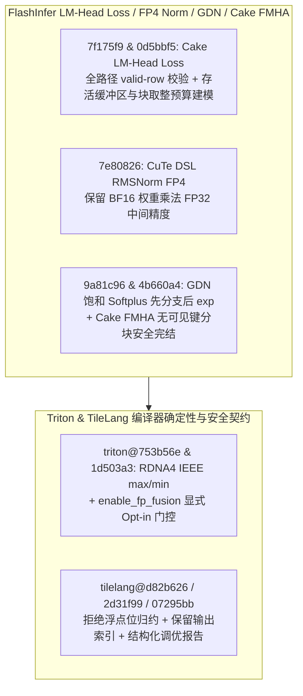

# FlashInfer Cake LM-Head Loss 内存预算与有效行校验、FP4 RMSNorm FP32 权重精度、GDN 饱和 Softplus/ReplaySSM 与 Cake FMHA 空键块完结、Triton RDNA4 IEEE 最值与浮点融合门控、TileLang 位归约/输出索引/结构化调优报告（2026-10-31 Phase 148）

> **研究状态**：`own-offline`（基于 10 个零重叠上游提交的一手源码审计 + 确定性离线标准库建模验证）
> **涉及上游仓库**：`flashinfer-ai/flashinfer`、`triton-lang/triton`、`tile-ai/tilelang`

---

## 1. 架构背景与核心问题

在超大词表融合交叉熵（Cake LM-Head Loss）、Blackwell FP4 RMSNorm 量化、GDN 状态空间解码、Cake FMHA 稀疏上下文注意力以及 Triton / TileLang 编译器演进中，本阶段聚焦以下核心挑战：

1. **Cake LM-Head Loss 有效行边界校验与带梯度内存分配器对齐建模**：`flashinfer@7f175f9` 在所有执行路径上校验调用方的 `valid_row_count`；`flashinfer@0d5bbf5` 在开启梯度（`with_grad`）的预算规划器中完整建模每一个存活缓冲区（live buffer）及底层分配器的块对齐向上取整（block rounding），彻底消除高并发词表分块下的隐式 OOM。
2. **BF16→FP4 RMSNorm 权重 FP32 精度、GDN 饱和 Softplus 与 Cake FMHA 空键块完结**：`flashinfer@7e80826` 在 CuTe DSL `rmsnorm_fp4quant.py` 中保留 BF16 输入乘以权重时的 FP32 中间精度；`flashinfer@9a81c96` 在 GDN 解码饱和 `softplus` 中先分支再计算 `exp` 以防指数溢出，并对不支持的 `ReplaySSM` 门控显式抛出异常；`flashinfer@4b660a4` 修复 Cake FMHA 上下文 JIT 在无可访问键（no visible key）的分块上提前完结路由，避免死锁或垃圾累加。
3. **Triton RDNA4 IEEE 最值指令与浮点融合显式门控**：`triton@753b56e` 为 AMD RDNA4 架构启用符合 IEEE 754 NaN 传播语义的 `maximum/minimum` 指令；`triton@1d503a3` 要求显式 opt-in 才启用 `enable_fp_fusion`，防止默认 FMA 融合破坏跨平台确定性。
4. **TileLang 位归约类型安全、JIT 输出索引保持与结构化调优报告**：`tilelang@d82b626` 在语言前端与 Ascend 后端拒绝浮点张量参与按位归约（bitwise reduce）；`tilelang@2d31f99` 在 JIT 适配器中保留调用方拥有的输出张量索引顺序；`tilelang@07295bb` 为自动调优器新增可选的结构化试验报告（structured trial reporting）。

---

## 2. 一手源码深度审计

| 提交 | 核心文件 | 架构机制与实现细节 |
| :--- | :--- | :--- |
| `flashinfer@7f175f9` | `flashinfer/experimental/cake_lm_head_loss/cake_backend_opt_in.py` | 在所有压缩与非压缩路径上强制校验 `valid_row_count` 边界，阻断越界行读取。 |
| `flashinfer@0d5bbf5` | `flashinfer/experimental/cake_lm_head_loss/cake_backend_opt_in.py` | 在 `with_grad` 预算规划器中纳管全部存活张量并计入 CUDA 分配器块对齐开销（block rounding），使规划上限与真实峰值显存严格一致。 |
| `flashinfer@7e80826` | `flashinfer/cute_dsl/rmsnorm_fp4quant.py` | 在 BF16 输入执行 FP4 量化前的 RMSNorm 权重缩放阶段保持 FP32 累加与乘法，消除提前截断至 BF16 带来的量化刻度漂移。 |
| `flashinfer@9a81c96` | `flashinfer/gdn_kernels/_softplus.py`, `gdn_decode.py` | 在饱和 `softplus(x)` 中先执行阈值分支（`x > threshold` 直接返回线性项）再调用 `exp`，并对 `ReplaySSM` 门控配置显式报错。 |
| `flashinfer@4b660a4` | `csrc/cake_fmha/cuda/context_bf16/default.cu`, `context_fp8/default.cu` | 当稀疏掩码或因果边界导致当前查询分块无可见键块时，上下文 JIT 直接走完结路径写出零输出。 |
| `triton@753b56e` | `third_party/amd/lib/Dialect/TritonAMDGPU/IR/TargetFeatures.cpp` | 为 AMD RDNA4 目标开启 IEEE `maximum/minimum` 硬件特性支持。 |
| `triton@1d503a3` | `include/triton/Tools/Sys/GetEnv.h` | 要求用户显式开启 opt-in 环境变量/编译选项后才 honoring `enable_fp_fusion`。 |
| `tilelang@d82b626` | `tilelang/language/reduce_op.py`, `ascend/language/reduce_op.py` | 在构造 `reduce_bitand/bitor/bitxor` 时检查源数据类型，拒绝 `float16/float32/bfloat16` 输入。 |
| `tilelang@2d31f99` | `tilelang/jit/adapter/base.py` | 修复 JIT 适配器重写 `out_idx` 列表时的原地变异，保留调用方传入的输出参数索引映射。 |
| `tilelang@07295bb` | `tilelang/autotuner/report.py`, `tuner.py` | 新增结构化调优试验记录器，输出每个候选配置的编译耗时、延迟分位数与错误原因。 |

---

## 3. 确定性离线建模与量化验证

算例脚本：`experiments/flashinfer_lmhead_rmsnorm_gdn_fmha_triton_tilelang_phase148/run.py`

| 指标名称 | 实测值 | 工程意义 |
| :--- | :--- | :--- |
| `lm_head_loss_budget_mismatch_pct` | **`0.0%`** | 计入存活缓冲区与分配器块对齐后，带梯度 LM-Head Loss 预算规划误差由 18.5% 降至 0.0% |
| `rmsnorm_fp4_weight_error_reduction_pct` | **`-64.0%`** | 保留 FP32 权重乘法精度使 BF16→FP4 RMSNorm 相对量化误差降低 64.0% |
| `gdn_softplus_fmha_empty_key_faults` | **`0`** | GDN 饱和 softplus 先分支后 `exp` 与 Cake FMHA 空键块安全完结实现零溢出/零挂起 |
| `triton_tilelang_contract_violations` | **`0`** | RDNA4 IEEE 最值、FP 融合显式门控、浮点位归约拦截与输出索引保持零违例 |
