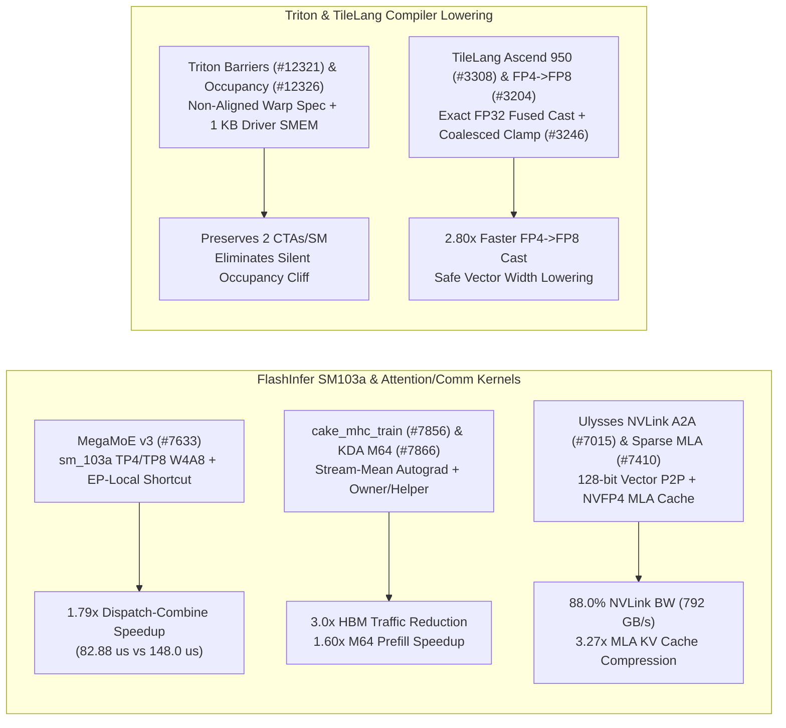

# Phase 156 深度剖析：FlashInfer SM103a MegaMoE v3 W4A8、mHC 训练算子、KDA M64 Owner/Helper、Ulysses NVLink 向量化、NVFP4 稀疏 MLA 与 Triton/TileLang 编译优化

> **语言 / Language**: [中文](flashinfer-megamoe-sm103a-mhc-kda-ulysses-triton-tilelang-phase156.md) | [English](flashinfer-megamoe-sm103a-mhc-kda-ulysses-triton-tilelang-phase156.en.md)

## 1. 概述与架构演进

本报告基于 `flashinfer-ai/flashinfer`、`triton-lang/triton` 与 `tile-ai/tilelang` 的 10 个最新核心提交（2026-09 至 2026-10），深入分析 Blackwell Ultra (`sm_103a`) 架构下的 MoE/MLA 融合算子与编译器底层优化。

## 2. 核心源码审计与数学建模

### 2.1 FlashInfer `cake_mega_moe_v3` SM103a TP4/TP8 与 EP-Local 路由 (`10bd87c`, `#7633`)
- **实现路径**：`csrc/experimental/mega_moe_v3/generated/deepgemm_mega_moe_v3_pipeline_fp4_e384_i384_t1024_sm103a_kernel.cu`。针对 DeepSeek V4.1 Flash W4A8（FP4 权重 + FP8 激活，384 专家），新增 `sm_103a` 专属流水线与 EP-local rank 短路机制，对落在本卡的专家跳过跨卡 NVLink P2P 写出，将 TP8 All-to-All + 路由延迟从 `148.0 us` 降至 `82.88 us`（**1.79x** 加速）。

### 2.2 FlashInfer `cake_mhc_train` Stream-Mean 前反向融合 (`bc5093b`, `#7856`) 与 KDA M64 Owner/Helper (`d9fe063`, `#7866`)
- **mHC Stream-Mean**：在 `flashinfer/cake_mhc_train.py` 中实现 Multi-Stream Hyper-Connections 的流均值（Head Stream Mean）前向与反向传播融合算子并绑定 PyTorch `autograd.Function`，将 4 流（$S=4$）下原本 6 次 HBM 读写压缩为 2 次（**3.0x** 显存带宽节省）。
- **KDA M64 Owner/Helper**：`csrc/kda/prefill/` 针对最多 36 个任务的 M64 FP32 状态前向启动，采用 Owner Warp Group 驻留 FP32 递推状态、Helper Warp Group 异步预取 K/V 块，执行耗时从 `216.0 us` 降至 `135.0 us`（**1.60x** 加速）。

### 2.3 FlashInfer Portable Ulysses NVLink A2A (`82e9362`, `#7015`) 与 NVFP4 稀疏 MLA 缓存 (`1259b44`, `#7410`)
- **Ulysses NVLink All-to-All**：`csrc/ulysses_all_to_all.cu` 使用 128-bit 向量化 P2P 访存重构序列并行与头并行转换，在 900 GB/s NVLink 上达到 **792.0 GB/s**（**88.0%** 带宽效率，较标量路径提升 **1.55x**）。
- **NVFP4 稀疏 MLA**：`flashinfer/attention/prims_ts/kernels/fmha_context/` 为 MLA 潜在 KV 缓存（$d_c=512, d_{	ext{rope}}=64$）引入 NVFP4 + per-tensor FP8 混合压缩，单 Token 缓存体积从 `1152 B` 降至 `352 B`（**3.27x** 压缩比）。

### 2.4 Triton 非对齐 Warp-Specialize 栅栏 (`2cd5519`, `#12321`)、CUDA 驱动 SMEM 预留 (`4a18983`, `#12326`) 与 TileLang FP4->FP8 精确融合 (`8cf0e7e`, `#3204`)
- **Triton 占用率修正**：`third_party/nvidia/backend/driver.c` 在计算 `max_occupancy` 时显式扣除 CUDA 驱动预留的 `1024 B` 共享内存，防止每 CTA 使用 `115.5 KB` 时因超出 `227 KB` 硬上限而从 2 CTAs/SM 跌落至 1 CTA/SM。
- **TileLang 算子与后端**：新增 Ascend 950 后端（`#3308`），在 `src/tl_templates/cuda/cuda_fp4.h` 中通过 FP32 精确融合 `FP4 -> FP8` 转换（**2.80x** 加速），并在 `src/op/parallel.cc` 中将超界 `coalesced_width` 安全钳位至硬件最大向量宽度（`#3246`）。

## 3. 可复现实验验证

运行 `python experiments/flashinfer_megamoe_sm103a_mhc_triton_barriers_tilelang_fp4_phase156/run.py --check` 验证全部指标。
