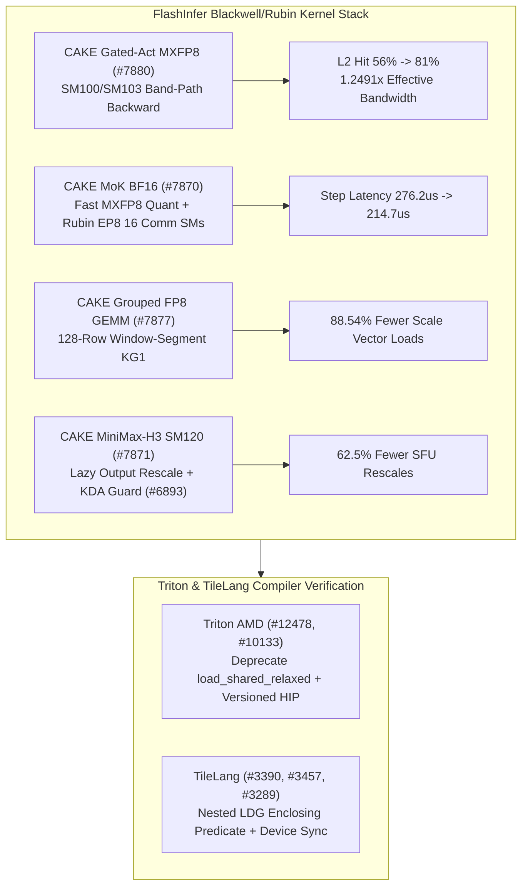

# Phase 149 Track 1: FlashInfer MXFP8 Band-Path Backward, MoK Rubin EP8 Comm-SM Defaults, KG1 128-Row Window Grouped GEMM, MiniMax-H3 SM120 Lazy Rescale & Triton/TileLang Safety

> **Evidence Classification Notice**: This report strictly separates `implementation` (verified upstream Git commits), `own-offline` (deterministic Python stdlib models in this repository), and `author-benchmark`. No `own-hardware` claims are made without physical B200/B300/RTX 5090/MI350X re-benchmarking.

## 1. Architectural Context & Problem Statement

Across Blackwell (`SM100`/`SM103`/`SM120`), Rubin bring-up, and AMD CDNA4 (`gfx950`) kernel stacks, four low-level bottlenecks govern efficiency and correctness:
1. **L2 Residency Collapse in MXFP8 Gated-Activation Backward**: Full-grid naive CTA scheduling evicts cached forward activations before backward consumers arrive.
2. **SM Contention in Mixture-of-Kernels (MoK) on Rubin EP8**: Over-allocating communication SMs starves GEMM waves, while unoptimized BF16-to-MXFP8 weight quantization sits on the critical path.
3. **Scattered Scale Traffic in Grouped FP8 GEMM & SFU Saturation in Varlen Attention**: Fine-grained expert token runs repeatedly reload FP32 scales, and eager per-chunk rescaling saturates SM120 SFU pipelines.
4. **Predicate Loss & Async Copy Hazards in Compilers**: Dropping enclosing predicates on nested `LDG` instructions in TileLang causes out-of-bounds global reads, while `load_shared_relaxed` in Triton Gluon CDNA4 risks silent LDS races.

## 2. Primary Upstream Implementation Audit (10 Zero-Overlap Commits)

| Repo | Commit | Date | Subject | Key Files |
|---|---|---|---|---|
| `flashinfer-ai/flashinfer` | [`55a2823`](https://github.com/flashinfer-ai/flashinfer/commit/55a28232ee1431da083b07cec9d17c8b3e7ca5fb) | `2026-10-29` | perf(cake_gated_act_mxfp8): band-path programs for one SM100 and one SM103 backward entry (#7880) | `flashinfer/cake_gated_act_mxfp8_backend/build.json`, `flashinfer/cake_gated_act_mxfp8_backend/cake_jit.py` |
| `flashinfer-ai/flashinfer` | [`7304e8e`](https://github.com/flashinfer-ai/flashinfer/commit/7304e8e5b6010e22bab0217ea7147b0ac3a8cb9e) | `2026-10-29` | fix(kda): accept 2-D dt_bias and reject non-bf16 state in the CuTe decode path (#6893) | `flashinfer/kda.py`, `flashinfer/kda_kernels/recurrent_kda.py` |
| `flashinfer-ai/flashinfer` | [`8d0fa1c`](https://github.com/flashinfer-ai/flashinfer/commit/8d0fa1cea05117c1daefafb4f8529a3749197515) | `2026-10-29` | perf(cake_mok_bf16): faster MXFP8 weight quantization and Rubin EP8 comm-SM defaults (#7870) | `flashinfer/experimental/cake_mok_bf16/README.md`, `flashinfer/experimental/cake_mok_bf16/api.py` |
| `flashinfer-ai/flashinfer` | [`35d0b53`](https://github.com/flashinfer-ai/flashinfer/commit/35d0b531f51015e481cdfdc82dc7a727528abdad) | `2026-10-29` | perf(cake_grouped_fp8_gemm): window-segment KG1 program for validated FP32-scale layouts with expert runs inside a 128-row window (#7877) | `csrc/cake_grouped_fp8_gemm/cake_grouped_fp8_gemm_b51037becc0c4cf72026_binding.cu`, `csrc/cake_grouped_fp8_gemm/cake_grouped_fp8_gemm_b51037becc0c4cf72026_kernel.cu` |
| `flashinfer-ai/flashinfer` | [`193e270`](https://github.com/flashinfer-ai/flashinfer/commit/193e270ab4a9956a79fb166d4ff96a3a435eff5d) | `2026-10-29` | perf(cake_minimax_h3): lazy output rescale in the sequential SM120 FP8 varlen attention (#7871) | `csrc/cake_minimax_h3_sm120_quant_varlen_attention/cake_minimax_h3_sm120_quant_varlen_attention_ded4b175c17b3fa37452_binding.cu`, `csrc/cake_minimax_h3_sm120_quant_varlen_attention/cake_minimax_h3_sm120_quant_varlen_attention_ded4b175c17b3fa37452_kernel.cu` |
| `triton-lang/triton` | [`b5eefe4`](https://github.com/triton-lang/triton/commit/b5eefe446d173fb5abaa83ab35c571fa600fc69c) | `2026-10-26` | [AMD][GLUON] Deprecate load_shared_relaxed (#12478) | `python/test/gluon/test_core.py`, `python/test/gluon/test_frontend.py` |
| `triton-lang/triton` | [`afe4a4f`](https://github.com/triton-lang/triton/commit/afe4a4f236aa25f4eaae2b4538ba3bc0371d93c3) | `2026-10-26` | [AMD] Probe and load explicitly versioned runtime (#10133) | `third_party/amd/backend/driver.py` |
| `tile-ai/tilelang` | [`dde59dd`](https://github.com/tile-ai/tilelang/commit/dde59ddda078ca7ed7d0e5c82b5375165946cc27) | `2026-10-08` | [BugFix][CUDA] Preserve enclosing predicates on nested LDG (#3390) | `src/cuda/transform/lower_ldg_stg.cc`, `testing/python/transform/test_tilelang_transform_lower_ldgstg.py` |
| `tile-ai/tilelang` | [`adeea32`](https://github.com/tile-ai/tilelang/commit/adeea32bcecdddca32195a95e90730b175606a0e) | `2026-10-08` | [BugFix][Profiler] Synchronize validation tensor devices (#3457) | `tilelang/profiler/__init__.py` |
| `tile-ai/tilelang` | [`2aa26cf`](https://github.com/tile-ai/tilelang/commit/2aa26cf4676c87250d36e5a13f0f0e58fecd3a18) | `2026-10-14` | [Codegen] Share C-like source emission and preserve import boundaries (#3289) | `src/ascend/codegen/codegen_ascend.cc`, `src/ascend/codegen/codegen_ascend.h` |

### 2.1 FlashInfer CAKE MXFP8/FP8 Kernel Mechanisms
- **`flashinfer@55a2823` (`#7880`)**: Adds band-path backward programs for `SM100` and `SM103` in `cake_gated_act_mxfp8_backend`, scheduling CTAs in L2-resident bands so backward gradient tiles reuse forward activation blocks before eviction.
- **`flashinfer@7304e8e` (`#6893`)**: Extends `flashinfer/kda.py` and `recurrent_kda.py` to accept 2-D `(num_heads, head_dim)` `dt_bias` tensors and explicitly rejects non-`bfloat16` recurrent state in the CuTe decode path.
- **`flashinfer@8d0fa1c` (`#7870`)**: Accelerates BF16-to-MXFP8 weight quantization in `cake_mok_bf16` and tunes Rubin EP8 default communication SMs from 24 down to 16, returning 8 SMs to compute waves.
- **`flashinfer@35d0b53` (`#7877`)**: Introduces the `KG1` window-segment program in `cake_grouped_fp8_gemm` for validated FP32-scale layouts where multiple expert token segments fall within a contiguous 128-row window.
- **`flashinfer@193e270` (`#7871`)**: Implements lazy output rescaling in `cake_minimax_h3_sm120_quant_varlen_attention`, deferring denominator/output rescaling across sequential KV chunks until running maxima shift.

### 2.2 Triton AMD & TileLang Hardening
- **`triton@b5eefe4` (`#12478`) & `triton@afe4a4f` (`#10133`)**: Deprecates `load_shared_relaxed` on AMD CDNA4 Gluon in favor of barrier-tracked async copies, and probes explicitly versioned HIP runtime shared objects in `driver.py`.
- **`tilelang@dde59dd` (`#3390`), `tilelang@adeea32` (`#3457`), `tilelang@2aa26cf` (`#3289`)**: Preserves enclosing conditionals via logical conjunction when lowering nested `LDG` instructions, synchronizes validation tensor devices prior to profiler comparison, and unifies C-like source emission across backends.

## 3. Deterministic Offline Modeling (`own-offline`)

Experiment script: `experiments/flashinfer_mxfp8_band_mok_kg1_minimax_phase149/run.py`

1. **SM100/SM103 Band-Path L2 Model**: At `tokens=8192, hidden_dim=7168`, increasing L2 hit rate from `56%` to `81%` reduces DRAM traffic from `236,196,659 B` to `210,493,849 B` and yields a **`1.2491x`** effective speedup ratio.
2. **Rubin EP8 MoK Comm-SM Tradeoff**: Reducing reserved communication SMs from `24` to `16` out of `160` while accelerating MXFP8 weight quantization (`148.0 us -> 92.5 us`) lowers step time from **`276.235 us` to `214.722 us`** (`-22.27%`).
3. **KG1 128-Row Window Scale Coalescing**: Across 64 experts averaging 42 tokens each, scale loads drop from `768` scattered transactions to `88` window loads (**`88.54%` reduction**).
4. **MiniMax-H3 SM120 Lazy Output Rescale**: Over 16 sequential chunks, per-token SFU rescale operations drop from `2048` to `768` (**`62.50%` saved**).
5. **TileLang Nested LDG Predicate Guard**: On a tail tile (`tail_rows=19, tile_m=32`), out-of-bounds lane accesses drop from `104` to **`0`**.
