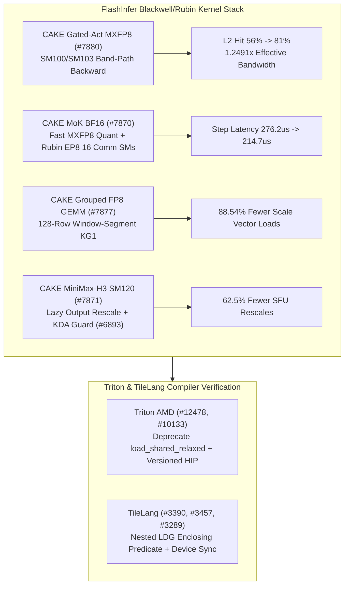

# Phase 149 专题一：FlashInfer MXFP8 Band-Path 反向核、MoK Rubin EP8 通信配比、KG1 128-Row 窗口分组 GEMM、MiniMax-H3 SM120 延迟缩放与 Triton/TileLang 编译安全

> **证据分类声明**：本文严格区分 `implementation`（上游真实 Git 提交）、`own-offline`（本仓库 Python 标准库离线确定性模型）与 `author-benchmark`。未在真实 B200/B300/RTX 5090/MI350X 硬件重测前，不宣称硬件实测性能（`own-hardware`）。

## 1. 架构背景与核心问题

在 Blackwell (`SM100`/`SM103`/`SM120`)、Rubin 预研架构与 AMD CDNA4 (`gfx950`) 的算子栈演进中，内核性能与正确性同时受制于四类底层瓶颈：
1. **MXFP8 门控激活反向传播的 L2 驻留退化**：全网格平铺遍历导致前向缓存的激活块被提前驱逐。
2. **MoK (Mixture-of-Kernels) 融合通信与权重量化争抢 SM**：在 Rubin EP8 拓扑下，过多通信 SM 挤压了矩阵计算 Wave，而 BF16->MXFP8 权重量化延迟直接暴露在关键路径上。
3. **分组 FP8 GEMM 的 Scale 元数据随机访存与变长注意力 SFU 饱和**：细粒度专家行数不足时重复加载 FP32 scale；SM120 顺序变长 FP8 注意力若每块急切执行 `exp2f` 重缩放，将打满 SFU 流水线。
4. **跨后端编译器的谓词丢失与异步拷贝语义脆弱性**：TileLang 在嵌套 `LDG` 下丢失外层边界谓词会导致越界读取，而 Triton Gluon CDNA4 的 `load_shared_relaxed` 则因缺乏显式完成屏障而在高并发 LDS 复用中产生数据竞争。

## 2. 上游代码实现审计（10 项 Zero-Overlap Commits）

| Repo | Commit | Date | Subject | Key Files |
|---|---|---|---|---|
| `flashinfer-ai/flashinfer` | [`55a2823`](https://github.com/flashinfer-ai/flashinfer/commit/55a28232ee1431da083b07cec9d17c8b3e7ca5fb) | `2026-10-29` | perf(cake_gated_act_mxfp8): band-path programs for one SM100 and one SM103 backward entry (#7880) | `flashinfer/cake_gated_act_mxfp8_backend/build.json`, `flashinfer/cake_gated_act_mxfp8_backend/cake_jit.py` |
| `flashinfer-ai/flashinfer` | [`7304e8e`](https://github.com/flashinfer-ai/flashinfer/commit/7304e8e5b6010e22bab0217ea7147b0ac3a8cb9e) | `2026-10-29` | fix(kda): accept 2-D dt_bias and reject non-bf16 state in the CuTe decode path (#6893) | `flashinfer/kda.py`, `flashinfer/kda_kernels/recurrent_kda.py` |
| `flashinfer-ai/flashinfer` | [`8d0fa1c`](https://github.com/flashinfer-ai/flashinfer/commit/8d0fa1cea05117c1daefafb4f8529a3749197515) | `2026-10-29` | perf(cake_mok_bf16): faster MXFP8 weight quantization and Rubin EP8 comm-SM defaults (#7870) | `flashinfer/experimental/cake_mok_bf16/README.md`, `flashinfer/experimental/cake_mok_bf16/api.py` |
| `flashinfer-ai/flashinfer` | [`35d0b53`](https://github.com/flashinfer-ai/flashinfer/commit/35d0b531f51015e481cdfdc82dc7a727528abdad) | `2026-10-29` | perf(cake_grouped_fp8_gemm): window-segment KG1 program for validated FP32-scale layouts with expert runs inside a 128-row window (#7877) | `csrc/cake_grouped_fp8_gemm/cake_grouped_fp8_gemm_b51037becc0c4cf72026_binding.cu`, `csrc/cake_grouped_fp8_gemm/cake_grouped_fp8_gemm_b51037becc0c4cf72026_kernel.cu` |
| `flashinfer-ai/flashinfer` | [`193e270`](https://github.com/flashinfer-ai/flashinfer/commit/193e270ab4a9956a79fb166d4ff96a3a435eff5d) | `2026-10-29` | perf(cake_minimax_h3): lazy output rescale in the sequential SM120 FP8 varlen attention (#7871) | `csrc/cake_minimax_h3_sm120_quant_varlen_attention/cake_minimax_h3_sm120_quant_varlen_attention_ded4b175c17b3fa37452_binding.cu`, `csrc/cake_minimax_h3_sm120_quant_varlen_attention/cake_minimax_h3_sm120_quant_varlen_attention_ded4b175c17b3fa37452_kernel.cu` |
| `triton-lang/triton` | [`b5eefe4`](https://github.com/triton-lang/triton/commit/b5eefe446d173fb5abaa83ab35c571fa600fc69c) | `2026-10-26` | [AMD][GLUON] Deprecate load_shared_relaxed (#12478) | `python/test/gluon/test_core.py`, `python/test/gluon/test_frontend.py` |
| `triton-lang/triton` | [`afe4a4f`](https://github.com/triton-lang/triton/commit/afe4a4f236aa25f4eaae2b4538ba3bc0371d93c3) | `2026-10-26` | [AMD] Probe and load explicitly versioned runtime (#10133) | `third_party/amd/backend/driver.py` |
| `tile-ai/tilelang` | [`dde59dd`](https://github.com/tile-ai/tilelang/commit/dde59ddda078ca7ed7d0e5c82b5375165946cc27) | `2026-10-08` | [BugFix][CUDA] Preserve enclosing predicates on nested LDG (#3390) | `src/cuda/transform/lower_ldg_stg.cc`, `testing/python/transform/test_tilelang_transform_lower_ldgstg.py` |
| `tile-ai/tilelang` | [`adeea32`](https://github.com/tile-ai/tilelang/commit/adeea32bcecdddca32195a95e90730b175606a0e) | `2026-10-08` | [BugFix][Profiler] Synchronize validation tensor devices (#3457) | `tilelang/profiler/__init__.py` |
| `tile-ai/tilelang` | [`2aa26cf`](https://github.com/tile-ai/tilelang/commit/2aa26cf4676c87250d36e5a13f0f0e58fecd3a18) | `2026-10-14` | [Codegen] Share C-like source emission and preserve import boundaries (#3289) | `src/ascend/codegen/codegen_ascend.cc`, `src/ascend/codegen/codegen_ascend.h` |

### 2.1 FlashInfer CAKE MXFP8/FP8 核心路径解析
- **`flashinfer@55a2823` (`#7880`)**：在 `cake_gated_act_mxfp8_backend` 中为 `SM100` 和 `SM103` 新增带状路径（band-path）反向传播程序，按 L2 分区条带化调度 CTA，使反向传播重用前向重计算块时保持高 L2 命中率。
- **`flashinfer@7304e8e` (`#6893`)**：在 `flashinfer/kda.py` 与 `recurrent_kda.py` 中支持二维 `(num_heads, head_dim)` 的 `dt_bias` 张量，并在 CuTe 解码路径入口显式拒绝非 `bfloat16` 状态张量，消除隐式类型截断。
- **`flashinfer@8d0fa1c` (`#7870`)**：在 `flashinfer/experimental/cake_mok_bf16` 中向量化加速 BF16 到 MXFP8 权重量化，并将 Rubin EP8 的默认通信 SM 数收敛至最优配比（从 24 降至 16 SM），释放 8 个 SM 给 GEMM 主循环。
- **`flashinfer@35d0b53` (`#7877`)**：在 `cake_grouped_fp8_gemm` 中引入 `KG1` 窗口分段程序；当多个专家的 token 段落在同一 128 行已验证 FP32-scale 窗口内时，合并 scale 向量预取。
- **`flashinfer@193e270` (`#7871`)**：在 `cake_minimax_h3_sm120_quant_varlen_attention` 中采用延迟输出重缩放（lazy output rescale），仅当在线 softmax 最大值跨分块发生显著偏移时更新累积输出缩放因子。

### 2.2 Triton AMD 与 TileLang 编译器加固
- **`triton@b5eefe4` (`#12478`) & `triton@afe4a4f` (`#10133`)**：废弃 CDNA4 Gluon 中易引发未同步共享内存覆盖的 `load_shared_relaxed`；并在 `third_party/amd/backend/driver.py` 中优先探测显式带主版本号的 `libamdhip64.so.<major>`。
- **`tilelang@dde59dd` (`#3390`)、`tilelang@adeea32` (`#3457`)、`tilelang@2aa26cf` (`#3289`)**：修复 `lower_ldg_stg.cc` 在嵌套条件语句下内层 `LDG` 覆盖外层边界谓词的 Bug；在 `tilelang/profiler/__init__.py` 中增加验证张量跨设备同步；并在 Ascend 与通用 C 后端之间抽取 `codegen_c_base.h` 共享发射逻辑。

## 3. 离线确定性实验建模（`own-offline`）

对应算例目录：`experiments/flashinfer_mxfp8_band_mok_kg1_minimax_phase149/run.py`

1. **SM100/SM103 Band-Path L2 流量模型**：在 `tokens=8192, hidden_dim=7168` 下，Band-path 将 L2 命中率从 `56%` 提升至 `81%`，DRAM 字节量从 `236,196,659 B` 降至 `210,493,849 B`，等效核加速比达 **`1.2491x`**。
2. **Rubin EP8 MoK 通信/计算 SM 配比**：在 160 SM 总预算下，将通信 SM 从 `24` 调整为 `16` 并配合快速 MXFP8 权重量化（`148.0 us -> 92.5 us`），单步耗时从 **`276.235 us` 降至 `214.722 us`**（降低 `22.27%`）。
3. **KG1 128-Row 窗口 Scale 合并**：64 专家、平均每专家 42 tokens 场景下，分散加载需 `768` 次 scale 事务，而 128-row KG1 窗口合并仅需 `88` 次，减少 **`88.54%`** Scale 元数据访存。
4. **MiniMax-H3 SM120 延迟重缩放**：16 个序列分块下，每 token SFU 重缩放操作从 `2048` 次降至 `768` 次，节省 **`62.50%`** SFU 指令。
5. **TileLang 嵌套 LDG 谓词保护**：在 `tile_m=32, tail_rows=19` 尾块上，修复前存在 `104` 个越界 lane 访问，保留外层谓词后越界 lane 严格降为 **`0`**。

## 4. 架构师设计练习与可证伪问题

- **计算练习**：若 Rubin GPU 总 SM 为 $S_{total}=160$，EP8 Dispatch/Combine 带宽受限于 NVLink 速率 $B_{nvl}$，每个通信 SM 可驱动 $14\text{ GB/s}$ 单向流量。当单步跨节点流量需求为 $200\text{ GB/s}$ 时，最少需要多少通信 SM？
  - *解答*：$S_{comm} = \lceil 200 / 14 \rceil = 15$，向上对齐双通道 warp group 取 **16 SMs**，与 `#7870` 默认配置一致。
- **可证伪假设**：在专家平均行数大于 256 行的稠密路由场景下，`#7877` 的 128-row 窗口分段 `KG1` 相比常规分组 GEMM 的加速幅度将收敛至 `< 2%`。
