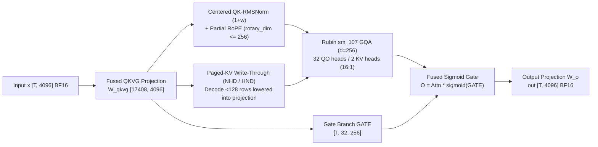

# FlashInfer Qwen 3.5 Rubin (`sm_107`) FROST Gated Attention Block, Dedicated MoE-EP All-to-All Backends, and Self-Contained Cake Packages

> **Category**: Kernels & Hardware Co-Design (`kernels`) · **Phase**: Phase 48 (`priority: 57`) · **Date**: 2026-10-22  
> **First-Hand Upstream Sources**:
> - [`flashinfer-ai/flashinfer@449967377a`](https://github.com/flashinfer-ai/flashinfer/commit/449967377a0caa9912be45515e7dea1a8a76cbcd) — `feat(experimental): Qwen 3.5 gated attention block for Rubin via cuDNN FROST`
> - [`flashinfer-ai/flashinfer@9d3837c44b`](https://github.com/flashinfer-ai/flashinfer/commit/9d3837c44bf364be84d4ea3a3a8635f68bfbb4ab) — `refactor(moe_ep): split MoE all-to-all out of flashinfer.comm into dedicated backends (#6621)`
> - [`flashinfer-ai/flashinfer@4d79be4100`](https://github.com/flashinfer-ai/flashinfer/commit/4d79be410085d79bd825343003349f035163a726) — `refactor(cake): hoist TMA descriptor encoders into experimental/cake_host_common.cuh (#6920)`
> - [`flashinfer-ai/flashinfer@595bc5746c`](https://github.com/flashinfer-ai/flashinfer/commit/595bc5746cd57efc0006ff888b4bf8144f8235b9) — `refactor(cake_deepgemm_batched_gemm): ship the experimental batched GEMM as a self-contained vendorable package (#6928)`
> - [`flashinfer-ai/flashinfer@597e3a67ca`](https://github.com/flashinfer-ai/flashinfer/commit/597e3a67ca36e1d2f3820acc9b0e3ca6817c8d2e) — `refactor(cake_deepgemm_fp8_gemm): ship the experimental FP8 GEMM as a self-contained vendorable package (#6927)`
> - [`flashinfer-ai/flashinfer@c2476a6ea4`](https://github.com/flashinfer-ai/flashinfer/commit/c2476a6ea405cca3829f0054b6a34d4bd1064e09) — `refactor(cake_concat_mla_kv_quant_fp8): re-export the MLA K/V FP8 pack through the in-tree program loader (#6901)`
> - [`flashinfer-ai/flashinfer@edfb3f7f88`](https://github.com/flashinfer-ai/flashinfer/commit/edfb3f7f883950308f74ce6e8d41759eb21afa12) — `refactor(cake_nvfp4_attention): ship the experimental NVFP4 attention as a self-contained vendorable package (#6902)`

---

## 1. Background and Architectural Challenges

Across NVIDIA Rubin (`sm_107` / GR100, compute capability `10.7`) and Blackwell (`sm_100a` GB200, `sm_103a` GB300), FlashInfer addressed three core kernel and packaging bottlenecks:

1. **Whole-Block Fusion for Qwen 3.5 Gated Attention with Zero `cudnn` Runtime Dependency**: Qwen 3.5 (`d_model=4096, num_qo_heads=32, num_kv_heads=2, head_dim=256`, GQA ratio `16:1`) augments standard GQA with a sigmoid gate branch `O *= sigmoid(GATE)`, centered QK-RMSNorm `(1 + w)`, and partial RoPE (`rotary_dim <= 256`). Executing 6 separate unfused operators reads and writes `92` hidden-dim equivalents per token across HBM.
2. **MoE Expert-Parallel (MoE-EP) Backend Separation and GR100 (`SM107`) Build Validation**: `flashinfer.comm` previously coupled tensor-parallel collectives with MoE all-to-all dispatches and exposed a deprecated `"trtllm"` backend placeholder; furthermore, rewriting `(10, 7)` to `sm_100f` caused `Mercury Validator: Validation failed for SM 107` on GR100.
3. **Self-Contained Vendorability of Cake-Generated Packages**: Downstream runtimes vendoring DeepGEMM batched/FP8 GEMM, MLA KV FP8 packing, or NVFP4 attention needed a manifest-driven (`cake-build/1`) loader that can load prebuilt `aot/<name>.so` libraries via `tvm_ffi` without importing `flashinfer`.

---

## 2. Mechanism and Upstream Source Analysis

### 2.1 Rubin (`sm_107`) Qwen 3.5 Gated Attention Super-Graph (`flashinfer.qwen_3_5_block`)

In `flashinfer-ai/flashinfer@449967377a`, `flashinfer.qwen_3_5_block` byte-faithfully vendors **103** cuDNN Frontend 1.32.0 (`d8b0a7ed5`) FROST CuTe-DSL files (verified by `VENDOR_MANIFEST.json`) and compiles them directly to Rubin `sm_107` device code through `nvidia-cutlass-dsl` with **zero `cudnn` runtime library dependency**:

- **Three Serving Forms**:
  - `qwen_3_5_block_bf16_prefill`: Ragged variable-length prefill without prior KV cache;
  - `qwen_3_5_block_bf16_extend`: Appends new K/V tokens into the paged KV cache (`NHD` or `HND`) and attends over cached prefix + new tokens;
  - `qwen_3_5_block_bf16_decode`: Lowers the paged-KV write-through directly into the projection chain for decode microbatches with `< 128` rows.
- **Activation HBM Traffic Compression**: Cuts per-token HBM activation traffic from `376,832 B` (`24.12 MiB` at `T=64`) to `36,864 B` (`2.36 MiB` at `T=64`), delivering a **`10.2222x`** reduction.

### 2.2 `flashinfer.moe_ep` All-to-All Split, `DeepSeekFp8` Block Scale, and `SM107` Fix (`#6621`)

- **Dedicated `flashinfer.moe_ep` Namespace (`@9d3837c44b`)**: Splits out `NVLinkOneSidedAlltoAll`, `NVLinkTwoSidedAlltoAll`, and `CakeAlltoAll` while retiring `backend="trtllm"`.
- **`QuantFormat.DeepSeekFp8` Block-Scale Benchmarking**: Adds `--fp8-block-scale` to `bench_moe_ep_comm.py` (1-byte E4M3 + one 4-byte FP32 scale per `128` elements), shrinking per-token payload at `hidden_size=7168` from `14,336 B` (BF16) to `7,392 B` (**`1.9394x`** bandwidth reduction).
- **SM107 (`GR100`) NVCC Target Fix**: Replaces the invalid `(10, 7) -> sm_100f` override with `get_nvcc_flags_list()`, resolving `Mercury Validator: Validation failed for SM 107`.

### 2.3 Self-Contained Cake Packages (`cake-build/1` Manifests & CUPTI Cold-L2 Benchmarks)

| Self-Contained Cake Package | Targets | Variants | GB300 (`sm_103a`) Latency (`µs`) | GB200 (`sm_100a`) Latency (`µs`) | Geomean Speedup (vs Shared-Unit Build) |
|---|---|---:|---:|---:|---:|
| `cake_deepgemm_batched_gemm` (`#6928`) | `sm_100a`, `sm_103a` | 6 (`M=64..2048`) | `9.727` (`m64`) – `85.153` (`m2048`) | `10.336` (`m64`) – `95.361` (`m2048`) | `1.000x` (GB300) / `1.000x` (GB200) |
| `cake_deepgemm_fp8_gemm` (`#6927`) | `sm_100a`, `sm_103a` | 2 (`forward` / `wgrad`) | `5.504` (`fwd_s1`) – `95.137` (`wgrad_s3`) | `5.792` (`fwd_s1`) – `97.377` (`wgrad_s3`) | `1.001x` (GB300) / `0.999x` (GB200) |
| `cake_concat_mla_kv_quant_fp8` (`#6901`) | `sm_100a`, `sm_103a` | 4 (`HG1..HG4`) | `3.808` (`HG3 T=1536`) – `726.946` (`HG4 T=65536`) | `3.904` (`HG3 T=1536`) – `725.588` (`HG4 T=65536`) | `1.000x–1.004x` |
| `cake_nvfp4_attention` (`#6902`) | `sm_103a` | 1 (non-causal persistent) | `114.161` (`B4H8S4096`) – `2837.625` (`B8H32S8192`) | N/A (`sm_103a` only) | `0.997x` |

---

## 3. Deterministic Standard-Library Reproduction

- Command: `python experiments/flashinfer-qwen35-frost-rubin-moe-ep-backends-sm107-cake-deepgemm-mla-fp8/run.py --check`
- Artifact: `experiments/flashinfer-qwen35-frost-rubin-moe-ep-backends-sm107-cake-deepgemm-mla-fp8/summary.json`
- Unit tests: `tests/test_phase48_experiments.py`
