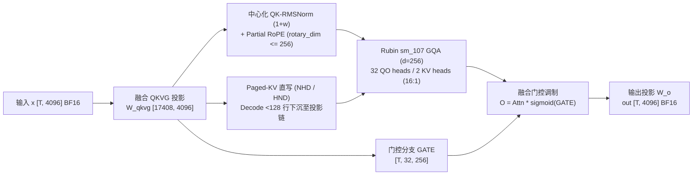

# FlashInfer Qwen 3.5 Rubin (`sm_107`) FROST 门控注意力、MoE-EP 独立通信后端与 Cake 自包含包

> **分类**：算子、内核与硬件协同 (`kernels`) · **阶段**：Phase 48 (`priority: 57`) · **日期**：2026-10-22  
> **上游一手来源**：
> - [`flashinfer-ai/flashinfer@449967377a`](https://github.com/flashinfer-ai/flashinfer/commit/449967377a0caa9912be45515e7dea1a8a76cbcd) — `feat(experimental): Qwen 3.5 gated attention block for Rubin via cuDNN FROST`
> - [`flashinfer-ai/flashinfer@9d3837c44b`](https://github.com/flashinfer-ai/flashinfer/commit/9d3837c44bf364be84d4ea3a3a8635f68bfbb4ab) — `refactor(moe_ep): split MoE all-to-all out of flashinfer.comm into dedicated backends (#6621)`
> - [`flashinfer-ai/flashinfer@4d79be4100`](https://github.com/flashinfer-ai/flashinfer/commit/4d79be410085d79bd825343003349f035163a726) — `refactor(cake): hoist TMA descriptor encoders into experimental/cake_host_common.cuh (#6920)`
> - [`flashinfer-ai/flashinfer@595bc5746c`](https://github.com/flashinfer-ai/flashinfer/commit/595bc5746cd57efc0006ff888b4bf8144f8235b9) — `refactor(cake_deepgemm_batched_gemm): ship the experimental batched GEMM as a self-contained vendorable package (#6928)`
> - [`flashinfer-ai/flashinfer@597e3a67ca`](https://github.com/flashinfer-ai/flashinfer/commit/597e3a67ca36e1d2f3820acc9b0e3ca6817c8d2e) — `refactor(cake_deepgemm_fp8_gemm): ship the experimental FP8 GEMM as a self-contained vendorable package (#6927)`
> - [`flashinfer-ai/flashinfer@c2476a6ea4`](https://github.com/flashinfer-ai/flashinfer/commit/c2476a6ea405cca3829f0054b6a34d4bd1064e09) — `refactor(cake_concat_mla_kv_quant_fp8): re-export the MLA K/V FP8 pack through the in-tree program loader (#6901)`
> - [`flashinfer-ai/flashinfer@edfb3f7f88`](https://github.com/flashinfer-ai/flashinfer/commit/edfb3f7f883950308f74ce6e8d41759eb21afa12) — `refactor(cake_nvfp4_attention): ship the experimental NVFP4 attention as a self-contained vendorable package (#6902)`

---

## 1. 背景与架构演进痛点

在下一代 NVIDIA Rubin (`sm_107` / GR100，Compute Capability `10.7`) 与 Blackwell (`sm_100a` GB200、`sm_103a` GB300) 的推理与训练栈演进中，FlashInfer 面临三个核心挑战：

1. **Qwen 3.5 门控注意力（Gated Attention）全块融合与零外部 cuDNN 运行时依赖**：Qwen 3.5 (`d_model=4096, num_qo_heads=32, num_kv_heads=2, head_dim=256`, GQA group size `16`) 在标准注意力路径之外引入了门控分支 `O *= sigmoid(GATE)`、中心化 QK-RMSNorm `(1 + w)` 与部分旋转位置编码（Partial RoPE）。若按传统 6 阶段未融合算子链执行（`W_qkvg` 投影 $\to$ QK-RMSNorm+RoPE $\to$ Paged-KV 写入 $\to$ GQA $\to$ Sigmoid 门控 $\to$ `o_proj`），每个 Token 需要在 HBM 往返读写高达 `92` 个隐藏维度当量的数据。
2. **MoE 专家并行（MoE-EP）通信原语解耦与 GR100 (`SM107`) 编译验证**：原先 `flashinfer.comm` 混杂了张量并行 AllReduce 与专家并行 All-to-All，且残留已废弃的 `"trtllm"` 后端占位；同时在 GR100 (`SM107`) 上将架构映射为 `sm_100f` 会触发 `Mercury Validator: Validation failed for SM 107` 致命错误。
3. **Cake 导出算子包的自包含可移植性（Vendorability）**：DeepGEMM 批量/FP8 GEMM、MLA KV FP8 拼接量化与 NVFP4 注意力若依赖外部宿主的 `tvm_ffi_utils.h` 或 `flashinfer` 根包导入，无法被下游框架以零依赖方式独立 AOT/JIT 集成。

---

## 2. 核心架构与上游源码机制解析

### 2.1 Rubin (`sm_107`) Qwen 3.5 门控注意力超级图 (`flashinfer.qwen_3_5_block`)

在 `flashinfer-ai/flashinfer@449967377a` 中，`flashinfer.qwen_3_5_block` 直接在仓库内原样内嵌（Vendoring）了 **103 个** cuDNN Frontend 1.32.0 (`d8b0a7ed5`) 的 FROST CuTe-DSL 源码文件（由 `VENDOR_MANIFEST.json` 进行字节级 SHA-256 校验），在运行期仅通过 `nvidia-cutlass-dsl` 直接编译为 Rubin `sm_107` 设备代码，**无需安装 `cudnn` 运行时库**：

- **三种推理形态（Serving Forms）**：
  - `qwen_3_5_block_bf16_prefill`：处理无前置缓存的变长（Ragged）Prefill 批次；
  - `qwen_3_5_block_bf16_extend`：将当前块的新 K/V 追加写入分页 KV 缓存（Paged KV Cache），并对历史前缀 + 新 Token 联合计算注意力；
  - `qwen_3_5_block_bf16_decode`：针对 `< 128` 行的单步/投机解码（Speculative Decode）微批次，将 Paged-KV 的 `reshape_and_cache` 直接下沉（Lowered）进投影流水线尾部，消除独立写缓存内核启动。
- **激活 HBM 流量压缩**：6 阶段未融合路径每 Token 产生 `376,832 B`（`T=64` 时共 `24.12 MiB`）HBM 激活读写；融合后仅需读取一次 `x`、写出一次新增 `K, V` 与最终 `out`，每 Token 仅 `36,864 B`（`T=64` 时 `2.36 MiB`），实现 **`10.2222x`** 的激活 HBM 带宽缩减。

### 2.2 `flashinfer.moe_ep` 三大独立 All-to-All 后端与 `SM107` 编译修复 (`#6621`)

`flashinfer-ai/flashinfer@9d3837c44b` 将 MoE 专家并行通信彻底从 `flashinfer.comm` 拆分至 `flashinfer.moe_ep`：
1. **三大专属通信类**：`NVLinkOneSidedAlltoAll`（基于单边 NVLink 写操作）、`NVLinkTwoSidedAlltoAll`（基于双边同步传输）与 `CakeAlltoAll`（Blackwell/Rubin 融合分发合并），并正式移除废弃的 `backend="trtllm"`。
2. **`QuantFormat.DeepSeekFp8` 块缩放基准**：在 `benchmarks/bench_moe_ep_comm.py` 中新增 `--fp8-block-scale`，采用 E4M3 载荷（`1 B/elem`）配合每 `128` 个元素的 `1` 个 FP32 缩放因子（`4 B / 128 elems`）。以 `hidden_size = 7168` 为例，单 Token 通信载荷从 BF16 的 `14,336 B` 降至 `7,392 B`，实现 **`1.9394x`** 跨节点/跨卡带宽节省。
3. **GR100 (`SM107`) 架构编译修复**：移除了 `flashinfer/jit/comm/nvlink_one_sided.py` 中将 `(10, 7)` 强制重写为 `sm_100f` 的错误映射，改用 `get_nvcc_flags_list()` 生成精确架构标志，彻底修复 `Mercury Validator: Validation failed for SM 107`。

### 2.3 Cake 自包含可移植算子包 (`cake-build/1` 清单与 CUPTI 实测)

通过 `#6920`、`#6928`、`#6927`、`#6901`、`#6902` 五个 PR，FlashInfer 完成了 Cake 生成算子包的自包含化重构：
- **共享宿主头文件提取 (`#6920`)**：将 1D/2D/3D/4D `CUtensorMap` TMA 描述符编码器与 CUDA 错误检查统一提升至 `csrc/include/experimental/cake_host_common.cuh`（消除 9 个绑定文件约 1,070 行重复代码）。
- **零 `flashinfer` 依赖的预编译加载 (`cake_build.py` + `build.json`)**：每个包内含 `build.json` (`cake-build/1`) 与 `cake_ffi_checks.h`；若 `aot/<name>.so` 存在，直接通过 `tvm_ffi` 加载，完全不导入 `flashinfer`。

| Cake 自包含算子包 | 架构支持 | 变体数 | GB300 (`sm_103a`) 实测延迟 (`µs`) | GB200 (`sm_100a`) 实测延迟 (`µs`) | 几何平均加速比 (vs 旧版共享构建) |
|---|---|---:|---:|---:|---:|
| `cake_deepgemm_batched_gemm` (`#6928`) | `sm_100a`, `sm_103a` | 6 (`M=64..2048`) | `9.727` (`m64`) – `85.153` (`m2048`) | `10.336` (`m64`) – `95.361` (`m2048`) | `1.000x` (GB300) / `1.000x` (GB200) |
| `cake_deepgemm_fp8_gemm` (`#6927`) | `sm_100a`, `sm_103a` | 2 (`forward` / `wgrad`) | `5.504` (`fwd_s1`) – `95.137` (`wgrad_s3`) | `5.792` (`fwd_s1`) – `97.377` (`wgrad_s3`) | `1.001x` (GB300) / `0.999x` (GB200) |
| `cake_concat_mla_kv_quant_fp8` (`#6901`) | `sm_100a`, `sm_103a` | 4 (`HG1..HG4`) | `3.808` (`HG3 T=1536`) – `726.946` (`HG4 T=65536`) | `3.904` (`HG3 T=1536`) – `725.588` (`HG4 T=65536`) | `1.000x–1.004x` |
| `cake_nvfp4_attention` (`#6902`) | `sm_103a` | 1 (非因果持久化 Tile) | `114.161` (`B4H8S4096`) – `2837.625` (`B8H32S8192`) | N/A (`sm_103a` 专属) | `0.997x` |

---

## 3. 标准库确定性复现实验验证

本课题提供纯 Python 3.12 标准库复现实验：
- 运行命令：`python experiments/flashinfer-qwen35-frost-rubin-moe-ep-backends-sm107-cake-deepgemm-mla-fp8/run.py --check`
- 产出契约：`experiments/flashinfer-qwen35-frost-rubin-moe-ep-backends-sm107-cake-deepgemm-mla-fp8/summary.json`
- 关联单测：`tests/test_phase48_experiments.py`
