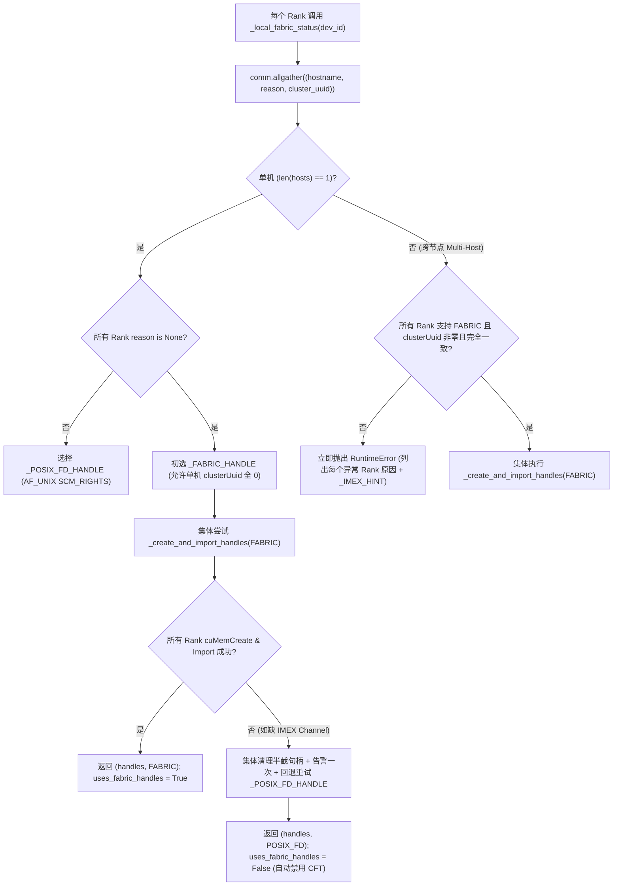

# FlashInfer Cake Rubin (`sm_107a`) NVFP4 MLA Paged Decode 与 Collective MNNVL Handle 协商及确认

> **English Version**: [flashinfer-rubin-nvfp4-mla-decode-mnnvl-collective-handle.en.md](flashinfer-rubin-nvfp4-mla-decode-mnnvl-collective-handle.en.md)  
> **关联问题 ID**: `flashinfer-rubin-nvfp4-mla-decode-mnnvl-collective-handle` (`priority: 50`, Phase 41)  
> **关联离线实验**: [`experiments/flashinfer_rubin_nvfp4_mla_mnnvl_handle/run.py`](../../experiments/flashinfer_rubin_nvfp4_mla_mnnvl_handle/run.py) · [`summary.json`](../../experiments/flashinfer_rubin_nvfp4_mla_mnnvl_handle/summary.json)  
> **证据等级**: `implementation` (第一手源码审计) + `author-benchmark` (作者在 R200 `sm_107a` 实测，非本仓实测) + `own-offline` (Python 标准库确定性建模)

---

## 1. 架构背景与核心问题

随着 NVIDIA Vera Rubin 架构 (`sm_107a`, Compute Capability `10.7`) 进入软件栈早期适配阶段，DeepSeek-V3/R1/V4 风格 Multi-head Latent Attention (MLA, 吸收态 `LATENT = 512`, `ROPE = 64`) 的 Decode 阶段面临双重工程挑战：

1. **NVFP4 Paged KV Cache 与 Multi-Token Prediction (MTP) 尾块利用率失衡**：将 MLA 的 512 维压缩潜向量 (`ckv`) 从 FP8/BF16 进一步量化为 NVFP4 (E2M1 + 每 16 通道 E4M3 块缩放)，虽将单 Token KV Cache 体积压缩至 **352 Bytes**，但在 MTP (`q_len = 2..4`) 与非 256 整数倍 Head 数（如 `H = 96, q_len = 4 -> 384 rows`）下，第二个 256-row Tile 仅含 128 个有效行（Half Tile），且 R200 (`sm_107a`) 的 208/212 个 SM 在分配 4-CTA Cluster 后仍剩余可运行 2-CTA Pair Cluster 的孤立 SM。
2. **MNNVL (Multi-Node NVLink) / Symmetric Memory 句柄协商与无 IMEX 降级不一致**：在单机 8×B200 或跨节点 GB200 NVL72 上，早期 `MnnvlMemory` 与 `SymmDeviceMemory` 各自维护一套句柄探测与 sticky 全局降级标记；单机 B200 在 NVML `clusterUuid` 全零时被误判回退 POSIX FD，而在驱动 595 报告 `CU_DEVICE_ATTRIBUTE_HANDLE_TYPE_FABRIC_SUPPORTED = 1` 但容器未挂载 `/dev/nvidia-caps-imex-channels/channel0` 时，`cuMemCreate(FABRIC)` 抛 `CUDA_ERROR_NOT_PERMITTED` 导致多卡死锁或半截状态崩溃。

本组件深度拆解 `flashinfer-ai/flashinfer` 于 `2026-10-21` 合入主干的两项核心实现：
- **Commit `adca7b87d23d426e7ae0eae6df3992d6b44532e8` (PR `#6931`)**：`flashinfer/experimental/cake_rubin_mla_nvfp4_decode`（`cake_backend.py` 1559 行、`cake_jit.py` 763 行）。
- **Commit `a48bf8af3cdfb2da60ad5bbaefe2f9754f494c70` (PR `#6734`)**：`flashinfer/comm/mnnvl.py` 与 `flashinfer/comm/nvlink_one_sided_alltoall.py` 的无状态集体 MNNVL 句柄选择、分配确认及 CFT 门控。

---

## 2. Cake Rubin (`sm_107a`) NVFP4 MLA Paged Decode 实现剖析

### 2.1 精确架构门控与 352-Byte/Token NVFP4 Paged KV 数据布局

在 `cake_jit.py:58-64` 与 `cake_jit.py:620-640` 中，后端严格绑定 `ARCH_BY_CAPABILITY = {(10, 7): "sm_107a"}`，不做跨架构家族回退（在 B200 `sm_100a` 或 Hopper `sm_90a` 上调用 `device_arch()` 直接抛出 `RuntimeError`）。

根据 `cake_backend.py:91-114` 与 `_check_cache` (`cake_backend.py:769-790`)，每个 Page 固定容纳 `PAGE = 64` 个 Token（对应 Rubin TMA Box 的单页边界），每个 Token 的 KV Cache 由三张張量组成（允许作为同一底层 Buffer 的 16-byte 对齐 strided 视图）：

| 张量名称 | 形状 `[num_pages, 64, width]` | 数据类型 | 每 Token 字节数 | 物理含义 |
|---|---|---|---|---|
| `ckv_cache` | `[num_pages, 64, 256]` | `uint8` (packed E2M1) | `256 B` | 512 维吸收态 Latent $c_{KV}$，每字节打包 2 个 E2M1 (`max=6.0`) |
| `ckv_sf_cache` | `[num_pages, 64, 32]` | `float8_e4m3fn` | `32 B` | 每 `SF_VEC = 16` 个 Latent 通道 1 个 E4M3 块缩放因子 (`512 / 16 = 32`) |
| `kpe_cache` | `[num_pages, 64, 64]` | `float8_e4m3fn` | `64 B` | 64 维解耦 RoPE Key $k_{PE}$ (`E4M3`, `max=448.0`) |
| **合计 (`NVFP4 MLA`)** | — | — | **352 B / token** | 相比 BF16 MLA (`1152 B/tok`) **节省 69.44%**；相比 FP8+BF16 RoPE (`640 B/tok`) **节省 45.00%** |

### 2.2 BF16 $\to$ NVFP4 Query 在线量化 (`CakeMlaNvfp4QueryQuantize`)

Decode 前置阶段 (`cake_backend.py:831-989`) 将吸收了 $W_{UK}$ 的 BF16 Query `[rows, 576]`（其中 `rows = sum(q_lens) * num_heads`）按行（每个 CTA 128 线程处理 `QUANTIZE_ROWS_PER_CTA = 4` 行，即每行 1 个 Warp）量化至调用方提供的 `356 B/row` 连续缓冲区 (`_QUERY_ROW_BYTES = 256 + 32 + 64 + 4 = 356`)：

1. **统一行级缩放因子 `q_scale` (`FP32`)**：
   $$c_{\text{nope}} = \frac{1}{6 \times 448}, \quad c_{\text{rope}} = \text{kpe\_scale} \cdot \text{rcp}(448 \times \text{ckv\_scale})$$
   $$q_{\text{scale}} = \max\!\left(\max_{i \in [0,512)} |q_{\text{nope}, i}| \cdot c_{\text{nope}},\; \max_{j \in [0,64)} |q_{\text{rope}, j}| \cdot c_{\text{rope}}\right)$$
   （若整行全零则置 `q_scale = 1.0`）。
2. **NoPE 块缩放与 E2M1 编码**：对每个 16 通道子块 $b \in [0, 32)$：
   $$\text{sf}_b = \text{e4m3}\!\left(\frac{\text{amax}_b}{6 \cdot q_{\text{scale}}}\right), \quad q_{\text{nope}, 16b+k} = \text{e2m1}\!\left(\frac{q_{16b+k}}{\text{sf}_b \cdot q_{\text{scale}}}\right)$$
3. **RoPE E4M3 编码与单标量点积还原**：
   $$q_{\text{rope}, j} = \text{e4m3}\!\left(\frac{q_{512+j} \cdot \text{kpe\_scale}}{q_{\text{scale}} \cdot \text{ckv\_scale}}\right)$$
   由于 `q_rope` 在量化时已预先乘入 $\text{kpe\_scale} / \text{ckv\_scale}$，Decode 内核无需分别缩放 NoPE 与 RoPE 分数，只需传入单一标量 `logit_scale = sm_scale * ckv_scale * log2(e)`，即可恢复未缩放 Logit：
   $$\text{logit}(q, k) = \text{sm\_scale} \cdot \text{ckv\_scale} \cdot q_{\text{scale}} \cdot \left(\langle Q_N, K_N \rangle_{\text{NVFP4}} + \langle Q_R, K_R \rangle_{\text{FP8}}\right)$$

### 2.3 4-CTA Clusters + 2-CTA Pairs 混合波次调度器 (`mla2_plan`)

Rubin Decode 内核以 `ROWS_TILE = 256` 行（`cta_group::2` 的 M 维）和 `KEY_TILE = 128` Keys（2 个 64-token Pages）为基本切分粒度，每个 Work Item 启动 `CLUSTER = 4` 个 CTA（每 CTA 512 线程，动态共享内存 `323,584 Bytes = 316 KiB`）。

然而在 R200 (`sm_107a`) 芯片上，受限于每 SM 寄存器/共享内存占用与硬件 Cluster 拓扑（`cake_backend.py:119-123`, `414-441`）：
- **208 SM 版 R200**：最多同时驻留 `units = 50` 个 4-CTA Cluster（占用 200 个 SM），剩余 8 个 SM 可驻留 `pairs = 4` 个 2-CTA Pair Cluster（组成 `couples = pairs // 2 = 2` 对 Couple）。
- **212 SM 版 R200**：最多驻留 `units = 46` 个 4-CTA Cluster（184 个 SM），剩余 28 个 SM 可驻留 `pairs = 14` 个 2-CTA Pair Cluster（`couples = 7` 对 Couple）。

`mla2_plan` (`cake_backend.py:134-375`) 通过确定性贪心列表调度 (`heapq`) 最小化总 Makespan + Merge 代价：
$$\text{Cost}(s_f, s_h, \text{scale}, s_t) = \text{Makespan}(\text{items}) + \text{MergeCost}(s_f, s_h, s_t)$$
其中：
- **Full Tile (`> 128` 有效行)** vs **Half Tile (`<= 128` 有效行)**：例如 `H = 96, q_len = 4` 时单请求有 `384` 行，拆分为 1 个 Full Tile (`256` 行) 和 1 个 Half Tile (`128` 行)。Half Tile 的每个 `s_h` 切分产生一个 **Double Item**：4-CTA Cluster 将其作为两个 2-CTA Pair 并行处理前后两半 Key Range（写入 `2*z` 与 `2*z+1` 两个 Partial Slot），耗时仅为 Full Tile 的 `0.6x`（加 `MLA2_ITEM_COST = 7` 个 Tile 时间启停开销）。
- **Couple 非对称长度缩放 (`scale` $\in \{1.0, 1/\text{pair\_cost}, \text{pair\_cost}\}$, $\text{pair\_cost}=1.4$)**：当 `couples > 0` 时，2-CTA Couple 处理 128 行半块的速率比 4-CTA Cluster 慢 `1.4x`；规划器将分配给 Couple 的 Key Range 缩短为 `1 / 1.4` 倍并排在发射序列索引 `[units, units + couples)`，使首波 4-CTA Cluster 与 2-CTA Couple 同时完工。
- **双内核静态派发 (`decode` vs `decode_full`) 与三档 Split-KV Merge (`merge_w4/w2/w1`)**：
  - `item_table` (`[items, 6]` `int32`: `request, row_tile, first_key_tile, tiles, z, split_count`) 将全部 `n_full` 个 Full-Tile Item 排在最前；若 `n_full == items`（如 `H = 128, q_len = 2 -> 256 rows` 无 Half Tile），`select_record` 选择去掉了 Double-Item 分支的专用 `decode_full` 内核；否则选择 `decode` (`mixed`) 内核。
  - 当 `max_splits > 1` 时，启动支持 PDL (`use_pdl: True`) 的 Merge 内核：按总行数自适应选择每行 Warp 数以维持 Grid 接近 512 CTA：`rows <= 1024` 选 `merge_w4`（4 warps/row，2 rows/CTA），`1025..2048` 选 `merge_w2`（2 warps/row，4 rows/CTA），`rows > 2048` 选 `merge_w1`（1 warp/row，8 rows/CTA）。当单行 Partial 数 `> 32` 时，统计遍需分两批加载，增加 `MERGE_BATCH_COST = 1.5` Tile 时间。
- **Decode Context Parallelism (DCP) 交错掩码 (`visible_keys`)**：在 `cp_world = W`、`cp_Interleave = I` 下，Rank $r$ 持有的第 $k$ 个本地 Key 对应全局位置 $((k // I) \cdot W + r) \cdot I + (k \bmod I)$。`visible_keys(bound, kv_len, W, r, I)` (`cake_backend.py:378-390`) 在 $O(1)$ 时间内精确计算满足全局位置 $\le \text{bound}$ 的本地可见 Key 数量，存入 `row_limit[row]`。

### 2.4 作者在 R200 (`sm_107a`) 上的基准测试对比 (`author-benchmark`)

根据 PR `#6931` 披露的预发布 NVIDIA R200 (`sm_107a`, 208 SMs, 120 MiB L2, CUDA 13.4) 对比 TokenSpeed MLA 2 (2.0.3) 的 16 组实测数据（`author-benchmark`）：
- **全 16 组几何平均加速比**：**1.044x**。
- **全部 8 组 MTP `Q = 4` 配置几何平均加速比**：**1.104x**。
- **最高加速点 (`H96-Q4-B64-KV128K`)**：Cake Rubin 耗时 **1300.8 $\mu$s** vs TokenSpeed MLA 2 **1623.8 $\mu$s**（**1.248x / 1.25x 加速**），直接验证了 Half-Tile Double Item + `merge_w1` 对 `H=96, Q=4` (`384 rows/req`, 含 128-row Half Tile) 的消除填充收益。

---

## 3. Collective MNNVL Handle 选择、分配确认与 CFT 门控

### 3.1 旧版痛点：独立猜测与不对称降级死锁

在 PR `#6734` 之前，`MnnvlMemory` 与 `SymmDeviceMemory` 存在三类生产级故障隐患：
1. **单机 8×B200 被误拒 FABRIC 句柄**：`is_mnnvl_fabric_supported` 要求 NVML `clusterUuid` 非全零，但单机 NVSwitch 互联的 8×B200 节点上 NVML `clusterUuid` 全为 `0`，导致被迫走 POSIX FD 甚至无法启用基于 FABRIC 句柄的硬件特性。
2. **容器缺失 IMEX Channel 时的半截崩溃**：在 CUDA Driver 595 等环境中，驱动属性 `CU_DEVICE_ATTRIBUTE_HANDLE_TYPE_FABRIC_SUPPORTED` 返回 `1`，但若容器未映射 `/dev/nvidia-caps-imex-channels/channel0`，调用 `cuMemCreate(..., CU_MEM_HANDLE_TYPE_FABRIC)` 会报 `CUDA_ERROR_NOT_PERMITTED`。
3. **跨 Rank 决策失步与 CFT (Copy-Free Tensor / Multicast) 误绑定**：若单卡独立决定回退或使用进程级 sticky 标志，多卡 Collective Rendezvous 会死锁；且 `NVLinkOneSidedAlltoAll` 仅检查静态设备能力而非工作区实际分配出的句柄类型。

### 3.2 `choose_mnnvl_handle_type` 与 `allocate_mnnvl_handles` 状态机

`flashinfer/comm/mnnvl.py:622-810` 将句柄选择与分配重构为两个无状态 Collective 函数：

关键工程不变量：
1. **两阶段集体错误归约 (`_create_and_import_handles`, `mnnvl.py:692-760`)**：在本地 `cuMemCreate` + `cuMemExportToShareableHandle` 后执行第一次 `comm.allgather(error)`；若任一 Rank 失败，已成功的 Rank 立即关闭导出的 POSIX FD 并调用 `cuMemRelease(local_handle)`。在全员交换并执行 `cuMemImportFromShareableHandle` 后执行第二次 `comm.allgather(error)`；若任一 Rank 导入失败，所有 Rank 释放已导入和本地句柄，确保回退重试前**零句柄/地址泄漏**。
2. **POSIX FD 精确单次关闭契约 (`mnnvl.py:726-752`)**：`exchange_fds` 在本 Rank 索引位置直接返回原 `exported` FD（而非 `dup`），`finally` 块统一遍历 `shareable` 调用 `os.close(int(fd))`，保证每个本地与远端 FD 恰好关闭一次。
3. **`NVLinkOneSidedAlltoAll` CFT 真实句柄门控 (`nvlink_one_sided_alltoall.py`)**：`MnnvlMemory.uses_fabric_handles()` 检查 `allocated_map` 中所有活动分配的 `record.handle_type == _FABRIC_HANDLE`；若单机因缺失 IMEX 回退至 POSIX FD，`workspace.fabric_handles` 为 `False`，`_cft_unsupported_reason` 与 `_bind_cft` 自动禁用 CFT 并回退至常规单边 NVLink 路径。

---

## 4. 本仓库离线仿真验证 (`own-offline`)

运行 `python experiments/flashinfer_rubin_nvfp4_mla_mnnvl_handle/run.py --check`，确定性复现并验证了以下核心指标：

1. **NVFP4 MLA 内存占用与在线量化开销**：单 Token KV Cache 为 `256 B (ckv E2M1) + 32 B (ckv_sf E4M3) + 64 B (kpe E4M3) = 352 B`，相比 BF16 MLA (`1152 B`) 降低 **69.44%**；Query 量化工作区精确为 `356 B / row`。
2. **`mla2_plan` 混合派发与 Workspace 规划**：
   - 在 R200 (`208 SMs -> units=50, pairs=4`) 上，`H96-Q4-B64-KV128K`（`rows_total = 24,576`，每请求 1 个 Full Tile + 1 个 Half Tile）生成 `items = 192`（其中 `n_full = 64`、Half-Tile Item `128`）、`max_splits = 4`，自动选中 `decode` (`mixed`) + `merge_w1` (`rows > 2048`)，256B 对齐 Workspace 精确为 `101,192,192 Bytes` (`96.50 MiB`)。
   - `H128-Q2-B16-KV64K`（`rows_total = 4,096`，每请求恰好 1 个 256-row Full Tile）生成 `items = 80, n_full = 80, max_splits = 5`，因 `n_full == items` 自动切换至无分支 `decode_full` + `merge_w1`。
3. **DCP `visible_keys` 完备性**：在 `cp_world = 4, cp_interleave = 64, global_kv = 1024, q_len = 4` 下，每个 Query Token $t \in \{0, 1, 2, 3\}$ 在 4 个 DCP Rank 上的 `visible_keys` 之和恒等于全局因果边界 `bound + 1`（`1021, 1022, 1023, 1024`）。
4. **MNNVL 集体句柄状态机**：验证单机 8×B200（`clusterUuid` 全零）在 IMEX 可用时成功选定 `FABRIC` (`cft_enabled=True`)，在 IMEX 缺失时全员无泄漏回退 `POSIX_FD` (`cft_enabled=False`)，以及跨节点 NVLink Domain UUID 不一致时立即抛出包含各 Rank 详情与 `_IMEX_HINT` 的异常。
