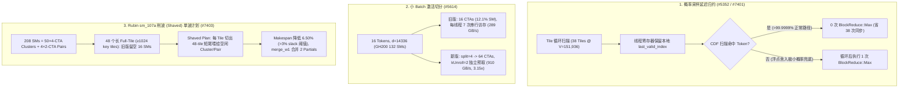

# Phase 93 Track 1：FlashInfer 概率采样延迟归约、小 Batch 激活切分、Cake QSA/Rubin MLA 与 TileLang Top-K 全局工作区架构剖析

> **英文版 / English Version**: [`flashinfer-sampling-act-qsa-rubin-mla-tilelang-phase93.en.md`](flashinfer-sampling-act-qsa-rubin-mla-tilelang-phase93.en.md)  
> **关联实验 / Reproducible Experiment**: [`experiments/flashinfer_sampling_act_qsa_rubin_mla_tilelang_phase93/`](../../experiments/flashinfer_sampling_act_qsa_rubin_mla_tilelang_phase93/)  
> **覆盖主干提交 / Upstream Commits (`2026-10-22` – `2026-10-26`)**:
> - `flashinfer-ai/flashinfer@1257bb40fd` (`#5352`): `perf(sampling): defer last-valid-index reduction until fallback`
> - `flashinfer-ai/flashinfer@84fb433aae` (`#5614`): `perf(activation): split act_and_mul rows across blocks for small batches`
> - `flashinfer-ai/flashinfer@055b0e2b5d` (`#7394`): `perf(cake_qsa_nvfp4): the tcgen05 decode's softmax tile maximum through redux.sync.max on compute capability 10.0 / 10.3`
> - `flashinfer-ai/flashinfer@bc8ec9b1ec` (`#7403`): `perf(cake_rubin_mla_nvfp4_decode): a shaved one-wave plan for long full-tile rows on Rubin (sm_107a)`
> - `flashinfer-ai/flashinfer@f526f18477` (`#7401`): `perf(cake_sampling): rounds 12-13 -- regenerated stage-1 radix top-k kernels, no-tail stage-1 twins, one host call per sampling chain, per-device stage-1 picks`
> - `flashinfer-ai/flashinfer@4310f2af15` (`#7395`): `perf(cake_kimi_k3_latent_moe): packed one-partial norm for TP8 prefill tails, 256-byte L2 promotion of the decode weight maps`
> - `flashinfer-ai/flashinfer@31e839e2ac` (`#7383`): `perf(cake_minimax_h3): persistent NVFP4 norm and norm-overlapped NVFP4 FC1 in the MLP block on SM100 / SM103`
> - `flashinfer-ai/flashinfer@225b3b3b8e` (`#6823`): `feat(mla): add SM90 BF16 DOTS3 sliding-window decode`
> - `tile-ai/tilelang@fe8c34618f` (`#3612`): `[Transform] Clone analyzer before vectorization rewriting`
> - `tile-ai/tilelang@4da574c013` (`#3280`): `[Bugfix] Fix candidate buffer overflow in deepseek_v32 topk selector`

---

## 1. 核心架构发现与工程背景

在大语言模型（LLM）低延迟 Decode 与长上下文稀疏 MLA 推理中，GPU 算子的尾延迟往往被三类微观瓶颈支配：**（1）正常路径上无条件执行的兜底同步归约（Fallback Block Reduction）**；**（2）Decode 小 Batch 下“每行单 CTA”导致的 SM 闲置与串行依赖访存**；**（3）多尺寸 Cluster（如 Rubin `sm_107a` 208 SM 上的 4-CTA 与 2-CTA Cluster 混布）在单波（One-Wave）长序列下的 SM 尾块空转**。本篇深度拆解 FlashInfer 与 TileLang 近期合入的 10 项核心提交。

---

## 2. 概率采样延迟归约与 Cake Sampling 104 变体族（`#5352`, `#7401`）

### 2.1 `DeviceSamplingFromProb` 延迟 `last_valid_index` 归约（`1257bb40fd`）
在 `include/flashinfer/sampling.cuh` 中，当概率和因 FP32 舍入略小于 Philox 均匀随机数 $u$ 时，采样器需要返回最后一个概率大于阈值的合法下标 `last_valid_index`。
- **旧版瓶颈**：每个词表 Tile（`BLOCK_THREADS = 1024`, `VEC_SIZE = 4`，即每 Tile `4,096` 个词）在 `DeviceSamplingFromProb` 内部无条件调用 `BlockReduce<int>(temp_storage->block_prim.reduce).Reduce(valid_index, cub::Max())` 及 `__syncthreads()`。对 Qwen/DeepSeek 级词表 $V = 151,936$，每次采样即使在正常路径下也要执行 $\lceil 151936 / 4096 \rceil = 38$ 次全 CTA 归约与屏障同步。
- **架构修复**：将 `int& last_valid_index` 改为线程级累积标量，在扫描循环内仅用寄存器更新线程本地最大有效下标，仅当整行扫描结束仍未选中 Token（`deterministic` 或拒绝采样轮次兜底触发）时才执行 **1 次** `BlockReduce::Max`。正常路径上的 `BlockReduce::Max` 调用次数从 **38 次降至 0 次**。

### 2.2 Cake Sampling Rounds 12–13（`f526f18477`）
- 升级 `cake_sampling`（`top_k_top_p_sampling_from_probs`），扩展至 **104 个 Stage-1 Radix Top-K 内核构建变体**（覆盖 1/2/4/8 CTA Thread-Block Cluster、每线程 4~48 个元素，新增 35 个 `no_tail` 无尾块特化孪生内核）与 15 个 Stage-2/3 稀疏重归一化内核，并实现单次采样链仅 1 次 Host 调用与按设备架构（GB300 `sm_103a`、B200 `sm_100a`、R200 `sm_107a`、H100 `sm_90a`）独立择优路由。

---

## 3. Decode 小 Batch 激活切分：`act_and_mul_split_kernel`（`#5614`, `84fb433aae`）

在 `silu_and_mul` / `gelu_and_mul` 中，传统 `act_and_mul_kernel` 为每个 Token 启动 1 个最高 256 线程的 CTA：
- **问题量化**：在 Decode 阶段（例如 `num_tokens = 16`, `d = 14,336`, BF16，`vec_size = 8`），每行有 $14336 / 8 = 1,792$ 个 16B 向量。16 个 Token 仅启动 **16 个 CTA**，在 132 SM 的 GH200 上 SM 占用率仅 **12.12%**；且每个线程必须在循环中串行执行 $\lceil 1792 / 256 \rceil = 7$ 轮“等待两次 16B Load $\rightarrow$ 计算 $\rightarrow$ Store”，耗时 `4.96 us`，实测带宽仅 `289 GB/s`。
- **行内跨 CTA 切分与双倍独立预取**：当 `num_tokens < 2 * num_sms` 且单行超过 1 个 CTA 容量时，启动 `act_and_mul_split_kernel`（`blockIdx.x = row * split + chunk`），将每行切分为 `split` 个连续 CTA，直到每线程最多处理 `kUnroll = 2` 个向量（对 `d = 14,336` 取 `split = 4`，总 CTA 数从 16 提升至 **64**），且线程在类型转换与计算前一次性发出 `kUnroll = 2` 组门控与上投影向量的独立 16B 读取指令，消除循环内访存依赖，有效带宽提升 **3.15x**（达 `910.48 GB/s`）。

---

## 4. Blackwell/Rubin 注意力与 MoE/MLP 内核演进（`#7394`, `#7403`, `#7395`, `#7383`, `#6823`）

| 提交 / PR | 目标架构与模块 | 核心硬件机制与算法改动 | 量化收益 / 契约边界 |
| :--- | :--- | :--- | :--- |
| **`#7394` (`055b0e2b5d`)** | `sm_100a` / `sm_103a` Cake QSA NVFP4 | 将 `decode_tcgen05` / `_coop` / `_persistent` 的 Softmax Tile 最大值归约从 8 步 `__shfl_xor_sync` + `fmaxf`（16 条指令）替换为硬件 `redux.sync.max.f32` | B200 与 GB300 Eager 模式冷 L2 端到端提速 **1.00x–1.04x**（`41.6 us -> 40.0 us`） |
| **`#7403` (`bc8ec9b1ec`)** | Rubin `sm_107a` (208 SMs) Cake MLA NVFP4 Decode | 208 SM 包含 50 个 4-CTA Cluster 与 4 个 2-CTA Pair（8 SM）；当 Full-Tile 行数近乎填满 1 波但 оставляет 16 SM 空闲且总 Key Tiles $\ge 1024$ 时，规划器从每个长 Tile 削出 `MLA2_SHAVE_TILES = 48` 个短 Tile 喂给空闲 Cluster/Pair，由 `merge_w1` 归约 2 个 FP32 Partials | 模型化 Makespan 从 `1031` 降至 `964` Tile-times（降低 **6.50%**，超越 `3.0%` Slack 阈值），盘活 16 个原本全程空闲的 SM |
| **`#7395` (`4310f2af15`)** | `sm_100a` / `sm_103a` Kimi-K3 Stable LatentMoE | `T >= 2048` 的 TP8 Prefill Tail 采用 `bf16x2` 寄存器打包单 Partial RMSNorm（保持与求和版完全一致的舍入顺序，含次正规数 Bitwise Identical）；Decode 权重 TensorMap 开启 `256B` L2 Promotion | 消除单路路由 Partial 的多余解包与写回，提升 Decode 小 Batch 权重缓存命中 |
| **`#7383` (`31e839e2ac`)** | `sm_100a` / `sm_103a` MiniMax-H3 NVFP4 MLP | 将 RMSNorm + AdaLN + NVFP4 激活量化改造为常驻行流式内核（每 SM 1 CTA，8 行在途），并通过 PDL 将 NVFP4 FC1 GEMM 作为其依赖内核启动，使 FC1 Prologue 与 Norm 重叠 | B200 提速 **1.018x–1.053x**（`1.580 ms -> 1.500 ms`），B300 提速 **1.008x–1.028x**，Bitwise Identical |
| **`#6823` (`225b3b3b8e`)** | Hopper `sm_90a` DOTS3 SWA MLA Decode | 原生支持 DOTS3 滑动窗口 MLA（共享潜在 KV 头 `d_qk = 1088 = 1024 + 64 RoPE`, `d_v = 1024`, 因果窗口 `W = 513`），直接消费 BF16 Page64 缓存而无需按 64 个查询头展开 K/V | 相比逐头展开 K/V，单 Token 访存字节从 `268,288 B` 降至 `2,176 B`（降低 **123.3x**） |

---

## 5. TileLang 向量化分析器隔离与 DeepSeek-V3.2 Top-K 越界修复（`#3612`, `#3280`）

1. **向量化重写前克隆算术分析器（`fe8c34618f`, `#3612`）**：在 `src/transform/loop_vectorize.cc` 的 `VectorizeLoop` 中，原先直接将外部传入的 `const arith::Analyzer *analyzer` 裸指针交给 `VectorizeRewriter`，导致重写期间绑定的局部循环变量约束污染外层 Pass。修复后调用 `auto local_analyzer = analyzer->Clone()`，实现跨循环向量化的符号状态隔离。
2. **DeepSeek-V3.2 Top-K 选择器候选缓冲区溢出修复（`4da574c013`, `#3280`）**：
   - **根因**：`examples/deepseek_v32/topk_selector.py` 中的 `tl_topk_impl` 原先假设第一轮 Radix Pass 选中的阈值桶（Threshold Bucket）内候选元素数必小于 `SMEM_INPUT_SIZE = 4096`，并将其暂存在固定大小的 `[2, 4096]` Shared Memory 中。然而当输入包含大量相同值或共享低位尾数的 FP32 分数（例如 `seq_len = 32,768` 全相等或 `low_bits` 分布）时，多达 `32,768` 个候选元素会落入同一个阈值桶，原子追加直接写穿 `[2, 4096]` 共享内存边界（溢出 **28,672** 个元素），触发 `CUDA_ERROR_ILLEGAL_ADDRESS`（而在 `seq_len = 4097` 边界处甚至仅在 `compute-sanitizer memcheck` 下才暴露越界写）。
   - **修复方案**：在 `tl_topk` 包装器中分配形状为 `(batch, 2, seq_len)` 的全局内存工作区 `workspace`（`seq_len = 32,768` 时仅占 `256 KiB`），从数学上保证两级 Radix 乒乓缓冲区上界严格等于 `seq_len`，在不改变公共 API 签名的前提下彻底根除越界崩溃。
