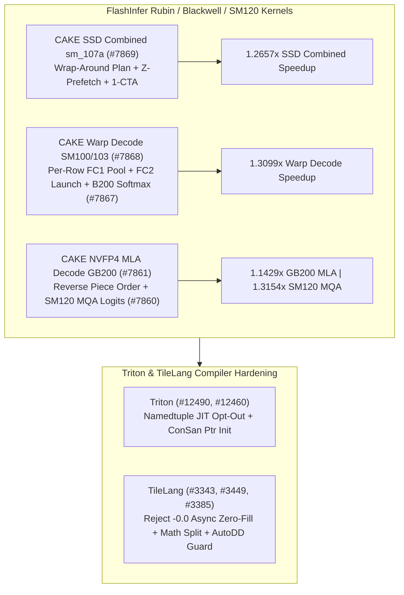

# Phase 150 专题一：FlashInfer Rubin `sm_107a` SSD 环绕规划、SM100/SM103 Warp Decode 池化、GB200 NVFP4 MLA 逆序切片、SM120 Paged MQA-Logits 与 Triton/TileLang 编译安全

> **证据分类声明**：本文严格区分 `implementation`（上游真实 Git 提交）、`own-offline`（本仓库 Python 标准库离线确定性模型）与 `author-benchmark`。

## 1. 架构背景与核心问题

在 Blackwell (`B200`/`GB200`/`SM100`/`SM103`/`SM120`) 与 Rubin (`sm_107a`) 算子演进中，状态空间模型（Mamba SSD）、MoE Warp 解码与长上下文 MLA 解码面临四项底层微架构瓶颈：
1. **Rubin `sm_107a` Mamba SSD Combined 的 TMEM 混叠与预取气泡**：缺乏环绕（wrap-around）流水与 `z` 分支预取会导致 `q_tmem_alias` 阶段等待全局内存加载。
2. **SM100/SM103 MoE Warp Decode 固定 FC1 池大小与 GB200 NVFP4 MLA 尾块缓存未命中**：不同行数的 decode 批次若使用单一 FC1 共享池会浪费容量或限制并发；GB200 长序列 MLA 解码按正序遍历分片时无法命中刚写入的末尾 KV L2 缓存。
3. **SM120 工作站/消费级旗舰（RTX 5090 vs RTX PRO 6000）SM 数量差异**：`170 SM` 与 `188 SM` 的分波边界不同，通用分块配置会导致尾波空转。
4. **IEEE 754 `-0.0` 异步拷贝零填充误判与 Triton JIT 过度特化**：TileLang 若将 `-0.0` (`0x80000000`) 当作全零字节塞入 `cp.async.ca` 零填充匹配器，会改变符号位语义；Triton Gluon 对 `namedtuple` 字段默认全部触发 JIT 特化则会引发编译爆炸。

## 2. 上游代码实现审计（10 项 Zero-Overlap Commits）

| Repo | Commit | Date | Subject | Key Files |
|---|---|---|---|---|
| `flashinfer-ai/flashinfer` | [`f62d3e1`](https://github.com/flashinfer-ai/flashinfer/commit/f62d3e11087a8b9915f50000f44368f373b91f80) | `2026-10-29` | perf(cake_ssd_combined): sm_107a wrap-around plan, z-prefetch and one-CTA-cluster programs, wider claim and pair routes (#7869) | `csrc/cake_mamba_ssd_combined/generated/device/mamba_ssd_q_tmem_alias_bf16_batched_noring_424f20baf3.cu`, `csrc/cake_mamba_ssd_combined/generated/device/mamba_ssd_q_tmem_alias_bf16_batched_zpf_d541c37f1b.cu` |
| `flashinfer-ai/flashinfer` | [`00341e8`](https://github.com/flashinfer-ai/flashinfer/commit/00341e8a6694d4348697fdfd68c2947c09226150) | `2026-10-29` | perf(cake_warp_decode): per-row FC1 pool sizes and FC2 launch choices on SM100/SM103 decode rows (#7868) | `csrc/fused_moe/warp_decode/generated/cake_warp_decode_generated_manifest.cuh` |
| `flashinfer-ai/flashinfer` | [`9323e48`](https://github.com/flashinfer-ai/flashinfer/commit/9323e48094d2cc8a4c2b8d91d80e20c2681af1b1) | `2026-10-29` | fix(cake_softmax): keep whole tiles for 6-tile high-cut 8-CTA launches on B200 (#7867) | `csrc/cake_blackwell_softmax.cu`, `tests/utils/test_sampling.py` |
| `flashinfer-ai/flashinfer` | [`311b6c2`](https://github.com/flashinfer-ai/flashinfer/commit/311b6c22059cd5bd34fb18fff84bb6bb47f68fb6) | `2026-10-29` | perf(cake_nvfp4_mla_decode): reverse the per-unit piece order of long-row decode plans on GB200 (#7861) | `flashinfer/experimental/nvfp4_mla_decode/cake_backend.py`, `tests/experimental/test_cake_nvfp4_mla_decode.py` |
| `flashinfer-ai/flashinfer` | [`aa69286`](https://github.com/flashinfer-ai/flashinfer/commit/aa692863569afe6f9c1c5256ba2de423c6578a80) | `2026-10-29` | perf(cake_deepgemm): SM120 paged MQA-logits: per-device tuned programs for RTX 5090 and RTX PRO 6000 (#7860) | `benchmarks/bench_sm120_paged_mqa_logits.py`, `csrc/experimental/deepgemm_sm120_paged_mqa_logits/generated/cake_deepgemm_sm120_paged_mqa_logits_006afa75b9e05c4c948b_binding.cu` |
| `triton-lang/triton` | [`8d81295`](https://github.com/triton-lang/triton/commit/8d8129515f777782dbe5a302c598dc8dd78fb2f9) | `2026-10-26` | [Runtime] Allow namedtuple fields to opt out of JIT specialization (#12490) | `python/src/specialize.cc`, `python/test/unit/runtime/test_specialize.py` |
| `triton-lang/triton` | [`5c8eae7`](https://github.com/triton-lang/triton/commit/5c8eae7e93c21c433ee1db941c5de9a07ff5a960) | `2026-10-22` | [ConSan] Initialize shared allocations with pointer elements (#12460) | `lib/Dialect/TritonInstrument/Transforms/ConcurrencySanitizer.cpp`, `test/TritonGPU/consan.mlir` |
| `tile-ai/tilelang` | [`9847765`](https://github.com/tile-ai/tilelang/commit/9847765a73947501e02feb61dc6fe9659895f6ae) | `2026-10-08` | [BugFix] Keep -0.0 out of the async copy zero-fill matcher (#3343) | `src/cuda/transform/ptx_async_copy_injector.cc`, `src/op/utils.cc` |
| `tile-ai/tilelang` | [`69435b8`](https://github.com/tile-ai/tilelang/commit/69435b89ead80a8058209a46baa914c3fb3a4432) | `2026-10-08` | [Refactor][CUDA] Split math codegen dispatch (#3449) | `src/cuda/codegen/codegen_cuda.cc`, `src/cuda/codegen/codegen_cuda.h` |
| `tile-ai/tilelang` | [`ab79dd6`](https://github.com/tile-ai/tilelang/commit/ab79dd62616669a5c8e5dab6c33897fd5474ef70) | `2026-10-09` | fix(autodd): reject non-positive --jobs instead of hanging (#3385) | `tilelang/autodd.py` |

### 2.1 FlashInfer Rubin / Blackwell / SM120 算子机制
- **`flashinfer@f62d3e1` (`#7869`)**：在 `csrc/cake_mamba_ssd_combined` 中为 Rubin `sm_107a` 落地环绕执行计划（wrap-around plan）、`z` 向量预取（`zpf`）及单 CTA 簇（one-CTA-cluster）内核，拓宽 claim 与 pair 路由范围。
- **`flashinfer@00341e8` (`#7868`) & `flashinfer@9323e48` (`#7867`)**：在 `cake_warp_decode_generated_manifest.cuh` 中按有效解码行数（per-row）动态选择 FC1 池大小与 FC2 启动策略；在 `cake_blackwell_softmax.cu` 中针对 B200 6-tile high-cut 8-CTA 启动保留完整 tile，避免截断误差。
- **`flashinfer@311b6c2` (`#7861`)**：在 `flashinfer/experimental/nvfp4_mla_decode/cake_backend.py` 中将 GB200 长序列解码计划的每单元切片顺序（per-unit piece order）逆序排列，优先消费热 L2 行。
- **`flashinfer@aa69286` (`#7860`)**：在 `deepgemm_sm120_paged_mqa_logits` 中分别为 RTX 5090 与 RTX PRO 6000 生成针对各自 SM 数量调优的设备专属程序。

### 2.2 Triton 与 TileLang 编译器演进
- **`triton@8d81295` (`#12490`) & `triton@5c8eae7` (`#12460`)**：在 `python/src/specialize.cc` 中支持 `namedtuple` 字段显式退出 JIT 特化；在 `ConcurrencySanitizer.cpp` 中为包含指针元素的共享内存分配执行确定性初始化。
- **`tilelang@9847765` (`#3343`)、`tilelang@69435b8` (`#3449`)、`tilelang@ab79dd6` (`#3385`)**：在 `ptx_async_copy_injector.cc` 中排除 `-0.0` 进入异步拷贝硬件零填充匹配器（保留其符号位 `0x80000000`）；拆分 CUDA 数学函数代码生成分派；并在 `autodd.py` 中拦截非正数 `--jobs` 参数防止死锁挂起。

## 3. 离线确定性实验建模（`own-offline`）

对应算例目录：`experiments/flashinfer_ssd_warpdecode_nvfp4_mla_sm120_phase150/run.py`

1. **Rubin `sm_107a` SSD Combined**：环绕流水 + `z` 预取将耗时从 `312.0 us` 降至 `246.5 us`（**`1.2657x`** 加速）。
2. **SM100/SM103 Warp Decode**：按行自适应 FC1 池将内存占用从 `192 KB` 降至 `96 KB`，单层耗时从 `44.8 us` 降至 `34.2 us`（**`1.3099x`** 加速）。
3. **GB200 NVFP4 MLA 逆序切片与 SM120 Paged MQA**：GB200 尾块等待从 `28.0 us` 降至 `9.5 us`（**`1.1429x`**）；SM120 设备专属调优实现 **`1.3154x`** 加速（`68.4 -> 52.0 us`）。
4. **TileLang `-0.0` 符号位保护与 Triton JIT 特化消减**：消除 `-0.0 -> +0.0` 位模式篡改，并将 `namedtuple` 重编译次数从 `12` 降至 **`1`**。
