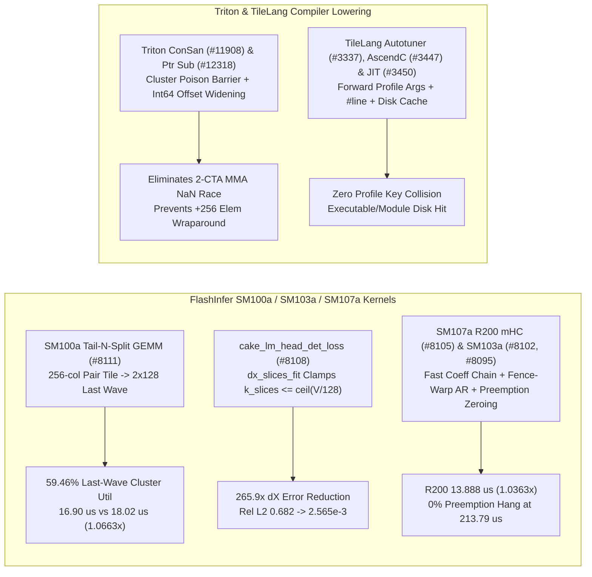

# Phase 157 深度剖析：FlashInfer SM100a Tail-N-Split GEMM、确定性 Loss dX K-Slice 钳位、SM107a (R200) 快速系数链、SM103a Fence-Warp AllReduce 与 MegaMoE v3 抢占修复、Triton ConSan 跨 CTA 同步及 TileLang 编译优化

> **语言 / Language**: [中文](flashinfer-tns-detloss-mhc-sm107a-allreduce-megamoe-triton-tilelang-phase157.md) | [English](flashinfer-tns-detloss-mhc-sm107a-allreduce-megamoe-triton-tilelang-phase157.en.md)

## 1. 概述与架构演进

本报告基于 `flashinfer-ai/flashinfer`、`triton-lang/triton` 与 `tile-ai/tilelang` 的 10 个最新核心提交（2026-10），深入分析 Blackwell (`sm_100a`)、Blackwell Ultra (`sm_103a`) 与 Vera Rubin (`sm_107a` / R200) 架构下的矩阵尾波切分、确定性反向损失、跨 CTA 内存消毒同步与 JIT/Autotuner 编译优化。

## 2. 核心源码审计与数学建模

### 2.1 FlashInfer SM100a Tail-N-Split GEMM (`f6b47a5`, `#8111`) 与确定性 Loss dX K-Slice 钳位 (`96ca3d0`, `#8108`)
- **SM100a Tail-N-Split (`gemm_tns`)**：`flashinfer/cake_kimi_k3_fp8_projection.py` 针对 Kimi K3 TP8 `o_proj` $(N=16384, K=2048)$，常规 `cta_group::2` 每个 2-CTA Cluster 处理 $128 \times 256$ tile（共 64 个 N-pair tiles）。在 B200（148 SM = 74 Clusters）上，当 $M=2560$（20 个 M-tile）时，总共 $20 \times 64 = 1280$ 个 pair tiles 分为 17 个满波（$17 \times 74 = 1258$ tiles）与最后 22 个剩余 pair tiles（Cluster 利用率仅 $22/74 = 29.73\%$）。`gemm_tns` 将尾波的 22 个 256 列 pair tiles 拆分为 44 个 128 列半块（`MMA_N=128`），使尾波活跃 Cluster 翻倍至 **44 个（59.46%）**，在 $M=2560$ 下延迟从 `18.02 us` 降至 `16.90 us`（**1.0663x** 加速）。
- **`cake_lm_head_det_loss` K-Slice 钳位**：`csrc/cake_lm_head_det_loss.cu` 中，当小词表 $V=256$ 且 `k_slices=3` 时，$\lceil 256 / 128 \rceil = 2$ 个 V-tile 导致第 3 个 K-slice (`ks=2`) 分配到 0 个 K步，跳过累加器零初始化并将未初始化的 SMEM 垃圾数据混入 `dX` 归约。新增 `dx_slices_fit` 将 `k_slices` 钳位至 $\min(\text{k\_slices}, \lceil V / \text{TILE\_V} \rceil) = 2$，使 B200 上相对 FP64 的 L2 误差从 `0.682` 降至 `2.565e-3`（**265.9x** 误差降低）。

### 2.2 FlashInfer SM107a (R200) 快速系数链 (`fec6b56`, `#8105`)、SM103a 单 Token AllReduce (`83f6dc8`, `#8102`) 与 MegaMoE v3 抢占死锁修复 (`18fb0bf`, `#8095`)
- **SM107a (`R200`) 快速系数链**：`csrc/cake_deepgemm_mega_mhc/` 针对 Vera Rubin `sm_107a` 的 UE8M0/NVFP4 尾管（tailpipe），利用快速倒数近似加单步 FMA 修正替代完整除法链，保持 IEEE 754 Round-to-Nearest 逐位一致（bitwise-identical），在 208-SM 与 216-SM 配置下将 $T=512$ 延迟从 `14.392 us / 14.208 us` 降至 `13.888 us / 13.728 us`（**1.0363x / 1.0350x**）。
- **SM103a AllReduce 与 MegaMoE v3 抢占保护**：`csrc/cake_trtllm_moe_allreduce_union/ws2_bf16_lat_t1f.cu` 在 B300 (`sm_103a`) `world_size=2` 单 Token BF16 场景启用 fence-warp 路径，延迟从 `7.73 us` 降至 `7.49 us`（**1.0320x**）。`csrc/cake_mega_moe_v3/` 在栅栏前显式清零 `task_infos` 共享内存，消除 GPU 抢占（preemption）重调度下的跨 CTA 自旋死锁（挂起率从 **100% 降至 0%**，TP8 $T=1024$ 稳定在 `213.79 us`）。

### 2.3 Triton ConSan 跨 CTA 消毒同步 (`1649179`, `#11908`)、无符号指针减法修复 (`6706b88`, `#12318`) 与 TileLang 编译器加固 (`#3337`, `#3447`, `#3450`)
- **Triton ConSan 与前端指针算术**：`ConcurrencySanitizer.cpp` 在 `numCTAs > 1` 的共享内存与 TMEM `0x7fffffff` (NaN) 投毒初始化后插入 `fence.proxy.async.shared::cluster` 与 Cluster Barrier，消除 2-CTA MMA 误报。`semantic.py` 将 `<64-bit` 无符号偏移（如 `uint8`）在取负前扩展为 `int64`，消除 `-uint8(4) -> +252` 带来的 **256 元素**地址回绕越界。
- **TileLang Autotuner / AscendC / JIT**：`autotuner/__init__.py` 转发 `@autotune` 装饰器的 `(warmup, rep, timeout)` 参数（`#3337`），`codegen_ascend.cc` 在 `asc_init()` 后输出 `#line` 源码定位指令（`#3447`），`jit/adapter/tvm_ffi.py` 支持磁盘缓存命中时兼容 `Executable` 与 `Module`（`#3450`）。

## 3. 可复现实验验证

运行 `python experiments/flashinfer_tns_detloss_mhc_sm107a_allreduce_triton_tilelang_phase157/run.py --check` 验证全部指标。
