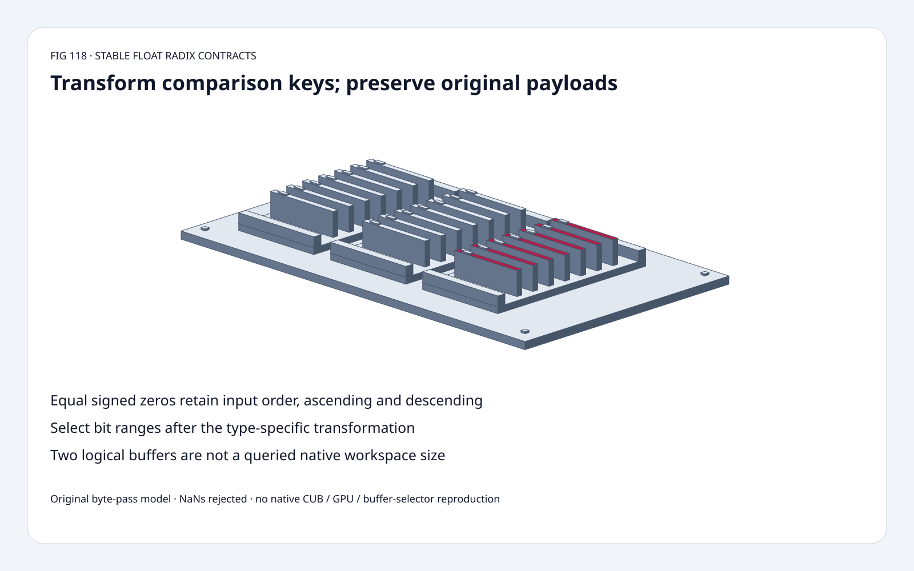
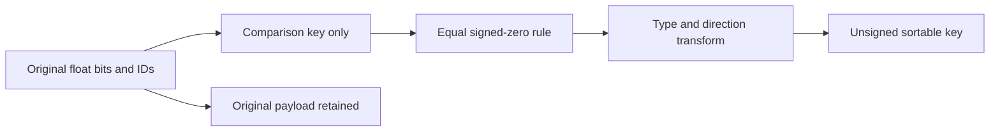
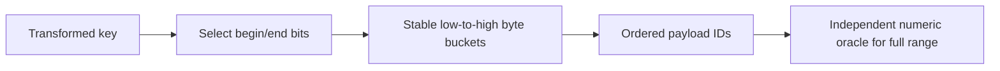
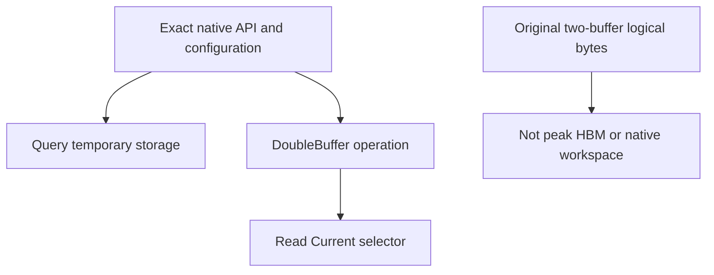

# Float radix-sort FAQ: signed zero, stable IDs and transformed bit ranges

> **Language**: [中文](float-radix-signed-zero-transformed-bit-range-selection-faq.md) | English
>
> **Round 118 · 2026-11-14 (night round 27)** · [SVG](../../assets/svg/float-radix-signed-zero-transformed-bit-range-selection-faq-summary.svg) · [7 cards](../reports/float-radix-signed-zero-transformed-bit-range-selection-cards.html) · [H5](../reports/float-radix-signed-zero-transformed-bit-range-sizer.html) · [Data](../../experiments/float_radix_contract_selection/report.json)
>
> **Synthetic, `independently_reproduced=false`.** Original float32 key/byte-pass model and separate CPU integer-key timing; no native CUB/GPU execution or NaN-order compatibility.



## 1. Executive summary: raw bit order is not numeric order

The original ten-key fixture includes negatives, both infinities,
signed zeros, subnormals and duplicate 1.5 values.
Stable transformed keys match an independent numeric oracle in
**10/10 output positions**; raw uint32 order matches **1/10**.
Omitting the zero rule reduces agreement to **8/10**.

Pinned CUB documents type-specific transformations, stable equal-zero
ordering, and bit selection **after** transformation.
The verified **November 10** source update qualifies internal calls
to suppress ADL. It is maintenance, **not an invention of these
existing sorting semantics**.

| Gate | Required contract |
| :--- | :--- |
| Numeric meaning | Transform signed/float keys before unsigned sorting |
| Equal keys | Preserve input order, including +0/-0 |
| Partial range | Select transformed bits, not an assumed raw field |
| Buffer result | Read native final selector; query actual workspace |

## 2. Architect Q&A: which key is being sorted?

### Q1: Why does unsigned reinterpretation fail for float32?

Positive float keys require a sign-bit flip; negative keys require
full-bit inversion to obtain ascending numeric order.
The original model folds both zero encodings to one **comparison**
key before transformation. It retains original raw payloads and IDs.

Fixture raw patterns:
`00000000,80000000,c0000000,3fc00000,bf800000,7f800000,ff800000,3fc00000,00000001,80000001`.
Numeric stable output IDs are
`[6,2,4,9,0,1,8,3,7,5]`.
Raw unsigned sorting gives
`[0,8,3,7,5,1,9,4,2,6]`.

These are deterministic fixture position agreements, not model
quality or calibrated probability.

### Q2: If +0 and -0 compare equal, can either order be returned?

Not when the selected operator promises **stability**.
Pinned CUB explicitly retains their original input order.
Our fixture presents +0 at ID 0 before -0 at ID 1.
Plain sign-flip/inversion without zero folding returns `[1,0]`;
the stable numeric result is `[0,1]`.

Do not modify original values merely to normalize comparison keys:
downstream code may inspect signbit or retained payload identity.

Descending stability also matters. Inverting transformed comparison
keys preserves equal-key order, whereas reversing an ascending result
reverses signed-zero and duplicate-value groups.
The original correct descending path agrees **10/10**;
the reverse-output shortcut agrees **6/10**.

### Q3: Can begin/end bits be interpreted as raw exponent or mantissa bits?

Not without accounting for type and direction transformations.
The pinned contract applies those transformations **before**
`[begin_bit,end_bit)` truncation. Negative-key inversion changes
the meaning of selected raw bits.

Our `[0,8)` fixture separately compares transformed selection with
raw low-byte sorting; they disagree.
Partial-key sorting need not produce full numeric order.

The model uses a deliberately explicit **+0-based canonical comparison
encoding**, and requires `0<=begin<end<=32`.
This is not certification of native internal zero encoding or every
partial-range/NaN boundary. Verify the actual implementation if those
internal representations matter.

### Q4: Why reject NaNs when the source accepts their bit patterns?

Pinned CUB documents no special numeric NaN handling: their transformed
bit representations determine ordering.
Our independent **numeric** oracle cannot make that into a portable
NaN policy, so the teaching model rejects NaN patterns explicitly.

Both infinities and positive/negative subnormals are supported without
flushing the original bit patterns. Tests include 500 seeded random
patterns before NaN filtering, independent numeric comparisons, and
an independent bit-string transformation/range oracle.

The narrower NaN policy is intentional and visible in Python/H5.
It must not be presented as native CUB input rejection.

### Q5: Does a two-buffer estimate tell me CUB temporary storage or final location?

No. Default 1,048,576 items, four-byte keys and selected four-byte
values give **8,388,608 bytes** per logical pair buffer and
**16,777,216 bytes** for two.

These are payload accounting, not queried workspace or peak HBM.
Pointer input/output APIs and DoubleBuffer APIs have different
contracts and storage requirements; query the exact API/version
with its intended configuration.

Read `DoubleBuffer.Current()` after the native operation rather than
assuming final location from our four byte passes.
Our pass count is an original teaching algorithm, not CUB's native
policy or dispatch schedule. Native workspace, final selector and
latency remain null.

## 3. Visual architecture: transform comparisons, retain payloads







## 4. Selection matrix: stability is not a tie-breaking convenience

| Choice | Good fit | Gate |
| :--- | :--- | :--- |
| Full numeric transformed key | Signed floats with stable IDs | Explicit signed-zero and NaN contracts |
| Raw unsigned key | Actual unsigned data | Not a proxy for signed float order |
| Partial transformed range | Deliberate radix subkey | Not guaranteed full numeric order |
| Stable descending key | Descending numeric order | Do not reverse equal groups |
| Original byte-pass model | Algorithm/contract teaching | Not native dispatch or speed prediction |
| Native CUB API | Actual GPU sort | Query storage and read actual final buffer |

## 5. Hands-on evidence: independent numeric and bit-string oracles

```powershell
python -m experiments.float_radix_contract_selection.run --check
python -m unittest discover -s tests -p test_float_radix_contract_selection.py -q
```

Eight tests cover numeric order, seeded random patterns, subnormals,
signed-zero and duplicate stability in both directions, five selected
bit ranges, independent string-bit transformations, payload retention,
empty input, invalid patterns/ranges, Node/Python parity and sealed
sample medians.

| Precomputed uint32 keys | Original Python byte buckets (ms) | C-backed Python sorted (ms) |
| :--- | ---: | ---: |
| 64 | 0.141650 | 0.004300 |
| 256 | 0.306550 | 0.023800 |
| 1,024 | 1.032100 | 0.155400 |
| 4,096 | 3.976000 | 0.760300 |

The original Python model is **slower** in these samples.
Different implementation languages and validation costs are included;
this is not an algorithm-only or GPU comparison.
Two warmups, seven alternating repeats, two operations/sample;
median repeat means. Float conversion, key generation, transfer
and native CUB excluded. No browser visual inspection.

## 6. Sources, provenance and readiness

- [Pinned DeviceRadixSort](https://github.com/NVIDIA/cccl/blob/0dd2af496098ca890304ed4b8b3bc13e6b88851c/cub/cub/device/device_radix_sort.cuh): float transformations, equal zeros, stability, transformed bit range and APIs.
- [November 10 maintenance](https://github.com/NVIDIA/cccl/commit/0dd2af496098ca890304ed4b8b3bc13e6b88851c): internal qualification to suppress ADL.
- [Repository license](https://github.com/NVIDIA/cccl/blob/0dd2af496098ca890304ed4b8b3bc13e6b88851c/LICENSE): inspected component header declares `SPDX-License-Identifier: BSD-3`; upstream rights retained.
- [Original experiment](../../experiments/float_radix_contract_selection/README.md): sealed fixture, CPU samples and explicit narrower NaN policy.

Original key/byte-pass models, oracles and art; no upstream implementation
copied. Native throughput, NaN compatibility, temporary storage,
buffer selector and peak HBM are not reproduced.
