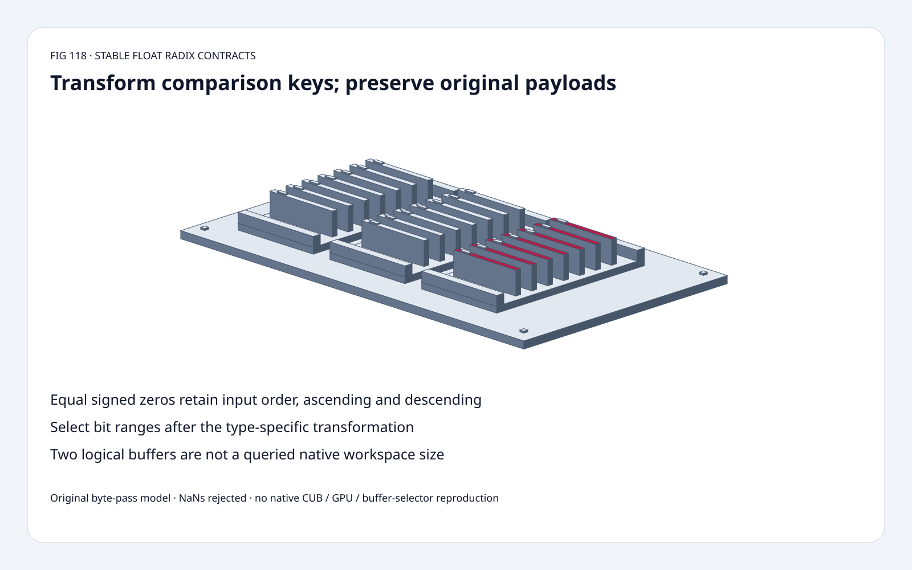
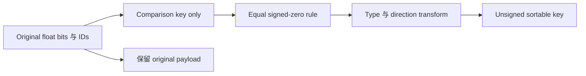
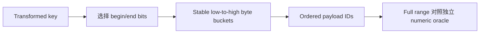
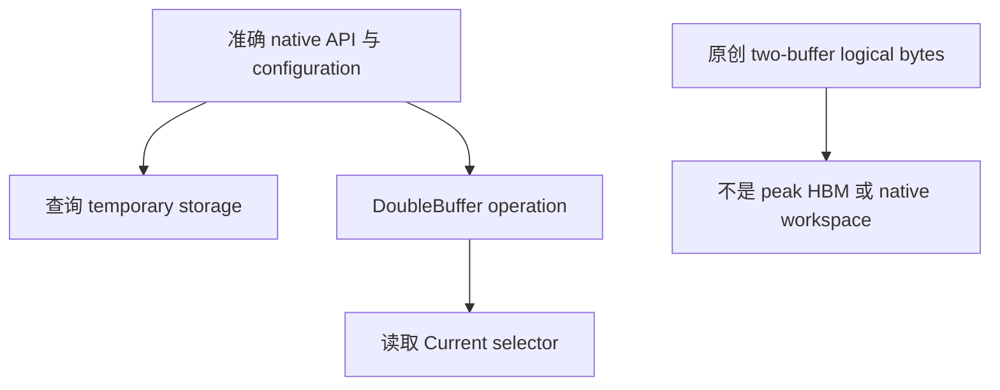

# Float Radix-Sort FAQ：Signed Zero、Stable IDs 与 Transformed Bit Range

> **语言**：中文 | [English](float-radix-signed-zero-transformed-bit-range-selection-faq.en.md)
>
> **Round 118 · 2026-11-14（夜班第 27 轮）** · [高清 SVG](../../assets/svg/float-radix-signed-zero-transformed-bit-range-selection-faq-summary.svg) · [七卡](../reports/float-radix-signed-zero-transformed-bit-range-selection-cards.html) · [H5](../reports/float-radix-signed-zero-transformed-bit-range-sizer.html) · [数据](../../experiments/float_radix_contract_selection/report.json)
>
> **Synthetic，`independently_reproduced=false`。** 原创 float32 key/byte-pass、
> 独立 CPU integer-key timing；不执行 native CUB/GPU，不认证 NaN-order compatibility。



## 一、先看结论：Raw Bit Order 不等于 Numeric Order

原创十 key 样例含负数、两侧 infinity、signed zeros、subnormals、
重复 1.5。Stable transformed keys 与独立 numeric oracle 对齐 **10/10**
output positions；raw uint32 只有 **1/10**；
遗漏 zero rule 降为 **8/10**。

固定 CUB 文档明确 type-specific transform、equal-zero stability，
以及**先 transform 再选 bit range**。
核验 **11 月 10 日**更新为 internal qualification 抑制 ADL，
只是维护，**不是今天新发明这些既有 sorting semantics**。

| Gate | 必须明确 |
| :--- | :--- |
| Numeric meaning | Signed/float keys 先变换再 unsigned sort |
| Equal keys | 包含 +0/-0 的原输入次序 |
| Partial range | 选择 transformed bits，而非猜 raw field |
| Buffer result | 查询 native workspace，读取 final selector |

## 二、架构师 Q&A：真正排序的是哪个 Key？

### Q1：为什么直接 Reinterpret Uint32 不行？

Positive float 翻转 sign bit，negative float 全 bit 取反，
才得到 ascending numeric key。
原创先把两种 zero 折叠为同一 **comparison key**，
保留原始 raw payload 与 ID，不改原值。

Fixture：
`00000000,80000000,c0000000,3fc00000,bf800000,7f800000,ff800000,3fc00000,00000001,80000001`。
Numeric stable IDs：
`[6,2,4,9,0,1,8,3,7,5]`；
raw unsigned：
`[0,8,3,7,5,1,9,4,2,6]`。

这些是 deterministic fixture position agreements，
不是 model quality、confidence 或采样概率。

### Q2：+0 与 -0 相等，就能随意返回顺序吗？

若 operator 承诺 **stability**，不行。
固定 CUB 明确保留它们的输入次序；
本例 +0 ID 0 在 -0 ID 1 前。
只做 sign-flip/inversion、不做 zero folding，会变成 `[1,0]`，
stable numeric 应为 `[0,1]`。

Comparison key 正规化不代表可改原始值；
下游可能读取 signbit 或 payload identity。

Descending 同理：变换 key 的反序保持 equal-key order，
直接 reverse ascending output 则反转 signed-zero/duplicate groups。
正确 descending 对齐 **10/10**，reverse-output shortcut 仅 **6/10**。

### Q3：Begin/End Bits 可以直接当 Raw Exponent/Mantissa 吗？

必须先考虑 type/direction transformation。
固定文档在 `[begin_bit,end_bit)` 截取**之前**变换，
negative-key inversion 已改变 raw bits 的含义。

原创 `[0,8)` separately 比较 transformed selection 与 raw low-byte sorting，
两者不一致；partial-key sort 不承诺 full numeric order。

原型明确使用 **以 +0 为 canonical comparison encoding**，
并要求 `0<=begin<end<=32`；
不认证 native 内部 zero encoding 或所有 partial-range/NaN 边界，
依赖这些 representation 时要核验真实实现。

### Q4：Source 接受 NaN Bits，原型为什么拒绝？

固定 CUB 不做特殊 numeric NaN handling，
按 transformed bit representations 排序。
独立 **numeric** oracle 不能据此编出 portable NaN policy，
所以原创 Python/H5 显式拒绝 NaN patterns；
这**不是 native CUB 的输入拒绝规则**。

两侧 infinity、positive/negative subnormals 均支持，
不 flush 原 bit patterns。
Tests 从 500 个 seeded random patterns 中排除 NaN，
再做 numeric comparison，以及独立 bit-string transform/range oracle。

### Q5：Two-Buffer 估算能代表 CUB Temp Storage 或最终位置吗？

不能。默认 1,048,576 items、4-byte keys、选定 4-byte values：
一个 pair buffer **8,388,608 bytes**，
两个 **16,777,216 bytes**。

这是 payload accounting，不是 queried workspace/peak HBM。
Pointer input/output 与 DoubleBuffer APIs 的 storage contract 不同，
应查询准确 API/version/configuration。

执行后读 `DoubleBuffer.Current()`，不要用原创四个 byte passes
预测 native final selector；
原创 pass count 不是 CUB policy/dispatch。
Native workspace、selector、latency 全部保持 null。

## 三、三张架构图：变换 Comparison，保留 Payload







## 四、选型矩阵：Stability 不是可有可无的 Tie Convenience

| 选择 | 适合 | Gate |
| :--- | :--- | :--- |
| Full transformed numeric key | Signed floats、stable IDs | 明确 zero/NaN contract |
| Raw unsigned key | 真正 unsigned data | 不能代理 float numeric order |
| Partial transformed range | 有意选择 radix subkey | 不保证 full numeric order |
| Stable descending key | 反序 numeric sorting | 不 reverse equal groups |
| Original byte-pass | Algorithm/contract 教学 | 不预测 native dispatch/speed |
| Native CUB | 实际 GPU sort | 查询 storage、读取 final buffer |

## 五、动手证据：Independent Numeric 与 Bit-String Oracles

```powershell
python -m experiments.float_radix_contract_selection.run --check
python -m unittest discover -s tests -p test_float_radix_contract_selection.py -q
```

8 项 tests：numeric order、seeded patterns/subnormals、
双方向 zero/duplicate stability、五种 bit range、独立 bit-string oracle、
payload retention/empty input、invalid patterns/ranges、Node/Python parity、
封存 medians。

| Precomputed uint32 keys | Original Python byte buckets（ms） | C-backed Python sorted（ms） |
| :--- | ---: | ---: |
| 64 | 0.141650 | 0.004300 |
| 256 | 0.306550 | 0.023800 |
| 1,024 | 1.032100 | 0.155400 |
| 4,096 | 3.976000 | 0.760300 |

本组 **Python model 更慢**；包含实现语言与 validation 成本差异，
不是 algorithm-only 或 GPU comparison。
2 warmups、7 alternating repeats、2 ops/sample，取 repeat means median；
排除 float conversion、key generation、transfer、native CUB。
未做浏览器视觉验收。

## 六、来源、许可、溯源与 Readiness

- [固定 DeviceRadixSort](https://github.com/NVIDIA/cccl/blob/0dd2af496098ca890304ed4b8b3bc13e6b88851c/cub/cub/device/device_radix_sort.cuh)：float transform、equal zeros、stability、transformed bit range、APIs。
- [11 月 10 日维护](https://github.com/NVIDIA/cccl/commit/0dd2af496098ca890304ed4b8b3bc13e6b88851c)：internal qualification 抑制 ADL。
- [Repository LICENSE](https://github.com/NVIDIA/cccl/blob/0dd2af496098ca890304ed4b8b3bc13e6b88851c/LICENSE)：所读 component header 标记 `SPDX-License-Identifier: BSD-3`，上游权利保留。
- [原创实验](../../experiments/float_radix_contract_selection/README.md)：sealed fixture、CPU samples、显式更窄的 NaN policy。

Key/byte-pass models、oracles、视觉原创，未复制上游实现。
不声称 native throughput、NaN compatibility、temporary storage、
buffer selector 或 peak HBM。
