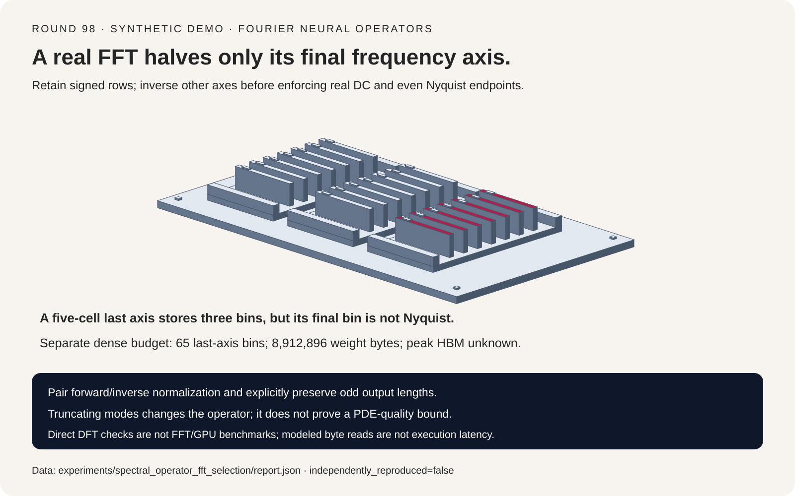
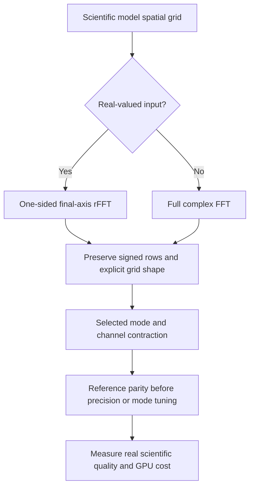
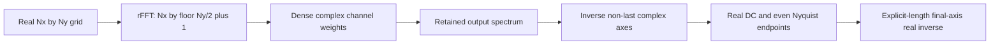
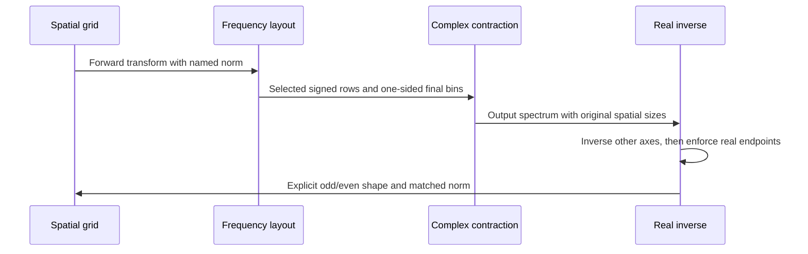

# Fourier neural operator FAQ: real-FFT layout, Hermitian boundaries and odd grids

> **Language**: [中文](fourier-neural-operator-real-fft-hermitian-selection-faq.md) | English
>
> **Round 98 · 2026-11-14 (seventh round of the November 13 night)** · [SVG](../../assets/svg/fourier-neural-operator-real-fft-hermitian-selection-faq-summary.svg) · [7-card report](../reports/fourier-neural-operator-real-fft-hermitian-selection-cards.html) · [H5 workbench](../reports/fourier-neural-operator-real-fft-hermitian-sizer.html) · [Sealed report](../../experiments/spectral_operator_fft_selection/report.json)
>
> **Synthetic, `independently_reproduced=false`.** Original standard-library DFT and circular-convolution checks. No neuraloperator/PyTorch/cuFFT execution, trained PDE model, GPU latency or peak-HBM measurement.



## 1. Executive summary: scientific-AI spectral layers need a frequency contract

Fourier neural operators mix channels in frequency space, retain selected
modes, then return to a spatial grid. Unlike an attention KV cache or a
graph-neighbor minibatch, the storage contract is governed by **complex
frequencies, conjugate symmetry and FFT normalization**.

| Contract | Correct interpretation | Wrong shortcut |
| :--- | :--- | :--- |
| Real multidimensional FFT | Only the last transformed axis is one-sided | Halve every axis |
| DC/even Nyquist boundaries | Real after inversing the other axes | Clear raw 2D boundary-column imaginary parts |
| Odd last-axis length | Explicit inverse spatial size | Infer an even length from stored bins |
| FFT normalization | Pair matching forward/inverse conventions | Mix conventions without amplitude accounting |

On the original `3 × 5` real-grid fixture, the correct spectral operation
matches independent spatial circular convolution within `2.22e-16`.
Treating the odd final bin as Nyquist adds `0.3994437368` maximum error.
An implicit even inverse returns `3 × 4` instead of `3 × 5`, so numeric
error is **null**, not zero.

First-party context is the pinned
[neuraloperator SpectralConv](https://github.com/neuraloperator/neuraloperator/blob/a6648eeeb60fe0837f2d7d021517a945a159a0c8/neuralop/layers/spectral_convolution.py).
Its [February 24, 2026 Hermitian-enforcement change](https://github.com/neuraloperator/neuraloperator/commit/dcd46cd80b41d71e6feb258cfe4fdd2f524adce0)
documents a GPU concern. The file's October 17 conditioning update is more
recent, but conditioning is not the subject of this experiment. Neither
metadata date is presented as a same-day popularity ranking.

## 2. Architect Q&A: where do real-grid spectral implementations go wrong?

### Q1: Why is only the final axis halved?

For real input, the full two-dimensional spectrum satisfies:

```text
X[-kx mod Nx, -ky mod Ny] = conjugate(X[kx,ky])
rfft2 stored shape = [Nx, floor(Ny/2)+1]
```

The conjugate partner flips both frequency coordinates. Retaining all
first-axis frequency rows and only the nonnegative last-axis half is enough
to reconstruct the full spectrum. Independently halving both axes loses
information. That control has maximum error `0.0866025404`.

The pinned layer uses `rfftn` for real data and `fftn` for complex data.
Its non-last axes are centered for mode slicing with `fftshift`; they must
be restored with the corresponding inverse shift. The toy uses unshifted
coordinates consistently rather than reproducing the source's slicing code.

### Q2: Aren't DC and Nyquist frequencies supposed to be real?

In a one-dimensional real transform, DC and an existing even Nyquist
endpoint are real. In a raw two-dimensional spectrum, however, an entire
`ky=0` column can be complex across `kx`: its rows carry first-axis phase.
The even last-axis Nyquist column has the same issue.

The pinned staged inverse first transforms the non-last axes back to space:

```text
rows = ifft(spectrum, axis=0, norm="forward")
rows[:,0].imag = 0
if Ny is even: rows[:,-1].imag = 0
output = irfft(rows, n=Ny, axis=1, norm="forward")
```

Only at that intermediate representation does every row describe a
one-dimensional real inverse. Clearing the raw frequency columns early
erases legitimate row phase. The odd fixture control has maximum error
`0.1212435565`; a separate `4 × 6` fixture also checks the even Nyquist
column's nonzero raw phase and near-real post-first-inverse endpoints.

This is a numerical explanation of the contract, **not** a reproduction of
the upstream GPU artifact described in source comments.

### Q3: What is special about odd grid sizes?

Both lengths four and five produce three stored real-FFT bins.
Inferring `2*(bins-1)` therefore chooses four and loses the odd-length
information. Preserve explicit output dimensions.

For length five, the highest stored positive-frequency bin still has a
distinct negative-frequency partner. It is not a self-conjugate Nyquist
endpoint. Clearing its imaginary part removes a valid sine component.
The original real inverse explicitly reconstructs conjugate pairs with
factor two; omitting that factor causes `0.3483804436` maximum error.

The source passes explicit `mode_sizes` through its inverse calls.
This harness checks size preservation only; it does not assess learned
resolution transfer or resampling quality.

### Q4: Does `norm="forward"` alter the scientific operator?

A matched transform pair preserves round-trip amplitudes:

| Convention | Forward scale per transform size N | Inverse scale |
| :--- | ---: | ---: |
| `forward` | `1/N` | `1` |
| `backward` | `1` | `1/N` |
| `ortho` | `1/sqrt(N)` | `1/sqrt(N)` |

For a fixed spectral multiplier, the matching factors cancel. The numerical
fixture defines that multiplier using an **unnormalized kernel transform**,
so all three matched pairs represent the same spatial circular convolution.
Their maximum errors are at most `2.78e-16`.

Mixing a forward-normalized input with a backward-normalized inverse scales
this `3 × 5` output by `1/15`, producing `0.7050449374` maximum error.
The pinned layer defaults to `fft_norm="forward"` and carries it into the
inverse. Other frameworks may choose another consistent convention.

### Q5: Does retaining fewer modes preserve the same operator?

Not generally. The toy retaining only last-axis bins zero and one differs
from the full operator by `0.4321381506`. But its staged inverse matches
an independent full-spectrum reconstruction **using the same retained
spectrum** within `1.67e-16`.

That is an intentional low-pass choice, not a correctness failure.
It says nothing about a trained neural operator's PDE error, boundary
conditions, out-of-distribution grids or physical conservation laws.
The fixture uses one input/output channel and a fixed real circular kernel;
the separate byte budget covers dense multi-channel weights.

## 3. Visual architecture: selection, spectral layout and inverse sequence







## 4. Selection matrix and dense complex-buffer accounting

| Need | Evaluate | Measurement still required |
| :--- | :--- | :--- |
| Correct real-grid operator | Odd/even, phase-sensitive reference fixtures | Full model behavior and scientific error |
| Fewer modes | Explicit mode policy and retained-spectrum parity | Resolution/accuracy tradeoff |
| Smaller spectral weights | Dense versus factorized contraction | Actual rank, kernel speed and quality |
| Lower precision | Backend-supported complex precision | Stability and scientific tolerances |
| GPU capacity planning | Complex buffers plus backend workspace | Allocator peak, optimizer and backward state |

The pinned real-data setter converts the final requested mode count to
`requested_modes_y//2+1`. The workbench keeps the public requested count
distinct from stored last-axis bins:

```text
FFT bins = Nx * (Ny//2+1)
dense weight complex values = Cin * Cout * modes_x * (modes_y//2+1)
complex bytes = 2 * real scalar bytes
selected input/output spectrum bytes =
    batch * (Cin+Cout) * Nx * (Ny//2+1) * complex bytes
```

Default batch four, 32 input and 64 output channels, `128 × 128` grid,
requested modes `(32,32)`, and four-byte real scalars give:

| Selected allocation | Bytes |
| :--- | ---: |
| Dense complex weights: `32*64*32*17` values | `8,912,896` |
| Input/output one-sided spectra | `25,559,040` |
| Corresponding full-complex spectra | `50,331,648` |
| Real input/output tensors | `25,165,824` |

These are separate selected quantities, not a guaranteed sum of simultaneously
live allocations. FFT workspace, intermediate transforms, activations,
gradients, optimizer state and framework allocation are excluded.
**Peak HBM remains null.** No factorization saving is claimed.

## 5. Worked evaluation and seven-card report

| Case | Maximum output error | Interpretation |
| :--- | ---: | :--- |
| Staged inverse | `2.22e-16` | Independent spatial reference passes |
| Clear raw 2D columns early | `0.1212435565` | Valid row phase erased |
| Invent an odd Nyquist endpoint | `0.3994437368` | Highest odd-grid sine erased |
| Infer even inverse length | `null` | Wrong `3 × 4` output shape |
| Omit pair factor | `0.3483804436` | Conjugate contribution lost |
| Mix inverse normalization | `0.7050449374` | Output amplitude divided by 15 |
| Halve every axis | `0.0866025404` | Signed rows omitted |

Card 6 shows **modeled one-pass reads of selected spectrum bytes** across
batch sizes one, two, four and eight. At an assumed `1000 GB/s` and `5 µs`
setup, default one-sided and full-complex reads are `0.03055904 ms` and
`0.055331648 ms`. This is not an FFT execution model, bandwidth measurement,
batching benchmark or speedup claim. Transform, contraction and workspace
costs remain unmeasured; median/repeats are not applicable.

All card coordinates come from the sealed report. The shared original
frequency-card sorter SVG uses solid geometry; its cards represent retained
frequency identities, not literal GPU hardware. H5 exposes bilingual inputs
and explicit validation. Browser visual verification was not performed:
the earlier approval refusal was respected.

## 6. Reproduction, provenance and readiness boundaries

```powershell
python -m experiments.spectral_operator_fft_selection.run
python -m experiments.spectral_operator_fft_selection.run --check
python -m unittest tests.test_spectral_operator_fft_selection
python scripts\validate_research.py
```

Eight tests cover independent versus separable transforms; odd/even and
singleton-axis round trips; spatial convolution; raw and staged boundary
phase; shape/pair/norm controls; intentional truncation; complex-byte and
invalid-input cases; sealed output/CSP/SVG; and Python/Node calculator parity.
Direct DFT loops are correctness references, not practical FFT algorithms.

First-party references:
[pinned SpectralConv](https://github.com/neuraloperator/neuraloperator/blob/a6648eeeb60fe0837f2d7d021517a945a159a0c8/neuralop/layers/spectral_convolution.py),
[Hermitian-enforcement change](https://github.com/neuraloperator/neuraloperator/commit/dcd46cd80b41d71e6feb258cfe4fdd2f524adce0),
and [MIT license](https://github.com/neuraloperator/neuraloperator/blob/a6648eeeb60fe0837f2d7d021517a945a159a0c8/LICENSE).
No upstream implementation or trained weights were copied.
The static report uses `default-src 'none'; style-src 'unsafe-inline'`
without external scripts, fonts or requests.

**Ready for:** reviewing frequency identity, output shape, normalization
and selected-buffer formulas. **Not ready for:** choosing production neural
operator precision/rank/modes, predicting GPU throughput, or replacing
scientific validation of a trained PDE surrogate.
