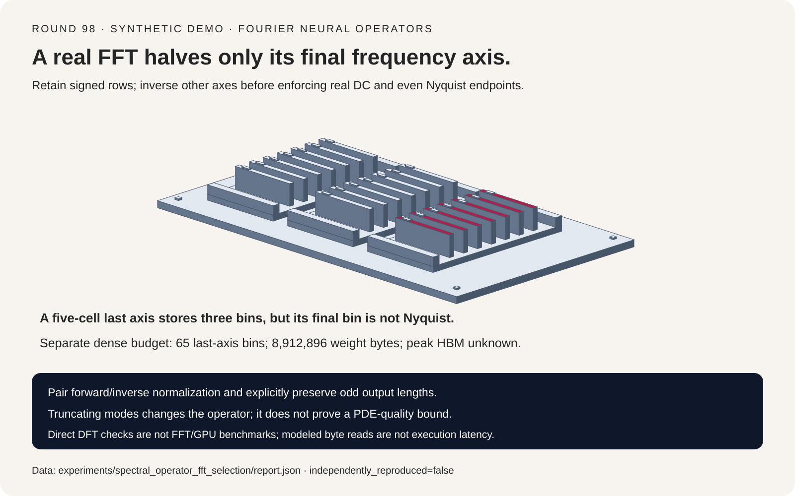
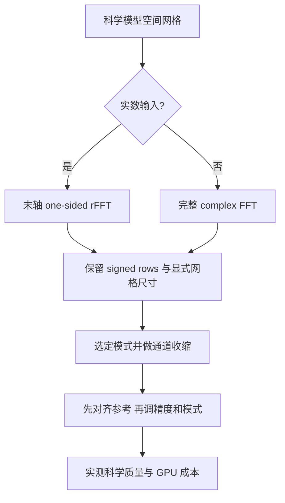
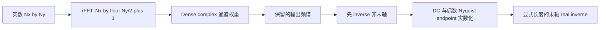
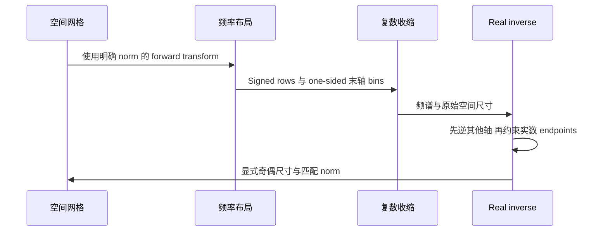

# Fourier 神经算子选型 FAQ：实数 FFT 布局、Hermitian 边界与奇数网格

> **语言**：中文 | [English](fourier-neural-operator-real-fft-hermitian-selection-faq.en.md)
>
> **Round 98 · 2026-11-14（11 月 13 日夜班第七轮）** · [SVG](../../assets/svg/fourier-neural-operator-real-fft-hermitian-selection-faq-summary.svg) · [七卡报告](../reports/fourier-neural-operator-real-fft-hermitian-selection-cards.html) · [H5 工作台](../reports/fourier-neural-operator-real-fft-hermitian-sizer.html) · [封存数据](../../experiments/spectral_operator_fft_selection/report.json)
>
> **Synthetic，`independently_reproduced=false`。** 原创标准库 DFT 与循环卷积验证，不执行 neuraloperator/PyTorch/cuFFT，不含 PDE 模型训练、GPU 延迟或峰值 HBM 实测。



## 一、先说结论：科学 AI 频谱层需要频率契约

Fourier Neural Operator 在频域混合通道、截取模式，再回到空间网格。
与 attention KV cache、图邻居 minibatch 不同，其存储契约由 **复数频率、
共轭对称与 FFT 归一化** 决定。

| 契约 | 正确理解 | 危险捷径 |
| :--- | :--- | :--- |
| 多维实数 FFT | 仅最后变换轴 one-sided | 每个轴都减半 |
| DC/偶数 Nyquist 边界 | 逆变换其他轴后才逐行实数化 | 提前清原始二维边界列的虚部 |
| 奇数末轴 | 显式保留 inverse 空间尺寸 | 从存储 bins 推断偶数长度 |
| FFT norm | 正逆 convention 成对匹配 | 混用 convention 不核对幅值 |

原创 `3 × 5` 网格中，正确频谱运算与独立空间循环卷积误差 `2.22e-16`。
将奇数末 bin 当 Nyquist 产生 `0.3994437368` 最大误差；隐式偶数 inverse
输出 `3 × 4` 而不是 `3 × 5`，数值误差必须为 **null**，不能填零。

一手背景是 [neuraloperator SpectralConv 固定源码](https://github.com/neuraloperator/neuraloperator/blob/a6648eeeb60fe0837f2d7d021517a945a159a0c8/neuralop/layers/spectral_convolution.py)
及 [2026-02-24 Hermitian enforcement 变更](https://github.com/neuraloperator/neuraloperator/commit/dcd46cd80b41d71e6feb258cfe4fdd2f524adce0)。
后者讨论特定 GPU 的问题。文件最近的 10 月 17 日 conditioning 更新并非
本轮复现对象，也不把这些日期包装成当日热度排名。

## 二、架构师 Q&A：频谱层会在哪些地方静默算错？

### Q1：为什么只能对末轴减半？

实数输入的完整二维频谱满足：

```text
X[-kx mod Nx, -ky mod Ny] = conjugate(X[kx,ky])
rfft2 stored shape = [Nx, floor(Ny/2)+1]
```

共轭伙伴同时反转两个坐标。保留首轴全部 signed rows、末轴非负半边
足以恢复完整频谱；两轴分别减半则丢信息。错误 control 最大误差
`0.0866025404`。

固定实现对 real data 使用 `rfftn`，complex data 使用 `fftn`。
非末轴用 `fftshift` 居中取模式，inverse 前须用配对的逆 shift。
原创 toy 始终使用 unshifted 坐标，不复制上游切片实现。

### Q2：DC 与 Nyquist 不是应该为实数吗？

一维 real transform 的 DC 与存在时的偶数 Nyquist endpoint 为实数。
但原始二维频谱中，整条 `ky=0` 列可随 `kx` 携带复数首轴相位；
偶数末轴 Nyquist 列也是如此。

固定源码先逆变换非末轴：

```text
rows = ifft(spectrum, axis=0, norm="forward")
rows[:,0].imag = 0
if Ny is even: rows[:,-1].imag = 0
output = irfft(rows, n=Ny, axis=1, norm="forward")
```

此时每行才是一个一维 real inverse。提前清原始频域边界列虚部，会擦掉
合法首轴相位；奇数 fixture 中最大误差 `0.1212435565`。另用 `4 × 6`
偶数网格，核对 Nyquist 原始列含非零虚部，而首次 inverse 后对应
endpoints 接近实数。

这解释数值契约，**不是** 本机重现上游源码注释所说的 GPU artifact。

### Q3：奇数网格有什么特殊之处？

四格与五格都存三个 rFFT bins。推断 `2*(bins-1)` 会选四格，无法恢复
“原来是五格”的信息，必须显式传空间尺寸。

五格的最高正频 bin 仍有独立负频伙伴，并非自共轭 Nyquist。清掉其虚部
会删合法 sine 分量。原创 inverse 用 factor two 合并共轭伙伴；漏掉
该 factor 导致 `0.3483804436` 最大误差。

固定实现显式传入 `mode_sizes`。本实验只验证长度保持，不评价学习到的
分辨率迁移或重采样质量。

### Q4：`norm="forward"` 会改变科学算子吗？

配对的 transform 保持 round-trip 幅值：

| Convention | 每次 N 点 forward 缩放 | Inverse 缩放 |
| :--- | ---: | ---: |
| `forward` | `1/N` | `1` |
| `backward` | `1` | `1/N` |
| `ortho` | `1/sqrt(N)` | `1/sqrt(N)` |

对固定频谱 multiplier，匹配因子抵消。Fixture 用 **未归一化 kernel
transform** 定义固定 multiplier，因此三种配对都等价同一个空间循环
卷积，最大误差不超过 `2.78e-16`。

Forward-normalized 输入配 backward-normalized inverse，会将本例
`3 × 5` 输出缩为 `1/15`，最大误差 `0.7050449374`。固定层默认
`fft_norm="forward"`，inverse 使用相同值；其他框架可选另一种一致惯例。

### Q5：少留一些模式，还能叫相同算子吗？

通常不能。本例仅留末轴 bins 0、1，与完整算子相差 `0.4321381506`；
但与 **同一截断频谱** 的独立 full-spectrum reconstruction 对比，
误差只有 `1.67e-16`。

这是有意低通，不是正确性失败。不能据此推导训练模型 PDE error、
边界条件、分布外网格或物理守恒。本 fixture 单输入/输出通道、固定实数
循环 kernel；多通道 dense 权重预算是另一个配置。

## 三、可视化架构：选型树、布局与分阶段 inverse







## 四、选型矩阵与 Dense 复数缓存预算

| 需求 | 应评估 | 仍需实测 |
| :--- | :--- | :--- |
| 实数网格算子正确 | 奇偶尺寸、带相位 reference fixture | 完整模型与科学误差 |
| 减少模式 | 明确截断与相同频谱 parity | 分辨率/质量权衡 |
| 压缩频谱权重 | Dense 对 factorized contraction | 实际 rank、kernel 与质量 |
| 降低精度 | 后端支持的 complex precision | 稳定性、科学容差 |
| GPU 容量规划 | Complex buffers 加 workspace | Allocator peak、反向与优化器 |

固定 real-data setter 将最后 requested mode count 转为
`requested_modes_y//2+1`。工作台区分公开请求模式数与实际存储 bins：

```text
FFT bins = Nx * (Ny//2+1)
dense weight complex values = Cin * Cout * modes_x * (modes_y//2+1)
complex bytes = 2 * real scalar bytes
selected input/output spectrum bytes =
    batch * (Cin+Cout) * Nx * (Ny//2+1) * complex bytes
```

默认 batch 4、32 输入与 64 输出通道、`128 × 128` 网格、requested modes
`(32,32)`、实数标量四字节：

| 选定分配 | Bytes |
| :--- | ---: |
| Dense complex 权重：`32*64*32*17` 个复数 | `8,912,896` |
| 输入/输出 one-sided spectra | `25,559,040` |
| 对应 full-complex spectra | `50,331,648` |
| 实数输入/输出 tensors | `25,165,824` |

这些是分别选定的量，不保证同时驻留，也不能简单相加称为 peak。
不含 FFT workspace、中间 inverse、activations、gradients、optimizer
或框架分配。**Peak HBM 保持 null**，未声称 factorization 节省。

## 五、可复现实例与七卡报告

| Case | 最大输出误差 | 解释 |
| :--- | ---: | :--- |
| 分阶段 inverse | `2.22e-16` | 通过独立空间参考 |
| 提前清二维原始边界列 | `0.1212435565` | 擦掉合法首轴相位 |
| 虚构奇数 Nyquist | `0.3994437368` | 丢最高奇数频率 sine |
| 推断偶数 inverse 长度 | `null` | 错误 `3 × 4` shape |
| 漏共轭 pair factor | `0.3483804436` | 少算伙伴贡献 |
| 混用 inverse norm | `0.7050449374` | 输出幅值除以 15 |
| 每个轴都减半 | `0.0866025404` | 丢 signed rows |

第六卡为 batch 1、2、4、8 下 **选定频谱字节的一次读取公式**。假设
`1000 GB/s`、启动 `5 µs`，默认 one-sided/full-complex 分别为
`0.03055904 ms` / `0.055331648 ms`，不是 FFT 执行模型、带宽实测、
batching benchmark 或 speedup。Transform、contraction、workspace
仍未测；median/repeats 不适用。

所有视觉坐标来自封存 report。共享原创实体分拣机 SVG 的卡片表示频率
身份，不是字面 GPU 硬件。H5 双语输入与显式校验；此前浏览器拒绝仍被
遵守，没有绕路进行视觉验收。

## 六、复现、来源与生产就绪边界

```powershell
python -m experiments.spectral_operator_fft_selection.run
python -m experiments.spectral_operator_fft_selection.run --check
python -m unittest tests.test_spectral_operator_fft_selection
python scripts\validate_research.py
```

八项测试覆盖独立/可分离变换，奇偶及 singleton-axis round-trip，空间
卷积，边界列原始/分阶段相位，shape/pair/norm controls，有意模式截断，
复数字节与非法输入，封存产物/CSP/SVG，以及 Python/Node parity。
Direct DFT 循环仅作正确性参考，不是实用 FFT 性能实现。

一手来源：[固定 SpectralConv](https://github.com/neuraloperator/neuraloperator/blob/a6648eeeb60fe0837f2d7d021517a945a159a0c8/neuralop/layers/spectral_convolution.py)、
[Hermitian enforcement 变更](https://github.com/neuraloperator/neuraloperator/commit/dcd46cd80b41d71e6feb258cfe4fdd2f524adce0)
及 [MIT LICENSE](https://github.com/neuraloperator/neuraloperator/blob/a6648eeeb60fe0837f2d7d021517a945a159a0c8/LICENSE)。
未复制上游实现或训练权重。静态七卡 CSP
`default-src 'none'; style-src 'unsafe-inline'`，无外部脚本、字体与请求。

**适用**：检查频率身份、输出 shape、norm 与选定 buffer 公式。
**不适用**：代替真实任务挑生产精度/rank/modes、预测 GPU 吞吐，
或替代训练后 PDE surrogate 的科学验证。
