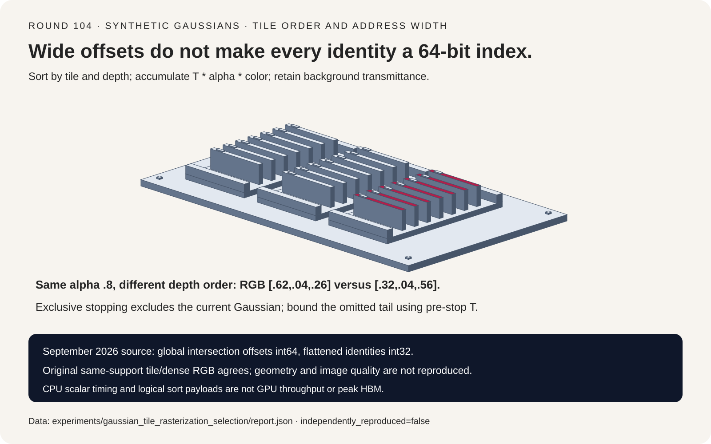
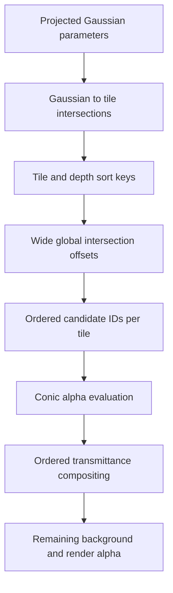
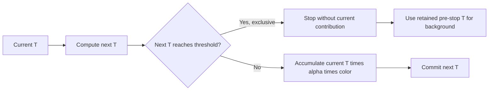
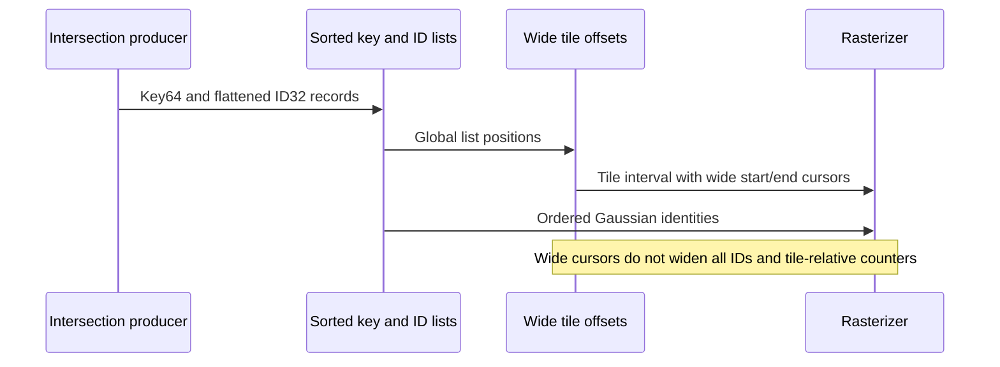

# Gaussian splat FAQ: ordered tiles, exclusive alpha termination and wide offsets

> **Language**: [中文](gaussian-splat-tile-alpha-wide-offset-selection-faq.md) | English
>
> **Round 104 · 2026-11-14 (thirteenth round of the November 13 night)** · [SVG](../../assets/svg/gaussian-splat-tile-alpha-wide-offset-selection-faq-summary.svg) · [7-card report](../reports/gaussian-splat-tile-alpha-wide-offset-selection-cards.html) · [H5 workbench](../reports/gaussian-splat-tile-alpha-wide-offset-sizer.html) · [Sealed report](../../experiments/gaussian_tile_rasterization_selection/report.json)
>
> **Synthetic, `independently_reproduced=false`.** Timing alone measures original CPU functions. No gsplat/CUDA execution, 3D projection, antialiasing, image-quality benchmark, GPU latency or peak-memory observation.



## 1. Executive summary: wide offsets do not make every index wide

A concrete September 1, 2026 gsplat change widened intersection offsets
to 64 bits across 29 files. The inspected rasterizer uses int64 global
intersection cursors, but int32 flattened Gaussian identities and
tile-relative last-contribution IDs remain. Addressability is a
multi-field contract, not one dtype switch.

Ordered alpha compositing is a separate correctness gate. For effective
alphas `.6/.5`, red then blue and background `[.1,.2,.3]`, output is
`[.62,.04,.26]`. Reversing depth yields `[.32,.04,.56]` even though both
have render alpha `.8`. Checking output alpha alone misses color errors.

| Layer | Preserve | Do not infer |
| :--- | :--- | :--- |
| Tile candidates | Same declared spatial support | Arbitrary culling is exact |
| Depth order | Front-to-back color/transmittance recurrence | Alpha parity implies RGB parity |
| Approximation | Exact order of floor/termination gates | A local threshold bounds total quality |
| Address widths | Global offsets, identities and packed fields | Every index is now int64 |

This study examines that pinned capability and underlying mechanics.
It does not claim a same-day release or daily popularity ranking.
Original references use float64 CPU arithmetic and finite square
support, not bitwise parity with source float32 CUDA near thresholds.

## 2. Architect Q&A: where do tile rasterizers change semantics?

### Q1: What is the correct front-to-back recurrence?

With remaining transmittance T, effective alpha a, unpremultiplied color c
and background b:

```text
color += T * a * c
T *= 1-a
after all accepted contributions: color += T * b
render_alpha = 1-T
```

Independent product-form weights are
`w_i=a_i*product(1-a_j for j<i)`. The original recurrence agrees with
that separate reference. Additive color without T changes maximum RGB
by `.3` in the fixture; omitting the remaining background changes it
by `.06`.

The source shared Gaussian-weight helper evaluates a conic exponent,
then caps alpha at `.99` and skips alpha below `1/255` or negative
exponent. Our square support is an additional explicit toy policy;
it does not reproduce projected ellipses or upstream tile culling.

### Q2: Does a `next_T <= 1e-4` cutoff bound missing color by `1e-4`?

Not with the inspected **exclusive** gate. It computes next_T, then
stops before accumulating the current Gaussian or updating T when
next_T reaches the threshold.

Three `.98` red/green/blue layers over black illustrate this:

| State | Full tail | Exclusive policy |
| :--- | ---: | ---: |
| Accepted layers | 3 | 2 |
| Remaining T | `.000008` | `.0004` |
| Blue | `.000392` | `0` |

The omitted blue `.000392` exceeds `1e-4`. For colors and background
bounded to `[0,1]`, **pre-stop T** bounds per-channel tail replacement
error. Hypothetical next_T does not include the omitted current
contribution. The bound is not valid unchanged for unbounded/HDR
features. This is an intentional approximation policy, not a claim
that the source violates its own implementation contract.

### Q3: Can many individually negligible alphas still matter?

Yes. Five hundred green layers each with alpha `.003` are all below
`1/255`. Without that floor they accumulate green
`1-(1-.003)^500 = .777372322423` over black; the floor discards all.

This synthetic construction demonstrates that per-sample smallness is
not a global image-error guarantee. It is not a measured PSNR failure,
representative scene or recommendation to remove a production threshold.
Real quality/performance tradeoffs require actual rendered scenes.

### Q4: When should dense and tile-indexed references agree?

When they use the same support, order, alpha cap/floor and background.
The original CPU references use pixel centers and declared finite
axis-aligned square support. The tiled path bins every pixel-containing
tile touched by that support; it does not change Gaussian evaluation.

On the `9×7`, 12-Gaussian fixture, toy tile size four visits 258
candidates versus dense 756, with identical RGB and 21 tile
intersections. Toy tile sizes 1/2/4/8 all preserve RGB. These are CPU
partitions, not claims that native kernels support all those launch
sizes. Early termination is disabled in this exact comparison.

Effective-alpha derivatives also agree with an independent tail-product
reference and finite differences within `3.59e-11` in the default
fixture. That check holds fixed order and avoids thresholds; no
projection/covariance/sort derivative parity is claimed.

### Q5: What other width boundaries remain after int64 offsets?

The pinned tile intersection code packs image/tile metadata and float
depth bits into 64-bit keys. Rasterization consumes int32 flattened
identities; tile-relative last IDs also remain int32.

A synthetic logical offset sequence crosses `2^31-1` and demonstrates
negative signed-int32 wrapping without allocating large arrays.
Widening global cursors prevents that class of address failure, but
does not certify every identity, tile-local counter or key metadata
field. Source depth-bit encoding and supported launch configurations
are not reproduced by the original CPU sorter.

## 3. Visual architecture: index, sort, blend and terminate







## 4. Selection matrix and intersection-budget calculator

| Situation | Check | Do not substitute |
| :--- | :--- | :--- |
| Large global intersection list | Every producer/consumer cursor width | One int64 declaration |
| Heavy tile overlap | Intersection multiplicity and local limits | Gaussian count alone |
| RGB mismatch | Depth order, T and background | Output alpha parity |
| Tail/alpha thresholds | Gate order and scene-quality evidence | Threshold as universal error bound |
| Memory planning | Sort payload plus real workspace/lifetimes | Two payload buffers as peak HBM |

Calculator inputs explicitly assume a uniform integer tile multiplicity
per Gaussian. It is not inferred from unknown projection geometry.
For I images, N Gaussians per image and m intersections each:

```text
entries = I*N*m
one key64 + ID32 payload = 12*entries bytes
two logical sort payload buffers = 24*entries bytes
tile-offset payload = I*ceil(W/tile)*ceil(H/tile)*8 bytes
```

The source offset array has one entry per tile; its final range end uses
the total intersection count rather than requiring an extra sentinel in
this budget.

Default one `1920×1080` image, tile16, N=1M and m=8:

| Selected payload | Bytes |
| :--- | ---: |
| One key/ID payload | `96,000,000` |
| Two sort payload buffers | `192,000,000` |
| 64-bit tile offsets | `65,280` |
| 32-bit offset comparison | `32,640` |

The small offset-byte increment does not quantify total algorithm
overhead. Sorting workspace, allocation alignment, projected attributes,
gradients and model memory are excluded. Peak HBM/GPU latency/image
quality remain null. Additional flags expose int32 identity and packed
metadata limits; a valid arithmetic estimate is not production approval.

## 5. Worked evaluation and seven-card report

| Control | Maximum RGB difference | Interpretation |
| :--- | ---: | :--- |
| Tile versus same-support dense | `0` | Same operator |
| Reverse depth | `.3` | Wrong color order |
| Drop transmittance multiplier | `.3` | Wrong blend |
| Omit background | `.06` | Wrong final color |
| Exclusive tail cutoff | `.000392` | Intentional approximation |
| Many individually sub-floor layers | `.777372322423` | Intentional approximation |

Sealed original CPU timings: `16×12` RGB, finite support, early
termination disabled; bin construction and validation included; two
warmups and seven alternating repeats:

| Gaussians | Tile-indexed median ms | Dense-scan median ms |
| ---: | ---: | ---: |
| 16 | `.6151` | `1.0962` |
| 64 | `1.6409` | `3.8087` |
| 256 | `6.0069` | `15.5480` |
| 1,024 | `24.9235` | `62.2991` |

Windows ARM64, Python 3.12.10; CPU identity is recorded in `latency.json`.
These compare original scalar candidate searches, not gsplat, CUDA,
production early-exit rasterizers or GPU speedup. They do not predict
PSNR, training quality or real-time rendering capacity.

Seven-card coordinates derive from sealed scores/timings. The original
card sorter represents tile/depth grouping, not actual GPU hardware.
Browser visual verification was not performed; the earlier refusal
remains respected.

## 6. Reproduction, provenance and readiness boundaries

```powershell
python -m experiments.gaussian_tile_rasterization_selection.run
python -m experiments.gaussian_tile_rasterization_selection.run --check
python -m unittest tests.test_gaussian_tile_rasterization_selection
python scripts\validate_research.py
```

Only explicit `--measure` replaces CPU samples; checking never remeasures.
Eight tests cover edge/empty scenes and tile partitions, independent
blend weights, effective-alpha finite differences, exclusive cutoff
bounds, accumulated small layers, cap/floor gates, invalid geometry,
wide offsets and remaining widths, payload limits, Python/Node parity,
sealed medians, CSP and SVG.

First-party sources:
[rasterizer](https://github.com/nerfstudio-project/gsplat/blob/81c13e668250fd5c3e78f1d87058b4ac071ebb31/gsplat/cuda/csrc/RasterizeToPixels3DGSSerialBatchFwd.cu),
[shared weight math](https://github.com/nerfstudio-project/gsplat/blob/81c13e668250fd5c3e78f1d87058b4ac071ebb31/gsplat/cuda/csrc/RasterizeToPixels3DGSDevice.cuh),
[tile intersections](https://github.com/nerfstudio-project/gsplat/blob/81c13e668250fd5c3e78f1d87058b4ac071ebb31/gsplat/cuda/csrc/IntersectTile.cu),
[constants](https://github.com/nerfstudio-project/gsplat/blob/81c13e668250fd5c3e78f1d87058b4ac071ebb31/gsplat/cuda/include/Common.h),
[Apache-2.0 license](https://github.com/nerfstudio-project/gsplat/blob/81c13e668250fd5c3e78f1d87058b4ac071ebb31/LICENSE).
Upstream rights remain with their holders; no renderer implementation
or scene assets were copied. Script-free cards use
`default-src 'none'; style-src 'unsafe-inline'`.

**Ready for:** reviewing candidate coverage, compositing gates and
address widths. **Not ready for:** scene-quality conclusions, full
projection/backward parity or production GPU/peak-memory claims.
