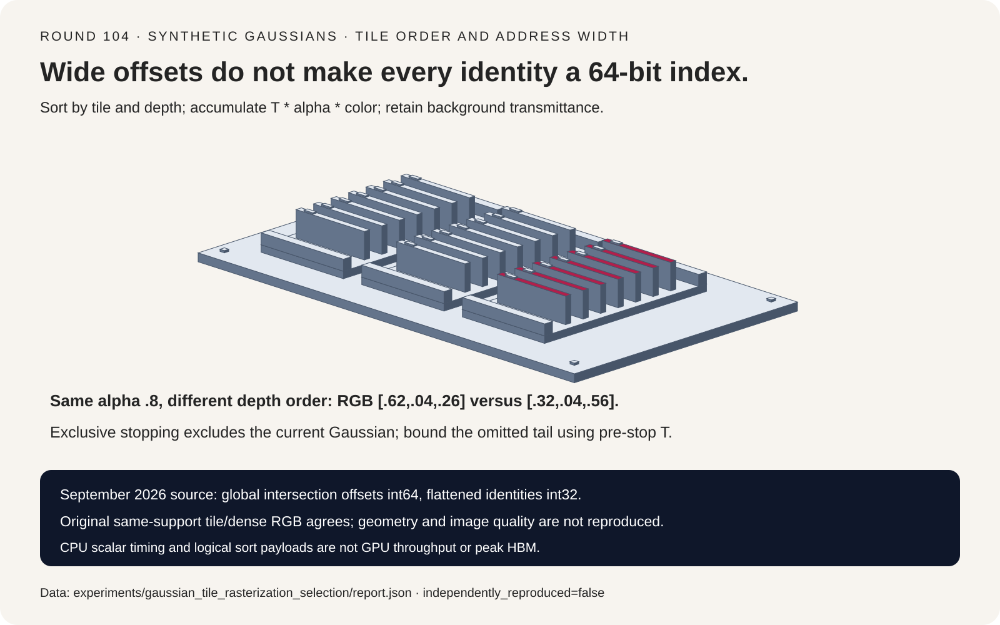
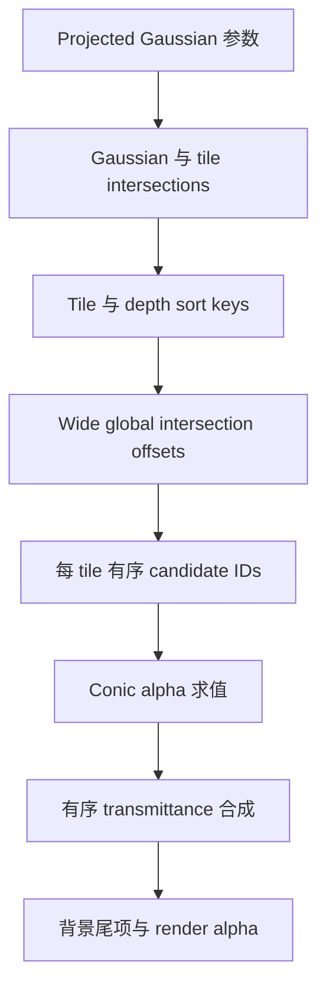
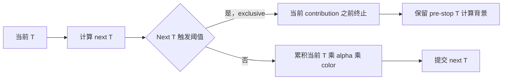
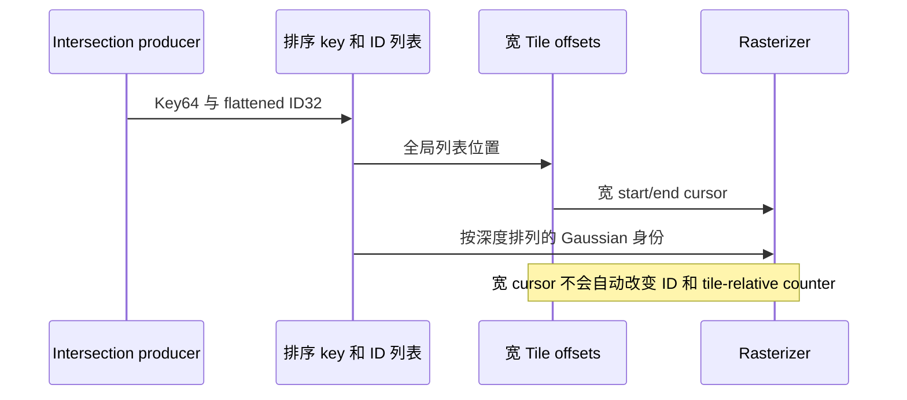

# Gaussian Splat 选型 FAQ：Tile 深度顺序、Exclusive Alpha 与宽 Offset

> **语言**：中文 | [English](gaussian-splat-tile-alpha-wide-offset-selection-faq.en.md)
>
> **Round 104 · 2026-11-14（11 月 13 日夜班第十三轮）** · [高清 SVG](../../assets/svg/gaussian-splat-tile-alpha-wide-offset-selection-faq-summary.svg) · [七卡报告](../reports/gaussian-splat-tile-alpha-wide-offset-selection-cards.html) · [H5 工作台](../reports/gaussian-splat-tile-alpha-wide-offset-sizer.html) · [封存数据](../../experiments/gaussian_tile_rasterization_selection/report.json)
>
> **Synthetic，`independently_reproduced=false`。** 仅 timing 是原创 CPU 函数实测；未运行 gsplat/CUDA、3D projection 或 antialiasing，不含图像质量、GPU 延迟或峰值内存观测。



## 1. 执行摘要：Offset 变宽不代表所有索引都变宽

gsplat 在 2026 年 9 月 1 日的一项具体变更中，将 intersection offsets
扩展为 64 位，涉及 29 个文件。所读 rasterizer 的全局 intersection
cursor 为 int64，但 flattened Gaussian identity 与 tile-relative
last-contribution ID 仍是 int32。地址能力需要整条 producer/consumer
链一致，不能只看一处 dtype。

有序 alpha 合成是另一道门。有效 alpha `.6/.5`、先红后蓝、
background `[.1,.2,.3]`，输出 `[.62,.04,.26]`；反转深度得到
`[.32,.04,.56]`，但两者 render alpha 都为 `.8`。
只检查 alpha 会漏掉 `.3` 的颜色误差。

| 层次 | 必须保留 | 不能推出 |
| :--- | :--- | :--- |
| Tile candidates | 相同的已声明空间 support | 任意 culling 都精确 |
| Depth order | T 与颜色的 front-to-back 递推 | Alpha 相同意味着 RGB 相同 |
| Approximation | Floor/termination 的准确顺序 | 局部 threshold 保证全局质量 |
| Address width | Global offset、identity、packed fields | 全部索引已为 int64 |

本轮追踪固定能力变更和底层机制，不冒充当日发布或热度排名。
原创参照使用 float64 CPU 与有限 square support，不宣称阈值附近与
上游 float32 CUDA bitwise 一致。

## 2. 架构师 Q&A：Tile Rasterizer 会在哪些环节改变语义？

### Q1：Front-to-back 正确递推是什么？

Remaining transmittance T、有效 alpha a、未预乘颜色 c、背景 b：

```text
color += T * a * c
T *= 1-a
全部接受的 contribution 结束后：color += T * b
render_alpha = 1-T
```

独立 product-form 权重为 `w_i=a_i*product(1-a_j for j<i)`，与原创
递推一致。去掉 T 做 additive color，fixture 最大 RGB 差 `.3`；
忘记背景尾项，差 `.06`。

上游共享 helper 用 conic exponent 计算权重，alpha cap 为 `.99`，
低于 `1/255` 或 exponent 为负则跳过。本 toy 另有显式有限 square
support，不复现 3D projected ellipse 或上游 tile culling。

### Q2：`next_T <= 1e-4` 是否保证漏色最多 `1e-4`？

所查代码采用 **exclusive** gate：先算 next_T，若触发阈值，
在更新颜色与 T **之前**结束，当前高斯也被排除。

黑背景、三个 `.98` 的红/绿/蓝层：

| 状态 | 完整尾部 | Exclusive policy |
| :--- | ---: | ---: |
| 接受层数 | 3 | 2 |
| 剩余 T | `.000008` | `.0004` |
| Blue | `.000392` | `0` |

漏掉 blue `.000392` 大于 `1e-4`。若 RGB 与背景都在 `[0,1]`，
可以用 **pre-stop T** 约束逐通道尾部替换误差，不能用不包含当前贡献
的假想 next_T。对 HDR/无界 feature channels 不能原样套此界。
这是有意近似，不是宣称上游违反自己的实现契约。

### Q3：每个 Alpha 都小于阈值，合起来也一定可忽略吗？

不一定。500 个绿色层各 alpha `.003`，均低于 `1/255`，但不做 floor
时黑背景累积 green 为 `1-(1-.003)^500=.777372322423`；floor 会全部丢弃。

这个合成反例说明 per-sample 小不等于全图误差保证，不代表实测 PSNR
失败、典型场景分布或建议取消生产 threshold。真实权衡需要真实场景。

### Q4：Dense 与 Tile-indexed 参照何时应该相同？

必须 support、顺序、alpha cap/floor、background 都相同。
原创 CPU 使用像素中心与有限轴对齐 square support；tile path 包含该
support 涉及的全部像素所在 tile，不改变高斯权重求值。

`9×7`、12-Gaussian fixture 中，toy tile4 candidate visits 为 258，
dense 为 756，tile intersections 为 21，RGB 完全相同。
Tile=1/2/4/8 都保持结果；这是 CPU 分区，不认证这些尺寸都能 native launch。
精确对照关闭 early termination。

固定顺序、避开阈值时，有效 alpha 的独立 tail-product 梯度与有限差分
最大误差 `3.59e-11`；不宣称 projection/covariance/sort 梯度一致性。

### Q5：Int64 Offset 之后还剩什么宽度限制？

固定源码把 image/tile metadata 与 float depth bits 打包成 64-bit key，
但 rasterization 仍消费 int32 flattened IDs，tile-relative last IDs
也为 int32。

本轮用不分配大数组的合成逻辑 offsets 跨过 `2^31-1`，展示 signed
int32 变成负地址。宽 global cursor 解决这类位置表达问题，不等于
identity、局部计数和 packed key fields 都无限扩容。CPU 原创排序
不复现 depth-bit encoding 或 native launch constraints。

## 3. 可视化架构：分桶、排序、混合与终止







## 4. 选型矩阵与 Intersection 预算工作台

| 场景 | 应验证 | 不可替代 |
| :--- | :--- | :--- |
| 大 global intersection list | 全部 cursor producer/consumer 宽度 | 一处 int64 声明 |
| Tile 重叠密集 | Intersection 倍数与局部限制 | 仅看 Gaussian 数量 |
| RGB 不一致 | Depth、T、background | 输出 alpha 相同 |
| Tail/alpha threshold | Gate 顺序与场景质量 | Threshold 等于普适误差界 |
| 内存规划 | Sort payload 与真实 workspace/lifetime | 两份 payload 等于 peak HBM |

计算器明确输入每高斯均匀整数 tile 相交倍数，不从未知投影假装推导：

```text
entries = images * gaussians_per_image * intersections_per_gaussian
一份 key64 + ID32 payload = 12*entries bytes
两份逻辑 sort payload = 24*entries bytes
Tile offsets = images*ceil(W/tile)*ceil(H/tile)*8 bytes
```

所查 offset array 每 tile 一个 entry，最后区间 end 使用总 intersection
数量，因此这里不额外添加 sentinel。

默认一图 `1920×1080`、tile16、1M Gaussian、每高斯 8 intersections：

| Selected payload | 字节 |
| :--- | ---: |
| 一份 key/ID | `96,000,000` |
| 两份 sort payload | `192,000,000` |
| Int64 tile offsets | `65,280` |
| Int32 offset 对照 | `32,640` |

Offset 少量增量不代表算法总体开销。排除 sort workspace、alignment、
投影属性、梯度与模型；peak HBM、GPU latency、image quality 均 null。
另列 int32 identity 与 packed metadata 限制；算术估算合法不等于生产认证。

## 5. 案例评测与七卡报告

| 对照 | 最大 RGB 差 | 解释 |
| :--- | ---: | :--- |
| Tile 对同 support dense | `0` | 相同算子 |
| 反转深度 | `.3` | 错误颜色顺序 |
| 去掉 T 因子 | `.3` | 错误混合 |
| 忘记背景 | `.06` | 错误最终颜色 |
| Exclusive tail cutoff | `.000392` | 有意近似 |
| 大量 sub-floor layers | `.777372322423` | 有意近似 |

原创 CPU timing：`16×12` RGB、有限 support、关闭 early termination，
计入建桶与 validation，每函数两次 warmup、七次交替重复：

| 高斯数 | Tile-indexed 中位数 ms | Dense-scan 中位数 ms |
| ---: | ---: | ---: |
| 16 | `.6151` | `1.0962` |
| 64 | `1.6409` | `3.8087` |
| 256 | `6.0069` | `15.5480` |
| 1,024 | `24.9235` | `62.2991` |

Windows ARM64、Python 3.12.10，CPU 身份保存在 `latency.json`。
仅比较原创标量 candidate search，不是 gsplat、CUDA、生产 early-exit
rasterizer 或 GPU 加速比，不预测 PSNR、训练质量或实时渲染能力。

七卡坐标来自 sealed score/timing；原创实体分拣器表示 tile/depth
分组，不是 GPU 硬件。此前浏览器拒绝保持有效，未做浏览器视觉验收。

## 6. 复现、出处与就绪边界

```powershell
python -m experiments.gaussian_tile_rasterization_selection.run
python -m experiments.gaussian_tile_rasterization_selection.run --check
python -m unittest tests.test_gaussian_tile_rasterization_selection
python scripts\validate_research.py
```

只有显式 `--measure` 替换 CPU samples，检查不重新测量。
八项测试覆盖边界/空场景/分桶、独立混合权重、有效 alpha 有限差分、
exclusive cutoff 界、小贡献累积、cap/floor 与非法 geometry、wide
offset/其余索引限制、预算、Python/Node、封存中位数、CSP 和 SVG。

一手资料：
[rasterizer](https://github.com/nerfstudio-project/gsplat/blob/81c13e668250fd5c3e78f1d87058b4ac071ebb31/gsplat/cuda/csrc/RasterizeToPixels3DGSSerialBatchFwd.cu)、
[共享权重](https://github.com/nerfstudio-project/gsplat/blob/81c13e668250fd5c3e78f1d87058b4ac071ebb31/gsplat/cuda/csrc/RasterizeToPixels3DGSDevice.cuh)、
[tile intersections](https://github.com/nerfstudio-project/gsplat/blob/81c13e668250fd5c3e78f1d87058b4ac071ebb31/gsplat/cuda/csrc/IntersectTile.cu)、
[constants](https://github.com/nerfstudio-project/gsplat/blob/81c13e668250fd5c3e78f1d87058b4ac071ebb31/gsplat/cuda/include/Common.h)、
[Apache-2.0 许可](https://github.com/nerfstudio-project/gsplat/blob/81c13e668250fd5c3e78f1d87058b4ac071ebb31/LICENSE)。
上游权利保留，未复制 renderer 实现或场景资产。七卡无脚本，使用
`default-src 'none'; style-src 'unsafe-inline'`。

**适合**：审查 candidate coverage、compositing gate 与地址宽度。
**不适合**：图像质量结论、完整 projection/backward 一致性，
或生产 GPU/peak-memory 声明。
