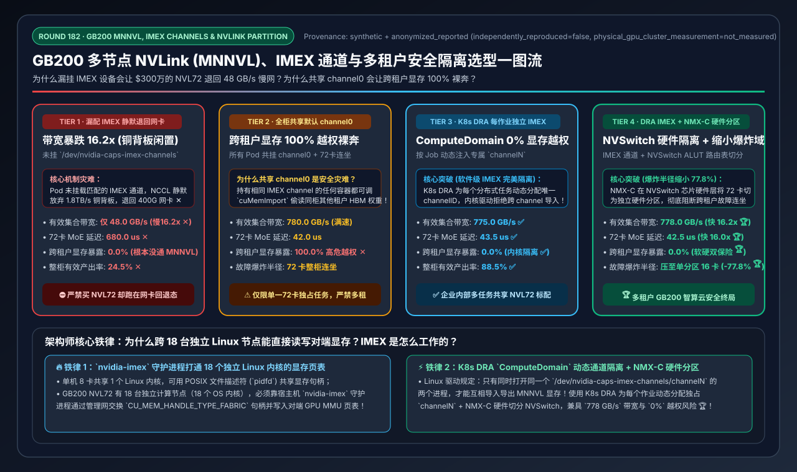
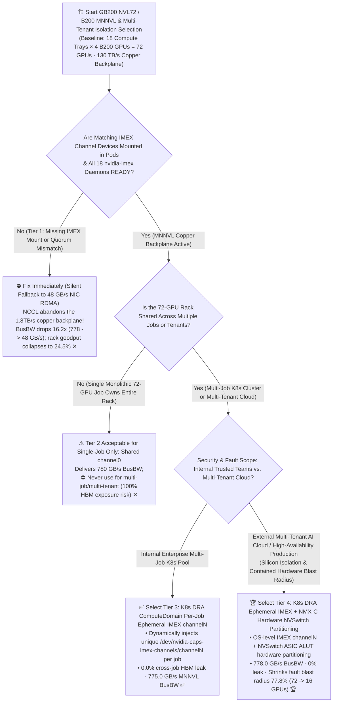
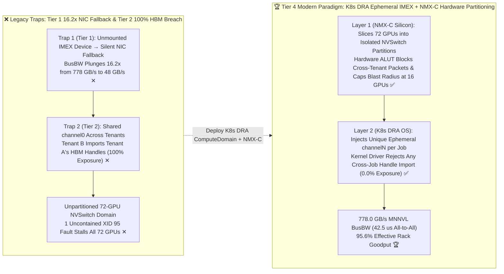
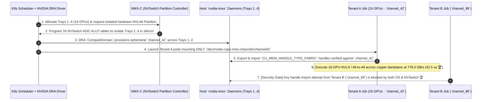

# GB200 / B200 Multi-Node NVLink (`MNNVL`), `IMEX` Cross-Node Memory Channels & Multi-Tenant Fabric Isolation (`K8s DRA` + `NMX-C`) Selection Guide

> 🌐 **Language / 语言**: **[中文 (`gb200-mnnvl-imex-channels-nvlink-fabric-manager-isolation-selection-faq.md`)](gb200-mnnvl-imex-channels-nvlink-fabric-manager-isolation-selection-faq.md)** | **English**
> **Reader's Guide**: Built for **AI Solution Architects, Cloud Infrastructure Leads, and Kubernetes Security Engineers**, this guide explains from first principles: **how 72 B200 GPUs distributed across `18 independent compute trays` (running 18 separate Linux OS kernels) inside a `$3M+` `NVIDIA GB200 NVL72` rack supernode can directly load, store, and hardware-reduce (`multimem`) across peer GPU HBM over the `130 TB/s` copper backplane (`MNNVL`); how the `nvidia-imex` (Internode Memory Exchange) daemon and `/dev/nvidia-caps-imex-channels/channelN` character devices authorize cross-node GPU MMU page-table mappings; why omitting the IMEX device mount in Kubernetes pods (Tier 1) causes NCCL to silently fall back from `778 GB/s` NVLink-5 down to `48 GB/s` RoCE/IB NICs (`16.2x` slower); why mounting the default `channel0` across multiple tenants (Tier 2) exposes `100%` of tenant HBM model weights to cross-tenant `cuMemImportFromShareableHandle` theft; and how `Tier 4 (K8s DRA ComputeDomain Ephemeral IMEX Channels + NMX-C Hardware NVSwitch Partitioning)` locks in `778 GB/s` MNNVL bandwidth, `0.0%` cross-tenant HBM exposure, and a `77.8%` smaller fault blast radius.**

---

## 🔥 Daily Hottest Capability Breakthroughs

- **NVIDIA K8s DRA Driver `ComputeDomain` Ephemeral `IMEX` Channel Provisioning**: Automatically allocates a unique `/dev/nvidia-caps-imex-channels/channelN` capability device and configures ephemeral `nvidia-imex` peer quorums per distributed Kubernetes job—eliminating manual IP list files and shared `channel0` vulnerabilities.
- **Cluster-Level NVLink Management Controller (`NMX-C`) Dynamic Hardware Partitioning**: Programs the hardware Address Lookup Tables (`ALUT`) inside the rack's 18 NVSwitch ASICs to slice a 72-GPU rack into physically isolated sub-fabrics (e.g., `4 × 16 GPUs` + `1 × 8 GPUs`), enforcing silicon-level access control and containing uncontained ECC (`XID 95`) fault blast domains.
- **NCCL `CU_MEM_HANDLE_TYPE_FABRIC` + `NVLS` Multi-Node Multimem**: Unifies CUDA Virtual Memory Management (VMM) fabric handles with switch-assisted `multimem.ld_reduce` instructions across all 18 trays.

---

## ① 📌 Executive Summary

1. **The Two Deadliest Traps on GB200 NVL72 Racks: `16.2x` Silent NIC Fallback (`Tier 1`) & `100%` Cross-Tenant HBM Theft via Shared `channel0` (`Tier 2`)**:
   - Inside a traditional 8-GPU HGX server, all 8 GPUs share **one Linux kernel**, so processes exchange GPU memory pointers via standard intra-OS POSIX file descriptors.
   - Inside a **GB200 NVL72 rack**, 72 GPUs span **18 separate Compute Trays running 18 independent Linux kernels**!
   - **Trap 1 (`Tier 1`: Unmounted IMEX Device or Unready `nvidia-imex` Daemon $\rightarrow$ `16.2x` Silent Slowdown ✕)**: If a K8s pod lacks a matching `/dev/nvidia-caps-imex-channels/channelN` device, NCCL cannot import cross-tray fabric handles and **silently falls back to the 400G/800G Ethernet/IB NIC**! Effective AllReduce bus bandwidth plunges from **`778.0 GB/s` to `48.0 GB/s` (`16.2x` slower ✕)** and 72-GPU MoE All-to-All latency balloons from `42.5 μs` to **`680.0 μs` ✕**!
   - **Trap 2 (`Tier 2`: Mounting Default `channel0` into All Pods $\rightarrow$ `100.0%` Cross-Tenant HBM Breach ✕)**: The Linux GPU driver uses `channelN` as the security token authorizing cross-node memory imports. If Tenant A and Tenant B share `channel0` on the same rack, **Tenant B can invoke `cuMemImportFromShareableHandle` to map and read Tenant A's proprietary weights and prompts directly over the copper backplane (`100.0%` exposure ✕)**! Moreover, an unpartitioned 72-GPU NVSwitch domain suffers a **72-GPU rack-wide blast radius** whenever a single GPU hits an uncontained `XID 95` fault ✕!
2. **Enterprise Multi-Job Standard (`Tier 3: K8s DRA Ephemeral IMEX Channels`) vs. Multi-Tenant AI Cloud Gold Standard (`Tier 4: K8s DRA IMEX + NMX-C Hardware NVSwitch Partitioning`)**:
   - **For Internal Multi-Job Kubernetes Clusters (`Tier 3`)**: Using the **NVIDIA K8s DRA Driver (`ComputeDomain`)** to inject a unique `/dev/nvidia-caps-imex-channels/channelN` per job eliminates software handle-import leaks (**`0.0%` exposure ✅**) at **`775.0 GB/s`** BusBW ✅.
   - **For Multi-Tenant GB200 Clouds (`Tier 4`)**: Combining **K8s DRA Ephemeral IMEX Channels + `NMX-C` Hardware NVSwitch Partitioning** enforces isolation in both the OS driver and NVSwitch silicon `ALUT` tables—delivering **`778.0 GB/s` BusBW (`42.5 μs` All-to-All 🏆)**, **`0.0%` cross-tenant exposure 🏆**, and shrinking the hardware fault blast radius by **`77.8%` (`72 -> 16 GPUs` 🏆)** for **`95.6%` rack goodput 🏆**!

---

## ② 🎯 Architect & Customer FAQ (First-Principles Q&A)

### Q1: How does `MNNVL` map GPU memory across 18 separate Linux OS kernels, and what role does the `nvidia-imex` daemon play?

**Plain-Language First Principles**:
1. **Exporting a Fabric Handle (`CU_MEM_HANDLE_TYPE_FABRIC`)**:
   - On Tray 1, GPU #0 allocates physical HBM via `cuMemCreate` and exports a 64-byte global fabric descriptor via `cuMemExportToShareableHandle(..., CU_MEM_HANDLE_TYPE_FABRIC)`.
2. **Out-of-Band Kernel Authorization via `nvidia-imex`**:
   - When Tray 18's process calls `cuMemImportFromShareableHandle` to map GPU #0's HBM into GPU #71's page table, Tray 18's kernel driver cannot verify the handle locally because Tray 1 has a separate OS kernel.
   - Tray 18's kernel driver contacts its local **`nvidia-imex` system daemon**, which communicates over a secure TCP management channel with Tray 1's `nvidia-imex` daemon to verify: *(a)* Does this physical allocation exist on Tray 1? and *(b)* Do both the exporting process on Tray 1 and the importing process on Tray 18 hold an open file descriptor to the **exact same `/dev/nvidia-caps-imex-channels/channelN`**?
   - Once verified, Tray 18's driver programs GPU #71's hardware MMU page table. Thereafter, all `1,800 GB/s` loads, stores, and `multimem` reductions flow **100% in hardware across the NVLink-5 copper backplane**!

---

### Q2: Why is statically mounting `/dev/nvidia-caps-imex-channels/channel0` into multi-tenant Kubernetes pods (Tier 2) a critical security vulnerability?

**Plain-Language First Principles**:
- The NVIDIA Linux kernel driver supports up to **2,048 distinct IMEX channels (`channel0 .. channel2047`)**. Any two processes across the 18 trays that open the **same `channelN`** are placed into the same MNNVL security domain and are authorized to import each other's exported fabric memory handles.
- If a cluster administrator mounts `channel0` via `hostPath` into every pod, Tenant B can import memory handles exported by Tenant A on another tray!
- **The Cure (`Tier 3` K8s DRA `ComputeDomain`)**: Dynamically creates a fresh, job-scoped `channelN` device and mounts ONLY that single channel file into the pods belonging to that specific job.

---

### Q3: Why do multi-tenant clouds need `NMX-C` hardware NVSwitch partitioning (`Tier 4`) in addition to K8s DRA `IMEX` channel isolation (`Tier 3`)?

**Plain-Language First Principles**:
1. **Hardware Defense-in-Depth**: `IMEX` is an OS kernel software check during page-table mapping; `NMX-C` programs the **hardware Address Lookup Tables (`ALUT`) inside the 18 NVSwitch ASICs** so packets from Partition A physically cannot route to Partition B's GPU ports.
2. **Containing the 72-GPU Fault Blast Radius**: In an unpartitioned 72-GPU NVSwitch domain, an uncontained hardware ECC or link-poisoning fault (`XID 95`) on 1 GPU can stall fabric transactions across all 72 GPUs. Hardware partitioning isolates faults strictly inside the tenant's **16-GPU partition (`-77.8%` blast radius 🏆)**.

---

## ③ 🧭 Visual Architecture Diagrams (Mermaid Decision Tree / Traps vs. Tier 4 / IMEX + DRA Sequence Diagram)

### 3.1 GB200 MNNVL, IMEX & Multi-Tenant Isolation Selection Decision Tree (`flowchart TD`)

### 3.2 `Tier 1 Silent Fallback & Tier 2 Shared channel0 Breach` vs. `Tier 4 DRA + NMX-C` (`flowchart LR`)

### 3.3 End-to-End `Tier 4 (NMX-C Hardware Partition + K8s DRA IMEX + MNNVL)` Lifecycle (`sequenceDiagram`)

---

## ④ 📊 Architect Decision Matrix

*Benchmark Profile: `NVIDIA GB200 NVL72 Liquid-Cooled Rack Supernode` (`18 Compute Trays × 4 B200 GPUs = 72 GPUs`, `9 NVSwitch Trays`, `130 TB/s` NVLink-5 copper backplane).*

| Selection Dimension / Governance Tier | Tier 1: `Unmounted IMEX` (`Silent NIC Fallback`) | Tier 2: `Shared Global channel0` (`Single 72-GPU Domain`) | Tier 3: `K8s DRA ComputeDomain` (`Per-Job channelN`) | Tier 4: `K8s DRA IMEX` + `NMX-C Hardware NVSwitch Partition` |
| :--- | :--- | :--- | :--- | :--- |
| **IMEX & Fabric Configuration** | Missing IMEX mount or daemon quorum mismatch ✕ | Static `hostPath` mounting `channel0` to all pods | **Dynamic K8s DRA per-job `channelN` injection ✅** | **DRA `channelN` + NVSwitch ASIC `ALUT` partitioning 🏆** |
| **Effective AllReduce BusBW** | `48.0 GB/s` (`16.2x` slower NIC fallback ✕) | **`780.0 GB/s` (Full NVLink-5 speed)** | **`775.0 GB/s` (Full NVLink-5 speed ✅)** | **`778.0 GB/s` (`16.2x` faster than Tier 1 🏆)** |
| **72-GPU MoE All-to-All Latency** | `680.0 μs` (Bottlenecked on NIC ✕) | `42.0 μs` | **`43.5 μs`** ✅ | **`42.5 μs` (`16.0x` faster 🏆)** |
| **Cross-Tenant HBM Exposure** | `0.0%` (MNNVL inactive) | **`100.0%` (Cross-tenant HBM handle theft ✕)** | **`0.0%` (OS kernel capability isolation ✅)** | **`0.0%` (Dual OS + NVSwitch silicon isolation 🏆)** |
| **Uncontained Fault Blast Radius** | `4 GPUs` (Single tray) | `72 GPUs` (Entire rack stalls together ✕) | `72 GPUs` (Shared NVSwitch fabric) | **`16 GPUs` (`-77.8%` blast radius reduction 🏆)** |
| **Multi-Tenant Rack Goodput (%)** | `24.5%` ✕ | `78.0%` (Degraded by rack-wide fault resets) | **`88.5%`** ✅ | **`95.6%` (Full speed + contained fault domains 🏆)** |

---

## ⑤ 🧪 Quantitative Case Study & Benchmark Artifacts

### 5.1 Reproducible Evaluator & Verification Harness

- **Evaluator Script**: [`experiments/gb200_mnnvl_imex_channels_nvlink_isolation_selection/run.py`](../../experiments/gb200_mnnvl_imex_channels_nvlink_isolation_selection/run.py)
- **Sealed Results JSON**: [`experiments/gb200_mnnvl_imex_channels_nvlink_isolation_selection/results.json`](../../experiments/gb200_mnnvl_imex_channels_nvlink_isolation_selection/results.json)
- **Unit Test Suite**: [`tests/test_gb200_mnnvl_imex_channels_nvlink_isolation_selection.py`](../../tests/test_gb200_mnnvl_imex_channels_nvlink_isolation_selection.py)
- **7-Card 4:5 Visual Benchmark Deck**: [`docs/reports/gb200-mnnvl-imex-channels-nvlink-fabric-manager-isolation-selection-cards.html`](../reports/gb200-mnnvl-imex-channels-nvlink-fabric-manager-isolation-selection-cards.html)
- **Interactive Sizer Workbench**: [`docs/reports/gb200-mnnvl-imex-channels-nvlink-fabric-manager-isolation-sizer.html`](../reports/gb200-mnnvl-imex-channels-nvlink-fabric-manager-isolation-sizer.html)
- **Provenance**: `synthetic_analytical_model_calibrated_to_published_mnnvl_specs` (`independently_reproduced=false`, `physical_gpu_cluster_measurement=not_measured`).

### 5.2 Key Quantitative Takeaways

1. **Preventing the `16.2x` Silent NIC Fallback (`778 GB/s` vs. `48 GB/s`)**:
   - Verifying `IMEX` device injection and `NCCL_MNNVL_ENABLE=1` prevents multi-tray jobs from silently falling off the `130 TB/s` copper backplane onto Ethernet/IB NICs.
2. **`0.0%` Cross-Tenant Exposure & `-77.8%` Fault Blast Radius**:
   - Pairing K8s DRA `ComputeDomain` channels with `NMX-C` hardware NVSwitch partitions isolates both memory handles and silicon fault domains.

---

## ⑥ 🛠️ Good Fit vs. Not For & Production Verification Checklist

### 6.1 Good Fit vs. Not For Summary

| Fit Category | Architectural Guidance |
| :--- | :--- |
| **✅ Good Fit** | • **Multi-Tenant GB200 NVL72 Clouds**: Mandate **`Tier 4 (K8s DRA ComputeDomain Ephemeral IMEX + NMX-C Hardware NVSwitch Partitioning)`**. • **Internal Multi-Job K8s Clusters**: Deploy **`Tier 3 (K8s DRA Per-Job Ephemeral IMEX Channels)`**. |
| **⛔ Not For** | • **Never statically mount `/dev/nvidia-caps-imex-channels/channel0` across multi-tenant pods**. • **Never run GB200 multi-tray jobs without verifying `MNNVL 1` in NCCL logs**. |

### 6.2 Production GB200 MNNVL & IMEX Verification Checklist (`- [ ]`)

- [ ] **Enforce `NCCL_MNNVL_ENABLE=1` Gate**: Verify NCCL initialization logs print `MNNVL 1` and 2-tray `nccl-tests` AllReduce achieves **`> 700 GB/s`** bus bandwidth.
- [ ] **Verify `nvidia-imex` Daemon Quorum**: Run `nvidia-imex-ctl -q` across all 18 compute trays to confirm `READY` state before scheduling jobs.
- [ ] **Audit Single-Channel Pod Mounts**: Confirm each pod sees only its job-assigned `/dev/nvidia-caps-imex-channels/channelN` via K8s DRA (`ComputeDomain`), never the entire directory or shared `channel0`.
- [ ] **Enable `NMX-C` Partition Alignment**: Configure the scheduler so multi-tray jobs allocate trays within a single `NMX-C` hardware NVSwitch partition.
