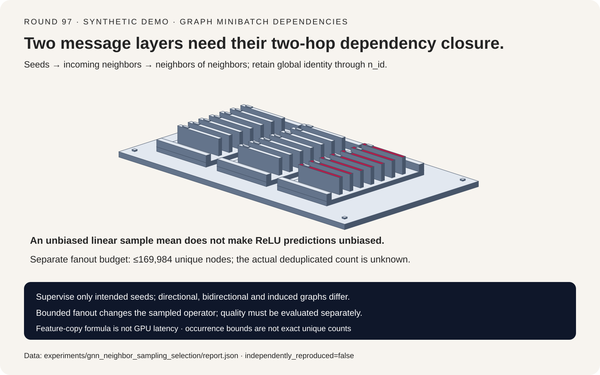
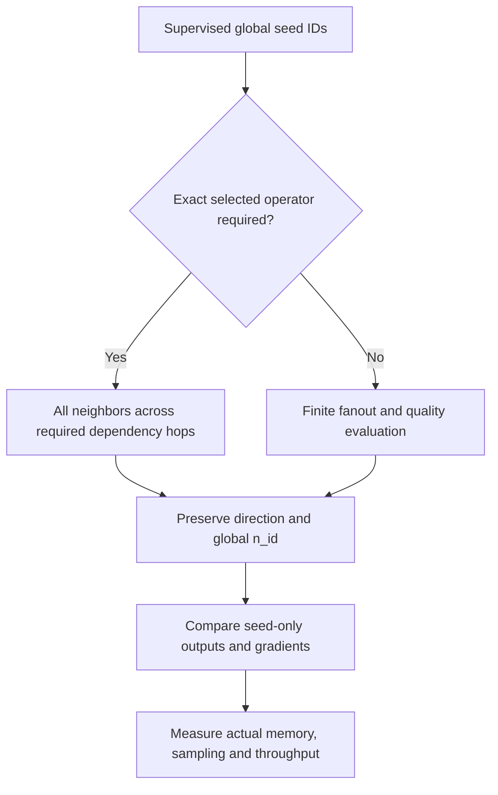
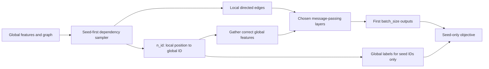
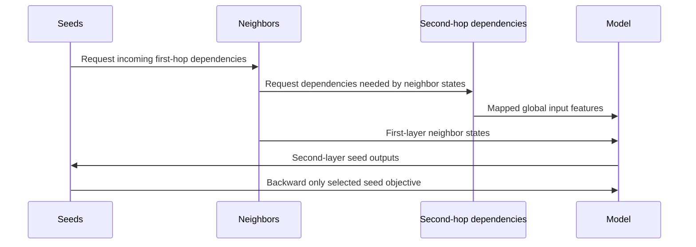

# GNN neighbor sampling FAQ: dependency hops, seed identity and fanout bias

> **Language**: [中文](gnn-neighbor-sampling-dependency-fanout-selection-faq.md) | English
>
> **Round 97 · 2026-11-14 (sixth round of the November 13 night)** · [SVG](../../assets/svg/gnn-neighbor-sampling-dependency-fanout-selection-faq-summary.svg) · [7-card report](../reports/gnn-neighbor-sampling-dependency-fanout-selection-cards.html) · [H5 workbench](../reports/gnn-neighbor-sampling-dependency-fanout-sizer.html) · [Sealed report](../../experiments/gnn_neighbor_sampling_selection/report.json)
>
> **Synthetic, `independently_reproduced=false`.** Original scalar numerical model and exact subset enumeration, not PyG execution, measured GPU latency, trained-model accuracy or a claim of a new release.



## 1. Executive summary: sampling is an operator choice, not just a smaller tensor

Neighbor sampling makes large-graph minibatches possible by collecting bounded
dependencies around supervised seed nodes. A correct implementation must keep
**dependency depth, message direction, global feature identity and seed-only
supervision** consistent. Shape agreement alone proves none of them.

| Choice | Intended meaning | Required check |
| :--- | :--- | :--- |
| All neighbors for each required hop | Preserve the chosen full-graph seed operator | Seed outputs and feature gradients |
| Finite per-hop fanout | Approximate that operator on sampled dependencies | Quality, variance, actual unique nodes and throughput |
| Bidirectional/induced subgraph | Change which local edges participate | Compatibility with the intended message-passing semantics |

The original seven-node, two-feature, two-layer example has exact full-neighbor
seed parity. Supplying only one dependency hop causes maximum output error
`0.1963333333`; indexing global features with local IDs causes `0.6808333333`.
Finite fanout `[1,1]` differs by `1.0423333333`, but is explicitly an
**intentional approximation**, not a failed exactness implementation.

This study extends the preceding sparse-table study from independent categorical
bags to recursively dependent graph neighborhoods. The inspected
[NeighborLoader source](https://github.com/pyg-team/pytorch_geometric/blob/5570242624e163e541716a993918b7d534de6369/torch_geometric/loader/neighbor_loader.py)
is pinned to November 18, 2024. These are established architectural contracts,
not evidence of a trending November 2026 capability launch.

## 2. Architect Q&A: what does a sampled minibatch actually represent?

### Q1: Why does a two-layer GNN need two dependency hops?

For incoming-neighbor mean aggregation, this harness computes:

```text
h_next[i] = ReLU(Wself h[i] + Wneighbor mean(h[incoming[i]]) + bias)
```

The second-layer seed output depends on first-layer neighbor states. Those
states depend on their own incoming neighbors. An additional tensor layer
cannot recreate edges omitted by the sampler.

The fixture uses global seeds `[4,1]`. Full-neighbor closure yields seed
outputs `[[1.0696666666666665,0.664],[1.1388333333333331,0.0]]`.
The original backward implementation agrees with independent central
differences to less than `1e-8` across all 14 input-feature coordinates.
This is not a distributed-autograd or PyG-kernel verification.

### Q2: Are local IDs sufficient to fetch features and labels?

No. The pinned loader documents seed-first order: the first `batch_size`
sampled nodes are the seeds, and `n_id` maps sampled local positions to
global graph IDs. The matching pattern is:

```text
local_x = global_x[n_id]
seed_prediction = local_prediction[:batch_size]
seed_label = global_y[n_id[:batch_size]]
```

The toy explicitly maps between these spaces. Its wrong-ID control uses
global feature rows selected by local positions, keeps compatible shapes,
and still changes seed outputs. Loss on every sampled node would also change
the supervised objective; the experiment uses only the chosen seed outputs.
It does not train a classifier or report label accuracy.

### Q3: Is sampled mean divided by the full graph degree?

For the chosen sampled-mean operator, divide by the number of retained
neighbors. Dividing by the full degree instead changes that operator.
The control differs by `1.0631111111` **against the same sampled edges**.
Its reference is not the full-graph output.

Importance-weighted estimators and other aggregation definitions can have
different normalization contracts. That possibility does not justify
silently swapping denominators in an ordinary sampled mean.

### Q4: Does an unbiased sample mean imply an unbiased GNN prediction?

No. Consider neighbors `[-2,1,1]` and enumerate every uniformly selected
subset of a fixed size, without replacement:

| Fanout | Expected sample mean | ReLU(full mean) | Expected ReLU(sample mean) |
| ---: | ---: | ---: | ---: |
| 1 | `0` | `0` | `2/3` |
| 2 | `0` | `0` | `1/3` |
| 3 | `0` | `0` | `0` |

Expectation does not commute with the nonlinearity. These are exact scalar
activation values, not accuracy points or evidence a trained sampled model
performs worse.

**Two experiments must not be conflated:** the main graph fixture selects
the first neighbors deterministically for reproducibility; only this separate
subset enumeration represents uniform sampling. No statistical uniformity
claim is made for the deterministic toy sampler.

### Q5: Can reversing edges or adding reverse edges repair missing hops?

Not generally. Directional, bidirectional and induced policies define
different local edge sets. Reversing the fixture's message direction
changes seed outputs by `0.737`. That control illustrates a changed
operator, not an upstream bug or a statement that all bidirectional
configurations are incorrect.

The correct policy depends on graph meaning and model design. Treating a
directed citation, transaction or dependency graph as undirected is a
semantic decision; it must not be hidden inside a memory optimization.

## 3. Visual architecture: selection, ID mapping and dependency expansion







## 4. Selection matrix and memory-bound interpretation

| Requirement | Evaluate | Do not assume |
| :--- | :--- | :--- |
| Reproduce full-graph seed output | Complete dependency closure | More local layers restore missing edges |
| Limit feature gathering | Per-hop fanout and feature caching | Fanout occurrences equal actual unique nodes |
| Directed graph semantics | Explicit incoming/outgoing policy | Reversing edges is harmless |
| Stable supervised objective | Seed ID/label mapping | Every sampled node is a training seed |
| Distributed graph execution | Partition placement and feature ownership | This local model verifies network routing |

For seed count `B` and fanouts `f1,...,fL`, a no-replacement dependency
occurrence bound is:

```text
occurrences <= B * (1 + f1 + f1*f2 + ... + f1*...*fL)
unique_node_upper_bound = min(graph_nodes, occurrences)
feature_subset_bytes <= unique_node_upper_bound * dimensions * scalar_bytes
```

Overlapping neighborhoods, degree limits and repeated discoveries can lower
the actual count. The workbench leaves **actual unique count null**.
It does not infer a deduplication ratio from fanouts.

For one million graph nodes, 1,024 seeds, fanouts `(15,10)`, 128 dimensions
and two-byte feature scalars, the bound is `169,984` nodes and
`43,515,904` feature bytes, versus `256,000,000` full-graph feature bytes.
Adjacency, edge indices, parameters, hidden activations, gradients,
framework allocations and sampler scratch space are excluded.

## 5. Worked evaluation and seven-card report

| Case | Maximum output difference | Reference and interpretation |
| :--- | ---: | :--- |
| Full-neighbor closure | `0` | Full-graph seeds; exact gate passes |
| One hop for two layers | `0.1963333333` | Missing dependencies |
| Wrong feature-ID space | `0.6808333333` | Misindexed features |
| Reverse message direction | `0.737` | Changed directed operator |
| Deterministic fanout `[1,1]` | `1.0423333333` | Intentional approximation |
| Sample mean / full degree | `1.0631111111` | Wrong divisor for the same sampled edges |

The seven cards separate contract gates, the exact nonlinear counterexample
and a transfer-only budget. At an **assumed** `50 GB/s` uncached transfer
rate and `10 µs` setup, the default feature subset bound takes
`0.88031808 ms` and the full feature table takes `5.13 ms`.
These are deterministic byte-transfer formulas, not measured batching
latency, sampled-node counts, GPU speedup or end-to-end execution.
Sampling, adjacency access and model compute remain unmeasured.

The SVG is original shared dependency-sorter geometry. The H5 calculator
supports light/dark themes and validates graph size, seed count and fanouts.
No browser visual inspection was performed: the earlier browser approval
was denied and no alternate browser route was used.

## 6. Reproduction, provenance and readiness boundaries

```powershell
python -m experiments.gnn_neighbor_sampling_selection.run
python -m experiments.gnn_neighbor_sampling_selection.run --check
python -m unittest tests.test_gnn_neighbor_sampling_selection
python scripts\validate_research.py
```

Eight focused tests cover closure and IDs, feature gradients, incorrect
controls, exact subset enumeration, bounds, isolated nodes/invalid inputs,
sealed output/CSP/SVG structure and Python/Node calculator parity.
The static report uses `default-src 'none'; style-src 'unsafe-inline'`;
no external scripts, fonts or requests are embedded.

First-party reference:
[PyG NeighborLoader, pinned source](https://github.com/pyg-team/pytorch_geometric/blob/5570242624e163e541716a993918b7d534de6369/torch_geometric/loader/neighbor_loader.py)
and [MIT license](https://github.com/pyg-team/pytorch_geometric/blob/5570242624e163e541716a993918b7d534de6369/LICENSE).
The repository's original formulas do not copy source implementation.
The loader documentation supports the stated fanout, hop, seed and ID
contracts, not performance or quality guarantees.

**Ready for:** reviewing dependency depth, indexing and budget assumptions.
**Not ready for:** choosing production fanouts, claiming unbiased trained
predictions, predicting PyG/GPU throughput, or certifying a distributed
graph-training stack without real workload measurements.
