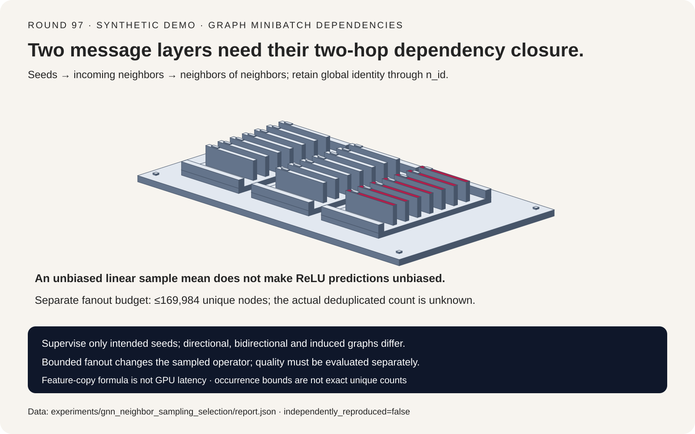
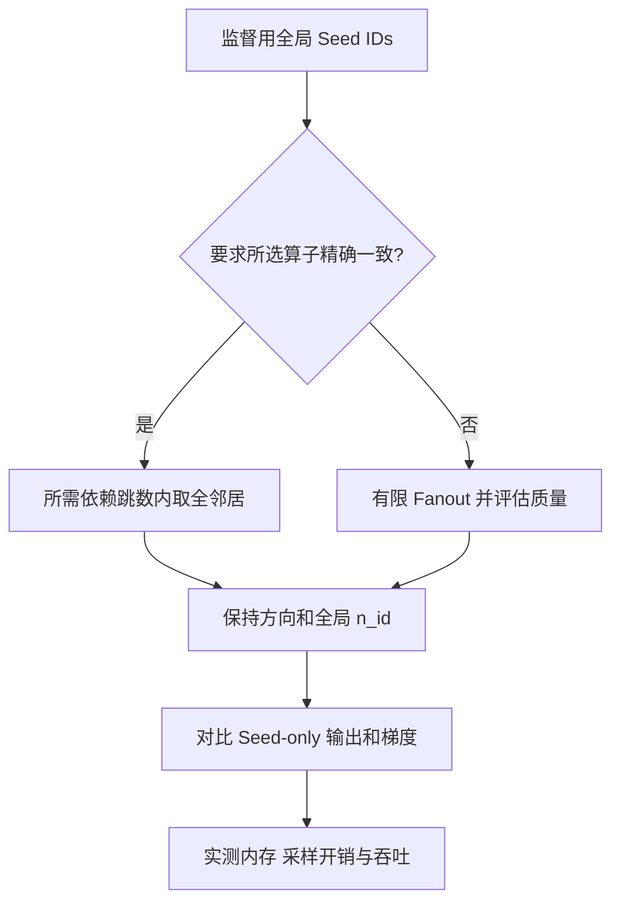
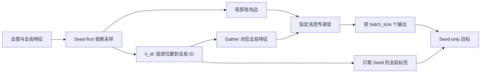
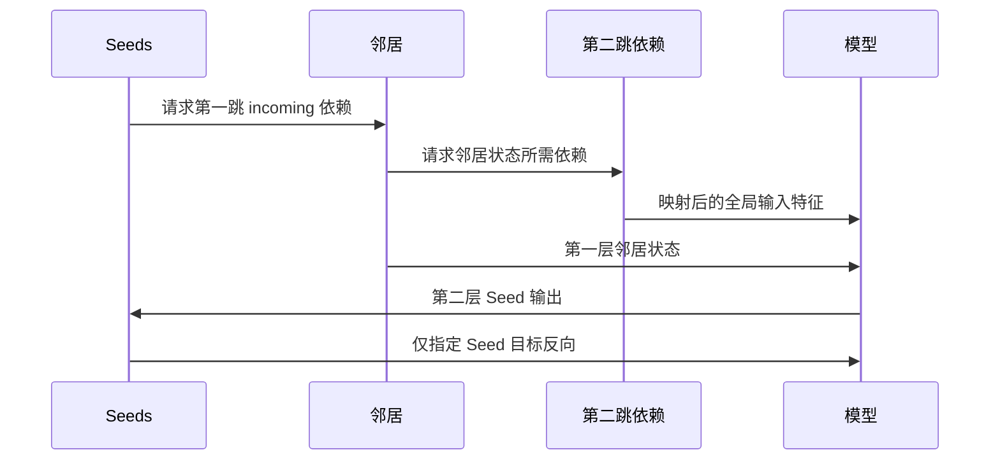

# GNN 邻居采样选型 FAQ：依赖跳数、Seed 身份与 Fanout 偏差

> **语言**：中文 | [English](gnn-neighbor-sampling-dependency-fanout-selection-faq.en.md)
>
> **Round 97 · 2026-11-14（11 月 13 日夜班第六轮）** · [SVG](../../assets/svg/gnn-neighbor-sampling-dependency-fanout-selection-faq-summary.svg) · [七卡报告](../reports/gnn-neighbor-sampling-dependency-fanout-selection-cards.html) · [H5 工作台](../reports/gnn-neighbor-sampling-dependency-fanout-sizer.html) · [封存数据](../../experiments/gnn_neighbor_sampling_selection/report.json)
>
> **Synthetic，`independently_reproduced=false`。** 原创标量数值模型与完整子集枚举，不是 PyG 实测、GPU 延迟、训练准确率，也不冒充新发布能力。



## 一、先说结论：采样改变的不只是张量大小

邻居采样围绕监督 seed 收集有限依赖，使大图 minibatch 成为可能。
但实现必须同时保持 **依赖深度、消息方向、全局特征身份与 seed-only
监督**。张量 shape 相同不能证明这些语义正确。

| 选择 | 目标 | 验证门槛 |
| :--- | :--- | :--- |
| 每个所需依赖 hop 保留全邻居 | 保持所选全图 seed 算子 | Seed 输出和特征梯度 |
| 逐 hop 有限 fanout | 在采样依赖上近似原算子 | 质量、方差、真实唯一节点数与吞吐 |
| 双向或 induced 子图 | 改变局部参与消息的边集 | 是否符合模型与图的语义 |

原创 fixture 使用七个节点、二维特征、两层消息传递。完整依赖闭包与全图
seed 输出完全相同；少一跳导致最大输出误差 `0.1963333333`，把 local ID
误当 global ID 取特征导致 `0.6808333333`。有限 fanout `[1,1]` 与全图相差
`1.0423333333`，但明确标为 **有意近似**，不是“精确实现失败”。

本轮将上一轮独立类别 bag 的 pooling，推进到具有递归依赖的图邻域。
所阅读的 [NeighborLoader 固定源码](https://github.com/pyg-team/pytorch_geometric/blob/5570242624e163e541716a993918b7d534de6369/torch_geometric/loader/neighbor_loader.py)
对应 2024-11-18：这是成熟的底层架构契约，不声称是 2026 年当日热点新发布。

## 二、架构师 Q&A：一个采样 minibatch 到底表示什么？

### Q1：为什么两层 GNN 需要两跳依赖？

本模型采用 incoming-neighbor mean：

```text
h_next[i] = ReLU(Wself h[i] + Wneighbor mean(h[incoming[i]]) + bias)
```

Seed 的第二层输出依赖邻居第一层状态；邻居第一层又依赖它自己的输入
邻居。只在一跳 directional 子图上多算一层，不能补出被漏掉的边。

全局 seeds 为 `[4,1]`，完整依赖输出为
`[[1.0696666666666665,0.664],[1.1388333333333331,0.0]]`。
原创 backward 与独立中心有限差分在全部 14 个输入特征坐标上误差小于
`1e-8`。这不代表验证了 PyG kernel 或分布式 autograd。

### Q2：Local ID 可以直接用来取全局特征、标签吗？

不能。固定 loader 文档约定 seed-first：前 `batch_size` 个采样节点是
seeds；`n_id` 将局部位置映射到全局图 ID。正确模式是：

```text
local_x = global_x[n_id]
seed_prediction = local_prediction[:batch_size]
seed_label = global_y[n_id[:batch_size]]
```

错误 ID control 直接按 local position 取全局特征，输出 shape 不变，
数值却改变。对全部 sampled nodes 计算 loss 也会改变监督目标。本实验
只使用指定 seed 输出；没有训练分类器，没有 label accuracy 指标。

### Q3：Sampled mean 应该除以全图 degree 吗？

对本轮选定的 sampled-mean 算子，应除以保留邻居数。改除全图 degree
会改变算子。错误 control 与 **同一组采样边** 的正确 sampled mean 相差
`1.0631111111`；这行的参照不是全图输出。

Importance-weighted estimator 等其他聚合定义可以有不同归一化契约，
但不能据此在普通 sampled mean 中暗换分母。

### Q4：邻居均值无偏，GNN 预测也无偏吗？

不成立。对邻居值 `[-2,1,1]`，等概率、不放回，完整枚举给定大小子集：

| Fanout | 采样均值的期望 | ReLU(全邻居均值) | ReLU(采样均值) 的期望 |
| ---: | ---: | ---: | ---: |
| 1 | `0` | `0` | `2/3` |
| 2 | `0` | `0` | `1/3` |
| 3 | `0` | `0` | `0` |

非线性与期望不可交换。这些是精确标量 activation，不是准确率百分点，
不能据此断言训练后的 sampled GNN 质量更差。

**注意实验分界**：主图 fixture 为可复现而确定性选取前几个邻居；
只有独立子集枚举采用 uniform sampling 的概率解释。不能把 toy sampler
包装成均匀采样后端。

### Q5：反转边、补反向边可以修复少跳吗？

通常不能。Directional、bidirectional、induced 对应不同局部边集。
反转 fixture 的消息方向改变输出 `0.737`；这是算子改变的示范，不是
上游 bug，也不是说所有双向配置都错。

有向交易、引用、依赖图是否可当作无向图，是语义与模型设计决策，
不能藏在“内存优化”之中。

## 三、可视化架构：选型树、ID 映射与依赖展开







## 四、选型矩阵与内存上界边界

| 需求 | 应评估 | 不可默认 |
| :--- | :--- | :--- |
| 重现全图 seed 输出 | 完整依赖闭包 | 多算局部层就能补边 |
| 限制 feature gathering | Fanout、特征缓存 | 邻居 occurrence 等于真实唯一节点 |
| 保持有向语义 | 显式 incoming/outgoing 策略 | 反转边不影响模型 |
| 保持监督目标 | Seed ID 与标签映射 | 每个 sampled node 都是训练 seed |
| 分布式图训练 | 分区、特征 owner 与路由 | 本地模型验证了网络栈 |

对 seed 数 `B` 与 fanouts `f1,...,fL`，不放回依赖 occurrence 上界为：

```text
occurrences <= B * (1 + f1 + f1*f2 + ... + f1*...*fL)
unique_node_upper_bound = min(graph_nodes, occurrences)
feature_subset_bytes <= unique_node_upper_bound * dimensions * scalar_bytes
```

邻域重叠、度数限制、重复发现均可能降低真实节点数。工作台将 **actual
unique count 留为 null**，不从 fanout 假造去重率。

默认百万节点图、1,024 seeds、fanouts `(15,10)`、128 维、每标量两字节，
上界 `169,984` 节点、`43,515,904` feature bytes；全图为 `256,000,000`
bytes。不含邻接、edge indices、参数、中间 activation、梯度、框架
分配或 sampler scratch，不能称为峰值 HBM。

## 五、可复现实例与七卡报告

| Case | 最大输出差异 | 参照与解释 |
| :--- | ---: | :--- |
| 完整全邻居闭包 | `0` | 对全图 seeds，精确门槛通过 |
| 两层只采一跳 | `0.1963333333` | 丢依赖 |
| 错误特征 ID 空间 | `0.6808333333` | 取错 feature |
| 反转消息方向 | `0.737` | 改变有向算子 |
| 确定性 fanout `[1,1]` | `1.0423333333` | 有意近似 |
| Sample mean 除全图 degree | `1.0631111111` | 对同一采样边集，用错分母 |

七卡分别呈现契约验证、非线性反例与 transfer-only 预算。**假设**
未缓存传输 `50 GB/s`、启动 `10 µs`，默认 feature 子集上界的传输时间为
`0.88031808 ms`，全图为 `5.13 ms`。这些是确定性字节公式，不是 batching
实测、真实采样节点数、GPU 加速比或端到端延迟。Sampling、邻接访问与
模型计算仍未测量。

SVG 使用原创共享依赖分拣机几何；H5 提供双语、明暗主题及图大小、seed、
fanout 校验。此前浏览器审批被拒，本轮没有绕路做浏览器视觉验收。

## 六、复现、来源与生产就绪边界

```powershell
python -m experiments.gnn_neighbor_sampling_selection.run
python -m experiments.gnn_neighbor_sampling_selection.run --check
python -m unittest tests.test_gnn_neighbor_sampling_selection
python scripts\validate_research.py
```

八项测试覆盖闭包与 ID、特征梯度、错误 controls、精确子集枚举、预算
上界、孤立节点/非法输入、封存产物/CSP/SVG 与 Python/Node 计算器一致性。
静态七卡 CSP 为 `default-src 'none'; style-src 'unsafe-inline'`，
不引入外部脚本、字体或网络资源。

一手引用：[PyG NeighborLoader 固定源码](https://github.com/pyg-team/pytorch_geometric/blob/5570242624e163e541716a993918b7d534de6369/torch_geometric/loader/neighbor_loader.py)
与 [MIT 许可](https://github.com/pyg-team/pytorch_geometric/blob/5570242624e163e541716a993918b7d534de6369/LICENSE)。
原创公式未复制上游实现。Loader 文档支持所述 fanout、hop、seed 与 ID
契约，不提供本报告的性能或质量保证。

**适用**：检查依赖深度、ID 空间与预算假设。
**不适用**：替真实任务挑生产 fanout、声称训练预测无偏、预测 PyG/GPU
吞吐，或据此认证分布式图训练栈。
