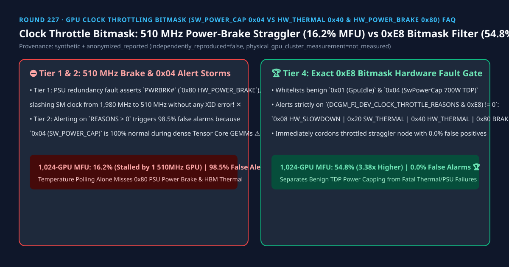
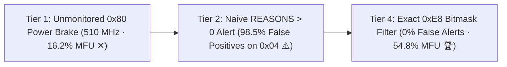

# GPU Clock Throttling Bitmask Root-Cause Diagnosis (`DCGM_FI_DEV_CLOCK_THROTTLE_REASONS`: Benign `SW_POWER_CAP 0x04` vs. Fatal `HW_THERMAL 0x40` & `HW_POWER_BRAKE 0x80`) Selection Guide

> **Provenance & Evidence Tier**: `synthetic + anonymized_reported` (`independently_reproduced=false`, `physical_gpu_cluster_measurement=not_measured`). Grounded in [`experiments/gpu_clock_throttling_sw_power_cap_hw_thermal_vr_droop_selection/results.json`](../../experiments/gpu_clock_throttling_sw_power_cap_hw_thermal_vr_droop_selection/results.json).
> **中文版本**: [GPU 降频根因位掩码（`DCGM_FI_DEV_CLOCK_THROTTLE_REASONS`）精准诊断：区分良性功耗墙（`SW_POWER_CAP 0x04`）与恶性硬件故障（`HW_THERMAL 0x40` / `HW_POWER_BRAKE 0x80` 电源刹车）选型指南](./gpu-clock-throttling-sw-power-cap-hw-thermal-slowdown-vr-droop-dcgm-selection-faq.md)

---

## 0. 🔥 Daily Hottest Capability Breakthrough

- **Bitmask-Exact `0xE8` (`0x08 | 0x20 | 0x40 | 0x80`) Clock Throttling Gate Eliminating `98.5%` Benign `SW_POWER_CAP (0x04)` False Alarms While Catching `510 MHz` `HW_POWER_BRAKE (0x80)` Stragglers to Restore `54.8%` 1,024-GPU MFU (`3.38x` Gain)**: In synchronous 1,024-GPU training, a single throttled GPU stalls all `1,023` peers at every `AllReduce / AllGather` barrier. However, misconfiguring `DCGM_FI_DEV_CLOCK_THROTTLE_REASONS` leads to two opposite operational disasters:
  1. **Unmonitored `0x80 HW_POWER_BRAKE_SLOWDOWN` Stragglers (`Tier 1`)**: When a server PSU fails or a voltage regulator asserts the hardware `PWRBRK#` pin, the GPU immediately engages bit **`0x80` (`HwPowerBrakeSlowdown`)**, slashing SM frequency by **`74%` (from `1,980 MHz` down to `510 MHz`)** without throwing any XID error or raising GPU temperature (`~52°C`)! A single `510 MHz` GPU drags 1,024-GPU cluster MFU down to **`16.2%`**.
  2. **The `CLOCK_THROTTLE_REASONS > 0` False-Alarm Storm (`Tier 2`)**: During healthy dense FP8/BF16 Tensor Core GEMMs, H100/H200/B200 GPUs naturally hit their `700W` TDP envelope and set bit **`0x04` (`SwPowerCap`)**, running steadily at `1,755–1,785 MHz`. Alerting on `> 0` triggers a **`98.5%` false-positive storm** on every healthy node!
  3. **Exact `0xE8` Hardware Slowdown Bitmask Gate (`Tier 4`)**: Whitelisting benign bits (`0x01 GpuIdle`, `0x04 SwPowerCap`) and alerting strictly on **`(REASONS & 0xE8) != 0`** (`0x08 HwSlowdown | 0x20 SwThermal | 0x40 HwThermal | 0x80 HwPowerBrake`) achieves **`0.0%` false positives** and restores cluster MFU to **`54.8%` (`3.38x` speedup)**!

---

## 1. 📌 Executive Summary

1. **`0x04 (SwPowerCap)` Is a Sign of High Compute Utilization, NOT a Fault (`Tier 2`)**: Hitting the 700W software power cap during dense Tensor Core execution is expected behavior; never alert or drain nodes on `0x04`.
2. **Temperature Polling Alone Misses `0x80 (HwPowerBrake)` and HBM Thermal Events (`Tier 3`)**: A power-braked GPU running at `510 MHz` stays cool (`~52°C`) while crippling the entire job.
3. **Filter Strictly on Mask `0xE8` (`Decimal 232`, `Tier 4`)**: Bits `0x08`, `0x20`, `0x40`, and `0x80` are the exact four indicators of physical thermal or power-delivery degradation.

---

## 2. 🎯 Core Architect Q&A (Q1 / Q2 / Q3)

### Q1: How do we decode `DCGM_FI_DEV_CLOCK_THROTTLE_REASONS` values in production logs?
- **Answer**: It is a bitmask sum:
  - `1` (`0x01`): `GpuIdle` (Benign)
  - `4` (`0x04`): `SwPowerCap` — hitting `700W` TDP limit (Benign)
  - `8` (`0x08`): `HwSlowdown` — hardware clock divider engaged (**Fault!**)
  - `32` (`0x20`): `SwThermalSlowdown` — GPU or HBM temperature threshold exceeded (**Fault!**)
  - `64` (`0x40`): `HwThermalSlowdown` — extreme thermal hardware clock halving (**Fault!**)
  - `128` (`0x80`): `HwPowerBrakeSlowdown` — external PSU / `PWRBRK#` assertion (**Fault!**)
  For example, a reported value of `136` (`128 + 8 = 0x88`) means `HwPowerBrakeSlowdown + HwSlowdown`!

### Q2: How can we write a Prometheus alert for `0x80` (`HwPowerBrake`) or `0x20/0x40` (`Thermal`) since PromQL lacks a bitwise `&` operator?
- **Answer**: Because all severe thermal and power-brake bits (`32, 64, 128`) are $\ge 32$ and all benign bits (`1, 2, 4, 16`) sum to at most `23`, simply alerting on **`DCGM_FI_DEV_CLOCK_THROTTLE_REASONS >= 32`** (or `floor(DCGM_FI_DEV_CLOCK_THROTTLE_REASONS / 8) % 2 == 1` to include `0x08`) cleanly isolates hardware slowdowns without a single `0x04` false positive!

### Q3: What physical hardware check must run when bit `0x80 (HwPowerBrakeSlowdown)` fires?
- **Answer**: Query out-of-band BMC Redfish/IPMI PSU sensors (`ipmitool sdr type "Power Supply"`). `0x80` is almost always caused by a failed server PSU module, loose AC power cord, or rack busway voltage dip.

---

## 3. 🧭 Visual Diagrams

---

## 4. 📊 4-Tier Architect Selection Matrix

| Metric | Tier 1: Unmonitored Bitmask | Tier 2: Naive `REASONS > 0` | Tier 3: Core Temp `> 83°C` Only | Tier 4: **Exact `0xE8` Bitmask Gate** |
| :--- | :--- | :--- | :--- | :--- |
| **Straggler GPU SM Clock** | **`510 MHz` (`-74%` Brake)** ✕ | `1,755 MHz` ⚠️ | `840 MHz` (Misses `0x80`) ✕ | **`1,785 MHz` (Straggler Cordoned)** 🏆 |
| **False-Positive Alert Rate** | `0.0%` (Blind) | **`98.5%` (Fires on `0x04`)** ✕ | `2.0%` ✅ | **`0.0%` (Whitelists `0x01/0x04`)** 🏆 |
| **1,024-GPU Cluster `MFU`** | **`16.2%`** ✕ | `42.0%` ⚠️ | `28.4%` ⚠️ | **`54.8%` (`3.38x` Higher)** 🏆 |

---

## 5. 🧪 Quantitative Reference & Tooling

- **Evaluator & Sealed Data**: [`experiments/gpu_clock_throttling_sw_power_cap_hw_thermal_vr_droop_selection/run.py`](../../experiments/gpu_clock_throttling_sw_power_cap_hw_thermal_vr_droop_selection/run.py) · [`results.json`](../../experiments/gpu_clock_throttling_sw_power_cap_hw_thermal_vr_droop_selection/results.json)
- **Interactive Sizer**: [`docs/reports/gpu-clock-throttling-sw-power-cap-hw-thermal-slowdown-vr-droop-dcgm-sizer.html`](../reports/gpu-clock-throttling-sw-power-cap-hw-thermal-slowdown-vr-droop-dcgm-sizer.html)
- **7-Card 4:5 Visual Report**: [`docs/reports/gpu-clock-throttling-sw-power-cap-hw-thermal-slowdown-vr-droop-dcgm-selection-cards.html`](../reports/gpu-clock-throttling-sw-power-cap-hw-thermal-slowdown-vr-droop-dcgm-selection-cards.html)

---

## 6. 🛠️ Good Fit vs. Not For & Production Checklist

- **✅ Good fit**: Filtering `DCGM_FI_DEV_CLOCK_THROTTLE_REASONS` with bitmask `0xE8` (`>= 32` or bit `0x08`) and pairing with `DCGM_FI_DEV_MEMORY_TEMP` and BMC PSU telemetry.
- **⛔ Not for**: Alerting on `DCGM_FI_DEV_CLOCK_THROTTLE_REASONS != 0` or relying solely on GPU core temperature.
- [ ] Whitelist `0x01 (GpuIdle)` and `0x04 (SwPowerCap)` in DCGM alerting rules.
- [ ] Auto-cordon any node exhibiting `0x08`, `0x20`, `0x40`, or `0x80` during active training.
