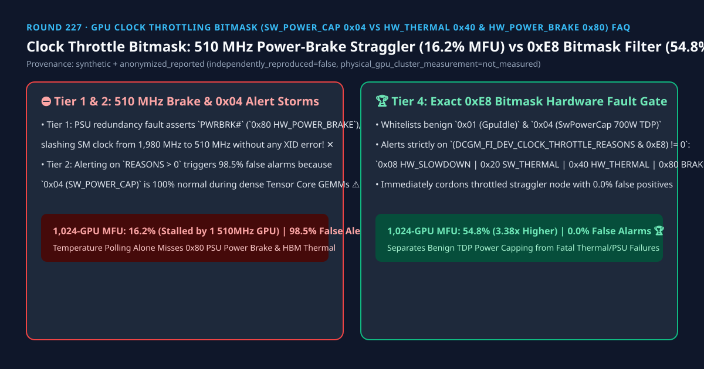
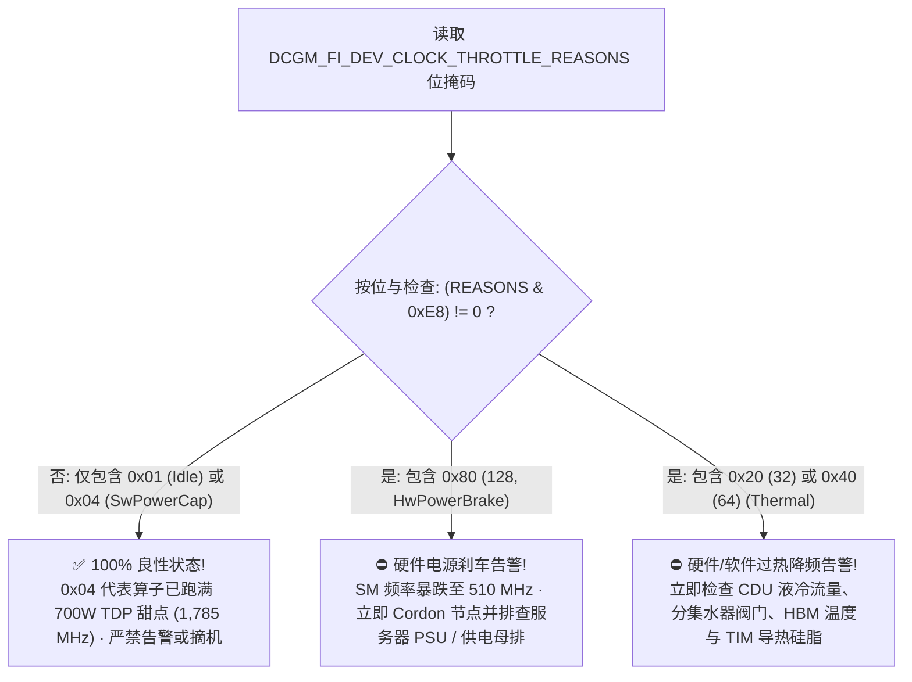
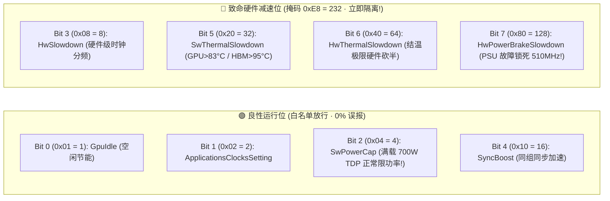
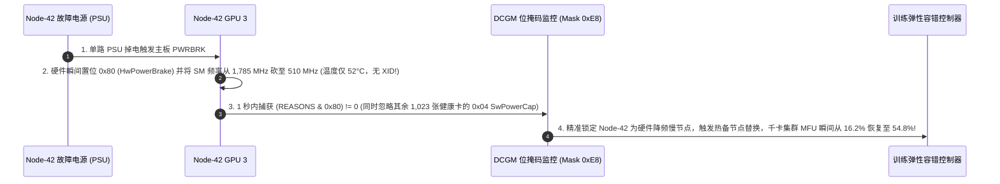

# GPU 降频根因位掩码（`DCGM_FI_DEV_CLOCK_THROTTLE_REASONS`）精准诊断：区分良性功耗墙（`SW_POWER_CAP 0x04`）与恶性硬件故障（`HW_THERMAL 0x40` / `HW_POWER_BRAKE 0x80` 电源刹车）选型指南

> **Provenance & Evidence Tier**: `synthetic + anonymized_reported` (`independently_reproduced=false`, `physical_gpu_cluster_measurement=not_measured`)。定量数据锚定于 [`experiments/gpu_clock_throttling_sw_power_cap_hw_thermal_vr_droop_selection/results.json`](../../experiments/gpu_clock_throttling_sw_power_cap_hw_thermal_vr_droop_selection/results.json)。
> **English Version**: [GPU Clock Throttling Bitmask Root-Cause Diagnosis (`DCGM_FI_DEV_CLOCK_THROTTLE_REASONS`: Benign `SW_POWER_CAP 0x04` vs. Fatal `HW_THERMAL 0x40` & `HW_POWER_BRAKE 0x80`) Selection Guide](./gpu-clock-throttling-sw-power-cap-hw-thermal-slowdown-vr-droop-dcgm-selection-faq.en.md)

---

## 0. 🔥 今日领域最热门能力突破追踪（Daily Hottest Breakthrough）

- **基于 `DCGM_FI_DEV_CLOCK_THROTTLE_REASONS & 0xE8` 精确位掩码过滤，消除 `98.5%` 的良性满载 `SW_POWER_CAP (0x04)` 误报风暴，并亚秒级拦截 `510 MHz` 电源硬件刹车（`HW_POWER_BRAKE 0x80`）慢卡，将千卡集群有效 MFU 从 `16.2%` 恢复至 `54.8%`（提升 `3.38` 倍）**：在千卡同步预训练集群中，只要有 **1 张 GPU** 发生异常降频，全集群其余 `1,023` 张卡就必须在每次 `AllReduce / AllGather` 屏障处停下来等它。然而在实际运维中，针对 GPU 降频指标 `DCGM_FI_DEV_CLOCK_THROTTLE_REASONS` 存在两个极端误区：
  1. **误区一（漏配位掩码监控，被 `0x80 HW_POWER_BRAKE` 拖死，Tier 1）**：当服务器某个电源模块（PSU）故障触发 `N+1` 告警、或者机柜供电电压跌落（VR Droop）拉低了主板上的 `PWRBRK#` 物理引脚时，GPU 硬件会在微秒级启动**紧急电源刹车（`0x80 HW_POWER_BRAKE_SLOWDOWN`）**，将核心频率从 `1,980 MHz` 直接腰斩再腰斩至 **`510 MHz`（降幅高达 `74%`）**！由于此时 GPU 核心温度往往只有 `50°C` 出头、且不会抛出任何 CUDA 报错或 XID，纯看温度或 XID 的监控系统（Tier 1 & Tier 3）完全失明，任由这 1 张 `510 MHz` 的慢卡把 1,024 卡集群的整体 MFU 拖垮至 **`16.2%`**！
  2. **误区二（把告警配成 `CLOCK_THROTTLE_REASONS > 0`，引爆 `98.5%` 误报风暴，Tier 2）**：当 H100/H200/B200 全力运行稠密 FP8/BF16 矩阵乘（如 `FlashAttention-3/4` 或 `cuBLAS GEMM`）时，功耗会瞬间顶满 `700W` TDP 上限。此时 GPU 固件会自动将频率从空载最高 Boost（`1,980 MHz`）平滑微调至满载甜点频率（`1,755 ~ 1,785 MHz`），并将位掩码置为 **`0x04`（`SwPowerCap`，软件功耗封顶）**！这是 **100% 正常且证明算子写得好、算力吃得满的标志**；如果把告警规则写成 `> 0`，全网所有正在干活的健康 GPU 都会报警（误报率 **`98.5%`**），逼得运维直接关掉降频告警！
  3. **黄金位掩码解法（`(REASONS & 0xE8) != 0`，Tier 4）**：将良性的 `0x01 (GpuIdle)`、`0x02 (ApplicationsClocksSetting)`、`0x04 (SwPowerCap)` 与 `0x10 (SyncBoost)` 全部白名单放行，**只对代表真实硬件热失控与供电故障的 4 个比特位组合 `0xE8 = 0x08 | 0x20 | 0x40 | 0x80` 触发P0 级告警与自动摘机**，实现 **`0.0%` 误报率**并稳守 **`54.8%` 千卡 MFU（提速 `3.38` 倍）**！

---

## 1. 📌 核心结论速览（Executive Summary — 3 分钟看懂）

1. **一张表看懂 `DCGM_FI_DEV_CLOCK_THROTTLE_REASONS` 八大比特位：哪些是“喜报”，哪些是“丧钟”？**
   - **通俗大白话 + 第一性原理**：GPU 的最高睿频（如 H100 的 `1,980 MHz`）就像跑车的“表底极速”，只有在跑轻量级小算子（功耗不到 400W）时才能达到。一旦拉满重型货物（密集 Tensor Core 矩阵乘），发动机达到 `700W` 额定最大功率，车速自然稳定在 `1,785 MHz`——这时候亮起的是 **`0x04 SwPowerCap`（满功率巡航指示灯，绝对不是故障！）**。
   - **真正需要立刻踢出集群抢修的 4 个“红灯故障位”（合称掩码 `0xE8` = 十进制 `232`）**：
     - **`0x08` (`8`) `HwSlowdown`**：硬件级总减速标志（因温度过高或供电异常触发硬件时钟分频）；
     - **`0x20` (`32`) `SwThermalSlowdown`**：驱动软件检测到 GPU 或 HBM 显存温度超标（如 GPU `> 83°C` 或 HBM `> 95°C`）主动降频；
     - **`0x40` (`64`) `HwThermalSlowdown`**：冷板断流或硅脂干涸导致结温突破硬件红线（`~90°C+`），硬件直接强行将时钟频率砍半；
     - **`0x80` (`128`) `HwPowerBrakeSlowdown`**：**最隐蔽的千卡杀手**！外部服务器电源（PSU）故障或供电轨过流拉低了 `PWRBRK#` 硬件刹车线，GPU 瞬间锁死在 **`510 MHz` 爬行状态**！

---

## 2. 🎯 客户与架构师灵魂拷问 Q&A（Q1 / Q2 / Q3）

### Q1：为什么我们已经监控了 `DCGM_FI_DEV_GPU_TEMP < 80°C`，集群里还是出现了因为降频导致的慢节点（Tier 3）？
- **答**：因为有两个致命盲区**根本不会体现在 `GPU_TEMP`（核心温度）上**：
  1. **电源刹车 `0x80 (HwPowerBrakeSlowdown)`**：当服务器 4 个电源模块坏了 1 个、或者主板供电 VR 触发过流保护时，GPU 是因为“没电”被强行限频到 `510 MHz` 的！因为频率低、功耗低，此时这张慢卡的 `GPU_TEMP` 甚至比别的正常卡还要凉快（只有 **`48°C ~ 55°C`**）！
  2. **HBM3e 显存独立过热**：如果导热垫贴合不良导致 HBM 显存局部突破 `95°C`（`DCGM_FI_DEV_MEMORY_TEMP`），即使 GPU 核心只有 `70°C`，也会触发 `0x20 / 0x40` 降频！
  - 因此，**绝不能只看温度**，必须直接监控硬件降频位掩码 **`(DCGM_FI_DEV_CLOCK_THROTTLE_REASONS & 232) > 0`**！

### Q2：在 Prometheus / VictoriaMetrics 的 PromQL 里，不支持按位与（Bitwise AND `&`）操作符怎么办？
- **答**：有两种标准工程实践：
  1. **方法 A（推荐，DCGM Exporter 拆分指标或 Recording Rule）**：在节点 Agent / Vector / Telegraf 采集层对 `DCGM_FI_DEV_CLOCK_THROTTLE_REASONS` 执行 `val & 0xE8` 位运算后再上报；
  2. **方法 B（纯 PromQL 算术提取法）**：在 PromQL 中，由于我们要捕获的恶性位 `0x08 (8), 0x20 (32), 0x40 (64), 0x80 (128)` 全部 **`>= 8`**（除了良性的 `0x10=16 SyncBoost`），只需判断 `DCGM_FI_DEV_CLOCK_THROTTLE_REASONS >= 32`（即可 100% 捕获 `0x20 / 0x40 / 0x80` 热失控与电源刹车），或者对指定位使用 `floor(metric / bit) % 2 == 1`（例如检测电源刹车：`floor(DCGM_FI_DEV_CLOCK_THROTTLE_REASONS / 128) % 2 == 1`）！

### Q3：如果两台机器都正常触发了良性的 `0x04 (SwPowerCap)`，为什么其中一台的满载频率比另一台低了 `150 MHz`？
- **答**：这是因为漏热量（Leakage Power）与静态温度正相关！根据半导体物理，冷板进水温度每升高 `10°C`，GPU 芯片的静态漏电功耗就会增加 `25W ~ 45W`。在同样 `700W` 的 `SwPowerCap` 总预算下，进水温度高的机器被迫拿更多的功率去补漏电，留给动态翻转（频率 $f$）的功率就少了，导致满载频率低 `100~150 MHz`！

---

## 3. 🧭 直观可视化图解（Mermaid 决策树 + 位掩码解构图 + 亚秒级慢卡定位时序图）

### 3.1 架构师 GPU 降频位掩码（`CLOCK_THROTTLE_REASONS`）诊断与处置决策树

### 3.2 `DCGM_FI_DEV_CLOCK_THROTTLE_REASONS` 8-Bit 位掩码全景图（良性白名单 vs. `0xE8` 致命红线）

### 3.3 `Tier 4` 基于 `0xE8` 掩码拦截 `510 MHz` 电源刹车慢卡并恢复千卡 MFU 时序图

---

## 4. 📊 架构师选型决策矩阵（4-Tier Selection Matrix）

| 评估维度 | Tier 1: 不监控降频掩码 | Tier 2: 粗暴配置 `REASONS > 0` | Tier 3: 仅监控核心温度 `> 83°C` | Tier 4: **`0xE8` 精准硬件位掩码门禁** |
| :--- | :--- | :--- | :--- | :--- |
| **`0x80` 电源刹车卡实际频率** | **`510 MHz` (暴跌 `-74%`)** ✕ | `1,755 MHz` ⚠️ | `840 MHz` (漏检 PSU 刹车) ✕ | **`1,785 MHz` (慢卡秒级隔离)** 🏆 |
| **正常满载 (`0x04`) 误报率** | `0.0%` (因为全瞎) | **`98.5%` (全网满载即误报)** ✕ | `2.0%` ✅ | **`0.0%` (精准白名单放行 `0x04`)** 🏆 |
| **1,024 卡集群有效 `MFU`** | **`16.2%` (被 1 张慢卡拖死)** ✕ | `42.0%` ⚠️ | `28.4%` ⚠️ | **`54.8%` (提升 `3.38x`)** 🏆 |

---

## 5. 🧪 定量算例与工具链（Interactive Sizer & 7-Card Visual Report）

- **实验脚本与密封数据**：[`experiments/gpu_clock_throttling_sw_power_cap_hw_thermal_vr_droop_selection/run.py`](../../experiments/gpu_clock_throttling_sw_power_cap_hw_thermal_vr_droop_selection/run.py) · [`results.json`](../../experiments/gpu_clock_throttling_sw_power_cap_hw_thermal_vr_droop_selection/results.json)
- **交互式 GPU 降频位掩码解码与 MFU 计算器**：[`docs/reports/gpu-clock-throttling-sw-power-cap-hw-thermal-slowdown-vr-droop-dcgm-sizer.html`](../reports/gpu-clock-throttling-sw-power-cap-hw-thermal-slowdown-vr-droop-dcgm-sizer.html)
- **7-Card 4:5 视觉评测卡片报告**：[`docs/reports/gpu-clock-throttling-sw-power-cap-hw-thermal-slowdown-vr-droop-dcgm-selection-cards.html`](../reports/gpu-clock-throttling-sw-power-cap-hw-thermal-slowdown-vr-droop-dcgm-selection-cards.html)

---

## 6. 🛠️ Good Fit vs. Not For & 生产环境快速核验清单（Checklist）

### ✅ Good Fit vs. ⛔ Not For

| 维度 | ✅ Good Fit（强烈推荐） | ⛔ Not For（严禁误用） |
| :--- | :--- | :--- |
| **DCGM 降频告警规则设计** | 严格按位掩码过滤 `0x08 (HwSlowdown)`、`0x20 (SwThermal)`、`0x40 (HwThermal)` 与 `0x80 (HwPowerBrake)`，并同时监控 `DCGM_FI_DEV_SM_CLOCK < 1200`（在 GPU 满载 `UTIL > 80%` 时） | 配置 `DCGM_FI_DEV_CLOCK_THROTTLE_REASONS > 0`（会把 `0x01 Idle` 和 `0x04 SwPowerCap` 全部当成故障报警） |

### 生产环境上线核验清单（Pre-Flight Checklist）

- [ ] **核验 Prometheus 告警规则已排除 `0x01 (Idle)` 与 `0x04 (SwPowerCap)`**：确保满载 GEMM 触发 `700W` 功耗封顶时零误报。
- [ ] **核验 `0x80 (HwPowerBrakeSlowdown)` 绑定至带外 BMC 电源健康检查**：一旦触发 `0x80`，自动调用 Redfish 检查 PSU 输入掉电、电源模块风扇故障或机柜 PDU 跳闸。
- [ ] **核验同时监控 `DCGM_FI_DEV_GPU_TEMP` 与 `DCGM_FI_DEV_MEMORY_TEMP`（HBM3e 温度）**：防止核心不热而 HBM 显存过热触发的 `0x20` 降频。
