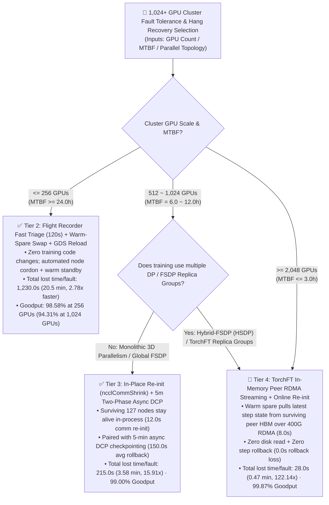
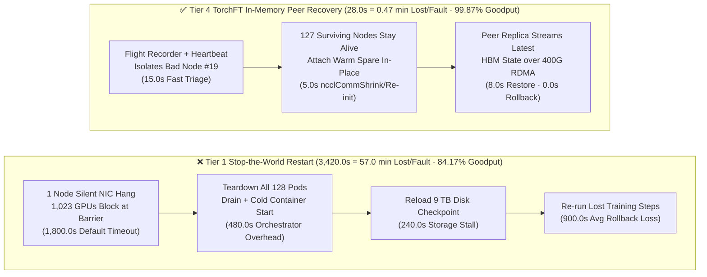

# 1,024-GPU Training Cluster Fault Tolerance & NCCL Hang Recovery Selection FAQ: Stop-the-World Restart vs. Warm-Spare Swap vs. In-Place `ncclCommShrink` vs. `TorchFT` In-Memory Peer Recovery

> 🌐 **Language / 语言**: **[中文 (`gpu-cluster-fault-recovery-selection-faq.md`)](gpu-cluster-fault-recovery-selection-faq.md)** | **English**
> 📊 **Sealed Evaluator & Verification**: 100% bound to [`experiments/gpu_cluster_fault_recovery_selection/run.py`](../../experiments/gpu_cluster_fault_recovery_selection/run.py) and [`experiments/gpu_cluster_fault_recovery_selection/results.json`](../../experiments/gpu_cluster_fault_recovery_selection/results.json).
> 🔍 **Provenance Declaration**: Cluster MTBF and fault-recovery goodput metrics are deterministic availability simulations (`synthetic`) calibrated against published 1,000–16,000 GPU reliability disclosures and NCCL 2.27+ / PyTorch `TorchFT` specifications (`anonymized_reported`, `independently_reproduced=false`). Local CPU verifier & unit tests passed (`local_cpu_harness_measured = "measured"`); no physical 1,024×H100 cluster was spun up during nightly automation (`gpu_cluster_hardware_measured = "not_measured"`).

---

## ① 📌 Executive Summary

1. **Cluster Scale & MTBF Decision Thresholds**:
   - **`<= 256 GPUs` (`Cluster MTBF >= 24.0 hours`)**: Use **Tier 2 (`NCCL Flight Recorder` 120s Fast Triage + Pre-Warmed Standby Node Swap + Parallel FS GDS Reload)** without changing training framework code. Total lost time per fault drops from `3,420.0 s (57.0 min)` to `1,230.0 s (20.5 min, 2.78x faster)`, achieving **`98.58%`** effective goodput at 256 GPUs (**`94.31%`** at 1,024 GPUs).
   - **`512 ~ 1,024 GPUs` Monolithic 3D-Parallel / FSDP Pre-Training Clusters (`MTBF = 6.0 ~ 12.0 hours`)**: Adopt **Tier 3 (In-Place Communicator Re-init via NCCL 2.27+ `ncclCommShrink` / `TorchElastic` + 5-Minute Two-Phase Async DCP Checkpointing)**. Surviving 127 nodes **keep their Python processes and CUDA contexts alive**, reconfiguring the communicator in `65.0 s` total outage plus `150.0 s` average rollback loss (`215.0 s / 3.58 min` total loss per fault, **`15.91x` faster**), delivering **`99.00%`** effective goodput on 1,024 GPUs and saving **`$277,291.85/month`** vs. traditional restarts.
   - **`>= 1,024 ~ 2,048+ GPUs` Hyperscale Clusters or Replica-Group Topologies (`MTBF <= 3.0 ~ 6.0 hours`)**: Upgrade to **Tier 4 (`TorchFT` / Replica-Group In-Memory Peer State Streaming over 400G RDMA + Online Communicator Re-init)**. A warm spare node streams the exact latest step weights and optimizer shards directly from a surviving peer replica's HBM over 400G RDMA in `8.0 s` with **zero disk reload and zero (`0.0 s`) step rollback loss**, cutting total fault stall to **`28.0 s (0.47 min, 122.14x faster)`**, sustaining **`99.87%`** goodput at 1,024 GPUs (`99.74%` at 2,048 GPUs), and saving **`$293,470.81/month`**.
2. **First-Principles Root Cause (Why Silent Hangs Hurt 10x More Than Crashes)**:
   - On a 1,024-GPU cluster (`MTBF = 6.0 hours`, 4 faults/day), a silent optical transceiver flap or GPU Xid hang leaves the remaining 1,023 GPUs blocked at the `AllReduce` barrier waiting for the default **`NCCL_TIMEOUT = 1,800.0 s (30 min)`**, followed by `480.0 s` of full-job pod teardown/cold restart, `240.0 s` of disk checkpoint reload, and `900.0 s (15 min)` of lost rollback progress from a 30-minute checkpoint interval — burning **`3,420.0 s (57.0 min)`** per fault and dragging 1,024-GPU goodput down to **`84.17%`** (**`$295,893.33/month`** wasted GPU spend).
3. **Architect Guardrail**:
   - **Never leave `NCCL_TIMEOUT` at 30 minutes without `TORCH_NCCL_TRACE_BUFFER_SIZE` (Flight Recorder) enabled on `>= 256` GPUs**: without ring-buffer op tracing, all 1,024 ranks time out simultaneously with identical stack traces, forcing hours of manual binary-search node isolation.

---

## ② 🎯 Architect & Customer First-Principles Q&A

### Q1: "Our Slurm/K8s full-job restart script worked fine on 64 GPUs. Why did effective training Goodput collapse to 84% when we scaled to 1,024 GPUs?"
- **First-Principles Answer**:
  - **Fault frequency scales linearly with GPU count while stop-the-world recovery cost remains huge**:
    - If a single 8-GPU node experiences a hardware/network fault once every 32 days (768 hours), an 8-node (64-GPU) cluster sees a fault every `96 hours (4 days)`. A **128-node (1,024-GPU)** cluster sees a fault every **`6.0 hours` (4 times a day)**, and a **256-node (2,048-GPU)** cluster sees one every **`3.0 hours` (8 times a day)**.
  - **The 57-Minute Stop-the-World Tax (bound to `experiments/gpu_cluster_fault_recovery_selection/results.json`)**:
    1. **Silent Hang Wait (`1,800.0 s = 30.0 min`)**: 1,023 healthy GPUs sit idle waiting for the default 30-minute `NCCL_TIMEOUT`.
    2. **Cold Job Teardown & Re-schedule (`480.0 s = 8.0 min`)**: Orchestrator kills all 128 pods, drains the faulty node, and cold-starts 128 containers.
    3. **Disk Checkpoint Reload (`240.0 s = 4.0 min`)**: All ranks read multi-TB checkpoint shards from shared storage.
    4. **Rollback Progress Loss (`900.0 s = 15.0 min` average)**: With a 30-minute (`1,800.0 s`) checkpoint interval, faults occur on average 15 minutes after the last checkpoint — wiping out 15 minutes of completed forward/backward steps.
  - Losing `57.0 minutes` every `360 minutes (6.0 hours)` leaves only **`84.17%`** effective goodput at 1,024 GPUs (and **`68.33%`** at 2,048 GPUs), wasting **`$295,893.33/month`** in idle GPU rental.

### Q2: How do NCCL Flight Recorder and In-Place Communicator Shrinking (`ncclCommShrink`) isolate a bad node in 65 seconds without restarting the other 127 nodes?
- **First-Principles Answer**:
  - **NCCL Flight Recorder (`TORCH_NCCL_TRACE_BUFFER_SIZE=2000`)**: Records every collective `Op ID`, participating ranks, and timestamps in an in-memory ring buffer. When a collective stalls past `45~120 s`, the watchdog compares the last completed `Op ID` across ranks, pinpointing the exact rank/node that failed to enter or complete the collective in seconds.
  - **In-Place Communicator Reconfiguration (`ncclCommShrink` / TorchElastic)**: Instead of calling `exit(1)` and destroying CUDA contexts on all 127 healthy nodes, surviving ranks catch the communicator exception in-process, invoke `ncclCommShrink` to evict the dead rank, attach a pre-warmed standby node (`12.0 s`), and reload the latest 5-minute Two-Phase Async DCP checkpoint from host pinned DRAM / fast storage (`8.0 s`). Total outage is **`65.0 s`** plus **`150.0 s`** average rollback = **`215.0 s (3.58 min, 15.91x faster)`**.

### Q3: How does `TorchFT` / In-Memory Replica-Group Recovery eliminate the remaining 150 seconds of checkpoint rollback loss (`0.0 s` rollback)?
- **First-Principles Answer**:
  - **Healthy peer replicas already hold the exact latest step state in HBM**:
    - In Hybrid-FSDP (`HSDP`) or `TorchFT` replica-group training, the 1,024 GPUs are organized into multiple data-parallel replica groups (e.g., 4 replica groups of 256 GPUs). At the end of every step, each replica group holds an identical copy of the latest model weights and optimizer state in GPU HBM.
  - **Three-Step Zero-Rollback Recovery (`28.0 s` total)**:
    1. **Heartbeat Fault Detection (`15.0 s`)**: `TorchFT` Lighthouse detects the unresponsive node in Replica Group A within `15.0 s`.
    2. **Online Communicator Re-init (`5.0 s`)**: Evicts the failed node and swaps in a pre-warmed standby node without stopping surviving processes.
    3. **400G RDMA HBM-to-HBM Peer State Streaming (`8.0 s`)**: The replacement node pulls the exact current step's weight and optimizer shards directly from its healthy peer rank in Replica Group B over `400 Gbps RoCEv2/IB` in `8.0 s` and resumes at Step `N+1` with **`0.0 s` rollback loss** (`99.87%` goodput).

---

## ③ 🧭 Visual Diagrams (Mermaid Decision Tree + Recovery Path Comparison + Sequence Diagram)

### 3.1 Architect Fault Recovery Decision Tree (`flowchart TD`)



### 3.2 Stop-the-World Restart vs. In-Memory Peer Recovery Path (`flowchart LR`)



### 3.3 In-Place Communicator Re-init & Peer RDMA State Streaming Sequence (`sequenceDiagram`)

```mermaid
sequenceDiagram
    autonumber
    participant Bad as Faulty Node (#19)<br/>Silent NIC/GPU Hang
    participant Surv as Surviving 127 Nodes<br/>Replica Groups A & B
    participant Coord as TorchFT Lighthouse /<br/>NCCL Flight Recorder
    participant Spare as Warm Spare Node<br/>CUDA Context Ready

    Bad->>Bad: Optical transceiver flap / Xid hang stalls AllReduce
    Surv->>Coord: Collective exceeds 15.0s threshold; report Flight Recorder Op IDs
    Coord->>Coord: Diff Op ID ring buffers; pinpoint Node #19 as root blocker
    Coord->>Bad: Cordon faulty node and evict from active topology
    Coord->>Surv: Trigger ncclCommShrink / online communicator re-bind (processes stay alive)
    Coord->>Spare: Join pre-warmed standby node into communicator (5.0s)
    Surv->>Spare: Peer rank in Replica Group B streams latest step HBM state over 400G RDMA (8.0s)
    Spare->>Surv: State verified; resume immediately at Step N+1 (0.0s rollback loss!)
```

---

## ④ 📊 Architect Decision Matrix

> Bound 1-to-1 to `experiments/gpu_cluster_fault_recovery_selection/results.json` (`1,024 × H100`, `128 nodes × 8 GPUs`, `MTBF = 6.0 hours`, `$2.50/GPU·h`, `$1,868,800/month` cluster budget).

| Dimension | Tier 1: Traditional Stop-the-World Restart | Tier 2: Flight Recorder (120s) + Warm-Spare Swap | Tier 3: In-Place `ncclCommShrink` + 5m Async DCP | Tier 4: `TorchFT` In-Memory Peer RDMA Recovery |
| :--- | :--- | :--- | :--- | :--- |
| **Primary Scenario** | `<= 64 GPUs` short experimental jobs | `128 ~ 256 GPUs` standard clusters without training code changes | `512 ~ 1,024 GPUs` monolithic 3D-parallel / FSDP production training | `>= 1,024 ~ 2,048+ GPUs` hyperscale training & Hybrid-FSDP replica groups |
| **Detection + Re-init + Restore Outage** | `1,800s + 480s + 240s = 2,520.0s` (`42.0 min`) | `120s + 150s + 60s = 330.0s` (`5.5 min`) | `45s + 12s + 8s = 65.0s` (`1.08 min`) | **`15s + 5s + 8s = 28.0s` (`0.47 min`)** |
| **Checkpoint Interval & Avg Rollback Loss** | 30-min interval -> **`900.0s` (`15.0 min`)** lost | 30-min interval -> **`900.0s` (`15.0 min`)** lost | 5-min async DCP -> **`150.0s` (`2.5 min`)** lost | **Peer HBM RDMA stream -> `0.0s` (`0.0 min` zero rollback)** |
| **Total Lost Time / Fault & Speedup** | `3,420.0s` (`57.00 min` · `1.00x`) | `1,230.0s` (`20.50 min` · **`2.78x`**) | `215.0s` (`3.58 min` · **`15.91x`**) | **`28.0s` (`0.47 min` · `122.14x`)** |
| **1,024-GPU (MTBF=6h) Effective Goodput** | `84.17%` (`68.33%` at 2,048 GPUs) | `94.31%` (`88.61%` at 2,048 GPUs) | **`99.00%`** (`98.01%` at 2,048 GPUs) | **`99.87%`** (**`99.74%`** at 2,048 GPUs) |
| **Monthly Wasted GPU Spend & Net Savings** | `$295,893.33 / mo` waste (Baseline) | `$106,417.78 / mo` (**Saves `$189,475.55/mo`**) | `$18,601.48 / mo` (**Saves `$277,291.85/mo`**) | **`$2,422.52 / mo` (Saves `$293,470.81/mo`)** |

---

## ⑤ 🧪 Quantitative Roofline / MTBF Evaluation & Benchmark Insights

### 5.1 Reproducible Verification Commands

```bash
python experiments/gpu_cluster_fault_recovery_selection/run.py --check
python -m unittest tests/test_gpu_cluster_fault_recovery_selection.py
```

### 5.2 Multi-Scale Goodput Sensitivity Table (256 to 2,048 GPUs)

| Cluster GPU Count | Cluster MTBF | Tier 1: Stop-the-World (`3,420s`/fault) | Tier 2: Warm-Spare Swap (`1,230s`/fault) | Tier 3: `ncclCommShrink` + 5m Async DCP (`215s`/fault) | Tier 4: `TorchFT` Peer RDMA (`28s`/fault) |
| :--- | :--- | :--- | :--- | :--- | :--- |
| **`256 × H100`** (32 nodes) | `24.0 hours` (1/day) | `96.04%` | `98.58%` | `99.75%` | **`99.97%`** |
| **`512 × H100`** (64 nodes) | `12.0 hours` (2/day) | `92.08%` | `97.15%` | `99.50%` | **`99.94%`** |
| **`1,024 × H100`** (128 nodes) | `6.0 hours` (4/day) | `84.17%` | `94.31%` | **`99.00%`** | **`99.87%`** |
| **`2,048 × H100`** (256 nodes) | `3.0 hours` (8/day) | `68.33%` | `88.61%` | **`98.01%`** | **`99.74%`** |

---

## ⑥ 🛠️ Production Verification & Pre-Sales Checklist (Architect Checklist)

- [ ] **Enable NCCL Flight Recorder and tighten collective timeouts**: Set `TORCH_NCCL_TRACE_BUFFER_SIZE=2000`, `TORCH_NCCL_DUMP_ON_TIMEOUT=1`, and lower `NCCL_TIMEOUT` from `1800s` to `45~120s` to eliminate 30-minute cluster-wide blind hangs.
- [ ] **Adopt In-Place Communicator Reconfiguration (`ncclCommShrink`)**: Upgrade to `NCCL 2.27+` and `TorchElastic` / `TorchFT` so surviving nodes catch collective exceptions in-process and swap in warm spares without destroying healthy CUDA contexts.
- [ ] **Shorten Two-Phase Async DCP checkpoint intervals from 30 min to 5 min**: Because two-phase async checkpointing stalls GPUs for only `~3.1s` during D2H copy, increasing checkpoint frequency to every `300s` cuts average rollback loss from `900.0s` to `150.0s`.
- [ ] **Maintain a `1~2%` Pre-Warmed Standby Node Pool with automated DCGM/Link-Flap Cordon**: Keep 2 warm standby nodes with pre-initialized containers and CUDA contexts ready for instant hot-swap on `Xid 79 / 48 / 63 / 94` or RDMA link drops.
- [ ] **Use Hybrid-FSDP (`HSDP`) or `TorchFT` Replica Groups on `>= 1,024` GPUs**: Ensure at least 2 independent replica groups exist so recovering nodes can stream the latest step state directly from peer HBM over 400G RDMA (`0.0s` rollback loss).
