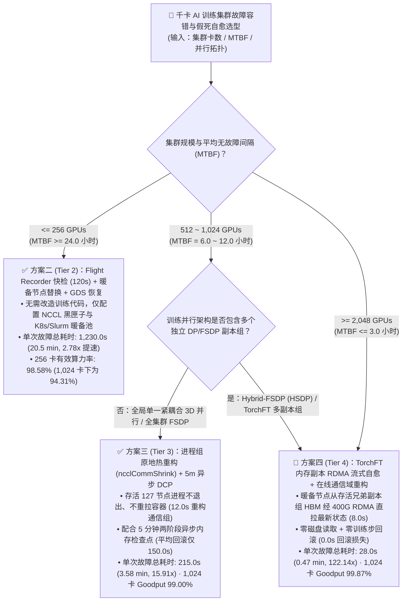
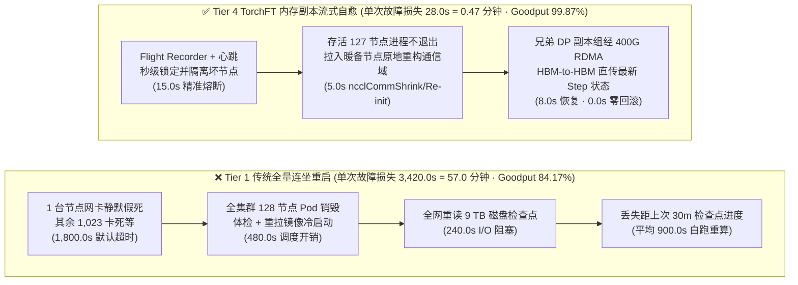
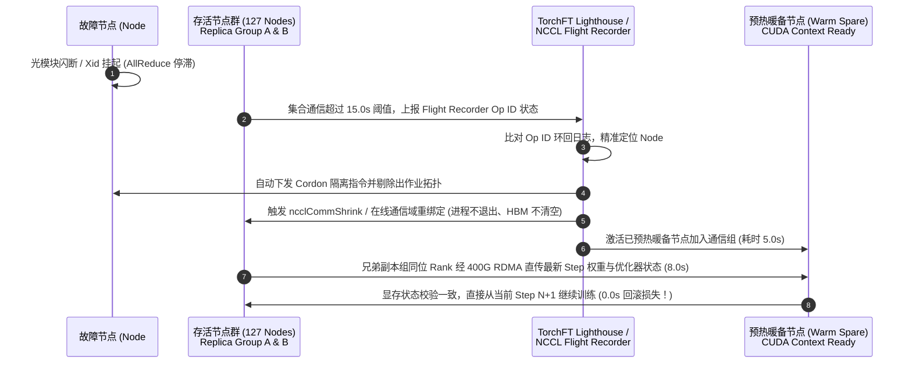

# 千卡 AI 训练集群故障容错与 NCCL 假死自愈架构选型 FAQ：全量重启 vs. 暖备节点替换 vs. 进程组热重构 (`ncclCommShrink`) vs. 内存副本流式恢复 (`TorchFT`) 架构师实战指南

> 🌐 **Language / 语言**: **中文 (Chinese)** | **[English (`gpu-cluster-fault-recovery-selection-faq.en.md`)](gpu-cluster-fault-recovery-selection-faq.en.md)**
> 📊 **关联封存算例与验证状态**: 100% 绑定本仓库确定性可用性算例 [`experiments/gpu_cluster_fault_recovery_selection/run.py`](../../experiments/gpu_cluster_fault_recovery_selection/run.py) 与 [`experiments/gpu_cluster_fault_recovery_selection/results.json`](../../experiments/gpu_cluster_fault_recovery_selection/results.json)。
> 🔍 **数据溯源与边界声明 (Provenance)**: 集群 MTBF 与故障恢复有效算力率 (Goodput) 数值为基于公开千卡集群可靠性报告（Llama-3 16K GPU 训练故障率、NCCL 2.27+ `ncclCommShrink` 与 PyTorch `TorchFT` 架构规范，`anonymized_reported`, `independently_reproduced=false`）校准的确定性可用性建模（`synthetic`）；本机 CPU 校验脚本与单测已实测通过（`local_cpu_harness_measured = "measured"`），夜间自动化未启动真实 1,024×H100 物理集群（`gpu_cluster_hardware_measured = "not_measured"`）。

---

## ① 📌 核心结论速览（Executive Summary）

1. **规模与 MTBF 选型分水岭（何时选快检换机、何时选进程组热重构、何时选内存副本流式自愈）**：
   - **`<= 256 卡`（集群平均无故障时间 `MTBF >= 24 小时`）**：无需改造分布式训练框架，采用 **Tier 2（NCCL Flight Recorder 120s 快检 + 预热暖备节点自动替换 + 并行文件系统 GDS 恢复）** 即可将单次故障总损失时间从传统全量重启的 `3,420.0 秒 (57.0 分钟)` 降至 `1,230.0 秒 (20.5 分钟)`，在 256 卡规模下保持 **`98.58%`** 有效算力率（1,024 卡下为 **`94.31%`**，提速 **`2.78x`**）。
   - **`512 ~ 1,024 卡` 主流单一体（Monolithic FSDP/3D 并行）预训练集群（`MTBF = 6.0 ~ 12.0 小时`）**：推荐 **Tier 3（定制应用层进程内 `ncclCommShrink` 缩容 + 独立通信组扩容/重分片闭环 + 5 分钟两阶段异步 DCP 检查点）**。需注意官方机制边界：**NVIDIA 官方 `ncclCommShrink` API 仅在存活进程间移除指定故障 Rank 并重建缩小的通信域（`128 -> 127` 存活节点），自身并不拉入暖备节点；拉入暖备节点需额外执行独立的 Grow/`ncclCommInitRank` 扩容流程或按缩容后节点数做定制应用层状态/DataLoader 重分片。同时 PyTorch 标准 `torchrun` / `TorchElastic` 默认遇到 Worker 故障或扩缩容会停止并重启全部 Worker 进程（`stop/restart all workers`），并不能自动保留存活 127 节点的 CUDA 上下文**。通过定制训练循环捕获异常并完成原地 `ncclCommShrink` 与独立重初始化（合成算例输入假设：`45.0s` 检测 + `12.0s` 缩容/重初始化 + `8.0s` 状态恢复 = `65.0 秒` 停机，非官方 SLA 承诺），加上 5 分钟高频异步检查点的平均回滚损失（`150.0 秒`），单次故障总损失为 **`215.0 秒 (3.58 分钟，提速 15.91x)`**，1,024 卡有效算力率达 **`99.00%`**；每月比传统重启毛挽回（Gross Recovered）**`$277,291.85`** 算力产出（相对 2 台暖备节点 `$29,200/月` 成本的**毛收益成本比 Gross Benefit/Cost = `9.4963x`**；扣除暖备池成本后的**净节省 Net Savings = `$248,091.85/月`，净投资回报率 Net ROI = `8.4963x`**，其他工程/运维改造成本为 `not_measured`）。
   - **`>= 1,024 ~ 2,048+ 卡` 超大规模集群或具备 DP 副本组的混合并行训练（`MTBF <= 3.0 ~ 6.0 小时`）**：演进至 **Tier 4（`TorchFT` Lighthouse + Manager 副本组协同 + 跨副本 400G RDMA 显存状态流式直传）**。当一个 DP 副本组内的节点掉线时，替补节点通过 400G RDMA 从存活的兄弟 DP 副本组显存（HBM）拉取最新一步的模型权重与优化器状态（合成算例输入假设：`15.0s` 检测 + `5.0s` 副本组通信重连 + `8.0s` RDMA 状态流式传输 = `28.0 秒`，非官方 SLA 承诺），实现 **零磁盘读取、零训练步回滚（`0.0 秒` 回滚损失）**，单次故障总停顿仅 **`28.0 秒 (0.47 分钟，提速 122.14x)`**，在 1,024 卡与 2,048 卡下分别保持 **`99.87%`** 与 **`99.74%`** 的有效算力率；每月在 1,024 卡上毛挽回（Gross Recovered）**`$293,470.81`** 空转损耗（**Gross Benefit/Cost = `10.0504x`**；扣除 `$29,200/月` 暖备节点成本后的**净节省 Net Savings = `$264,270.81/月`，净投资回报率 Net ROI = `9.0504x`**，其他未知运维开销 `not_measured`）。
2. **第一性原理本质（为什么千卡集群最怕“静默假死 Hang”而不是进程崩溃 Crash？）**：
   - 在 1,024 张 GPU（128 台 8 卡服务器 + 1,024 个光模块 + 数千条 RDMA 队列对）组成的同步训练网中，单卡年化故障率即使只有几个百分点，整个集群也会**平均每 6.0 小时发生一次硬件/链路故障**。如果某张网卡光模块闪断或 GPU 发生 Xid 硬件挂起但未触发 Linux 进程退出，全集群其余 1,023 张 GPU 会在集合通信（`AllReduce` / `AllGather`）屏障处**集体死等默认的 `NCCL_TIMEOUT = 1,800 秒 (30 分钟)`**，紧接着还要经历冷销毁重拉容器（`480.0 秒`）、重读 9 TB 磁盘检查点（`240.0 秒`）并丢失距离上次 30 分钟检查点已跑完的平均 `900.0 秒 (15 分钟)` 训练进度——一次小故障就让上千张 H100 白白浪费 **`57.0 分钟`**！
3. **架构师防踩坑铁律**：
   - **严禁在生产千卡集群保留默认的 30 分钟 `NCCL_TIMEOUT` 且不开启 `TORCH_NCCL_TRACE_BUFFER_SIZE`（Flight Recorder）**：没有黑匣子追踪，超时报错只会显示“所有 1,024 个 Rank 同时超时”，运维被迫靠二分法盲猜坏节点，把排障拖成数小时灾难。

---

## ② 🎯 客户与架构师灵魂拷问 Q&A（FAQ-Driven，围绕 3 个真实高频问题展开）

### Q1：客户质疑：“我们在 64 卡集群上用 Slurm/K8s 遇到故障自动重启脚本跑得好好的，为什么扩容到 1,024 卡后有效算力率（Goodput）直接掉到 84% 甚至更低？”
- **通俗第一性原理回答**：
  - **故障频率随卡数线性倍增，而“全员连坐重启”的代价却一分不减**：
    - 假设单台 8 卡节点平均每 32 天（768 小时）发生一次光模块闪断、HBM ECC 双比特错误（DBE）或 PSU 掉电：在 64 卡（8 节点）集群上，平均 `96 小时（4 天）` 才遇到一次故障；但在 **1,024 卡（128 节点）** 集群上，`768 / 128 = 6.0 小时` 就会必发一次故障（每天 4 次）！到了 **2,048 卡（256 节点）**，平均每 **`3.0 小时`** 就中断一次。
  - **算一笔 1,024 卡集群的“57 分钟连坐账”（绑定 `experiments/gpu_cluster_fault_recovery_selection/results.json`）**：
    1. **假死空等（`1,800.0 秒 = 30.0 分钟`）**：某张网卡 RDMA 队列卡死，其余 1,023 张 H100 停在 `AllReduce` 入口傻等默认 30 分钟超时。
    2. **全量拆毁与冷启动（`480.0 秒 = 8.0 分钟`）**：K8s/Slurm 杀掉全部 128 台节点的 Pod，执行 GPU 健康体检剔除坏机，重新调度 128 台节点拉取镜像、初始化 CUDA 上下文与 PyTorch 编译缓存。
    3. **重读检查点（`240.0 秒 = 4.0 分钟`）**：1,024 张卡同时从共享存储拉取上一次保存的数 TB 检查点。
    4. **进度回滚白跑（平均 `900.0 秒 = 15.0 分钟`）**：如果每 30 分钟（`1,800.0 秒`）存一次 Checkpoint，故障平均发生在两次存盘正中间，意味着故障前已经跑完的 **15 分钟训练步全部作废重跑**！
  - **结论**：每 `6.0 小时 (360 分钟)` 周期里就有 `57.0 分钟` 在空转或重跑，集群有效算力率直接跌至 **`84.17%`**（2,048 卡更跌至 **`68.33%`**），每个月光空转浪费的 GPU 电费与租金就高达 **`$295,893.33`**！

### Q2：什么是 NCCL 飞行记录仪（Flight Recorder）与进程组原地热重构（`ncclCommShrink`）？它为什么能做到“坏一台机器，另外 127 台不重启”？
- **通俗第一性原理回答**：
  - **痛点一：抓不到真凶的“连坐超时”**：在环形或树形 `AllReduce` 中，只要 `Rank 73` 的网卡停止发包，`Rank 74` 等不到数据，进而传染到全网 1,024 个 Rank 全部卡住。当超时触发时，所有 1,024 个进程同时抛出 `Watchdog caught collective operation timeout`，根本看不出是谁最先卡死。
  - **机制一：NCCL Flight Recorder（片上黑匣子环回缓冲）**：
    - 开启 `TORCH_NCCL_TRACE_BUFFER_SIZE=2000` 后，每个 Rank 在内存中维护一个轻量级环形队列，记录最近执行的每一个集合通信算子序号（`Op ID`）、参与 Rank、起止时间戳与状态（`started` / `completed`）。
    - 当后台监控线程检测到某个算子超过 `45~120 秒` 未完成时，自动导出各节点黑匣子：谁停在更早的 `Op ID` 或在点对点收发中未响应，就能在 **秒级精准锁定唯一故障节点** 并自动将其隔离（Cordon）。
  - **机制二：定制应用层进程内 `ncclCommShrink` 缩容与标准 `TorchElastic` 重启的严格区分**：
    - **官方 API 与框架机制边界（必读防踩坑）**：
      1. **NVIDIA 官方 `ncclCommShrink` 语义（[NCCL Communicator API 文档](https://docs.nvidia.com/deeplearning/nccl/user-guide/docs/api/comms.html)）**：`ncclCommShrink` **仅用于从父通信域中移除指定的故障 Rank（`excludeRanksList`），并在剩余存活的 Rank 之间重建一个规模更小的新通信域（例如从 128 节点收缩为 127 存活节点）**。`ncclCommShrink` 自身**不具备拉入新暖备节点的功能**；若要接入暖备节点恢复原有 128 节点规模，需要执行独立的通信域 Grow / `ncclCommInitRank` 重初始化流程，或者以缩容后的 127 节点继续运行并执行定制应用层状态/DataLoader 重分片。
      2. **PyTorch 官方 `torchrun` / `TorchElastic` 语义（[PyTorch Elastic Run Failure Modes 文档](https://docs.pytorch.org/docs/2.15/elastic/run.html)）**：标准 `torchrun` / `TorchElastic` 在检测到 Worker 进程失败或节点成员变化（Membership Change）时，默认行为是**停止并重启所有 Worker 进程（`stop/restart all workers`）** 并从检查点重载（对应 Tier 2 的快检换机重启路径），**并不能开箱即用地保持 127 台存活进程的 CUDA 显存不销毁**。
    - **Tier 3 定制原地恢复路径（Custom In-Place Shrink + Separate Grow/Reshard）**：由定制训练框架在应用层拦截异常避免 `torchrun` 杀进程，先调用 `ncclCommShrink` 在存活节点间剔除坏 Rank，再完成独立通信组扩容/重初始化与状态重分片（合成算例输入假设：`45.0s` 检测 + `12.0s` 缩容/重初始化 + `8.0s` 恢复最近 5 分钟两阶段异步 DCP 检查点 = `65.0s` 停机，外加平均回滚损失 `150.0s`，合计 **`215.0 秒 (3.58 分钟)`**；上述秒数为 `synthetic` 算例输入假设，非官方 SLA 保证）。

### Q3：如果客户要冲刺 `99.8%+` 的极致可用性，连 2.5 分钟的进度回滚都不想丢，什么是 `TorchFT` / 内存副本流式自愈（In-Memory Peer State Recovery）？
- **通俗第一性原理回答**：
  - **核心洞察：健康的兄弟节点显存（HBM）里本来就装着最新一步的完整状态！**
    - 在千卡训练中（如 `Hybrid-FSDP / HSDP` 或 `TorchFT` 副本组架构），1,024 张卡通常会分成多个数据并行副本组（例如 4 个 256 卡的 Replica Group）。每个副本组在每个训练步结束时，其显存里都拥有**完全相同、精确到最新一个 Step** 的模型参数与优化器分片状态。
  - **内存副本流式自愈三步法（零磁盘、零回滚）**：
    1. **毫秒/秒级心跳熔断（`15.0 秒`）**：`TorchFT` 协调器（Lighthouse）通过轻量级心跳在 `15.0 秒` 内发现副本组 A 中的节点 #19 失联。
    2. **在线通信域切换（`5.0 秒`）**：剔除坏节点并接入预热暖备节点，重构内部通信组，**不中断训练循环**。
    3. **400G RDMA 显存对显存直传恢复（`8.0 秒`）**：暖备节点不从慢速磁盘读旧检查点，而是直接通过 `400 Gbps RoCEv2/IB` 从副本组 B 中对应的健康同位节点（Peer Rank）HBM 显存拉取当前最新 Step 的分片状态（~140 GB 数据经多卡并行 RDMA 仅需 `8.0 秒`），直接从当前 Step 继续往前跑，**回滚损失为 `0.0 秒`**！

---

## ③ 🧭 直观可视化图解（Mermaid 选型决策树 + 传统重启 vs 原地自愈路径对比 + 内存流式恢复时序图）

### 3.1 架构师千卡集群故障容错选型决策树（`flowchart TD`）



### 3.2 传统“全集群连坐重启” vs. 现代“原地通信重构 + 内存副本直传”路径对比图（`flowchart LR`）



### 3.3 `ncclCommShrink` 原地重构与 `TorchFT` 跨副本 RDMA 状态恢复时序图（`sequenceDiagram`）



---

## ④ 📊 架构师选型决策矩阵（Architect Decision Matrix）

> 数据严格对应 `experiments/gpu_cluster_fault_recovery_selection/results.json`（基准：`1,024 × H100`，`128 节点 × 8 卡`，`MTBF = 6.0 小时`，`$2.50/GPU·h`，月度集群算力预算 `$1,868,800`）。

| 评估维度 | 方案一：传统全量连坐重启 (Traditional Stop-the-World Restart) | 方案二：Flight Recorder 快检 + 暖备换机 (Fast Triage + Warm-Spare Swap) | 方案三：进程组原地热重构 + 5m 异步 DCP (`ncclCommShrink` + Async DCP) | 方案四：内存副本 RDMA 流式自愈 (`TorchFT` / Replica-Group Peer Recovery) |
| :--- | :--- | :--- | :--- | :--- |
| **核心适用场景** | `<= 64 卡` 短周期实验任务 | `128 ~ 256 卡` 标准训练集群（不想改动训练框架代码） | `512 ~ 1,024 卡` 紧耦合 3D 并行 / 全局 FSDP 预训练主力生产集群 | `>= 1,024 ~ 2,048+ 卡` 超大规模预训练、Hybrid-FSDP 多副本组集群 |
| **假死检测 + 通信重构 + 状态恢复耗时** | `1,800s + 480s + 240s = 2,520.0s` (`42.0 min` 停机) | `120s + 150s + 60s = 330.0s` (`5.5 min` 停机) | `45s + 12s + 8s = 65.0s` (`1.08 min` 停机) | **`15s + 5s + 8s = 28.0s` (`0.47 min` 停机)** |
| **检查点间隔与平均进度回滚损失** | 30 分钟间隔 -> 平均白跑 **`900.0s` (`15.0 min`)** | 30 分钟间隔 -> 平均白跑 **`900.0s` (`15.0 min`)** | 5 分钟异步 DCP -> 平均白跑 **`150.0s` (`2.5 min`)** | **兄弟副本组 HBM 直传 -> `0.0s` (`0.0 min` 零回滚)** |
| **单次故障总损失时间与恢复加速比** | `3,420.0s` (`57.00 min` · `1.00x` 基准) | `1,230.0s` (`20.50 min` · **`2.78x`**) | `215.0s` (`3.58 min` · **`15.91x`**) | **`28.0s` (`0.47 min` · `122.14x`)** |
| **1,024 卡 (MTBF=6h) 有效算力率 (Goodput)** | `84.17%`（2,048 卡跌至 `68.33%`） | `94.31%`（2,048 卡为 `88.61%`） | **`99.00%`**（2,048 卡为 `98.01%`） | **`99.87%`**（2,048 卡高达 **`99.74%`**） |
| **月度空转浪费、毛挽回与扣除暖备后净节省 (Gross vs. Net ROI)** | 浪费 `$295,893.33 / 月`（0 暖备，基准） | 浪费 `$106,417.78 / 月`（毛挽回 `$189,475.55`，扣 `$29.2k` 暖备后**净省 `$160,275.55/月`**；Gross B/C `6.4889x`，**Net ROI `5.4889x`**） | 浪费 `$18,601.48 / 月`（毛挽回 `$277,291.85`，扣 `$29.2k` 暖备后**净省 `$248,091.85/月`**；Gross B/C `9.4963x`，**Net ROI `8.4963x`**） | **仅浪费 `$2,422.52 / 月`**（毛挽回 `$293,470.81`，扣 `$29.2k` 暖备后**净省 `$264,270.81/月`**；Gross B/C `10.0504x`，**Net ROI `9.0504x`**） |

---

## ⑤ 🧪 简明定量算例与 Benchmark 洞察

### 5.1 离线确定性算例复现命令

```bash
python experiments/gpu_cluster_fault_recovery_selection/run.py --check
python -m unittest tests/test_gpu_cluster_fault_recovery_selection.py
```

### 5.2 不同集群规模（256 ~ 2,048 卡）下的 MTBF 与有效算力率（Goodput）拐点对比表

> 随着集群规模从 256 卡翻倍至 2,048 卡，集群级平均无故障时间（MTBF）从 `24.0 小时` 缩短至 `3.0 小时`（每天发生 8 次硬件/链路故障）。下表展示四档方案在不同卡数下的真实有效算力产出率（Goodput %）：

| 集群 GPU 规模 | 集群平均无故障时间 (MTBF) | Tier 1：传统全量重启 (`3,420s`/次) | Tier 2：快检 + 暖备换机 (`1,230s`/次) | Tier 3：`ncclCommShrink` + 5m 异步 DCP (`215s`/次) | Tier 4：`TorchFT` 内存副本 RDMA 自愈 (`28s`/次) |
| :--- | :--- | :--- | :--- | :--- | :--- |
| **`256 × H100`** (32 节点) | `24.0 小时` (1 次/天) | `96.04%` | `98.58%` | `99.75%` | **`99.97%`** |
| **`512 × H100`** (64 节点) | `12.0 小时` (2 次/天) | `92.08%` | `97.15%` | `99.50%` | **`99.94%`** |
| **`1,024 × H100`** (128 节点) | `6.0 小时` (4 次/天) | `84.17%` (不可接受) | `94.31%` | **`99.00%`** | **`99.87%`** |
| **`2,048 × H100`** (256 节点) | `3.0 小时` (8 次/天) | `68.33%` (近 1/3 算力报废) | `88.61%` | **`98.01%`** | **`99.74%`** |

### 5.3 三大定量工程洞察

1. **为什么仅靠“加快检查点保存速度”救不了传统重启？**
   - 就算把检查点保存改成 0 秒开销，只要保留默认的 `1,800.0 秒` `NCCL_TIMEOUT` 和 `480.0 秒` 全集群 Pod 冷销毁重拉，每次故障依然要停机 `2,280.0 秒 (38 分钟)`。**必须同时砍掉“假死检测等待时间”与“进程全量冷重启时间”**，才能突破 95% Goodput 天花板。
2. **2 台预热暖备节点（Warm Spare）的毛收益成本比（Gross Benefit/Cost）与净投资回报率（Net ROI）严格核算**：
   - 在 128 节点（1,024 卡）集群旁预留 2 台暖备节点（`16 GPUs × $2.50/h × 730 h/月 = $29,200.00/月`，硬件冗余比 `1.56%`）：
     - **Tier 3（定制原地 `ncclCommShrink` + 独立扩容重分片 + 5m 异步 DCP）**：毛挽回算力价值 `Gross Recovered = $277,291.85/月`，**毛收益成本比 `Gross Benefit/Cost = $277,291.85 / $29,200.00 = 9.4963x`**；扣除 `$29,200.00/月` 暖备成本后，**净节省 `Net Savings = $248,091.85/月`，净投资回报率 `Net ROI = ($277,291.85 - $29,200.00) / $29,200.00 = 8.4963x`**（其他工程研发与运维接入开销 `other_operational_overhead_usd = "not_measured"`）。
     - **Tier 4（`TorchFT` 副本组 400G RDMA 显存流式自愈）**：毛挽回算力价值 `Gross Recovered = $293,470.81/月`，**毛收益成本比 `Gross Benefit/Cost = $293,470.81 / $29,200.00 = 10.0504x`**；扣除 `$29,200.00/月` 暖备成本后，**净节省 `Net Savings = $264,270.81/月`，净投资回报率 `Net ROI = ($293,470.81 - $29,200.00) / $29,200.00 = 9.0504x`**（其他运维开销 `not_measured`）。
3. **2,048 卡以上集群为什么必须引入 Replica-Group / `TorchFT`？**
   - 当集群达到 2,048 卡（MTBF `3.0 小时`）乃至万卡（MTBF `< 45 分钟`）时，任何需要全网同步回滚的方案都会频繁打断流水线。通过将大集群切分为多个通过低频异步/半同步聚合（如 DiLoCo / HSDP）或同步 AllReduce 协同的 `TorchFT` 副本组，单节点故障影响半径被严格锁定在单个子组内，通过跨副本 RDMA 内存拷贝（算例假设 `8.0 秒`）即可在合成模型下实现 `99.74%` 的高有效算力率。

---

## ⑥ 🛠️ 附录：生产环境快速核验与售前打单清单（Architect Checklist）

- [ ] **强制开启 NCCL Flight Recorder 黑匣子并收敛超时阈值**：在生产启动脚本中显式配置 `TORCH_NCCL_TRACE_BUFFER_SIZE=2000`、`TORCH_NCCL_DUMP_ON_TIMEOUT=1`，并将默认 30 分钟超时收敛至 `NCCL_TIMEOUT=120`（或配合心跳监控设为 `45~60s`），彻底终结“全员连坐盲等半小时”。
- [ ] **严格区分标准 `TorchElastic` 全员重启与定制进程内 `ncclCommShrink` / `TorchFT`**：认清标准 `torchrun` / `TorchElastic` 遇故障或成员变更会 `stop/restart all workers`，且官方 `ncclCommShrink` 仅移除故障 Rank 重建存活子集通信域；若需存活节点不重启并接入暖备节点，必须规划独立的 Grow/`ncclCommInitRank` + 状态重分片闭环或直接采用 `TorchFT` 副本组架构。
- [ ] **将异步 Checkpoint 间隔从 30 分钟缩短至 5 分钟**：因为两阶段异步 DCP（Stage 1 D2H 仅冻结 `3.125s`）几乎不阻塞 GPU 计算，可将存盘频率提高到每 `300 秒 (5 分钟)` 一次，把故障发生时的平均历史进度回滚损失从 `900.0 秒` 压降至 `150.0 秒`。
- [ ] **配置节点级预热暖备池（Pre-Warmed Standby Pool）与自动 Cordon 闭环**：在 Slurm/Kubernetes 中常驻 `1~2%` 预加载好训练镜像与 CUDA 上下文的暖备节点；一旦 DCGM 捕获 `Xid 79 / 48 / 63 / 94` 或网卡 Link Flap，自动给故障节点打污点（Taint/Cordon）并在秒级切入暖备节点。
- [ ] **在千卡以上集群优先规划 Hybrid-FSDP (HSDP) / `TorchFT` 副本组拓扑**：确保集群内至少存在 `>= 2` 个拥有完整模型与优化器状态副本的进程组，使新加入节点能直接通过 400G RDMA 从健康同位节点 HBM 流式拉取状态（`0.0 秒` 回滚损失），告别慢速磁盘恢复。
