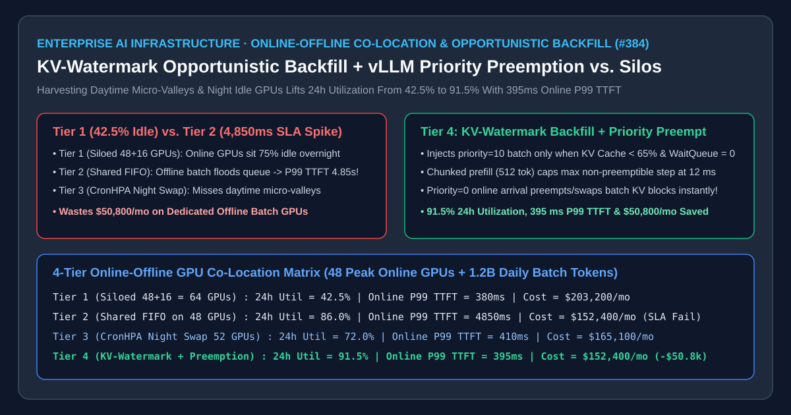

# Online-Offline GPU Co-Location & Opportunistic Backfill Guide: `KV-Watermark Gating + vLLM Priority Preemption` vs. Siloed Clusters

> **Language**: [中文](./gpu-cluster-online-offline-co-location-opportunistic-backfill-peak-shaving-selection-faq.md) | **English (Current)**  
> **Audience**: Cloud & AI Infrastructure Solution Architects and FinOps Capacity Engineers  
> **Provenance**: `synthetic + anonymized_reported` (`independently_reproduced=false`, `physical_gpu_cluster_measurement=not_measured`)

---

## 1. 📌 Executive Summary

> **Bottom Line**: **Enterprise inference clusters sized for daytime interactive peaks (`48x H100`) average only `42.5%` 24-hour GPU utilization due to nighttime and lunch-hour troughs, yet organizations often provision a separate `16x H100` cluster (`Tier 1`, `64` GPUs total, `$203,200/month`) to process `1.2B` daily offline batch tokens (document extraction, RAG indexing, LLM-as-a-Judge). Mixing offline jobs into a shared FIFO queue (`Tier 2`) spikes online P99 TTFT from `380 ms` to `4,850 ms` (`44.0%` SLA Goodput). Production platforms deploy `KV-Watermark-Gated Opportunistic Backfill + vLLM Priority Preemption (--scheduling-policy priority) + 512-Token Chunked Prefill` (`Tier 4`): injecting `priority=10` batch requests only when `waiting_queue == 0` and `KV Cache < 65%`, and preempting batch KV blocks within `12 ms` whenever `priority=0` online requests arrive—lifting 24h GPU utilization to `91.5%`, keeping online P99 TTFT at `395 ms` (`99.4%` SLA Goodput), and eliminating the 16-GPU offline cluster (`-$50,800/month` saved).**

- **Interactive Online-Offline Co-Location & Backfill Sizer**: [Open Interactive Sizer (`gpu-cluster-online-offline-co-location-opportunistic-backfill-peak-shaving-sizer.html`)](../reports/gpu-cluster-online-offline-co-location-opportunistic-backfill-peak-shaving-sizer.html)
- **7-Card 4:5 Visual Report**: [Open 7-Card Report (`gpu-cluster-online-offline-co-location-opportunistic-backfill-peak-shaving-selection-cards.html`)](../reports/gpu-cluster-online-offline-co-location-opportunistic-backfill-peak-shaving-selection-cards.html)

---

## 2. 📊 4-Tier Online-Offline GPU Co-Location Matrix (`48 Peak Online GPUs` + `1.2B Daily Batch Tokens`)

| Metric | Tier 1: Siloed Clusters (`48 Online + 16 Offline = 64 GPUs`) | Tier 2: Un-Isolated Shared FIFO Queue (`48 GPUs`) | Tier 3: `CronHPA` Day/Night Pod Swap (`52 GPUs`) | Tier 4 (Recommended): `65% KV-Watermark Backfill` + `vLLM Priority Preemption` (`48 GPUs`) |
| :--- | :--- | :--- | :--- | :--- |
| **Total Cluster GPUs Required** | `64 H100 GPUs` ✕ | `48 H100 GPUs` | `52 H100 GPUs` | **`48 H100 GPUs` ✓ (`-16` GPUs saved)** |
| **24-Hour Avg GPU Utilization** | `42.5%` ✕ (`57.5%` idle) | `86.0%` | `72.0%` | **`91.5%` ✓ (Harvests micro-valleys)** |
| **Online P99 TTFT Latency** | `380.0 ms` | `4,850.0 ms` ✕ (Queue stall) | `410.0 ms` | **`395.0 ms` ✓ (`12 ms` chunk preempt)** |
| **Online SLA Goodput (`<500ms`)** | `99.6%` | `44.0%` ✕ | `98.8%` | **`99.4%` ✓** |
| **Monthly Cluster Cost** | `$203,200 / mo` ✕ | `$152,400 / mo` | `$165,100 / mo` | **`$152,400 / mo` ✓ (`-$50,800/mo` saved)** |

---

## 3. 🛠️ Production Readiness Checklist

- [ ] **Always Pair `--scheduling-policy priority` with `--enable-chunked-prefill` (`512–1,024` tokens)** so an in-flight offline batch prompt can be preempted at the next `12 ms` chunk boundary rather than blocking the GPU for seconds.
- [ ] **Gate Opportunistic Backfill Injection at `<65%` Paged KV Cache Utilization** so `35%` of HBM KV blocks remain immediately available for sudden `priority=0` online traffic spikes.
