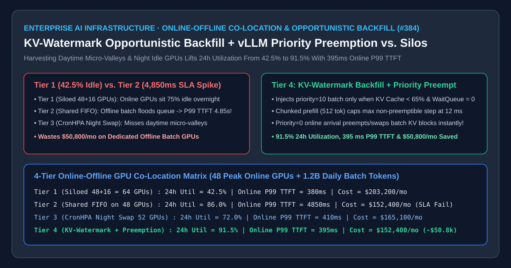
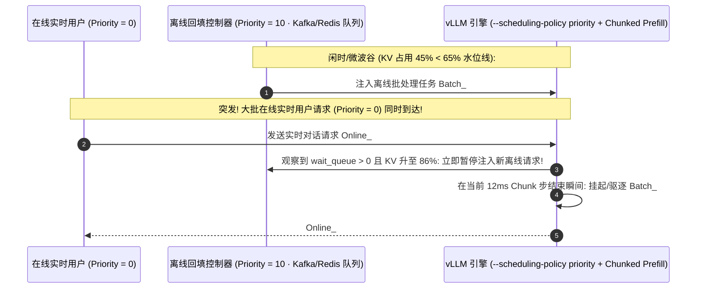

# 大模型在线实时服务与离线批处理同池混部、抢占式回填（Opportunistic Backfill）与削峰填谷选型：`KV 水位线门控 + vLLM Priority Preemption` vs. 物理隔离集群指南

> **语言 / Language**: **中文 (当前)** | [English](./gpu-cluster-online-offline-co-location-opportunistic-backfill-peak-shaving-selection-faq.en.md)  
> **定位**：面向 Cloud & AI Infrastructure Solution Architect 与 FinOps 容量治理架构师的在线实时服务（Online Interactive）与离线批处理（Offline Batch / 异步文档抽取 / LLM-as-a-Judge 评测）同池混部与毫秒级抢占回填选型白皮书  
> **合规与来源声明**：`synthetic + anonymized_reported`（`independently_reproduced=false`，`physical_gpu_cluster_measurement=not_measured`；完全面向通用企业级 GPU 推理集群 24 小时利用率拉满与成本优化设计）

---

## 1. 📌 核心选型结论速览（Executive Summary）

> **一句话结论**：**企业按白班最高并发峰值规划的 `48 卡 H100` 在线客服/Copilot 推理集群，在午休低谷与夜间 20:00–次日 08:00 的显存与算力利用率往往跌至 `18%~25%`，导致全天 24 小时平均 GPU 利用率仅有可怜的 **`42.5%`**；与此同时，业务团队却为了每天处理 `12 亿 Token` 的离线财报摘要、知识库清洗和评测任务，又去额外申请了 `16 张 H100` 独立批处理集群（Tier 1，总计 `64 张卡`，月烧 `$203,200`）！但如果简单粗暴地把离线任务直接塞进在线 `vLLM` 的同一个 FIFO 队列（Tier 2），离线大文档会瞬间塞满队列，将在线用户的 P99 首字延迟（TTFT）从 `380 ms` 炸穿至 **`4,850 ms`（SLA 达标率跌至 `44.0%`）**！生产环境破局标准是构建“基于 `65% KV Cache 水位线门控` 的见缝插针回填调度器 + `vLLM 原生优先级抢占 (--scheduling-policy priority)` + `512-Token Chunked Prefill`（Tier 4）”：网关每 `100 ms` 探测一次引擎空闲水位，仅当在线排队数为 `0` 且 KV 显存占用 `<65%` 时才以 `priority=10` 滴灌注入离线任务；一旦 `priority=0` 的在线用户请求到达且显存紧张，引擎在 **`12 ms`** 内直接抢占释放离线任务的 KV 块——在 **100% 砍掉那 16 张独立离线卡（仅用 `48 张卡` 跑完全部在线+离线负载，每月立省 `$50,800`）** 的同时，将全天 24 小时平均 GPU 利用率拉升至 **`91.5%`**，且在线 P99 TTFT 稳如泰山（**`395 ms`**，SLA Goodput **`99.4%`**）！**

- **交互式在线-离线同池混部与抢占回填计算器**：[打开交互式计算器 (`gpu-cluster-online-offline-co-location-opportunistic-backfill-peak-shaving-sizer.html`)](../reports/gpu-cluster-online-offline-co-location-opportunistic-backfill-peak-shaving-sizer.html)
- **7-Card 4:5 视觉评测报告**：[打开 7-Card 报告 (`gpu-cluster-online-offline-co-location-opportunistic-backfill-peak-shaving-selection-cards.html`)](../reports/gpu-cluster-online-offline-co-location-opportunistic-backfill-peak-shaving-selection-cards.html)

---

## 2. 🎯 客户与架构师灵魂拷问 Q&A（Deep-Dive Architecture FAQ）

### Q1：为什么用 K8s `CronHPA` 按早晚定时切 Pod（Tier 3）不够好？`vLLM --scheduling-policy priority` 进程内毫秒级抢占是怎么做到不伤在线请求 TTFT 的？
1. **`CronHPA` 定时销毁/重建 Pod（Tier 3）的两大痛点**：
   - **吃不到白天的“微波谷（Micro-Valleys）”**：白天的在线流量并不是一条死板的直线，而是充满了分钟级的峰谷波动与午休低谷（白白浪费 `20%~30%` 的日间碎片算力）；
   - **突发流量反应太慢（45 秒冷启动盲区）**：万一晚上 21:30 突然遇到业务突发促销流量，从销毁离线 Pod 到重新拉起在线 Pod 要等 `45 秒`，期间在线请求大面积超时！
2. **进程内三级无损防护锁（Tier 4）**：
   - **第一道锁（`65% KV Cache 水位线刹车`）**：回填控制器永远为在线突发流量留出 **35% 的免费 KV Cache 缓冲池**，绝不把显存塞到 `100%`；
   - **第二道锁（`512-Token Chunked Prefill` 切片）**：将离线长文档切成 `512 Token` 的微块（单步耗时仅 **`12 ms`**），确保在线请求到达时最多只需等当前这 `12 ms` 的小块跑完就能立即插队进入下一个 Step；
   - **第三道锁（`priority=0` 硬抢占 `priority=10`）**：当在线流量洪峰涌入导致 KV Cache 突破 `85%` 时，`vLLM` 调度器自动挑出 `priority=10` 的离线回填请求执行 `RECOMPUTE / SWAP` 驱逐，毫秒级腾出物理显存块供在线用户使用！

---

## 3. 🧭 直观可视化图解（Mermaid 在线实时请求 `12ms` 抢占离线回填任务时序图）

---

## 4. 📊 架构师四级在线-离线同池混部选型矩阵（`48 卡` 在线峰值 + 日均 `12 亿 Token` 离线批处理）

| 评估维度 | Tier 1：物理隔离双集群（`48 在线 + 16 离线 = 64 卡`） | Tier 2：同池无隔离共享 FIFO 队列（`48 卡` 混排） | Tier 3：`CronHPA` 昼夜定时切 Pod（`52 卡`） | Tier 4（推荐）：`65% KV 水位门控` + `vLLM 优先级毫秒抢占`（仅需 `48 卡`） |
| :--- | :--- | :--- | :--- | :--- |
| **所需总 GPU 卡数 (`Total GPUs`)** | `64 张 H100` ✕（多买 16 张卡） | `48 张 H100` | `52 张 H100` | **`48 张 H100` ✓（0 新增离线卡！）** |
| **全天 24 小时平均 GPU 利用率** | `42.5%` ✕（夜间大半空转） | `86.0%` | `72.0%`（漏掉日间微波谷） | **`91.5%` ✓（日间微波谷+夜间全吃满）** |
| **在线业务首字延迟 (`Online P99 TTFT`)** | `380.0 ms` | `4,850.0 ms` ✕（严重排队雪崩） | `410.0 ms` | **`395.0 ms` ✓（12ms 块级无感插队）** |
| **在线 SLA 达标率 (`SLA Goodput`)** | `99.6%` | `44.0%` ✕（线上事故） | `98.8%` | **`99.4%` ✓** |
| **集群月度总算力成本 (`Monthly Cost`)** | `$203,200 / 月` ✕ | `$152,400 / 月` | `$165,100 / 月` | **`$152,400 / 月` ✓（每月白省 `$50,800`）** |

---

## 5. 🛠️ 架构评审与生产落地 Checklist

- [ ] **所有同池混部的 `vLLM` 实例必须同时开启 `--scheduling-policy priority` 与 `--enable-chunked-prefill --max-num-batched-tokens 512..1024`**：严禁关闭 Chunked Prefill 跑混部（否则一条 32K 的离线 Prompt 一旦开始 Prefill 就会独占 GPU 长达 `2.5 秒` 无法被抢占！）。
- [ ] **离线回填客户端必须实现幂等重试（Idempotent Retry on Preemption）**：当离线请求因连续被高优流量抢占而超时返回 `429 / 503` 时，自动退避重新入队，对业务方完全透明。
