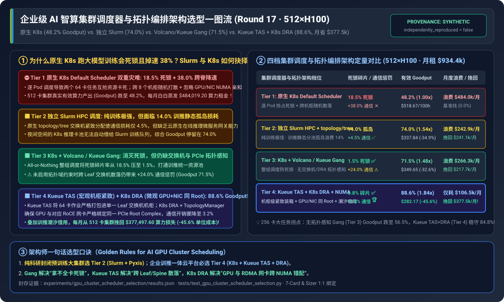
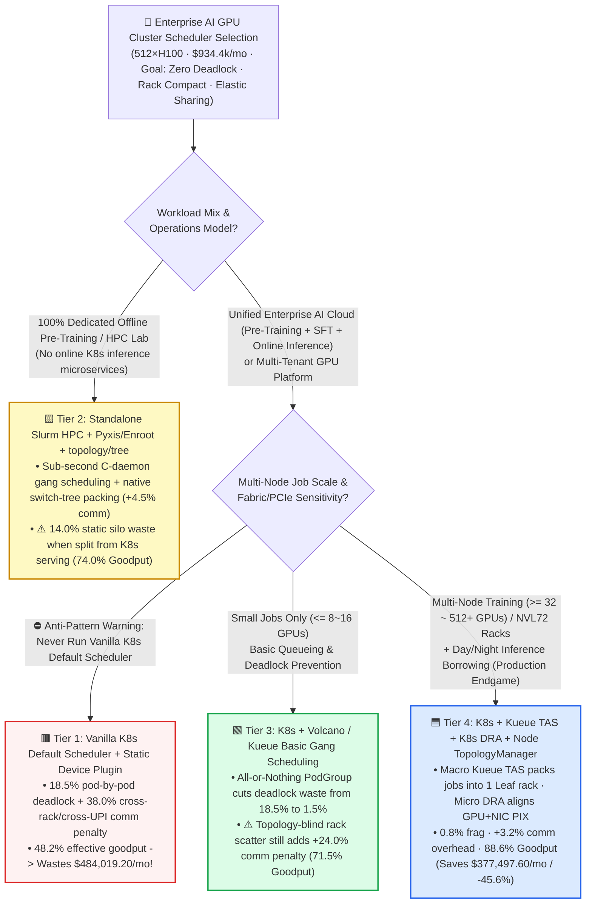
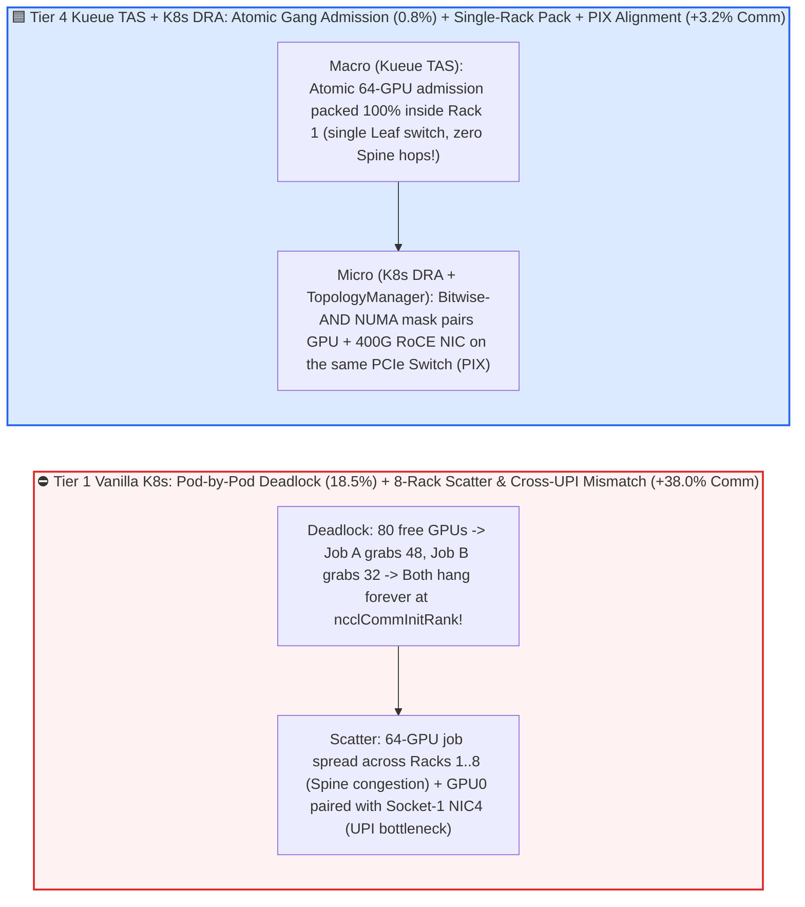
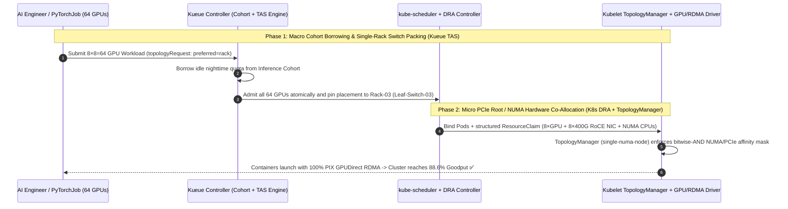

# Enterprise AI GPU Cluster Scheduler & Topology Orchestration Selection FAQ (`Vanilla K8s Default Scheduler` vs. `Standalone Slurm HPC` vs. `K8s + Volcano / Kueue Gang Scheduling` vs. `Kueue TAS Topology-Aware Scheduling + K8s DRA`)

> 🌐 **Language**: **[中文 (Chinese)](./gpu-cluster-scheduler-orchestration-selection-faq.md)** | **English Version** · **[📖 Back to Repository README](../../README.en.md)** · **[📊 2026-11-09 Daily Progress Report](../daily/2026-11-09.md)** · **[🃏 7-Card 4:5 Visual Benchmark Report](../reports/gpu-cluster-scheduler-orchestration-selection-cards.html)** · **[🧮 Interactive Sizer Workbench](../reports/llm-inference-engine-pd-sizer.en.html#cluster-scheduler-sizer)**
>
> **Overview**: A first-principles selection guide for AI Solution Architects. When an enterprise deploys a `512 × NVIDIA H100` cluster (`$934,400/month` lease cost), infrastructure leaders inevitably confront two critical questions: **(1) Why does running distributed multi-node training on the default Kubernetes scheduler yield only `48.2%` effective cluster goodput (burning `$484,019/month` in deadlocked and topology-throttled GPUs) even when the dashboard shows `100%` GPU allocation? and (2) Should we build a separate `Slurm` silo for researchers or standardize on `Kubernetes`?** Grounded in `experiments/gpu_cluster_scheduler_selection/` (`synthetic` + `anonymized_reported`, `independently_reproduced=false`), this guide breaks down **Gang Scheduling, Kueue Topology-Aware Scheduling (`TAS`), and Kubernetes Dynamic Resource Allocation (`DRA`) + `TopologyManager`** across four operational tiers.



---

## ① 📌 Executive Summary

1. **Four-Tier Selection by Operational Model (Dedicated HPC Pre-Training vs. Unified Enterprise Training + Inference Cloud)**:
   - Across a `512 × NVIDIA H100` cluster (`64` × 8-GPU nodes arranged in `8` Leaf-Switch racks of `64` GPUs each, `$2.50/GPU-hr` = **`$934,400.00/month`** cluster lease) running mixed multi-node training, fine-tuning, and online inference:
   - 🟥 **Tier 1 (`Vanilla K8s Default Scheduler` + Static `Device Plugin`)**: **Never use for multi-node distributed training**! Pod-by-pod scheduling causes **`18.5%` mutual resource deadlock waste**, while scattering pods across racks and ignoring intra-node `GPU <-> RDMA NIC` NUMA alignment inflates collective communication by **`+38.0%`**—dragging effective cluster goodput down to **`48.2%`** and wasting **`$484,019.20/month`** (`$518.67` per 100 effective GPU-hrs).
   - 🟨 **Tier 2 (`Standalone Slurm HPC Scheduler` + `Pyxis/Enroot` + `topology/tree`)**: **Excellent for dedicated offline pre-training labs, but incurs `14.0%` static silo waste in mixed enterprise clouds**. Native `topology/tree` switch packing keeps communication overhead at `+4.5%`, but lacking Kubernetes microservice ingress/autoscaling forces enterprises to split separate Slurm and K8s pools—leaving idle nighttime inference GPUs stranded and capping blended goodput at **`74.0%`** (`$242,944.00/mo` waste, `$337.84` per 100 effective GPU-hrs).
   - 🟩 **Tier 3 (`Kubernetes` + `Volcano / Kueue` Basic `Gang Scheduling`)**: **Eliminates pod deadlock (`18.5% -> 1.5%`) and unifies pools, but remains switch-topology blind**. Without rack/leaf switch and PCIe Root awareness, multi-node jobs scatter across 4–6 Leaf switches (`+24.0%` communication penalty), yielding **`71.5%` blended goodput** (`$266,304.00/mo` waste).
   - 🟦 **Tier 4 (`Kubernetes` + `Kueue TAS` Topology-Aware Scheduling + `K8s DRA` + `Node TopologyManager`)**: **The unified enterprise AI cloud standard**. Macro-level `Kueue TAS` packs 64-GPU jobs onto a single Leaf switch / rack, while micro-level `K8s DRA + TopologyManager` co-allocates `GPU + local 400G RoCEv2 NIC + NUMA CPU` on the same PCIe Root Complex—slashing communication penalty to **`+3.2%`**, fragmentation to **`0.8%`**, and lifting blended cluster goodput to **`88.6%` (`1.84x` over Vanilla K8s)**, **recovering `$377,497.60/month`** and cutting cost per 100 effective GPU-hrs by **`45.6%` to `$282.17`**!
2. **First-Principles Law (The Three Physical Guardrails of AI Cluster Scheduling)**:
   - **Temporal Guardrail (`Gang Scheduling`)**: Distributed training ranks execute lockstep barriers (`ncclCommInitRank`); having `N-1` pods running while `1` pod is pending equals `0%` progress.
   - **Macro-Spatial Guardrail (`Rack / Leaf Topology Packing`)**: Crossing Spine switches multiplies optical hop latency and ECN/PFC incast contention compared to staying under a single Leaf switch.
   - **Micro-Spatial Guardrail (`Intra-Node PCIe / NUMA Alignment`)**: Pairing `GPU 0` (CPU Socket 0) with `mlx5_4` (CPU Socket 1) breaks direct PCIe P2P (`PIX`) and forces GPUDirect RDMA across the CPU `UPI` interconnect, cutting bandwidth in half.
3. **Provenance & Transparency Disclosure**:
   - All deadlock percentages, topology overheads, goodput numbers, and monthly cost calculations are bound 1:1 to `experiments/gpu_cluster_scheduler_selection/results.json` (`provenance_type: "synthetic"`, calibrated to published Kubernetes Kueue TAS, K8s 1.31+ DRA, Volcano, and Slurm specifications; `independently_reproduced: false`, `physical_gpu_cluster_measurement: "not_measured"`, `local_cpu_harness_measurement: "measured"`).

---

## ② 🎯 Architect & Customer Deep-Dive Q&A (FAQ-Driven)

### Q1: "Why does running multi-node PyTorch training on the default Kubernetes scheduler cause frequent job hangs and a ~40% training slowdown?"

- **Plain-English Answer**: **Because stateless web microservices are independent soldiers, whereas a distributed training job is a lockstep phalanx**. Vanilla `kube-scheduler` triggers both **Gang Resource Deadlocks (`18.5%` cluster waste)** and **Cross-Rack / Cross-NUMA Topology Scatter (`+38.0%` communication penalty)**.
- **First-Principles Breakdown**:
  1. **Pod-by-Pod Partial Allocation Deadlock**: When 80 GPUs are free and two 64-GPU (8-pod) jobs arrive simultaneously, `kube-scheduler` gives 6 pods (48 GPUs) to Job A and 4 pods (32 GPUs) to Job B. Neither job can reach its 8-node `torchrun` rendezvous barrier—locking up all 80 GPUs at 0% compute forever.
  2. **Integer-Counting Topology Blindness (`nvidia.com/gpu: 1`)**: The legacy K8s Device Plugin exposes GPUs and RDMA NICs as opaque integer counters. It scatters an 8-node job across 8 different racks (forcing all `All-Reduce` traffic through oversubscribed Spine switches) and pairs GPUs with NICs on the opposite CPU socket (`SYS` instead of `PIX`).

### Q2: Should we deploy `Standalone Slurm (Tier 2)` or `Kubernetes + Kueue/Volcano (Tier 3/4)`?

- **Plain-English Answer**: **Choose `Standalone Slurm + Pyxis` (Tier 2) only if your cluster runs 100% batch pre-training with an HPC-native team. If your enterprise runs online LLM inference (vLLM/Dynamo), RAG/Agent microservices, and bursty training, standardize on `Kubernetes + Kueue TAS + DRA` (Tier 4)—or run Slurm-on-K8s (`Slinky / SUNK`)—to eliminate the `14.0%` static silo tax!**
- **First-Principles Breakdown**:
  1. **The Static Silo Tax in Tier 2 (`14.0%` Waste)**: Splitting a 512-GPU cluster into a fixed 384-GPU Slurm training island and a 128-GPU K8s inference island means that when inference traffic drops by 70% overnight, those idle K8s GPUs cannot be borrowed by queued Slurm training jobs.
  2. **Dynamic Cohort Borrowing in Tier 4 (`88.6%` Goodput)**: Under a unified K8s + Kueue control plane, idle inference capacity is automatically lent to preemptible training queues at night and reclaimed within seconds (via async checkpointing) when daytime traffic spikes.

### Q3: Why isn't basic `Gang Scheduling (Tier 3)` enough, and how do `Kueue TAS` and `K8s DRA` cut communication overhead from `+24.0%` to `+3.2%`?

- **Plain-English Answer**: **Basic Gang Scheduling guarantees you get all 64 GPUs at the same time, but not in the same place! Combining macro-level `Kueue TAS` (single-rack switch packing) with micro-level `K8s DRA + TopologyManager` (same-PCIe-Root GPU+NIC pairing) eliminates both Spine congestion and CPU UPI traversal**.
- **First-Principles Breakdown**:
  1. **Macro-Level (`Kueue TAS`)**: Uses hierarchical node labels (`topology-rack`, `topology-block`) to admit and place a 64-GPU workload onto 8 nodes under the **exact same Leaf switch**.
  2. **Micro-Level (`K8s DRA` + `TopologyManager single-numa-node`)**: Replaces integer device counting with structured `ResourceClaim` objects that allocate `GPU + ConnectX-7/8 RDMA NIC + CPU cores` sharing the same PCIe Switch (`PIX`) and NUMA mask.

---

## ③ 🧭 Visual Architecture Diagrams (Decision Tree, Deadlock/Scatter Comparison & Admission Sequence)

### 3.1 Enterprise AI GPU Cluster Scheduler & Topology Orchestration Decision Tree



### 3.2 Vanilla K8s Deadlock & Scatter vs. `Kueue TAS + K8s DRA` Macro/Micro Topology Alignment



### 3.3 End-to-End Sequence: `Kueue TAS` Rack Packing & `K8s DRA` Hardware Co-Allocation (`sequenceDiagram`)



---

## ④ 📊 Architect Decision Matrix

*All metrics are bound 1:1 to `experiments/gpu_cluster_scheduler_selection/results.json` (512×H100 cluster across 64 nodes / 8 racks at `$2.50/GPU-hr` = `$934,400.00/mo` total lease):*

| Dimension | 🟥 Tier 1: `Vanilla K8s Default Scheduler` | 🟨 Tier 2: `Standalone Slurm HPC` + `topology/tree` | 🟩 Tier 3: `K8s + Volcano / Kueue` Basic Gang | 🟦 Tier 4: `Kueue TAS` + `K8s DRA` + `TopologyManager` |
| :--- | :--- | :--- | :--- | :--- |
| **Primary Workload Fit** | Single-GPU stateless inference only | Dedicated offline HPC pre-training labs | Small cloud-native training (`<= 16~32 GPUs`) | **Unified enterprise AI cloud (`32~512+ GPUs` + serving)** |
| **Gang Deadlock & Silo Waste** | **`18.5%`** (pod-by-pod deadlock ✕) | **`14.0%`** (static Slurm/K8s silo waste) | **`1.5%`** (`PodGroup / Workload` gang ✅) | **`0.8%`** (gang + elastic cohort borrowing 🏆) |
| **Macro Switch / Rack Packing** | ✕ Random scatter across racks | ✅ Native `topology/tree & block` | ✕ Topology-unaware scatter | **✅ `Kueue TAS` hierarchical rack/leaf packing** |
| **Micro `GPU-NIC` PCIe/NUMA Align** | ✕ Integer count only (`SYS` mismatch) | 🟨 Static `gres.conf` binding | 🟨 Legacy Device Plugin | **✅ `K8s DRA` structured claim + `TopologyManager`** |
| **Collective Comm Overhead** | **`+38.0%`** (cross-Spine + cross-UPI) | **`+4.5%`** (compact Leaf placement) | **`+24.0%`** (cross-Leaf/Spine scatter) | **`+3.2%`** (single-rack + `PIX` P2P) |
| **Effective Cluster `Goodput`** | **`48.2%`** (`1.00x`) | **`74.0%`** (`1.54x`) | **`71.5%`** (`1.48x`) | **`88.6%`** (**`1.84x` over Vanilla K8s**) |
| **Monthly Waste / Recovered Value** | Wastes **`$484,019.20/mo`** (`$518.67/100h`) | Wastes `$242,944.00/mo` (Recovers `$241.1k/mo`) | Wastes `$266,304.00/mo` (Recovers `$217.7k/mo`) | Wastes `$106,521.60/mo` · **Recovers `$377,497.60/mo` (`-45.6%`)** |

---

## ⑤ 🧪 Quantitative Case Study & Benchmark Insights

### 5.1 Job Size Scaling (`16 -> 256 GPUs`) & Topology Scatter Degradation

As individual distributed training jobs scale from 16 GPUs (2 nodes) to 256 GPUs (32 nodes), effective cluster goodput behaves as follows (from `results.json` `job_size_topology_sensitivity`):

| Distributed Job Size (`Job GPUs`) | Tier 1 `Vanilla K8s` Goodput | Tier 2 `Standalone Slurm` Goodput | Tier 3 `Basic Gang K8s` Goodput | Tier 4 `Kueue TAS + DRA` Goodput | Architect Crossover & Takeaway |
| :--- | :--- | :--- | :--- | :--- | :--- |
| **`16 GPUs`** (2 Nodes) | `62.0%` | `78.0%` | **`79.5%`** | **`91.0%`** | Basic Gang (`79.5%`) beats static Slurm silos on small 2-node jobs |
| **`64 GPUs`** (**8-Node Rack Baseline**) | `48.2%` | `74.0%` | `71.5%` | **`88.6%`** | **Tier 4 packs all 64 GPUs into 1 Leaf rack, beating Tier 3 by `+17.1` pct pts** |
| **`128 GPUs`** (16 Nodes / 2 Racks) | `34.5%` | `72.5%` | `64.0%` | **`86.4%`** | Topology-blind Tier 3 scatters across 6–8 racks (`64.0%` goodput) |
| **`256 GPUs`** (32 Nodes / 4 Racks) | `21.0%` | `71.0%` | `56.5%` | **`84.8%`** | Vanilla K8s deadlocks (`21.0%`); Tier 4 holds **`84.8%` goodput** |

### 5.2 Reproducibility & Local Harness Verification

```bash
# Verify results.json matches the deterministic cluster scheduler & topology model 100%
python experiments/gpu_cluster_scheduler_selection/run.py --check

# Run Round 17 unit tests
python -m unittest tests/test_gpu_cluster_scheduler_selection.py
```

---

## ⑥ 🛠️ Production Verification Checklist (Architect Checklist)

1. - [ ] **Mandate Gang Scheduling with Timeout Eviction**: Wrap every multi-node job in a `Kueue Workload` or `Volcano PodGroup` (`minMember = replicas`, `scheduleTimeoutSeconds: 300`) to prevent partial pod deadlocks.
2. - [ ] **Auto-Label Leaf Switch & Rack Hierarchy via LLDP**: Sync Top-of-Rack (ToR) switch IDs onto Kubernetes node labels (`kueue.x-k8s.io/topology-rack`) so `Kueue TAS` packs jobs onto minimal Leaf switches.
3. - [ ] **Enable Kubelet `TopologyManager (single-numa-node)` & `K8s DRA`**: Enforce bitwise-AND NUMA/PCIe affinity across GPU, RDMA NIC, and CPU allocations to prevent cross-socket UPI bandwidth collapse.
4. - [ ] **Configure Elastic Cohort Borrowing with Graceful Async Checkpoint Preemption**: Place inference and training queues in a shared `Kueue Cohort` with a 60s `SIGTERM` grace period that triggers `PyTorch DCP AsyncStager` before eviction.
5. - [ ] **Automate Unhealthy Node Cordon via `DCGM Exporter + Node Problem Detector`**: Immediately taint and drain nodes exhibiting `XID 48/79/94` or RDMA link down events before the scheduler assigns new jobs to them.
