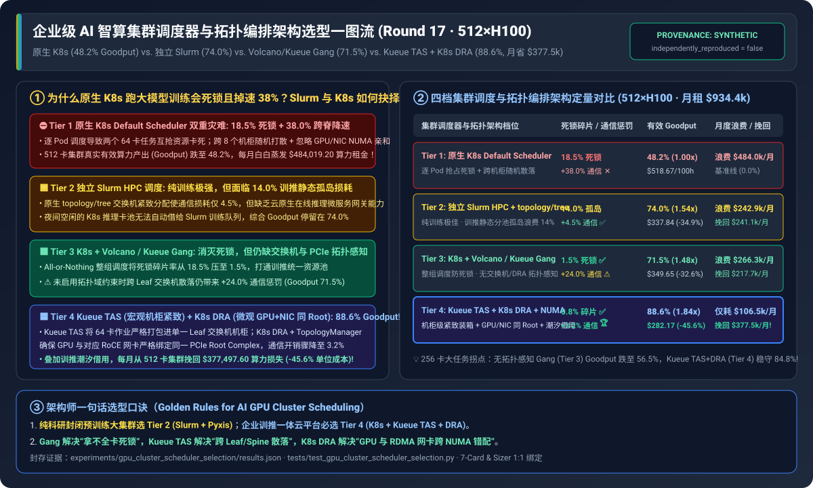
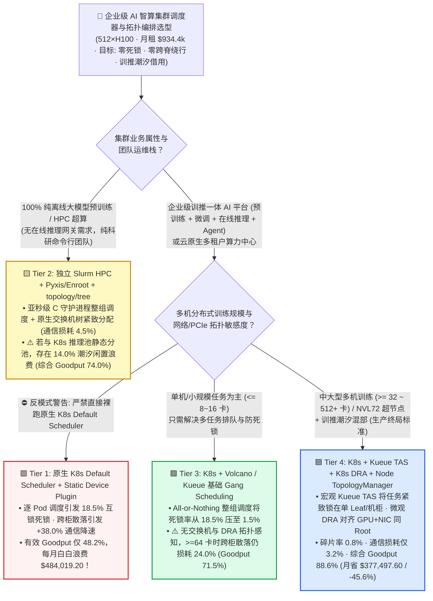
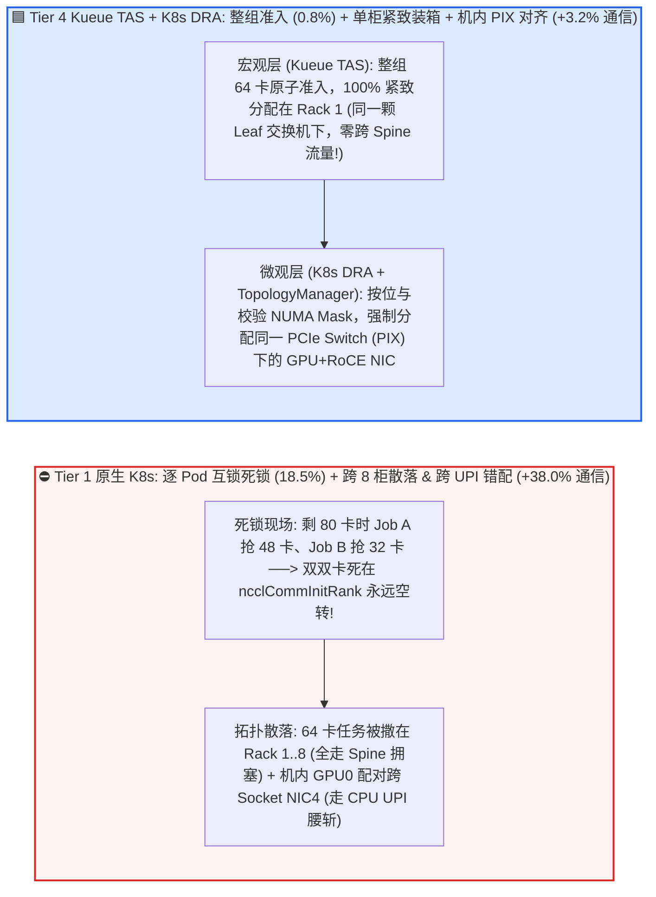
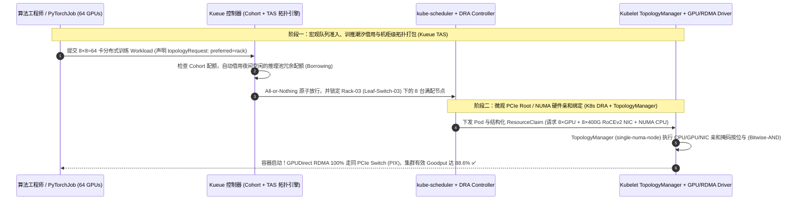

# 企业级 AI 智算集群调度器与拓扑编排架构选型指南（`原生 K8s Default Scheduler` vs. `独立 Slurm HPC 调度` vs. `K8s + Volcano / Kueue Gang Scheduling` vs. `Kueue TAS 拓扑感知调度 + K8s DRA 动态资源分配`）

> 🌐 **Language**: **中文 (Chinese)** | **[English Version](./gpu-cluster-scheduler-orchestration-selection-faq.en.md)** · **[📖 返回仓库根目录 README](../../README.md)** · **[📊 2026-11-09 每日进展日报](../daily/2026-11-09.md)** · **[🃏 7-Card 4:5 视觉评测报告](../reports/gpu-cluster-scheduler-orchestration-selection-cards.html)** · **[🧮 交互式定容工作台](../reports/llm-inference-engine-pd-sizer.html#cluster-scheduler-sizer)**
>
> **导读**：面向 AI Solution Architect 的第一性原理实战选型指南。当企业花费上千万美元采购 `512 × NVIDIA H100`（月度租金成本高达 `$934,400/月`）建设智算中心时，最常遇到的两大运营噩梦是：**① 为什么直接用企业现有的原生 Kubernetes 调度器跑多机训练，集群明明看起来 `100%` 分配满载，真实算力有效产出（Goodput）却只有可怜的 `48.2%`（每月白白蒸发 `$484,019` 算力费）？② 到底该听算法科学家的话搭一套独立的 `Slurm` 集群，还是听云原生团队的话全栈上 `Kubernetes`？** 本文基于 `experiments/gpu_cluster_scheduler_selection/` 封存的确定性模型（`synthetic` + `anonymized_reported`，`independently_reproduced=false`），从第一性原理拆解 **Gang Scheduling（防死锁整组调度）、Kueue TAS（交换机/机柜宏观拓扑紧致装箱）与 K8s DRA + TopologyManager（节点内 GPU-NIC-CPU 微观 PCIe/NUMA 亲和对齐）** 的四档架构选型边界。



---

## ① 📌 核心结论速览（Executive Summary）

1. **按业务形态（纯封闭科研预训练 vs. 企业训推一体云平台）四档精准选型**：
   - 在 `512 × NVIDIA H100` 集群（`64` 台 8 卡节点分布在 `8` 个 Leaf 交换机机柜，每柜 `64` 卡，`$2.50/GPU-hr` = 月度总租用成本 **`$934,400.00/月`**）运行多机分布式训练、微调与在线推理混合负载下：
   - 🟥 **Tier 1（原生 `K8s Default Scheduler` + 静态 `Device Plugin`）**：**严禁用于多机分布式训练或大规模 GPU 池**！因逐 Pod 调度引发 **资源互锁死锁（`18.5%` 集群碎片空转）**，且随机跨 8 个机柜打散节点并忽略机内 GPU-NIC NUMA 亲和（带来 **`+38.0%` 集合通信降速**），集群真实有效产出（Goodput）跌至 **`48.2%`**，每月白白浪费 **`$484,019.20`**（每百小时有效 GPU 算力真实成本高达 **`$518.67`**）。
   - 🟨 **Tier 2（独立 `Slurm HPC 调度器` + `Pyxis/Enroot` 容器插件 + `topology/tree`）**：**纯科研大模型预训练团队的经典利器，但在企业训推混合场景下存在 `14.0%` 静态孤岛浪费**。Slurm 原生支持亚秒级整组调度与交换机树拓扑紧致打包（通信惩罚仅 `+4.5%`），但缺乏在线推理微服务（Ingress/Autoscaler/CRD）治理能力；将 512 卡拆分为静态 Slurm 训练池与 K8s 推理池会导致夜间空闲推理卡无法借用，综合 Goodput 为 **`74.0%`**（月度浪费 `$242,944.00`，每百有效 GPU 小时成本 `$337.84`）。
   - 🟩 **Tier 3（`Kubernetes` + `Volcano / Kueue` 基础 `Gang Scheduling` 整组调度）**：**解决“拿不全卡死锁”与训推分池问题，但仍未解决“跨机柜散落”**。通过 `PodGroup / Workload` 全有或全无（All-or-Nothing）准入将死锁率从 `18.5%` 压至 **`1.5%`**；但因缺乏交换机层级与 PCIe Root 拓扑感知，跨 Leaf/Spine 散落仍带来 **`+24.0%` 通信开销**，综合 Goodput 停留在 **`71.5%`**（月度浪费 `$266,304.00`）。
   - 🟦 **Tier 4（`Kubernetes` + `Kueue TAS` 拓扑感知调度 + `K8s DRA` 动态资源分配 + `Node TopologyManager`）**：**企业级“训推一体”智算中心的唯一终局方案**。在宏观层由 `Kueue TAS` 将 64 卡作业 100% 紧致打包进单台 Leaf 交换机机柜，在微观层由 `K8s DRA + TopologyManager` 将 GPU 与同 PCIe Root Complex 下的 `400G RoCEv2 NIC` 及 CPU 核精准配对，将通信开销压至 **`+3.2%`**、死锁碎片率压至 **`0.8%`**，叠加夜间推理闲置卡自动借给可抢占训练队列（Cohort Borrowing），将综合 Goodput 推升至 **`88.6%`（比原生 K8s 提升 `1.84x`）**，**每月直接挽回 `$377,497.60` 算力损失**，每百有效 GPU 小时成本降至 **`$282.17`（立省 `45.6%`）**！
2. **第一性原理定性（AI 集群调度的“三大物理护栏”）**：
   - **时间护栏（Gang Scheduling）**：分布式训练所有 Rank 必须同时启动，`N-1` 张卡就绪等于 `0` 张卡可用；
   - **宏观空间护栏（Rack/Leaf Topology Packing）**：跨 Spine 交换机的光模块跳数与 Incast 拥塞比同 Leaf 交换机高数倍；
   - **微观空间护栏（Intra-Node PCIe/NUMA Alignment）**：分到 GPU 0 却绑定了挂载在 CPU Socket 1 上的网卡 `mlx5_4`，会导致 GPUDirect RDMA 退化为跨 CPU `UPI` 绕行，单卡带宽瞬间腰斩！
3. **证据口径与透明性声明**：
   - 本指南所有死锁碎片率、通信惩罚、有效 Goodput 与月度挽回账单均绑定 `experiments/gpu_cluster_scheduler_selection/results.json`（`provenance_type: "synthetic"`，基于 Kubernetes Kueue TAS、K8s 1.31+ DRA、Volcano 及 Slurm `topology/tree` 公开规范校准的确定性算例，`independently_reproduced: false`，未在生产 512×H100 集群执行破坏性死锁压测 `physical_gpu_cluster_measurement: "not_measured"`；本机 Python 单测与校验为 `local_cpu_harness_measurement: "measured"`）。

---

## ② 🎯 客户与架构师灵魂拷问 Q&A（FAQ-Driven）

### Q1：客户问：“我们已经用原生 Kubernetes 跑了几千个微服务容器，为什么直接拿原生 K8s Default Scheduler 调度多机大模型训练，集群经常卡死不动，且训练速度比单测慢了近 40%？”

- **直白结论**：**因为微服务是“彼此独立的散兵游勇（Stateless Pods）”，而大模型训练是“同生共死的连体方阵（Tightly-Coupled Gang）”**。用原生 K8s 调度大模型训练会同时引爆 **“半截工程死锁（Gang Deadlock）”** 与 **“拓扑盲目散落（Topology Scatter）”** 两颗炸弹！
- **第一性原理拆解（原生 K8s 的两大调度失灵现场）**：
  1. **失灵一：逐 Pod 调度引发“互锁死锁”（吃掉 `18.5%` 集群算力）**：假设集群当前剩余 `80` 张空闲 GPU，此时团队 A 和团队 B 同时提交了需要 `64` 张卡（8 个 Pod）的 `PyTorchJob`。原生 `kube-scheduler` 是逐个 Pod 循环调度的——结果任务 A 抢到了 `48` 张卡（6 个 Pod），任务 B 抢到了 `32` 张卡（4 个 Pod）。由于 `torchrun` 必须等齐全部 8 个节点才能完成 `ncclCommInitRank` 握手，**任务 A 和任务 B 双双卡在初始化屏障上永远干等，80 张昂贵的 H100 处于 100% 占用却 0% 计算的死锁空转状态**！
  2. **失灵二：把整数当硬件（`nvidia.com/gpu: 2` 的拓扑失明，拖慢 `+38.0%`）**：传统的 K8s `Device Plugin` 只向调度器汇报一个干巴巴的整数（例如“本节点剩余 4 张卡”）。调度器既不知道哪两张节点在同一个 Leaf 交换机下，也不知道节点内部哪张 GPU 和哪张 400G RoCE 网卡挂在同一颗 PCIe Switch（`PIX`）下，结果把一个 64 卡任务随机撒在 8 个不同机柜上，并在机内把 `GPU 0`（Socket 0）和 `NIC 4`（Socket 1）胡乱配对，导致全网 `All-Reduce` 慢了 **`38.0%`**！

### Q2：既然 `Slurm` 在超算中心用了二十年，我们该选 `独立 Slurm（Tier 2）` 还是 `Kubernetes + Kueue/Volcano（Tier 3/4）`？能不能兼得两者的优势？

- **直白结论**：**如果你的集群 100% 只跑离线预训练且团队全是 HPC 背景，选 `Slurm + Pyxis/Enroot`（Tier 2）最省心；但如果企业同时有在线大模型推理（vLLM/SGLang）、Agent 沙箱、RAG 微服务与多部门潮汐算力复用需求，必须选 `Kubernetes + Kueue TAS + DRA`（Tier 4，或者采用 `Slinky / SUNK` 在 K8s 底座之上托管虚拟 Slurm 队列）！**
- **第一性原理拆解（独立 Slurm 孤岛之痛 vs. 训推潮汐池化红利）**：
  1. **为什么独立 Slurm 在企业生产环境会浪费 `14.0%` 算力？** 企业白天的在线推理（Inference）流量是夜间的 3～5 倍。如果把 512 张卡硬切成“384 卡 Slurm 训练集群”和“128 卡 K8s 推理集群”两个物理孤岛，到了凌晨 00:00～08:00 推理低谷期，K8s 池里闲置的 96 张 H100 根本无法被 Slurm 里的排队训练任务借走！
  2. **`Kueue Cohort` 潮汐借用（Fair-Share Borrowing & Preemption）如何破局？** 在统一 K8s 底座（Tier 4）下，通过 `Kueue` 将推理池与训练池划入同一个 `Cohort`：白天推理高峰时，高优先级推理 Pod 瞬间毫秒级抢占归还算力；夜间推理低谷时，排队中的微调/预训练任务（配合第 3/14 轮的快速 Checkpoint）自动借用闲置推理卡，将全集群综合有效产出（Goodput）从 `74.0%` 推升至 **`88.6%`**！

### Q3：为什么光上 `Volcano / Kueue Gang Scheduling（Tier 3）` 还不够？什么是 `Kueue TAS（拓扑感知调度）` 与 `K8s DRA（动态资源分配）`？

- **直白结论**：**`Gang Scheduling` 只保证了“同时给齐 64 张卡”，但没保证“给你的 64 张卡挨在一起”！只有叠加 `Kueue TAS`（管机柜/交换机宏观紧致度）+ `K8s DRA & TopologyManager`（管单机内部 GPU/NIC/CPU 微观对齐），才能把跨网通信开销从 `+24.0%` 砍到 `+3.2%`！**
- **第一性原理拆解（宏观 `Kueue TAS` + 微观 `K8s DRA` 双剑合璧）**：
  1. **宏观层：`Kueue Topology-Aware Scheduling (TAS)` 交换机/机柜装箱**：通过给 K8s 节点打上物理拓扑标签（如 `kueue.x-k8s.io/topology-block: rack-01` 和 `topology-leaf: leaf-sw-01`），并在 Workload 中声明 `podSetUpdates.topologyRequest.preferred`，Kueue 会在准入时刻直接计算出**能把整个 64 卡作业塞进同一个 Leaf 交换机（甚至同一个 `NVL72` 液冷机柜）的节点组合**，避免流量跨 Spine 交换机绕行。
  2. **微观层：`K8s DRA (Dynamic Resource Allocation, K8s 1.31+)` 替代老旧 `Device Plugin`**：老旧的 `Device Plugin` 只能分配整数且无法协调多设备拓扑。`K8s DRA` 引入了结构化 `ResourceClaim`，配合节点 Kubelet `TopologyManager (single-numa-node)` 按位与（Bitwise-AND）亲和掩码校验，确保容器申请 `1×GPU + 1×RDMA NIC + 16×CPU` 时，**100% 分配同一颗 PCIe Switch（`PIX`）和同一个 NUMA 节点下的物理设备**，彻底杜绝跨 CPU Socket `UPI` 降速！

---

## ③ 🧭 直观可视化图解（选型决策树 + 散落死锁 vs 拓扑紧致对比 + 准入分配时序图）

### 3.1 企业级 AI 智算集群调度器与拓扑编排选型决策树



### 3.2 原生 K8s 死锁与跨机柜散落 vs. `Kueue TAS + K8s DRA` 宏观/微观双层拓扑对齐图



### 3.3 `Kueue TAS` 拓扑准入与 `K8s DRA + TopologyManager` 硬件亲和分配时序图（`sequenceDiagram`）



---

## ④ 📊 架构师选型决策矩阵（Architect Decision Matrix）

*数据完全绑定 `experiments/gpu_cluster_scheduler_selection/results.json`（512×H100 集群，64 节点 / 8 机柜，`$2.50/GPU-hr`，月度总租金 `$934,400.00/月`）：*

| 选型维度 | 🟥 Tier 1：原生 `K8s Default Scheduler` + 静态插件 | 🟨 Tier 2：独立 `Slurm HPC` + `Pyxis` + `topology/tree` | 🟩 Tier 3：`K8s + Volcano / Kueue` 基础 Gang 调度 | 🟦 Tier 4：`Kueue TAS` 拓扑感知 + `K8s DRA` + `NUMA` |
| :--- | :--- | :--- | :--- | :--- |
| **核心适用场景** | 仅限单卡独立微服务（严禁跑多机训练） | 纯离线科研大模型预训练 / 传统超算中心 | 中小规模云原生训练（`<= 16~32 卡` 任务为主） | **企业级训推一体智算云、百卡/千卡训练与 `NVL72` 超节点** |
| **防死锁整组调度 (`Gang Scheduling`)** | ✕ 不支持（逐 Pod 抢占引发 **`18.5%` 死锁浪费**） | ✅ 原生支持（但训推静态分池带来 **`14.0%` 孤岛浪费**） | ✅ 支持 `PodGroup / Workload`（死锁率 **`1.5%`**） | ✅ 支持 + 训推潮汐借用（碎片率仅 **`0.8%`**） |
| **交换机/机柜宏观拓扑感知** | ✕ 随机跨机柜打散 | ✅ 原生 `topology/tree & block` | ✕ 默认无感知（跨柜散落） | **✅ `Kueue TAS` 层级域紧致装箱（Rack / Block / Leaf）** |
| **机内 `GPU-NIC` 微观 PCIe/NUMA 对齐** | ✕ 仅认整数，跨 CPU UPI 错配 | 🟨 依赖 `gres.conf` 手工静态绑定 | 🟨 仅基础 Device Plugin | **✅ `K8s DRA` 结构化声明 + `TopologyManager` 强对齐** |
| **集合通信额外拓扑惩罚** | **`+38.0%`**（跨 Spine 拥塞 + 跨 Socket UPI） | **`+4.5%`**（同 Leaf 紧致） | **`+24.0%`**（跨 Leaf/Spine 散落） | **`+3.2%`**（单柜紧致 + 同 Root `PIX` 直通） |
| **集群真实有效产出 (`Goodput`)** | **`48.2%`** (`1.00x`) | **`74.0%`** (`1.54x`) | **`71.5%`** (`1.48x`) | **`88.6%`** (**`1.84x` vs 原生 K8s**) |
| **月度算力浪费 / 每月净挽回价值** | 浪费 **`$484,019.20/月`**（`$518.67/100h`） | 浪费 `$242,944.00/月`（挽回 `$241.1k/月`） | 浪费 `$266,304.00/月`（挽回 `$217.7k/月`） | 仅耗 `$106,521.60/月` · **每月净挽回 `$377,497.60` (`-45.6%`)** |

---

## ⑤ 🧪 简明定量算例与 Benchmark 洞察

### 5.1 单任务规模从 `16 卡 -> 256 卡` 增长下的拓扑散落惩罚与 Goodput 拐点

当集群中运行的分布式训练单任务规模从 2 节点（16 卡）增大到 32 节点（256 卡）时，四档调度器的有效 Goodput 表现如下（源自 `results.json` `job_size_topology_sensitivity`）：

| 分布式任务卡数 (`Job GPUs`) | Tier 1 `原生 K8s` Goodput | Tier 2 `独立 Slurm` Goodput | Tier 3 `K8s 基础 Gang` Goodput | Tier 4 `Kueue TAS + DRA` Goodput | 架构师核心拐点解读 |
| :--- | :--- | :--- | :--- | :--- | :--- |
| **`16 GPUs`**（2 节点微调） | `62.0%` | `78.0%` | **`79.5%`** | **`91.0%`** | 16 卡任务跨机柜概率较低，基础 Gang (`79.5%`) 已能超过静态分池的 Slurm |
| **`64 GPUs`**（**8 节点整柜基线**） | `48.2%` | `74.0%` | `71.5%` | **`88.6%`** | **Tier 4 将 64 卡精准锁进单台 64 卡机柜，Goodput 高出 Tier 3 达 `+17.1` 个百分点** |
| **`128 GPUs`**（16 节点双柜训练） | `34.5%` | `72.5%` | `64.0%` | **`86.4%`** | 无拓扑感知的 Tier 3 被随机散落到 6~8 个机柜，Goodput 跌至 `64.0%` |
| **`256 GPUs`**（32 节点半集群训练） | `21.0%` | `71.0%` | `56.5%` | **`84.8%`** | 256 卡下原生 K8s 基本死锁瘫痪（`21.0%`），Tier 4 依靠紧凑分块稳守 **`84.8%`** |

### 5.2 复现命令与本地校验（Local CPU Harness Check）

```bash
# 校验封存算例 JSON 与确定性集群调度拓扑模型 100% 一致
python experiments/gpu_cluster_scheduler_selection/run.py --check

# 运行 Round 17 单元测试
python -m unittest tests/test_gpu_cluster_scheduler_selection.py
```

---

## ⑥ 🛠️ 附录：生产环境 AI 集群调度与拓扑核验清单（Architect Checklist）

1. - [ ] **强制开启整组原子调度（Gang Scheduling）与超时回收**：所有多机训练任务（`PyTorchJob / RayJob / MPIJob`）必须绑定 `Kueue Workload` 或 `Volcano PodGroup`（设置 `minMember = replicas` 及 `scheduleTimeoutSeconds: 300`），严禁半截 Pod 占卡干等。
2. - [ ] **注入三层物理拓扑标签（Spine / Leaf-Rack / NVLink-Block）**：通过 LLDP 自动发现脚本或交换机遥测，将每个节点的物理机柜与上联 Leaf 交换机 ID 自动同步为 K8s Node Labels，配置 `Kueue Topology` 层级。
3. - [ ] **节点 Kubelet 开启 `TopologyManager (single-numa-node)` 与 `K8s DRA`**：在双路 GPU 服务器上配置 `--topology-manager-policy=single-numa-node` 与 `--topology-manager-scope=container`，杜绝 GPU 与 RDMA 网卡跨 CPU Socket 配对。
4. - [ ] **打通训推共享 `Cohort` 潮汐借用与优雅抢占（Graceful Preemption）**：将在线推理队列设为高优先级、训练队列设为可借用低优先级，并配置抢占前 `SIGTERM` 宽限期（如 `60s`）触发第 3 轮的 `PyTorch DCP AsyncStager` 秒级存盘后再退出。
5. - [ ] **部署故障节点自动摘除闭环（`Node Problem Detector + DCGM Exporter`）**：当监测到 GPU `XID 48/79/94` 或 RDMA 端口 Down 时，秒级自动对节点执行 `kubectl cordon/taint` 并触发作业重调度，防止坏节点成为黑洞反复吸纳新任务。
