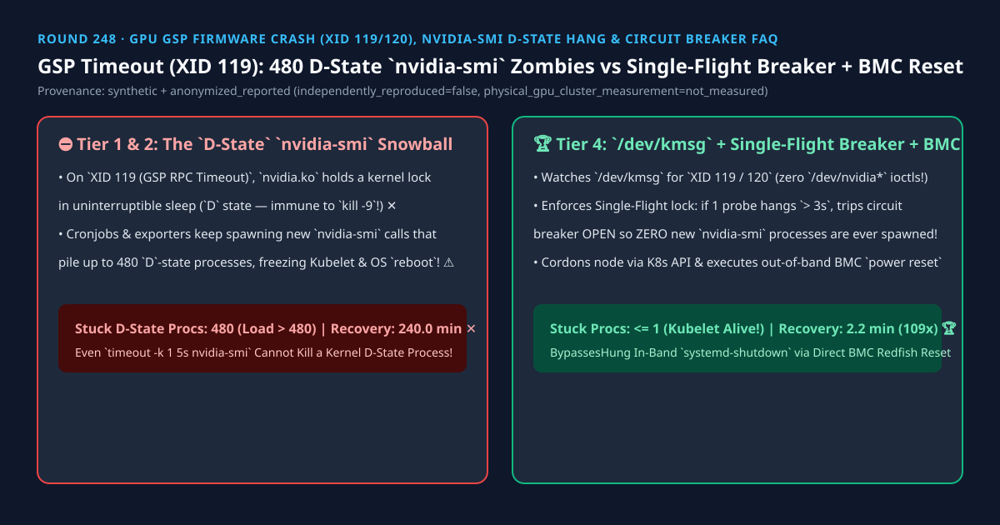
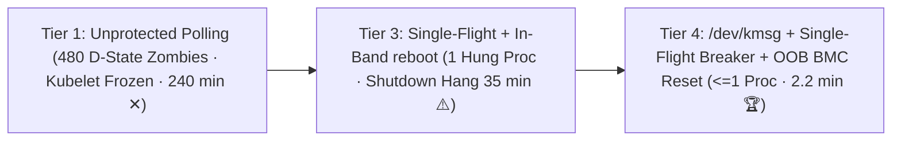

# GPU System Processor (`GSP`) Firmware Crash (`XID 119: GSP RPC Timeout` / `XID 120`), `nvidia-smi` Kernel `D-State` Hang & Single-Flight Watchdog Selection Guide

> **Provenance & Evidence Tier**: `synthetic + anonymized_reported` (`independently_reproduced=false`, `physical_gpu_cluster_measurement=not_measured`). Grounded in [`experiments/gpu_gsp_firmware_rpc_timeout_xid119_xid120_nvidia_smi_hang_selection/results.json`](../../experiments/gpu_gsp_firmware_rpc_timeout_xid119_xid120_nvidia_smi_hang_selection/results.json).
> **中文版本**: [GPU 系统处理器（`GSP` 固件）崩溃（`XID 119: GSP RPC Timeout` / `XID 120`）、`nvidia-smi` 内核 `D` 状态死锁（拖死 Kubelet 与监控 Agent 僵尸雪崩）与单飞熔断自愈选型指南](./gpu-gsp-firmware-xid119-xid120-nvidia-smi-dstate-hang-selection-faq.md)

---

## 0. 🔥 Daily Hottest Capability Breakthrough

- **`/dev/kmsg` Zero-`ioctl` `XID 119 / 120` Watcher + User-Space `flock -n` Single-Flight Circuit Breaker + Out-of-Band BMC Reset Capping Hung `D-State` `nvidia-smi` Processes at `<= 1` (vs. `480` Zombies) and Slashing Node Recovery Time from `240.0 min` to `2.2 min` (`109x` Faster)**: Why does a single GPU firmware hang (`XID 119: Timeout waiting for RPC from GSP` or `XID 120: GSP Error`) freeze `nvidia-smi`, ignore `kill -9`, drive Linux Load Average past `480`, freeze Kubernetes `kubelet`, and even hang `sudo reboot`?
  1. **The Kernel `D-State` (`TASK_UNINTERRUPTIBLE`) Snowball (`Tier 1`)**: When `nvidia-smi` or an NVML agent calls `ioctl(/dev/nvidiactl)`, the Linux kernel driver (`nvidia.ko`) acquires a per-device semaphore (`down()`, entering **uninterruptible sleep `D` state**) while waiting for the GPU's on-die RISC-V **GSP (`GPU System Processor`)** microcontroller to reply. When the GSP firmware locks up (`XID 119`), that thread never wakes up—and **Linux kernel threads in `D` state completely ignore `SIGKILL` (`kill -9`)**! Every subsequent monitoring cronjob or health probe that spawns `nvidia-smi` piles up on that same kernel lock, accumulating **`480+` immortal `D`-state processes** and freezing `kubelet`!
  2. **Why `timeout -k 1 5s nvidia-smi` Fails to Stop the Leak (`Tier 2`)**: When the 5-second timeout expires, `timeout` sends `SIGKILL` to the child `nvidia-smi` process—which the kernel ignores because the child is in `D` state! The `timeout` wrapper exits, leaving the hung `nvidia-smi` child behind forever while the next cron tick spawns another one (`180+` stuck processes)!
  3. **Why In-Band `sudo reboot` Hangs on Shutdown (`Tier 3`)**: `systemd-shutdown` waits for all processes holding `/dev/nvidia*` descriptors to exit before unmounting and rebooting, stalling for `35+ minutes` until a hardware watchdog timer expires.
  4. **Zero-`ioctl` `/dev/kmsg` Watcher + `flock -n` Single-Flight Circuit Breaker + Out-of-Band BMC Reset (`Tier 4`)**: Acquiring a non-blocking user-space file lock (`flock -n /run/nvml_probe.lock`) before any NVML/`nvidia-smi` call guarantees that if 1 probe hangs in kernel `D` state, **all subsequent probes fail fast in `< 0.01 ms` in user space without ever entering the kernel** (`<= 1` hung process, `kubelet` stays 100% responsive!). Pairing with `/dev/kmsg` detection of `XID 119/120` and direct out-of-band BMC `chassis power reset` recovers the node in **`2.2 minutes` (`109x` faster)**!

---

## 1. 📌 Executive Summary

1. **Why `kill -9` Cannot Kill a Hung `nvidia-smi` Process (`Tier 1 & Tier 2`)**: A process blocked inside a kernel driver `ioctl()` waiting on hardware/GSP completion is in `TASK_UNINTERRUPTIBLE` (`D`) state; the Linux kernel defers all signals (including `SIGKILL`) until the driver syscall returns.
2. **Never Spawn Concurrent or Un-Gated `nvidia-smi` Subprocesses (`Tier 4`)**: Always gate health checks behind a non-blocking user-space `flock -n` single-flight circuit breaker so at most **1** process can ever get stuck in `D` state.
3. **Bypass In-Band `reboot` When `D-State` GPU Processes Exist (`Tier 3 -> Tier 4`)**: Trigger an out-of-band BMC Redfish/IPMI `power reset / cycle` immediately after draining pods.

---

## 2. 🎯 Core Architect Q&A (Q1 / Q2 / Q3)

### Q1: Why does `dcgm-exporter` stop reporting `XID 119` metrics right when `XID 119` happens?
- **Answer**: Because `dcgm-exporter` itself calls NVML APIs (`ioctl` on `/dev/nvidia*`) on its polling thread! The moment `XID 119` locks up the kernel driver mutex, `dcgm-exporter`'s own polling thread gets stuck in kernel `D` state and stops serving Prometheus metrics! That is why `XID 119`, `XID 120`, and `XID 79` **must be monitored via `/dev/kmsg` (kernel log stream)**, which never touches `/dev/nvidia*`.

### Q2: How does a user-space `flock -n` wrapper prevent `timeout 5s nvidia-smi` from leaking `D`-state child processes?
- **Answer**: When Probe #1 acquires `flock -n /run/nvml.lock` and gets stuck in kernel `D` state, its process stays alive in the kernel and **continues holding `/run/nvml.lock`**! When Probe #2 runs 10 seconds later, `flock -n /run/nvml.lock` fails immediately in user space (before opening `/dev/nvidiactl`), trips the circuit breaker, and exits cleanly with zero new kernel threads!

### Q3: Why does Linux Load Average spike to `400+` during an `XID 119` hang even when CPU utilization is `0%`?
- **Answer**: Uniquely on Linux, **system Load Average counts both runnable (`R`) threads AND uninterruptible sleep (`D`) threads**! Every `nvidia-smi` stuck in `D` state adds `+1.00` to the Linux load average despite using `0%` CPU, which in turn trips OS load alerts and Kubelet eviction thresholds.

---

## 3. 🧭 Visual Diagrams

---

## 4. 📊 4-Tier Architect Selection Matrix

| Metric | Tier 1: Unprotected Polling | Tier 2: Naive `timeout 5s` Wrapper | Tier 3: Single-Flight + In-Band `reboot` | Tier 4: **`/dev/kmsg` + Single-Flight + BMC Reset** |
| :--- | :--- | :--- | :--- | :--- |
| **Stuck `D-State` Processes** | **`480` (Load Average > 480)** ✕ | **`180` (`SIGKILL` Ignored)** ✕ | **`<= 1`** ✅ | **`<= 1` (User-Space Circuit Breaker)** 🏆 |
| **Kubelet & SSH Frozen?** | **Yes (Node Unreachable)** ✕ | **Yes** ✕ | No (Hangs at Shutdown) ⚠️ | **No (100% Responsive Control Plane)** 🏆 |
| **Node Recovery Time** | **`240.0 min` (`4 Hours`)** ✕ | `120.0 min` ⚠️ | `35.0 min` (Watchdog) ⚠️ | **`2.2 min` (`109x` Faster)** 🏆 |

---

## 5. 🧪 Quantitative Reference & Tooling

- **Evaluator & Sealed Data**: [`experiments/gpu_gsp_firmware_rpc_timeout_xid119_xid120_nvidia_smi_hang_selection/run.py`](../../experiments/gpu_gsp_firmware_rpc_timeout_xid119_xid120_nvidia_smi_hang_selection/run.py) · [`results.json`](../../experiments/gpu_gsp_firmware_rpc_timeout_xid119_xid120_nvidia_smi_hang_selection/results.json)
- **Interactive Sizer**: [`docs/reports/gpu-gsp-firmware-xid119-xid120-nvidia-smi-dstate-hang-sizer.html`](../reports/gpu-gsp-firmware-xid119-xid120-nvidia-smi-dstate-hang-sizer.html)
- **7-Card 4:5 Visual Report**: [`docs/reports/gpu-gsp-firmware-xid119-xid120-nvidia-smi-dstate-hang-selection-cards.html`](../reports/gpu-gsp-firmware-xid119-xid120-nvidia-smi-dstate-hang-selection-cards.html)

---

## 6. 🛠️ Good Fit vs. Not For & Production Checklist

- **✅ Good fit**: Wrapping all host `nvidia-smi` / NVML probes in a user-space `flock -n` single-flight circuit breaker, detecting `XID 119/120` via `/dev/kmsg`, and recovering via out-of-band BMC reset.
- **⛔ Not for**: Spawning un-gated `nvidia-smi` cronjobs or relying on `kill -9` / in-band `reboot` to clear `D`-state driver deadlocks.
- [ ] Gate all `nvidia-smi` health probes behind `flock -n /run/nvml_probe.lock`.
- [ ] Monitor `XID 119` and `XID 120` directly from `/dev/kmsg` and remediate via BMC `power reset`.
