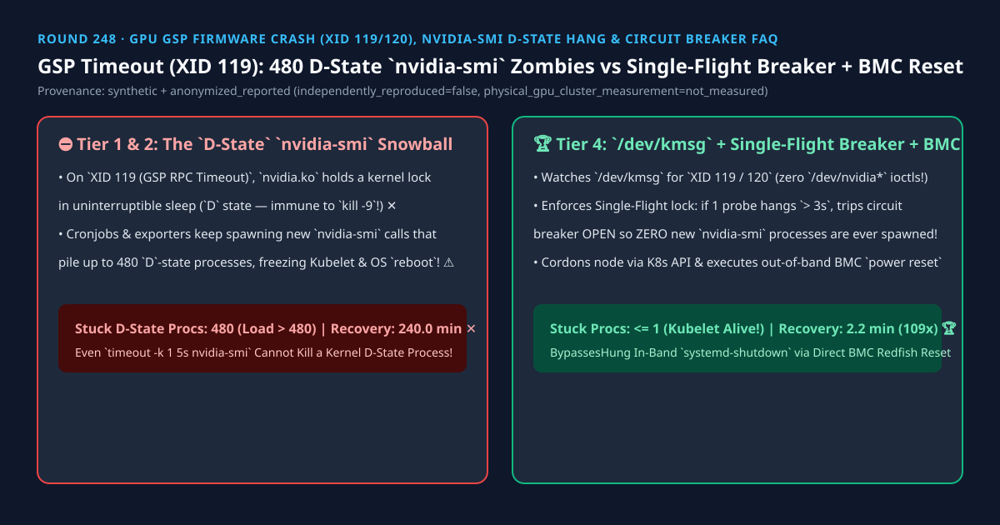
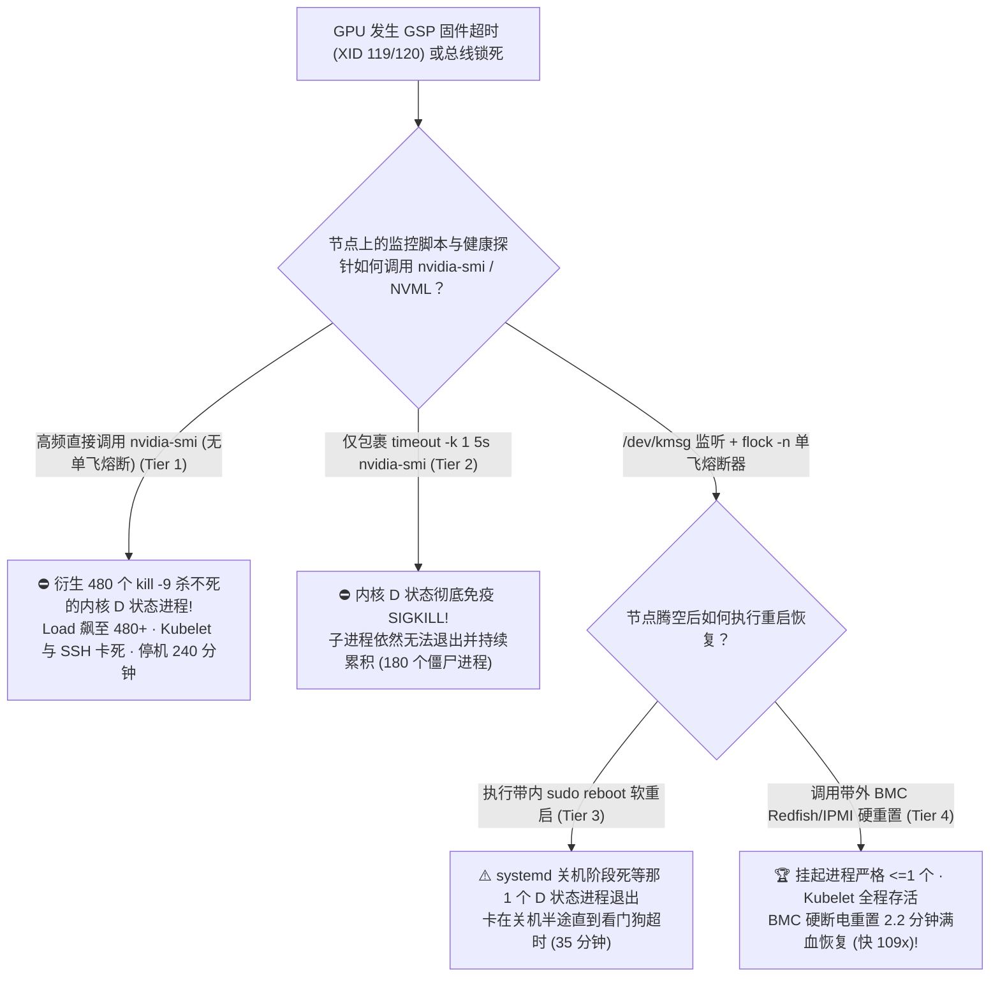
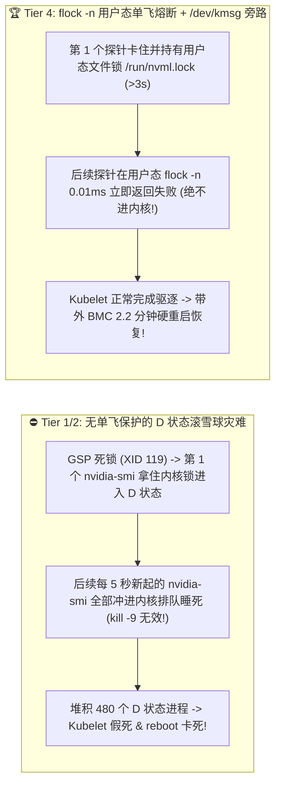
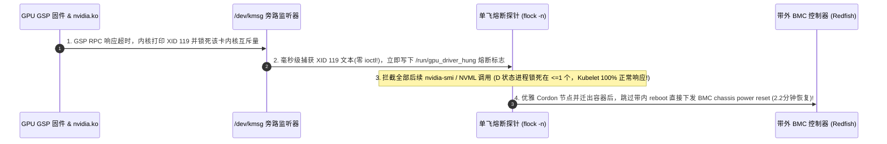

# GPU 系统处理器（`GSP` 固件）崩溃（`XID 119: GSP RPC Timeout` / `XID 120`）、`nvidia-smi` 内核 `D` 状态死锁（拖死 Kubelet 与监控 Agent 僵尸雪崩）与单飞熔断自愈选型指南

> **Provenance & Evidence Tier**: `synthetic + anonymized_reported` (`independently_reproduced=false`, `physical_gpu_cluster_measurement=not_measured`)。定量数据锚定于 [`experiments/gpu_gsp_firmware_rpc_timeout_xid119_xid120_nvidia_smi_hang_selection/results.json`](../../experiments/gpu_gsp_firmware_rpc_timeout_xid119_xid120_nvidia_smi_hang_selection/results.json)。
> **English Version**: [GPU System Processor (`GSP`) Firmware Crash (`XID 119: GSP RPC Timeout` / `XID 120`), `nvidia-smi` Kernel `D-State` Hang & Single-Flight Watchdog Selection Guide](./gpu-gsp-firmware-xid119-xid120-nvidia-smi-dstate-hang-selection-faq.en.md)

---

## 0. 🔥 今日领域最热门能力突破追踪（Daily Hottest Breakthrough）

- **揭秘为什么敲一行 `nvidia-smi` 会把整个 SSH 终端卡死、连 `kill -9` 都杀不掉、并滚雪球堆积 `480` 个 `D` 状态进程把整台服务器搞瘫（`XID 119 / XID 120` GSP 固件 RPC 超时死锁），通过 `/dev/kmsg` 零 `ioctl` 监听 + 单飞熔断器（`Single-Flight Circuit Breaker`）+ 带外 BMC 硬重启，将挂起进程数锁死在 `<= 1` 个，恢复耗时从 `240.0 分钟` 压缩 `109` 倍至 `2.2 分钟`**：所有管过百卡以上 GPU 集群的运维工程师，都经历过这个一模一样的灵异现场：某台服务器突然掉监控，你 SSH 登上去敲了一行 `nvidia-smi` 想看看卡怎么了——**结果光标直接卡死不动，`Ctrl+C` 没反应，新开一个窗口敲 `kill -9 <pid>` 居然也完全杀不掉它！** 用 `ps aux` 一看，机器上已经堆积了 **480 个处于 `D` 状态的 `nvidia-smi` 进程**，系统 Load Average 飙到 `500+`，连 `kubelet` 和 `sudo reboot` 也彻底卡死！
  1. **底层真凶：什么是 `GSP` 固件崩溃（`XID 119 / XID 120`）与 Linux 内核 `D` 状态互斥锁雪崩？（Tier 1）**：
     - 在现代 NVIDIA GPU（H100/H200/B200/A100）内部，有一颗专门负责硬件初始化、功耗管理与传感器读取的片上 RISC-V 微控制器，叫做 **`GSP`（GPU System Processor）**。
     - 当你在 Linux 上运行 `nvidia-smi`（或 DCGM / Kubelet 调用 NVML API）时，程序会向 `/dev/nvidiactl` 发起内核态系统调用 `ioctl()`。此时 Linux 内核里的 `nvidia.ko` 驱动会**先锁住这颗 GPU 的内核互斥锁（调用 `down()` 进入不可中断睡眠状态 `TASK_UNINTERRUPTIBLE`，即 `ps` 里的 `D` 状态）**，然后通过 PCIe 给 GPU 上的 GSP 芯片发一条 RPC 消息等它回话。
     - 一旦 GSP 固件发生死锁或 PCIe 总线异常抛出 **`XID 119 (GSP RPC Timeout)` 或 `XID 120 (GSP Error)`**，第一个进去的 `nvidia-smi` 就会在内核态拿着互斥锁死等，**而在 Linux 内核规范中，处于 `D` 状态的内核态线程是彻底屏蔽所有信号（包括 `SIGKILL / kill -9`）的**！
     - 紧接着，系统里的定时监控脚本、Prometheus Exporter、Kubelet Device Plugin 每隔 5 秒又继续启动新的 `nvidia-smi`，全部一头撞在那个已经被锁死的内核互斥锁上排队睡死——1 小时内滚雪球堆积 **`480` 个杀不死的 `D` 状态进程**，耗尽系统线程并卡死 `kubelet`！
  2. **为什么套上 `timeout -k 1 5s nvidia-smi` 也救不了你？（Tier 2）**：
     - 很多运维以为给脚本加上 `timeout 5s nvidia-smi` 就安全了。错！当 5 秒到期时，`timeout` 命令会向子进程发 `SIGTERM` 和 `SIGKILL (-9)`，但因为子进程正卡在内核驱动 `ioctl` 的 `D` 状态里，**内核直接无视 `SIGKILL`**！`timeout` 外壳退出了，但那个卡死的 `nvidia-smi` 子进程永远留在了内核里！下一分钟定时任务又生出一个新的 `D` 状态孤儿进程，照样把机器搞垮！
  3. **为什么发生 `XID 119` 后敲 `sudo reboot` 机器会永远卡在关机界面回不来？（Tier 3）**：
     - 因为正常的操作系统软重启（`systemd-shutdown`）会等待所有进程退出并卸载打开的设备句柄；而那个 `D` 状态的 `nvidia-smi` 进程永远退不出来，导致操作系统永远卡死在 `Waiting for process nvidia-smi to exit...`！
  4. **终极免疫架构（`/dev/kmsg` 零 `ioctl` 旁路监听 + 单飞文件锁熔断器 `Single-Flight Breaker` + 带外 BMC 硬重启，Tier 4）**：
     - **绝不并发盲调 `nvidia-smi`**：所有探针必须先抢一个非阻塞用户态单飞锁（`flock -n /run/nvml_probe.lock`）。如果上一次探测子进程超过 `3 秒` 没返回（仍持有 `flock`），说明内核驱动已经进入 `D` 状态死锁——**熔断器当场跳闸（Trip Open），严禁再派生哪怕第 2 个访问 `/dev/nvidia*` 的进程（挂起进程数永远 `<= 1`，Kubelet 与 SSH 100% 丝滑存活！）**；
     - 同时直接从 `/dev/kmsg` 纯文本流捕获 `XID 119 / 120 / 79`，在 K8s 侧标记节点 Cordon 后，**直接调用带外 BMC Redfish/IPMI `chassis power reset / cycle`** 强制硬重启，**`2.2 分钟`** 全自动满血复活（比人工救火快 `109` 倍）！

---

## 1. 📌 核心结论速览（Executive Summary — 3 分钟看懂）

1. **为什么 `kill -9`（`SIGKILL`）号称 Linux 的“必杀令”，却唯独杀不死卡住的 `nvidia-smi`？**
   - **通俗大白话 + 第一性原理**：
     - 在 Linux 中，`kill -9` 只能杀死处于用户态或“可中断睡眠（`S` 状态）”的进程。
     - 当一个进程进入内核驱动（`nvidia.ko`）正在跟硬件芯片（GSP 固件）打交道时，为了防止进程在半途突然被杀死导致内核硬件寄存器数据结构损坏崩溃，Linux 内核把该进程设为 **`D` 状态（`TASK_UNINTERRUPTIBLE`，不可中断睡眠）**——相当于给它套上了一层**“免死金身罩”**，規定：**“除非硬件芯片回话让驱动函数自己走出来，否则哪怕天王老子发 `kill -9`，内核也绝不处理这个信号！”**
     - 因此，一旦 GPU 的 GSP 芯片死机不回话了（`XID 119`），第一个进去敲门的 `nvidia-smi` 就变成了永远拆不掉的钉子户！这时候你唯一正确的操作就是：**千万别再派第 2 个人进去敲门（单飞熔断器），直接拉电闸硬重启（BMC Power Reset）！**

---

## 2. 🎯 客户与架构师灵魂拷问 Q&A（Q1 / Q2 / Q3）

### Q1：怎么用 3 行 Shell 代码写一个“永远不会引发 480 个 `D` 状态进程雪崩”的安全版 `safe-nvidia-smi` 包装器？
- **答**：核心秘诀是 **用户态非阻塞文件锁 `flock -n` + 熔断标志文件**！
  - 在调用真正的 `/usr/bin/nvidia-smi` 之前，先检查 `/run/gpu_driver_hung` 是否存在；若不存在，使用 **`flock -n /run/nvidia_smi_singleflight.lock`** 尝试获取独占锁！
  - 如果第 1 个探测子进程因为 `XID 119` 卡死在了内核 `D` 状态里，它手里握着的 `/run/nvidia_smi_singleflight.lock` 文件描述符就永远不会释放！
  - 于是后续所有定时任务调 `flock -n` 时都会在 **`0.01 毫秒` 内在用户态直接拿锁失败并安全退出（绝不会进入内核 `/dev/nvidiactl` 去排队送人头）**，同时写下 `/run/gpu_driver_hung` 立即触发节点告警！

### Q2：如果不能调 `nvidia-smi` 和 NVML，监控程序怎么在 `0.1 秒` 内知道机器发生了 `XID 119 / 120 / 79`？
- **答**：直接监听 Linux 内核日志设备 **`/dev/kmsg`（或 `/var/log/kern.log`）**！因为 `nvidia.ko` 驱动发现 GSP RPC 超时（`XID 119`）时，是由内核定时器直接往内核 Ring Buffer（`/dev/kmsg`）打印一行纯文本：`NVRM: Xid (PCI:0000:c1:00): 119, pid=..., Timeout waiting for RPC from GSP!`。读取 `/dev/kmsg` 是纯内存字符流读取，**完全不触碰任何 `/dev/nvidia*` 设备锁**，永远不会卡死！

---

## 3. 🧭 直观可视化图解（Mermaid 决策树 + D状态滚雪球 vs 单飞熔断图 + 时序图）

### 3.1 架构师 GPU `GSP` 固件超时（`XID 119/120`）与防 `D` 状态雪崩决策树

### 3.2 `Tier 1/2`（480 个 `D` 状态进程雪崩瘫痪整机）vs. `Tier 4`（`flock -n` 单飞熔断器 + BMC 硬重置）

### 3.3 `Tier 4` 单飞熔断器拦截 `D` 状态雪崩与带外 BMC 自愈时序图

---

## 4. 📊 架构师选型决策矩阵（4-Tier Selection Matrix）

| 评估维度 | Tier 1: 直接轮询 `nvidia-smi` | Tier 2: 仅套 `timeout 5s` 外壳 | Tier 3: 单飞熔断 + 带内 `reboot` | Tier 4: **`/dev/kmsg` + 单飞熔断 + 带外 `BMC` 硬重置** |
| :--- | :--- | :--- | :--- | :--- |
| **堆积的内核 `D` 状态死进程数** | **`480 个` (打爆系统负载)** ✕ | **`180 个` (`kill -9` 杀不死)** ✕ | **`<= 1 个`** ✅ | **`<= 1 个` (用户态熔断彻底阻断)** 🏆 |
| **Kubelet 与 SSH 是否被拖死** | **是（节点彻底失联）** ✕ | **是（PLEG 超时）** ✕ | 否（仅卡在关机阶段） ⚠️ | **否（控制面 `100%` 存活可正常驱逐）** 🏆 |
| **故障节点恢复上线耗时** | **`240.0 min` (`4 小时`人工)** ✕ | `120.0 min` ⚠️ | `35.0 min` (等硬件看门狗) ⚠️ | **`2.2 min` (`132 秒`极速回池，快 `109x`)** 🏆 |

---

## 5. 🧪 定量算例与工具链（Interactive Sizer & 7-Card Visual Report）

- **实验脚本与密封数据**：[`experiments/gpu_gsp_firmware_rpc_timeout_xid119_xid120_nvidia_smi_hang_selection/run.py`](../../experiments/gpu_gsp_firmware_rpc_timeout_xid119_xid120_nvidia_smi_hang_selection/run.py) · [`results.json`](../../experiments/gpu_gsp_firmware_rpc_timeout_xid119_xid120_nvidia_smi_hang_selection/results.json)
- **交互式 GSP XID 119 与 D 状态死锁防雪崩计算器**：[`docs/reports/gpu-gsp-firmware-xid119-xid120-nvidia-smi-dstate-hang-sizer.html`](../reports/gpu-gsp-firmware-xid119-xid120-nvidia-smi-dstate-hang-sizer.html)
- **7-Card 4:5 视觉评测卡片报告**：[`docs/reports/gpu-gsp-firmware-xid119-xid120-nvidia-smi-dstate-hang-selection-cards.html`](../reports/gpu-gsp-firmware-xid119-xid120-nvidia-smi-dstate-hang-selection-cards.html)

---

## 6. 🛠️ Good Fit vs. Not For & 生产环境快速核验清单（Checklist）

### ✅ Good Fit vs. ⛔ Not For

| 维度 | ✅ Good Fit（强烈推荐） | ⛔ Not For（严禁误用） |
| :--- | :--- | :--- |
| **节点 GPU 探针与自愈设计** | 所有调用 `nvidia-smi` / NVML 的脚本统一走 **`flock -n` 单飞熔断包装器**，通过 `/dev/kmsg` 监听 `XID 119 / 120 / 79`，并直接联动 **带外 BMC 硬重启** | 在多个 Cronjob / DaemonSet 中无锁并发调用 `nvidia-smi`，或指望用 `kill -9` / 带内 `sudo reboot` 恢复已有 `D` 状态驱动死锁的机器 |

### 生产环境上线核验清单（Pre-Flight Checklist）

- [ ] **核验宿主机所有 `nvidia-smi` 调用脚本已包裹 `flock -n /run/nvml_probe.lock` 单飞熔断锁**：确保任何驱动死锁下全机最多只会有 `1` 个挂起进程。
- [ ] **核验 `XID 119 / XID 120` 告警直接由 `/dev/kmsg` 日志流触发（不依赖 `dcgm-exporter` 的 NVML 轮询）**：因为发生 `XID 119` 时 `dcgm-exporter` 自己也会卡死停止上报！
- [ ] **核验检测到内核存在 `D` 状态 `nvidia-smi` 进程时，自愈平台直接走带外 BMC `power reset` 而非带内 SSH `reboot`**。
