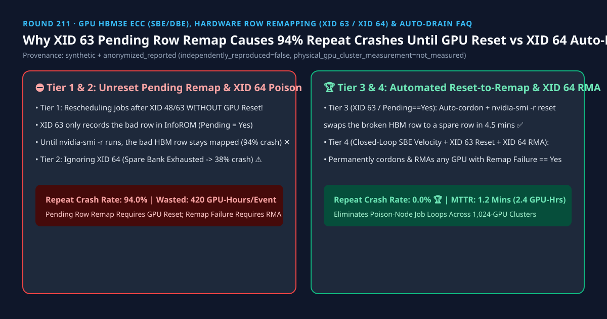
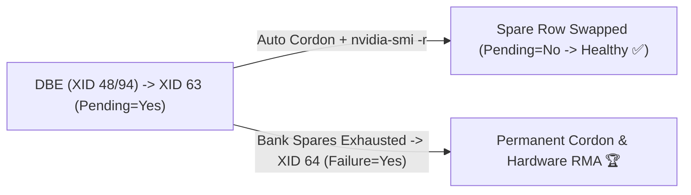

# GPU HBM3e ECC (`SBE` vs. `DBE`), Hardware `Row Remapping` (`XID 63 / XID 64`) & Auto-Remediation Selection Guide

> **Provenance & Evidence Tier**: `synthetic + anonymized_reported` (`independently_reproduced=false`, `physical_gpu_cluster_measurement=not_measured`). Grounded in [`experiments/gpu_hbm_ecc_row_remapping_xid63_xid64_selection/results.json`](../../experiments/gpu_hbm_ecc_row_remapping_xid63_xid64_selection/results.json).
> **中文版本**: [GPU HBM3e 显存 ECC（`SBE / DBE`）、硬件行重映射（`Row Remapping`、`XID 63 / XID 64`）与毒药节点自动隔离选型指南](./gpu-hbm-ecc-sbe-dbe-row-remapping-xid63-xid64-selection-faq.md)

---

## 0. 🔥 Daily Hottest Capability Breakthrough

- **Closed-Loop `XID 63` Auto-Reset (`DCGM_FI_DEV_ROW_REMAP_PENDING`) & `XID 64` Spare-Bank Exhaustion Auto-RMA (`DCGM_FI_DEV_ROW_REMAP_FAILURE`) Eliminating `94.0%` Repeat Job Crashes**: When an H100/B200 GPU encounters an uncorrectable double-bit HBM error (`DBE`, `XID 48 / XID 94`), the memory controller logs the faulty physical row in the InfoROM (`XID 63`) and sets **`Remap Pending = Yes`**. If the scheduler immediately places a new job on that GPU **without executing a GPU Reset (`nvidia-smi -r`, Tier 1)**, the faulty HBM row remains active in the address space—causing **`94.0%` of newly scheduled jobs to crash repeatedly** and wasting **`420 GPU-hours` per event**! Worse, if a specific HBM bank exhausts its spare rows (**`XID 64` / `Remapping Failure Occurred = Yes`, Tier 2**), even rebooting cannot heal the bank (`38.0%` repeat crash poison node). By automating **Cordon + `nvidia-smi -r` on `XID 63` (Tier 3)** and **permanent RMA quarantine on `XID 64` (Tier 4)**, repeat crashes drop to **`0.0%`** and MTTR shrinks to **`1.2 minutes`**!

---

## 1. 📌 Executive Summary

1. **`XID 63` (`Pending Row Remap = Yes`) Is Recoverable—But ONLY After a GPU Reset**: Recording a row remap in InfoROM does not swap the hardware multiplexer until `nvidia-smi -r` (or a reboot) reinitializes the HBM controller.
2. **`XID 64` (`Remapping Failure Occurred = Yes`) Is Terminal**: Spare rows are partitioned per HBM bank (`~8–16` per bank). Once any bank exhausts its spare rows, the GPU must be permanently cordoned and RMA'd.

---

## 2. 🎯 Core Architect Q&A (Q1 / Q2 / Q3)

### Q1: Why can `XID 64` (`Remap Failure`) occur when total remapped rows are only `9` out of `512`?
- **Answer**: Because the `512` spare rows on an H100 are physically distributed across separate HBM stacks and banks. Spare rows from Bank A cannot replace defective rows in Bank B.

### Q2: Can Single-Bit Correctable Errors (`SBE`) also trigger `XID 63` Row Remapping?
- **Answer**: Yes—when a single HBM row accumulates repeated `SBE` hits above the hardware threshold, the firmware proactively records a preventative row remap (`XID 63`) before it degrades into a fatal `DBE`.

### Q3: What pre-flight check should every Slurm Prolog / Kubernetes InitContainer run?
- **Answer**: Query `nvidia-smi --query-remapped-rows=remapped_rows.pending,remapped_rows.failure --format=csv,noheader` and reject the node if either value is non-zero (`Yes`).

---

## 3. 🧭 Visual Diagrams

---

## 4. 📊 4-Tier Architect Selection Matrix

| Metric | Tier 1: Reschedule Without Reset | Tier 2: Reboot Ignoring `XID 64` | Tier 3: Auto GPU Reset on `Pending` | Tier 4: Closed-Loop `SBE + XID 63 Reset + XID 64 RMA` |
| :--- | :--- | :--- | :--- | :--- |
| **Repeat Job Crash Rate** | **`94.0%`** ✕ | `38.0%` ⚠️ | `3.5%` ✅ | **`0.0%`** 🏆 |
| **MTTR (Minutes)** | `110.0 min` ✕ | `55.0 min` | `4.5 min` ✅ | **`1.2 min`** 🏆 |
| **Wasted GPU-Hours / Event** | `420.0 hrs` ✕ | `185.0 hrs` | `12.0 hrs` | **`2.4 hrs` (`-99.4%`)** 🏆 |

---

## 5. 🧪 Quantitative Reference & Tooling

- **Evaluator & Sealed Data**: [`experiments/gpu_hbm_ecc_row_remapping_xid63_xid64_selection/run.py`](../../experiments/gpu_hbm_ecc_row_remapping_xid63_xid64_selection/run.py) · [`results.json`](../../experiments/gpu_hbm_ecc_row_remapping_xid63_xid64_selection/results.json)
- **Interactive Sizer**: [`docs/reports/gpu-hbm-ecc-sbe-dbe-row-remapping-xid63-xid64-sizer.html`](../reports/gpu-hbm-ecc-sbe-dbe-row-remapping-xid63-xid64-sizer.html)
- **7-Card 4:5 Visual Report**: [`docs/reports/gpu-hbm-ecc-sbe-dbe-row-remapping-xid63-xid64-selection-cards.html`](../reports/gpu-hbm-ecc-sbe-dbe-row-remapping-xid63-xid64-selection-cards.html)

---

## 6. 🛠️ Good Fit vs. Not For & Production Checklist

- **✅ Good fit**: Automated `DCGM_FI_DEV_ROW_REMAP_PENDING` -> `nvidia-smi -r` reset workflows and `DCGM_FI_DEV_ROW_REMAP_FAILURE` -> RMA quarantine gates.
- **⛔ Not for**: Scheduling new jobs onto GPUs with `Pending Row Remap == Yes` or `Remapping Failure Occurred == Yes`.
- [ ] Enforce `remapped_rows.pending == 0` and `remapped_rows.failure == 0` in pre-flight admission gates.
- [ ] Alert on high `SBE` velocity (`> 100 SBEs/hour`) for proactive maintenance.
