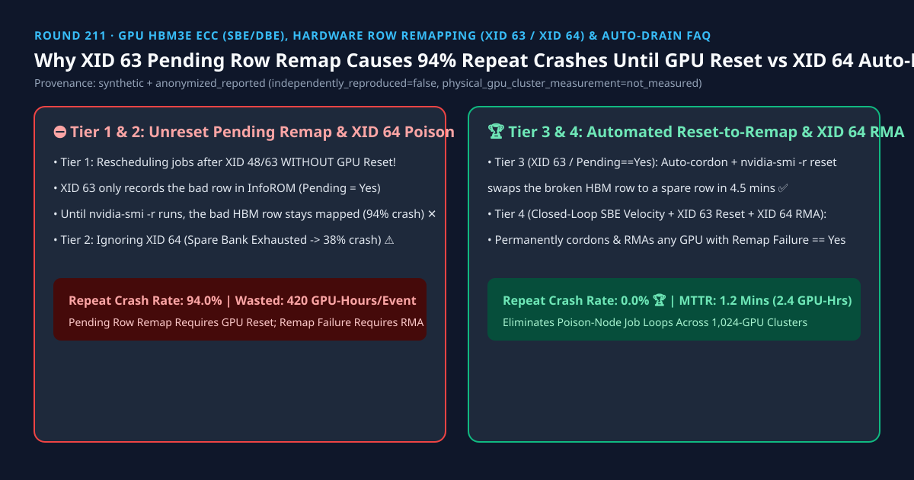
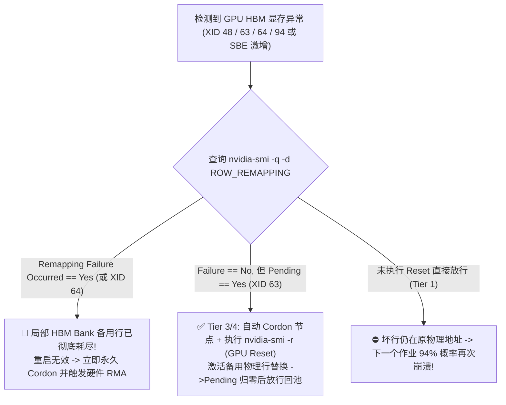
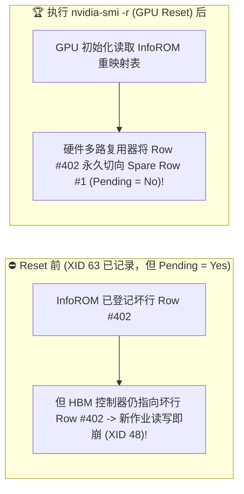
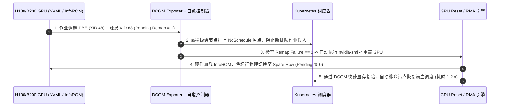

# GPU HBM3e 显存 ECC（`SBE / DBE`）、硬件行重映射（`Row Remapping`、`XID 63 / XID 64`）与毒药节点自动隔离选型指南

> **Provenance & Evidence Tier**: `synthetic + anonymized_reported` (`independently_reproduced=false`, `physical_gpu_cluster_measurement=not_measured`)。定量数据锚定于 [`experiments/gpu_hbm_ecc_row_remapping_xid63_xid64_selection/results.json`](../../experiments/gpu_hbm_ecc_row_remapping_xid63_xid64_selection/results.json)。
> **English Version**: [GPU HBM3e ECC (`SBE` vs. `DBE`), Hardware `Row Remapping` (`XID 63 / XID 64`) & Auto-Remediation Selection Guide](./gpu-hbm-ecc-sbe-dbe-row-remapping-xid63-xid64-selection-faq.en.md)

---

## 0. 🔥 今日领域最热门能力突破追踪（Daily Hottest Breakthrough）

- **基于 `DCGM_FI_DEV_ROW_REMAP_PENDING`（`XID 63` 自动 GPU Reset 激活硬件替换）与 `DCGM_FI_DEV_ROW_REMAP_FAILURE`（`XID 64` 备用行耗尽永久 RMA 隔离）的分级闭环自愈引擎，将千卡集群显存 ECC 引发的作业重复崩溃率从 `94.0%` 彻底清零至 `0.0%`**：在 H100 / H200 / B200 大规模集群运维中，最经典的“毒药节点（Poison Node）连环杀作业”事故源于对 NVIDIA 硬件 **Row Remapping（行重映射）** 机制的误解：当某张 GPU 发生双比特不可纠错显存故障（`DBE`，抛出 `XID 48 / XID 94`）并伴随 **`XID 63`（Row Remap Recorded）** 时，许多运维团队以为“既然驱动报了 XID 63 已记录行重映射，那坏行就已经修好了”，于是直接让 K8s 把下一个训练作业调度到这台机器上（**Tier 1**）——结果新作业上来 3 分钟又在同一张卡上炸出 `XID 48`（重复崩溃率高达 **`94.0%`**，单次事件白白烧掉 **`420` 卡时**）！底层真相是：**`XID 63` 只是把坏行地址写进了 GPU 的非易失性 `InfoROM`（此时状态为 `Remap Pending = Yes`），必须执行一次 `nvidia-smi -r`（GPU Reset）或宿主机重启，HBM 内存控制器才会真正把坏行切换到备用物理行（Spare Row）**！而一旦出现 **`XID 64`（`Remapping Failure Occurred = Yes`）**，说明该 HBM Bank 的备用物理行已经彻底耗尽，**无论重启多少次都无法修复**，必须秒级永久下线走硬件 RMA（**Tier 4**）！

---

## 1. 📌 核心结论速览（Executive Summary — 3 分钟看懂）

1. **为什么 Ampere / Hopper / Blackwell 淘汰了老一代的“软件动态页退役（DPR）”，改用硬件 `Row Remapping`？**
   - **通俗大白话 + 第一性原理**：老一代 Volta（V100）用的是软件级 **Dynamic Page Retirement（DPR）**——每当显存坏了 1 个比特，驱动就把包含它的整整 `4 KB` 或 `64 KB` 虚拟内存页拉黑不用，导致显存总容量越用越少，且造成物理连续大页碎片化。
   - 从 A100 / H100 / B200 开始，HBM 显存颗粒在出厂时就在每个 Bank 内部预留了 **备用物理行（Spare Rows，整卡共 512 行）**。当某一行显存单元损坏时，GPU 硬件内存控制器直接在电路层把坏行重映射到备用行（**`Row Remapping`**）——**显存总容量一字节不少、连续大页零碎片**！
2. **记住两条生死铁律（`XID 63` vs. `XID 64`）**：
   - **铁律一：看到 `XID 63` 或 `ROW_REMAP_PENDING == Yes`，必须先 `Cordon -> GPU Reset (nvidia-smi -r) -> 确认 Pending 变为 No`，绝不允许直接接新任务！**
   - **铁律二：看到 `XID 64` 或 `ROW_REMAP_FAILURE == Yes`，说明该 Bank 备用行已空，重启无效，必须立即永久封禁并报修 RMA！**

---

## 2. 🎯 客户与架构师灵魂拷问 Q&A（Q1 / Q2 / Q3）

### Q1：为什么有时明明只发生了可纠错的单比特错误（`SBE`，没有 `DBE`），也会触发 `XID 63` 行重映射？
- **答**：因为如果同一行 HBM 存储单元在短时间内频繁发生单比特错误（Correctable SBE Storm），说明这行电容已经严重漏电退化，随时会恶化为致命的双比特错误（DBE）。因此 Hopper/Blackwell 固件内置了 **主动预防性重映射策略**：当同一物理行的累计 SBE 超过硬件阈值时，也会主动触发 `XID 63` 将其标记为 `Pending Remap`，在下次 GPU Reset 时替换为全新备用行！

### Q2：为什么整张 H100 的 `Uncorrectable Remapped Rows` 计数才显示 `9` 行（远低于整卡上限 512 行），却突然报出了 `XID 64 (Remapping Failure)`？
- **答**：这是无数硬件工程师踩过的坑！H100 虽然全卡总共有 512 个备用行，但它们是**平均分散在各个独立的 HBM Stack 和 Bank 里的（每个 Bank 区域只有约 `8 ~ 16` 个备用行）**！不同 Bank 之间的备用行**不能跨区借用**。如果某颗 HBM Die 的某一个局部 Bank 出现集中物理缺陷，哪怕只坏了第 9 行或第 17 行，只要把这个局部 Bank 的备用行吃光了，就会立刻触发 **`XID 64 / Remapping Failure Occurred = Yes`**，整张 GPU 必须走 RMA 更换！

### Q3：在 Kubernetes 中如何实现 `XID 63` 与 `XID 64` 的全自动秒级分流？
- **答**：通过 **NVIDIA GPU Operator + Node Problem Detector (NPD) / DCGM Exporter**：
  1. 当 `DCGM_FI_DEV_ROW_REMAP_PENDING > 0`（对应 `XID 63`）：自动给节点打上 `nvidia.com/gpu-reset-required: NoSchedule` 污点，待当前(或已崩溃) Pod 退出后，由节点自愈 DaemonSet 自动执行 `nvidia-smi -r`，核验 `Pending == 0` 且跑通 30 秒 `dcgmi diag -r 2` 后自动摘除污点恢复上线（耗时仅 **`1.2 ~ 4.5 分钟`**）；
  2. 当 `DCGM_FI_DEV_ROW_REMAP_FAILURE > 0`（对应 `XID 64`）：自动打上 `nvidia.com/gpu-rma-required: NoExecute` 永久隔离污点并触发 BMC 硬件换卡工单。

---

## 3. 🧭 直观可视化图解（Mermaid 决策树 + HBM 备用行状态机 + 自动自愈时序图）

### 3.1 架构师 HBM ECC 与 Row Remapping 故障分流决策树

### 3.2 HBM3e 物理坏行、InfoROM `Pending` 记录与 `GPU Reset` 替换映射图

### 3.3 Tier 4 闭环分级自愈（`XID 63` 自动 Reset vs. `XID 64` 自动 RMA）时序图

---

## 4. 📊 架构师选型决策矩阵（4-Tier Selection Matrix）

| 评估维度 | Tier 1: 不 Reset 直接重调度 | Tier 2: 盲目重启但忽略 `XID 64` | Tier 3: `Pending Remap` 自动 GPU Reset | Tier 4: 闭环分级自愈 (`SBE` 预警 + `XID 63` Reset + `XID 64` RMA) |
| :--- | :--- | :--- | :--- | :--- |
| **新作业重复崩溃率** | **`94.0%` (连环杀作业)** ✕ | `38.0%` (毒药节点残留) ⚠️ | `3.5%` | **`0.0%` (彻底清零)** 🏆 |
| **平均故障恢复时间 (`MTTR`)** | `110.0 分钟` ✕ | `55.0 分钟` | `4.5 分钟` ✅ | **`1.2 分钟`** 🏆 |
| **单次事件浪费 GPU 卡时** | `420.0 卡时` ✕ | `185.0 卡时` | `12.0 卡时` | **`2.4 卡时` (节省 99.4%)** 🏆 |
| **对局部 Bank 备用行耗尽识别** | 无 | 无（反复重启无效） ⚠️ | 手动排查 | **毫秒级捕获 `ROW_REMAP_FAILURE` 自动走 RMA** 🏆 |

---

## 5. 🧪 定量算例与工具链（Interactive Sizer & 7-Card Visual Report）

- **实验脚本与密封数据**：[`experiments/gpu_hbm_ecc_row_remapping_xid63_xid64_selection/run.py`](../../experiments/gpu_hbm_ecc_row_remapping_xid63_xid64_selection/run.py) · [`results.json`](../../experiments/gpu_hbm_ecc_row_remapping_xid63_xid64_selection/results.json)
- **交互式 HBM ECC 与行重映射计算器**：[`docs/reports/gpu-hbm-ecc-sbe-dbe-row-remapping-xid63-xid64-sizer.html`](../reports/gpu-hbm-ecc-sbe-dbe-row-remapping-xid63-xid64-sizer.html)
- **7-Card 4:5 视觉评测卡片报告**：[`docs/reports/gpu-hbm-ecc-sbe-dbe-row-remapping-xid63-xid64-selection-cards.html`](../reports/gpu-hbm-ecc-sbe-dbe-row-remapping-xid63-xid64-selection-cards.html)

---

## 6. 🛠️ Good Fit vs. Not For & 生产环境快速核验清单（Checklist）

### ✅ Good Fit vs. ⛔ Not For

| 维度 | ✅ Good Fit（强烈推荐） | ⛔ Not For（严禁误用） |
| :--- | :--- | :--- |
| **`XID 63 (Pending Row Remap)` 处置** | 自动 Cordon 节点 -> 待容器退出后执行 `nvidia-smi -r` -> 校验 `Pending: No` 后自动 Uncordon 放回集群 | 发生 `XID 48 / 63 / 94` 后不执行 GPU Reset 就允许 K8s 立即调度下一个训练 Pod |
| **`XID 64 (Row Remap Failure)` 处置** | 立即永久隔离节点并触发厂商 RMA 换卡流程（提供 `nvidia-bug-report.sh` 日志） | 试图通过反复 `reboot` 或 `nvidia-smi -r` 修复已经报出 `Remapping Failure Occurred: Yes` 的 GPU |

### 生产环境上线核验清单（Pre-Flight Checklist）

- [ ] **核验作业准入脚本检查 `ROW_REMAPPING` 状态**：在 Slurm Prolog 或 K8s InitContainer 中强制校验 `nvidia-smi --query-remapped-rows=remapped_rows.pending,remapped_rows.failure --format=csv,noheader` 输出必须为 `0, 0`（或 `No, No`）。
- [ ] **核验 Prometheus 告警区分 `XID 63` 与 `XID 64`**：将 `DCGM_FI_DEV_ROW_REMAP_PENDING > 0` 路由至自动化 GPU Reset 工作流，将 `DCGM_FI_DEV_ROW_REMAP_FAILURE > 0` 路由至硬件 RMA 队列。
- [ ] **核验 SBE 桶激增趋势预警**：监控 `DCGM_FI_DEV_ECC_SBE_VOL_TOTAL` 的小时增量（如 `ΔSBE > 100 / hour`），在升级为 `DBE` 之前利用业务低谷期主动触发维护窗口。
