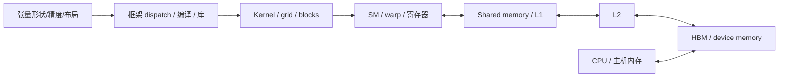

# GPU 与 HBM：为什么“装得下”不等于“跑得快”

研究问题：用执行模型、内存层级和显式算术，解释 AI 算子的容量、带宽与计算约束。状态：公开文档静态研究；配套程序是 CPU/offline 模型，**无 GPU 测量**。先修：张量形状、矩阵乘法、attention 与训练/推理区别。

证据 ID：`gpu-execution-memory`、`historical-hopper-structure`、`capacity-roofline-offline`。来源版本与实际读取范围见 [台账](../../research/sources.json)；可变 CUDA 文档不被冒充成不可变 release。

## 1. 从一个算子看系统

这是逻辑研究路径，不声称所有访存必经每一级 cache，也不把图当成某块 GPU 的物理版图。真实 dispatch、kernel 和缓存策略需要固定 runtime 与 profiler/实现证据。

CUDA 模型将线程组织为 block 和 grid；block 在一个 SM 上执行，warp 在 NVIDIA CUDA 的该模型中为 32 个线程。不同 block 的调度顺序不能依赖；cluster/cooperative 等机制是有具体保证与前提的扩展，不让任意 block 获得无条件全局同步。

SIMT 的关键不是“很多 CPU 线程”：控制分歧会造成部分 lane 被屏蔽，访存模式会影响有效 transaction，而活跃 warp 数受资源限制。AMD wavefront/CU 应读对应 ROCm/架构文档，不能把 CUDA warp 数直接推广到所有加速器。

## 2. 片上资源和 HBM 的分工

| 资源 | 用途/范围 | 架构误区 |
|---|---|---|
| Registers | 编译器管理的线程私有值；SM 资源 | 强压寄存器提高 occupancy 可能导致 spill，反而增加设备访存 |
| Shared memory | block 协作的数据复用/scratchpad；与 L1 资源配置相关 | 增加 tile 不一定更快，资源占用和同步也会增加 |
| L1/L2 | 缓存，L2 在设备上由 SM 共享 | cache hit、容量与流量模型有关，不能把逻辑张量大小当 HBM 实际读取量 |
| Global/device memory | 大容量、跨 kernel 持续的分配；数据中心 GPU 常用 HBM backing | 容量满足不表示带宽、访问效率和同步满足 |
| Local memory | 线程局部的逻辑范围，可能由设备/global 空间 backing | 名称“local”不等于片上寄存器或 shared memory |

HBM 通过堆叠和宽接口支持高带宽/容量，但全系统收益还受控制器、访问形态、cache、功率/热与封装约束影响。不要从“HBM 代际更新”直接推出模型吞吐倍率。

已读的 Hopper 官方结构文章明确区分完整 GH100 设计、H100 SXM5 与 PCIe 实现，并区分其 HBM3/HBM2e 配置。这是一个**历史结构案例**：同一 GPU 家族名称不保证相同 SM、内存、功率或互连配置。文章的发布期性能表含 preliminary 限制，不能作为当前采购参数或实测结果。

JEDEC HBM 正文没有取得；本报告不声称完成 HBM3E/HBM4 的标准比较，不凭产品名推导通道/时序细节。

## 3. 为什么 Tensor Core 峰值不是算子性能

矩阵计算需要合适的形状、布局、数据类型和数据供给；peak FLOPS 是有条件的硬件能力。前后转换、非矩阵算子、同步、访存、kernel launch 与 padding 都可能使端到端吞吐远离峰值。

以矩阵乘法 `C[M,N] = A[M,K] × B[K,N]` 为例，近似计算量为 `2MKN FLOPs`，但 HBM traffic 不是简单固定成三个张量大小：tiling、cache、重复装载、中间结果、融合、split-K 和精度转换都会改变流量。使用 Roofline 前必须说明在哪一层统计 bytes。

Tiling 的作用是让一次从远端内存取得的数据服务更多计算；代价是寄存器/shared memory 占用与同步。异步 copy/TMA 等机制可能支持流水，但不能从“支持异步”推断应用已经隐藏全部访存。

## 4. 容量账本

传统 MHA/GQA 的 K/V logical payload：

`KV_bytes = 2 × layers × kv_heads × head_dim × sequence × batch × bytes_per_element`

第一个 2 是 K 与 V，`kv_heads` 不是总 query heads。适用于此存储布局，不直接适用于 MLA、hybrid/recurrent 状态或额外压缩/共享策略。

合成例：24 层、4 KV heads、128 head dimension、8192 tokens、batch 2、BF16：

`KV = 805306368 bytes = 0.805306368 GB = 0.75 GiB`

这些不是某个真实模型的规格。权重 INT4 不会自动改变 KV 的 BF16；上下文与 batch 增长会增加该模型下的 KV payload。

完整设备容量至少需要独立列：

`weights + allocated_KV + activations/workspace + communication buffers + runtime/graphs + allocator reserve`

配套 [离线实验](../../experiments/capacity_roofline/README.md) 显式处理所建模的权重/KV/workspace/reserve，并说明未建模项。Token block 取整影响 allocated KV；logical KV 不等于 allocator allocation，更不等于设备峰值。

训练还需梯度、优化器状态、activation 保存/重计算及分片/通信缓冲。不能拿推理容量公式估算完整训练，也不能用“参数量 × 一个固定常数”覆盖全部优化器/精度组合。

## 5. Roofline：边界，不是预测

定义同一统计层：

- `F`：FLOPs，`Q`：该内存层移动的 bytes，`I = F/Q`：arithmetic intensity。
- `P`：匹配精度/稠密性/操作的 peak FLOP/s；`B`：同一内存层的 bytes/s。
- `performance_upper_bound = min(P, B × I)`。
- `ridge_point = P/B`；`time_lower_bound = max(F/P, Q/B)`。

这是理想模型；执行效率、事务放大、依赖、launch、cache miss、通信等都可能恶化实际时间。不同内存层对应不同 Roofline，不能用 shared-memory bytes 和 HBM bandwidth 混算。

合成例 `F=1e12, Q=1e10, P=1e14, B=1e12`：

`I=100 FLOP/byte`，`ridge=100 FLOP/byte`，上界 `1e14 FLOP/s`，时间下界 `0.01 s`。

这不是硬件计时。该方法解释为什么增加 peak FLOPS 对 memory-bound 情况可能无效，以及为什么改善复用有时比升级计算单元更有意义。

## 6. 将 GPU/HBM 连接到工作负载

| 场景 | 假设下可能的压力 | 不能泛化的地方 |
|---|---|---|
| Prefill | 长输入提供矩阵并行机会；attention、激活/临时存储和质量/布局重要 | 长上下文、batch、kernel/attention 实现可改变瓶颈 |
| Decode | 低 batch 下对权重/KV 的数据供给可能占主导；排队与通信同样重要 | 大 batch、MoE、cache 复用、TP 和网络可以改变限制 |
| 训练 | 前反向计算、activation/optimizer、集体通信、checkpoint 同时参与 | 高算力利用率不能证明端到端扩展好或故障恢复快 |

首要决策不是“买哪个最高 FLOPS GPU”，而是：质量/SLO 是什么、状态放在哪里、数据复用多少、峰值/尾延迟由谁决定。

## 7. 架构判断与反证

- 容量不足优先区分权重、KV、workspace 与分配余量；量化/分片/缩短 context 解决的项不同。
- 带宽不足先看 workload、layout、实际 HBM traffic、cache 与同步；更多 SM 未必改善。
- 多卡能扩大容量，也会增加通信/调度成本；TP 与低延迟 decode 必须联合看互连。
- 若提高 batch 后 throughput 上升但 TPOT/排队恶化，需要 SLO-goodput 而非纯 tokens/s 评估。
- 如果 profiler 显示主要瓶颈在 CPU dispatch 或跨节点通信，应拒绝“HBM 升级足够”的假设。

自测与评分见 [练习 1–5](../learning/exercises.md)。后续深挖：固定 kernel dispatch、tile/寄存器/shared-memory 权衡、HBM 代际公开证据及多 GPU 通信；实际 profiling 需环境授权。

## 来源

- [CUDA Programming Model](https://docs.nvidia.com/cuda/cuda-programming-guide/01-introduction/programming-model.html)：SM、block、warp、cluster 的实际读取段落。
- [Writing CUDA Kernels](https://docs.nvidia.com/cuda/cuda-programming-guide/02-basics/writing-cuda-kernels.html)：2.3.3 device memory spaces。
- [NVIDIA Hopper Architecture In-Depth](https://developer.nvidia.com/blog/nvidia-hopper-architecture-in-depth/)：已读结构/特性及 preliminary 性能限制；不采用其速度倍率。
- [ROCm 文档入口](https://rocm.docs.amd.com/en/latest/)：仅生态/兼容入口，未完成 AMD 硬件执行对照。
