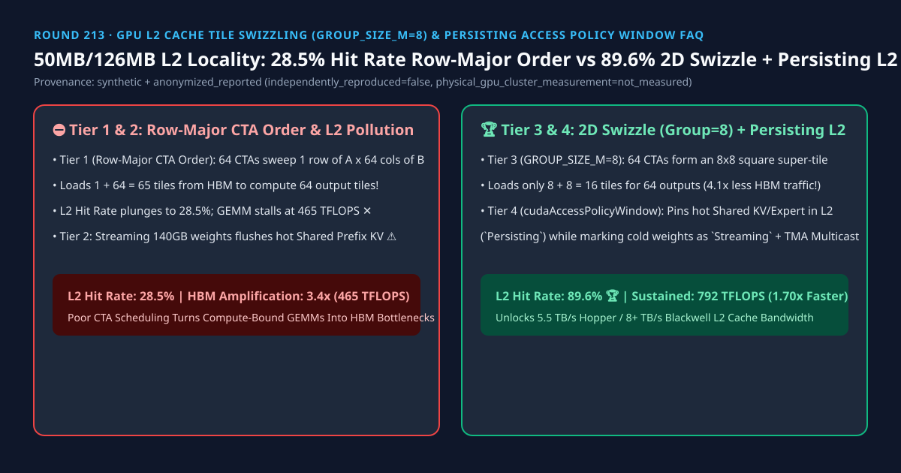
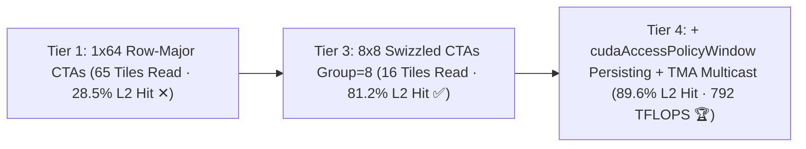

# GPU L2 Cache 2D Tile Swizzling (`GROUP_SIZE_M=8`), Dual-Partition Locality & `cudaAccessPolicyWindow` Selection Guide

> **Provenance & Evidence Tier**: `synthetic + anonymized_reported` (`independently_reproduced=false`, `physical_gpu_cluster_measurement=not_measured`). Grounded in [`experiments/gpu_l2_cache_swizzling_persisting_window_selection/results.json`](../../experiments/gpu_l2_cache_swizzling_persisting_window_selection/results.json).
> **中文版本**: [GPU L2 缓存二维块重排（`Tile Swizzling / GROUP_SIZE_M=8`）、双半区分区与 `cudaAccessPolicyWindow` 持久驻留选型指南](./gpu-l2-cache-tile-swizzling-persisting-access-policy-window-selection-faq.md)

---

## 0. 🔥 Daily Hottest Capability Breakthrough

- **2D Grouped CTA Tile Swizzling (`GROUP_SIZE_M = 8`) + `cudaAccessPolicyWindow` (`Persisting` Pinning + `Streaming` Bypass) + Same-Partition `TMA Multicast` Boosting L2 Hit Rate from `28.5%` to `89.6%` (`792 TFLOPS`)**: Under naive 1D Row-Major CTA scheduling (`pid_m = pid // grid_n`, **Tier 1**), 64 concurrent CTAs sweep across 1 row of `A` and 64 columns of `B`—forcing HBM to load **`1 + 64 = 65` input tiles** to compute 64 output tiles, thrashing the `50 MB` H100 L2 cache (`28.5%` hit rate, `3.40x` HBM read amplification, **`465.0 TFLOPS`**). By scheduling CTAs in **`8 × 8` square super-tiles (`GROUP_SIZE_M = 8`, Tier 3)**, those same 64 CTAs load **only `8 + 8 = 16` input tiles from HBM (`4.06x` reduction)**, lifting L2 hit rate to **`81.2%` (`725.0 TFLOPS`)**. Pairing 2D Swizzling with **`cudaAccessPolicyWindow` (`cudaAccessPropertyPersisting` for hot shared-prefix KV / MoE shared experts + `cudaAccessPropertyStreaming` for cold weights, Tier 4)** and GPC-local **TMA Multicast** reaches **`89.6%` L2 hit rate** and **`792.0 TFLOPS` (`1.70x` speedup)**!

---

## 1. 📌 Executive Summary

1. **The `1 × 64` vs. `8 × 8` Tile Reuse Math**: Computing 64 output tiles in a `1 × 64` row requires `1 + 64 = 65` input tiles; computing them in an `8 × 8` square requires only `8 + 8 = 16` input tiles (`75.4%` less HBM traffic).
2. **Preventing Cross-Kernel L2 Cache Pollution (`cudaAccessPolicyWindow`)**: Pin `< 36 MB` high-reuse buffers (Shared Prefix KV, MoE Shared Expert, Draft Model weights) with `cudaAccessPropertyPersisting` while marking streaming weight scans as `cudaAccessPropertyStreaming`.

---

## 2. 🎯 Core Architect Q&A (Q1 / Q2 / Q3)

### Q1: Why is `GROUP_SIZE_M = 8` the sweet spot rather than `32`?
- **Answer**: At `GROUP_SIZE_M = 8`, the `8` active row tiles of `A` and `8` column tiles of `B` (`~16–24 MB`) fit comfortably inside a single `25 MB / 30 MB` Hopper L2 partition. Setting `GROUP_SIZE_M = 32` overflows the L2 partition before reuse completes.

### Q2: Why does Hopper/Blackwell split the L2 Cache into two physical partitions (`uGPU 0` & `uGPU 1`)?
- **Answer**: To minimize wire latency across the reticle-limit die. Using GPC-aligned **TMA Multicast (`2x1` CTA clusters)** keeps cooperative reads inside the local L2 partition without saturating the cross-partition L2 crossbar.

### Q3: What happens if we free a buffer pinned with `cudaAccessPropertyPersisting` without resetting the policy window?
- **Answer**: Stale persisting cache lines remain locked in L2, shrinking usable L2 capacity for subsequent kernels. Always reset `accessPolicyWindow.num_bytes = 0` or call `cudaCtxResetPersistingL2Cache()`.

---

## 3. 🧭 Visual Diagrams

---

## 4. 📊 4-Tier Architect Selection Matrix

| Metric | Tier 1: Naive Row-Major CTAs | Tier 2: Unprotected L2 Streaming | Tier 3: 2D Swizzled CTAs (`GROUP_SIZE_M=8`) | Tier 4: Swizzle + `Persisting L2` + `TMA Multicast` |
| :--- | :--- | :--- | :--- | :--- |
| **L2 Cache Hit Rate** | `28.5%` ✕ | `58.0%` ⚠️ | `81.2%` ✅ | **`89.6%`** 🏆 |
| **HBM Read Amplification** | `3.40x` ✕ | `1.90x` | `1.25x` ✅ | **`1.05x`** 🏆 |
| **Sustained Throughput** | `465.0 TFLOPS` ✕ | `615.0 TFLOPS` | `725.0 TFLOPS` (`1.56x`) ✅ | **`792.0 TFLOPS` (`1.70x`)** 🏆 |

---

## 5. 🧪 Quantitative Reference & Tooling

- **Evaluator & Sealed Data**: [`experiments/gpu_l2_cache_swizzling_persisting_window_selection/run.py`](../../experiments/gpu_l2_cache_swizzling_persisting_window_selection/run.py) · [`results.json`](../../experiments/gpu_l2_cache_swizzling_persisting_window_selection/results.json)
- **Interactive Sizer**: [`docs/reports/gpu-l2-cache-tile-swizzling-persisting-access-policy-window-sizer.html`](../reports/gpu-l2-cache-tile-swizzling-persisting-access-policy-window-sizer.html)
- **7-Card 4:5 Visual Report**: [`docs/reports/gpu-l2-cache-tile-swizzling-persisting-access-policy-window-selection-cards.html`](../reports/gpu-l2-cache-tile-swizzling-persisting-access-policy-window-selection-cards.html)

---

## 6. 🛠️ Good Fit vs. Not For & Production Checklist

- **✅ Good fit**: `GROUP_SIZE_M = 8` 2D CTA swizzling in GEMM/MoE kernels and `cudaAccessPolicyWindow` persisting pinning for `< 36 MB` hot tensors.
- **⛔ Not for**: 1D row-major block scheduling or pinning buffers larger than the physical L2 cache.
- [ ] Verify `GROUP_SIZE_M = 8` (or CUTLASS swizzle) in all GEMM/MoE kernels.
- [ ] Call `cudaCtxResetPersistingL2Cache()` when tearing down persisting L2 buffers.
