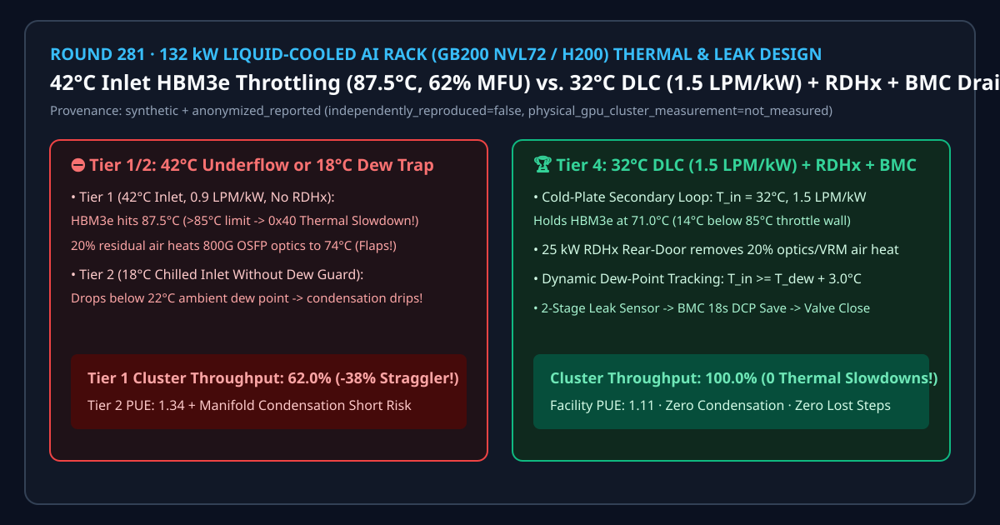
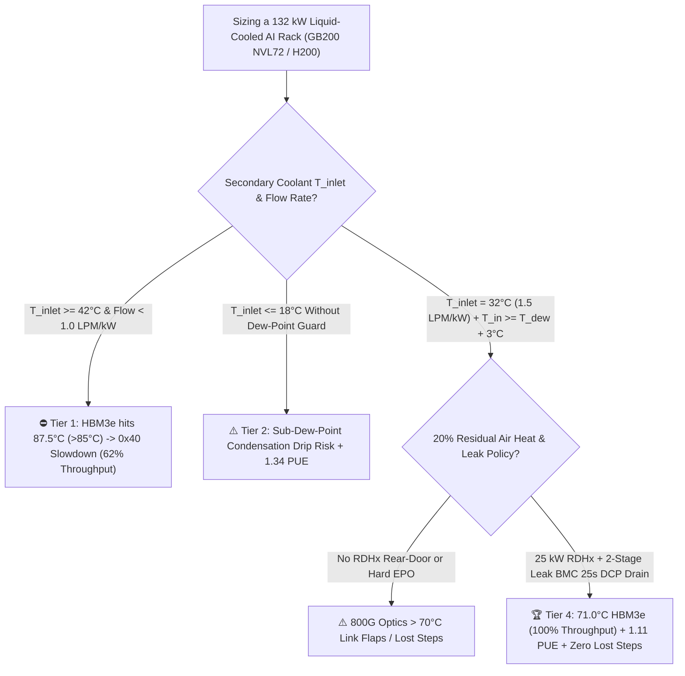
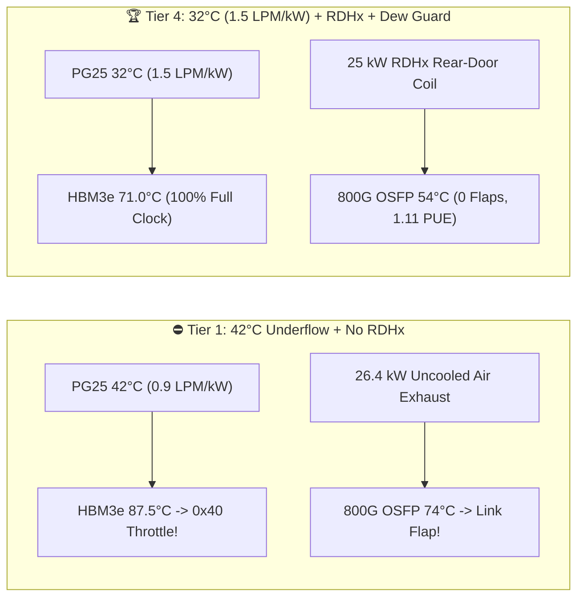
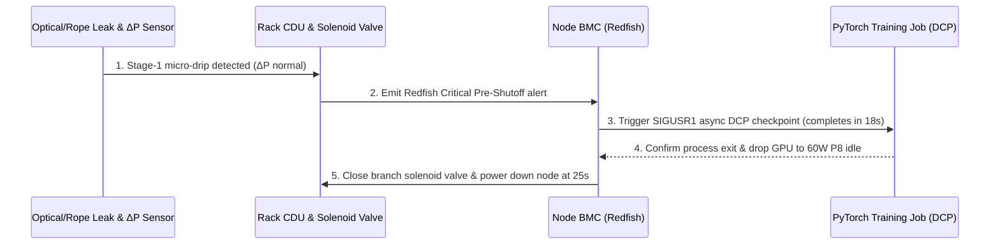

# 132 kW Liquid-Cooled AI Rack (`GB200 NVL72 / H200 DLC`) Inlet Temperature, Flow Sizing & Leak-Drain Selection Guide: Why `42°C` Warm-Water Underflow Triggers `HBM3e` `85°C` Thermal Throttling (`0x40`, `62%` MFU Collapse) & `800G` Optical Flaps vs. `32°C` (`1.5 LPM/kW`) + `RDHx` + `BMC` Graceful Drain

> **Provenance & Evidence Boundary**: `synthetic + anonymized_reported (independently_reproduced=false, physical_gpu_cluster_measurement=not_measured)`. All quantitative figures in this guide are generated by the deterministic evaluator `experiments/gpu_liquid_cooling_cdu_manifold_leak_inlet_temp_throttling_selection/run.py` and sealed in `results.json`.



---

## 0. Daily Capability Breakthrough Tracking

- **Breakthrough Focus**: **`132 kW` Direct-to-Chip Liquid Cooling (`DLC`) Rack Co-Design (`32°C` PG25 Inlet at `1.5 LPM/kW` + `25 kW RDHx` Rear-Door Heat Exchanger for `20%` Optics/VRM Air Heat + Dew-Point Margin `T_in >= T_dew + 3°C` + 2-Stage Leak `BMC` 25s Async `DCP` Drain)**.
- **Architect Value**: Pushing secondary-loop water temperature to `42°C` at `0.9 LPM/kW` while ignoring the `20%` residual air heat (`~26.4 kW/rack` from `800G OSFP` transceivers and power shelves) causes **`HBM3e` stacks (`87.5°C`) to breach their `85°C` thermal throttle ceiling (`0x40 HW_THERMAL_SLOWDOWN`, tighter than the `88°C` GPU die limit)** and bakes `800G` optics past `70°C`—slashing synchronous cluster training throughput to **`62.0%`**. Conversely, over-chilling to `18°C` without dew-point tracking causes manifold condensation shorts and inflates PUE to `1.34`. Running **`32°C` inlet (`1.5 LPM/kW`) + `25 kW RDHx` + dynamic dew-point tracking + 2-stage leak `BMC` graceful checkpoint drain** holds `HBM3e` at **`71.0°C` (`100.0%` throughput)** at a **`1.11` facility PUE**.

---

## ① 📌 Executive Summary

1. **Why `HBM3e` (`85°C`) and `800G` Optics (`70°C`) Throttle Before the GPU Die (`88°C`)**:
   3D-stacked `HBM3e` memory has higher vertical thermal resistance and doubles DRAM refresh overhead above `85°C`, triggering hardware slowdown (`0x40`). Meanwhile, cold plates capture ~`80%` of rack heat; without a **Rear-Door Heat Exchanger (`RDHx`)** to remove the remaining `~26.4 kW` of air heat, `800G OSFP` transceivers exceed `70°C` and link-flap.
2. **Why `18°C` Over-Chilled Water Causes Condensation Shorts**:
   In a data hall at `26°C` and `65%` RH, the dew point is `~19.0°C`. Running `18°C` coolant causes conductive moisture to condense on `UQD` quick-disconnects and drip onto `50V` busbars. Always enforce $T_{\text{inlet}} \ge T_{\text{dew}} + 3.0^\circ\text{C}$.
3. **2-Stage Leak Detection + `25s` `BMC` Graceful `DCP` Checkpoint Drain**:
   On a Stage-1 micro-drip alert (optical/rope sensor wet, differential pressure $\Delta P$ normal), `BMC` signals the training job via Redfish/SIGTERM to flush an asynchronous `PyTorch DCP` checkpoint in `18s` before closing the branch solenoid valve at `25s`—achieving **`0` lost training steps**.

---

## ② 🎯 Key Architectural Q&A (Q1 / Q2 / Q3)

### Q1: Why must the secondary loop use inhibited `PG25` (`25%` Propylene Glycol) with `50 μm` filtration instead of pure deionized (DI) water?
- GPU micro-channel cold plates have fin pitches of just **`0.15–0.25 mm`**. Uninhibited DI water rapidly leaches ions and grows bacterial biofilm (`bio-fouling`), clogging micro-channels within months and tripling thermal resistance. OCP-compliant **`PG25` with corrosion/biocide inhibitors + `50 μm` duplex filters** prevents both galvanic corrosion and micro-channel clogging.

### Q2: How do we size secondary-loop flow rate for a `132 kW` `GB200 NVL72` rack?
- Target a **`1.4–1.5 LPM / kW`** flow rate (`~158–180 LPM` per rack for the `105 kW` liquid load) to keep the inlet-to-outlet temperature rise $\Delta T \le 10^\circ\text{C}$. Under-sizing flow to `0.9 LPM/kW` stretches $\Delta T$ to `17°C`, pushing downstream `HBM3e` past `85°C`.

### Q3: Why is wiring leak rope sensors directly to a hard PDU emergency power-off (`Hard EPO`) dangerous?
- High-humidity condensation or residual assembly fluid on a `UQD` fitting can trigger false-positive trips, instantly crashing 72 GPUs and corrupting in-flight NVMe checkpoints. A **2-stage policy** (Stage-1 optical drip -> `18s` DCP checkpoint save -> `25s` valve close; Stage-2 $\Delta P$ pressure drop -> immediate valve shutoff) protects both hardware and training state.

---

## ③ 🧭 Visual Diagrams (Decision Tree, Cooling Loop & Leak Sequence)

### 3.1 `132 kW` DLC Rack Thermal & Leak Selection Decision Tree



### 3.2 `80%` Cold-Plate + `20%` `RDHx` Air-Assist Architecture Comparison



### 3.3 2-Stage Leak Sensor -> `CDU + BMC + PyTorch DCP` Graceful Drain Sequence



---

## ④ 📊 4-Tier Architect Decision Matrix

| Selection Tier | Coolant Inlet & Flow | `20%` Residual Air Heat | Peak `HBM3e` Temp (`85°C` Limit) | Cluster Step Throughput | Facility PUE | Target Scenario |
| :--- | :--- | :--- | :--- | :--- | :--- | :--- |
| **Tier 1: `42°C` Warm-Water Underflow (`0.9 LPM/kW`)** | `42°C` / Underflow | No `RDHx` | `87.5°C` (`0x40` Throttle! ✕) | `62.0%` (`-38%` ✕) | `1.09` | ⛔ **Severe HBM3e throttling & optical flaps** |
| **Tier 2: `18°C` Over-Chilled (No Dew Guard)** | `18°C` (`< T_dew`) | Room CRAC | `61.0°C` | `98.5%` | `1.34` ⚠️ | ⚠️ **Condensation short-circuit hazard** |
| **Tier 3: `32°C` (`1.5 LPM/kW`) + `RDHx`** | `32°C` / `1.5 LPM/kW` | `25 kW RDHx` | `72.0°C` ✅ | `99.6%` | `1.12` | ✅ Baseline high-density DLC rack |
| **Tier 4: `32°C` + `RDHx` + Dew Guard + `BMC` Drain (Recommended)** | **`32°C` (`\ge T_{\text{dew}}+3^\circ\text{C}$)** | **`25 kW RDHx`** | **`71.0°C` (`0` Throttle 🏆)** | **`100.0%` 🏆** | **`1.11` 🏆** | 🏆 **Production 120–132 kW AI Pod Standard** |

---

## ⑤ 🧪 Quantitative Evaluator & 7-Card 4:5 Visual Report

- **Deterministic Evaluator**: [`experiments/gpu_liquid_cooling_cdu_manifold_leak_inlet_temp_throttling_selection/run.py`](../../experiments/gpu_liquid_cooling_cdu_manifold_leak_inlet_temp_throttling_selection/run.py) · Sealed JSON: [`results.json`](../../experiments/gpu_liquid_cooling_cdu_manifold_leak_inlet_temp_throttling_selection/results.json)
- **Interactive Sizer Workbench**: [`docs/reports/gpu-liquid-cooling-cdu-manifold-leak-inlet-temp-thermal-throttling-sizer.html`](../reports/gpu-liquid-cooling-cdu-manifold-leak-inlet-temp-thermal-throttling-sizer.html)
- **7-Card 4:5 Visual Benchmark Deck**: [`docs/reports/gpu-liquid-cooling-cdu-manifold-leak-inlet-temp-thermal-throttling-selection-cards.html`](../reports/gpu-liquid-cooling-cdu-manifold-leak-inlet-temp-thermal-throttling-selection-cards.html)

```chart
{
  "data": {
    "values": [
      { "tier": "Tier 1: 42°C Underflow No RDHx", "hbm3e_temp_c": 87.5, "throughput_pct": 62.0 },
      { "tier": "Tier 2: 18°C Over-Chilled (Dew Risk)", "hbm3e_temp_c": 61.0, "throughput_pct": 98.5 },
      { "tier": "Tier 3: 32°C (1.5 LPM/kW) + RDHx", "hbm3e_temp_c": 72.0, "throughput_pct": 99.6 },
      { "tier": "Tier 4: 32°C + RDHx + Dew + BMC Drain", "hbm3e_temp_c": 71.0, "throughput_pct": 100.0 }
    ]
  },
  "semantic_types": {
    "tier": "Category",
    "hbm3e_temp_c": "Quantity",
    "throughput_pct": "Percentage"
  },
  "chart_spec": {
    "chartType": "Bar Chart",
    "title": "32°C DLC (1.5 LPM/kW) + RDHx Holds HBM3e at 71°C (<85°C Wall) for 100% Throughput",
    "subtitle": "HBM3e peak temperature (°C) vs 85°C throttle wall across 132 kW DLC rack tiers (synthetic + anonymized_reported)",
    "encodings": {
      "x": "tier",
      "y": "hbm3e_temp_c",
      "color": "tier"
    }
  }
}
```

---

## ⑥ 🛠️ Production Verification Checklist (Good fit vs. Not for)

### ✅ Good fit vs. ⛔ Not for
- **✅ Good fit**: All `60–132 kW` Direct-to-Chip liquid-cooled AI racks (`GB200 NVL72`, `HGX H200 / B200`).
- **⛔ Not for**: Operating secondary loops below $T_{\text{dew}} + 3^\circ\text{C}$ or omitting `RDHx` air-assist for `800G` optical transceivers.

### Production Checklist
- [ ] **Dew-Point & Flow-Rate Interlock**: Enforce $T_{\text{inlet}} = \max(30^\circ\text{C}, T_{\text{dew}} + 3.0^\circ\text{C}) \le 34^\circ\text{C}$ at $\ge 1.4\text{ LPM/kW}$ (`PG25` with `50 μm` filtration).
- [ ] **Dedicated `HBM3e` Temperature Alert (`< 82°C`)**: Alert on `DCGM_FI_DEV_MEMORY_TEMP >= 80°C` before the `85°C` `0x40` hardware throttle wall is reached.
- [ ] **`25 kW RDHx` for `800G` Optical Transceivers**: Verify transceiver case temperature stays `< 62°C` via `ethtool -m`.
- [ ] **2-Stage Leak -> `BMC` `25s` Graceful `DCP` Drain**: Wire Stage-1 drip sensors to trigger an `18s` asynchronous checkpoint flush before closing the branch solenoid valve.
