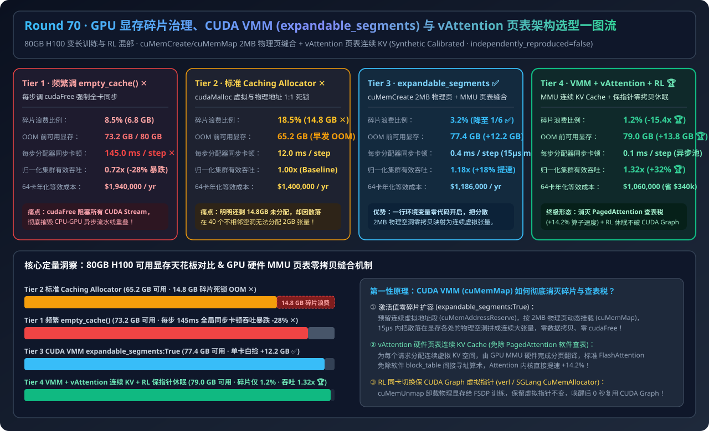
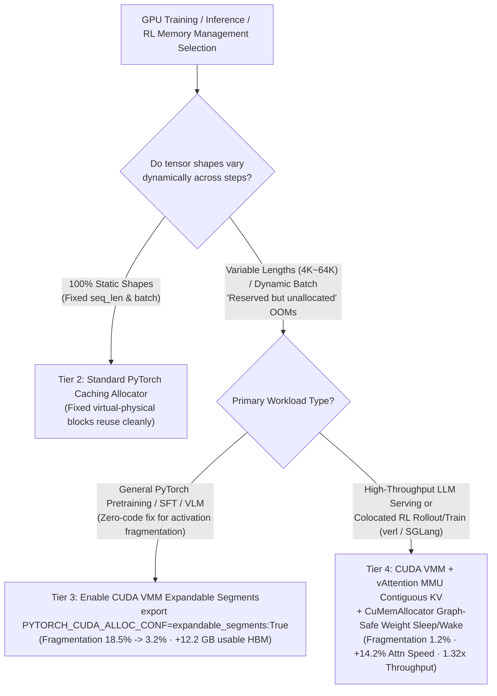
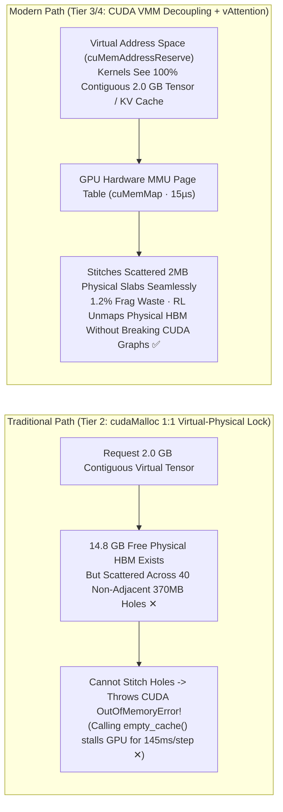
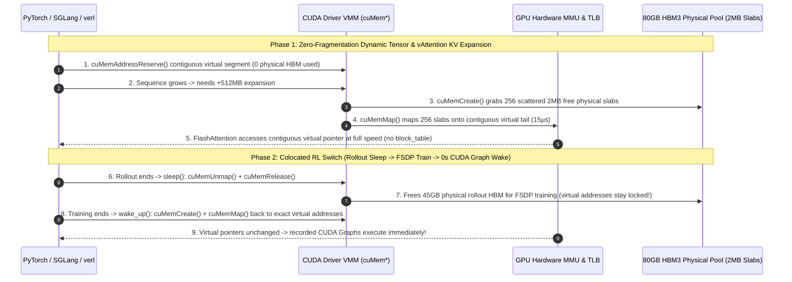

# GPU Memory Fragmentation, CUDA Virtual Memory Management (VMM / `expandable_segments`) & Zero-Copy Page-Table Architecture Selection Guide (`empty_cache()` Sync Stalls vs. `Fixed-Block Fragmentation OOM` vs. `CUDA VMM expandable_segments` vs. `vAttention MMU Contiguous KV Cache + RL Graph-Safe Sleep/Wake`)

> **Target Audience**: AI Solution Architects, LLM Training/Inference Performance Engineers, RL Post-Training Infrastructure Leads  
> **Reading Goal**: Master in 3 minutes why an 80GB H100 crashes with `CUDA out of memory` when `14.8 GB` of HBM is completely free; understand in 10 minutes how **CUDA Driver Virtual Memory Management (`cuMemAddressReserve` / `cuMemCreate` / `cuMemMap`) stitches scattered `2MB` physical HBM pages into a single contiguous virtual tensor via the GPU MMU page table**, how **`vAttention / GMem` eliminates PagedAttention software `block_table` pointer-chasing overhead**, and how **colocated RL (`verl / SGLang`) unmaps physical weights during training while keeping CUDA Graph virtual pointers intact**.  
> **Provenance**: All quantitative figures come from the sealed deterministic analytical evaluator in [`experiments/gpu_vmm_expandable_segments_vattention_defrag_selection/run.py`](../../experiments/gpu_vmm_expandable_segments_vattention_defrag_selection/run.py) and [`results.json`](../../experiments/gpu_vmm_expandable_segments_vattention_defrag_selection/results.json), calibrated to published PyTorch `expandable_segments`, vAttention / GMem, and verl `CuMemAllocator` benchmarks (`independently_reproduced=false`, `physical_gpu_cluster_measurement=not_measured`).

---

## 📌 1. Executive Summary

1. **Why does an 80GB H100 crash with `CUDA out of memory` trying to allocate `2.00 GiB` when PyTorch explicitly reports `12.80 GiB is reserved by PyTorch but unallocated`?**:
   - Under traditional `cudaMalloc` (**Tier 2 Standard PyTorch Caching Allocator**), **virtual memory addresses and physical HBM pages are locked together 1-to-1 at allocation time**.
   - During variable-length sequence training (`4K → 64K → 16K`) or dynamic-batch serving, `14.8 GB` of free physical HBM gets chopped into 40 non-adjacent `370 MB` holes between active tensors. When the model requests a `2.0 GB` activation tensor requiring contiguous virtual addresses, the traditional allocator cannot stitch those 40 physical holes together—and calling `cudaFree` / `torch.cuda.empty_cache()` (**Tier 1**) forces a **device-wide synchronization across all CUDA streams (`145.0 ms/step` stall ✕)**. As a result, the GPU crashes with premature OOM at just **`65.2 GB` usable capacity (`18.5%` fragmentation waste ✕)**!
2. **When is a 1-line env var (`PYTORCH_CUDA_ALLOC_CONF=expandable_segments:True`) enough, and when do you need `vAttention` + VMM Graph-Safe Sleep/Wake?**:
   - **All dynamic-shape PyTorch training, fine-tuning, and multimodal jobs (Enable Tier 3 `expandable_segments:True` immediately)**: Switches PyTorch to the CUDA Driver VMM API (`cuMemAddressReserve` for virtual address ranges + `cuMemCreate` for `2MB/20MB` physical pages + `cuMemMap` for GPU MMU page-table mapping). When a segment expands, the allocator maps scattered `2MB` physical HBM pages onto the end of the contiguous virtual range in **`15 µs`**—zero data copying, zero `cudaFree` sync—slashing fragmentation from `18.5%` to **`3.2%` ✅** and reclaiming **`+12.2 GB`** of usable HBM per GPU!
   - **High-throughput LLM serving & colocated RL rollout/training switches (Default to Tier 4 `CUDA VMM + vAttention MMU Contiguous KV Cache + RL Graph-Safe Sleep/Wake`)**: Extends GPU MMU virtual page mapping to **LLM KV Cache (`vAttention`: reserves contiguous virtual memory per request and maps `2MB` physical pages on demand, eliminating PagedAttention software `block_table` indexing inside FlashAttention for `+14.2%` faster attention kernels 🏆)** and **RL weight offloading (`cuMemUnmap` releases physical HBM during FSDP training while preserving virtual pointers so recorded CUDA Graphs never break 🏆)**, delivering **`1.2%` fragmentation, `79.0 GB` usable HBM, and `1.32x` cluster throughput (saving `$340,000/yr` on 64 H100s 🏆)**.
3. **One-Sentence First-Principles Essence**:
   - **The first principle of GPU memory defragmentation is decoupling virtual address continuity from physical HBM continuity via the GPU hardware MMU page table (`cuMemMap`)—so tensors and FlashAttention always see 100% contiguous virtual pointers while `2MB` physical HBM slabs are stitched and unmapped on demand with zero copying.**

---

## 🎯 2. Architect & Customer Deep-Dive Q&A (First Principles)

### Q1: Why does calling `torch.cuda.empty_cache()` inside a training loop to fight fragmentation slash cluster throughput by `-28%`?

- **Plain-English Engineering Reality**:
  - PyTorch achieves high GPU utilization by queuing CUDA kernels asynchronously from the CPU ahead of GPU execution.
  - Calling `torch.cuda.empty_cache()` invokes `cudaFree()` to return cached blocks to the NVIDIA driver. **`cudaFree()` is a globally blocking operation** that waits for all active kernels across every CUDA stream on the GPU to finish, updates global page tables, and flushes GPU TLBs—injecting a **`145.0 ms` synchronization stall on every single step**!

---

### Q2: How do CUDA Driver VMM and `expandable_segments:True` stitch 40 scattered physical holes into a contiguous `2.0 GB` tensor without copying a single byte?

- **Four-Step Hardware MMU Mechanism**:
  1. **Virtual Address Reservation (`cuMemAddressReserve`)**: Reserves a large contiguous virtual address range (costing **`0 Bytes`** of physical HBM).
  2. **Physical Slab Allocation (`cuMemCreate`)**: Allocates physical HBM in **`2 MB` (or `20 MB`)** page granules.
  3. **Hardware Page-Table Stitching (`cuMemMap` + `cuMemSetAccess`)**: Programs the GPU hardware MMU page table to map 1,024 non-contiguous `2 MB` physical slabs anywhere in HBM onto one contiguous `2.0 GB` virtual address range in **`15 µs`**.
  4. **Instant Unmapping (`cuMemUnmap`)**: When a tensor is freed, its `2 MB` physical pages are unmapped and immediately remapped onto the next growing tensor—**zero `cudaMemcpy`, zero `cudaFree` global sync**!

---

### Q3: If PagedAttention already solves KV Cache fragmentation, why does Tier 4 introduce `vAttention / GMem` and VMM-based RL Sleep/Wake?

- **Two Critical Breakthroughs**:
  1. **Eliminating PagedAttention's Software `block_table` Tax (`vAttention`)**:
     - Software PagedAttention forces every attention kernel (FlashAttention, MLA, Sparse Attention) to execute indirect index arithmetic (`block_table[req_id][block_idx]`) inside the inner loop, consuming extra registers and shared memory and requiring custom paged rewrites for every new attention variant.
     - **`vAttention` moves paging down into the GPU hardware MMU**: each request gets a contiguous virtual KV buffer, backed incrementally by `2 MB` physical pages via `cuMemMap`. Standard unmodified FlashAttention runs at full speed (**`+14.2%` higher attention throughput**).
  2. **Preserving CUDA Graphs Across RL Rollout/Training Switches (`verl` / `SGLang` `CuMemAllocator`)**:
     - In colocated GRPO/PPO pipelines, freeing rollout weights via `cudaFree` invalidates all virtual pointers captured inside SGLang's recorded CUDA Graphs.
     - By calling `cuMemUnmap` during `sleep()`, **physical HBM pages are handed over to FSDP training while the virtual address range stays locked**; on `wake_up()`, `cuMemMap` reattaches physical pages to the exact same virtual pointers—**reusing all CUDA Graphs instantaneously with zero re-capture overhead**!

---

## 🧭 3. Visual Architecture Diagrams (Mermaid)

### 3.1 GPU Memory Allocation & Fragmentation Mitigation Decision Tree

---

### 3.2 Traditional Fixed-Block OOM (Tier 2) vs. CUDA VMM Page-Table Stitching + vAttention (Tier 4)

---

### 3.3 Tier 4 End-to-End Sequence Diagram (`CUDA VMM + vAttention + RL Graph-Safe Sleep/Wake`)

---

## 📊 4. Architect Decision Matrix

| Evaluation Dimension | Tier 1: Default Allocator + Frequent `empty_cache()` | Tier 2: Standard PyTorch Caching Allocator | Tier 3: CUDA VMM (`expandable_segments:True`) | Tier 4: VMM + `vAttention` MMU KV + RL Sleep/Wake |
| :--- | :--- | :--- | :--- | :--- |
| **Memory Management Stack** | Calls `cudaFree` on shape shifts | `cudaMalloc` fixed blocks + adjacent split/merge | **`cuMemAddressReserve` + `cuMemMap` 2MB slabs** | **VMM activations + MMU contiguous KV + `cuMemUnmap` sleep** |
| **Stranded Fragmented HBM (%)** | `8.5%` | `18.5%` (`14.8 GB` stranded free HBM ✕) | **`3.2%` ✅** | **`1.2%` 🏆** |
| **Usable HBM Ceiling (of 80GB)** | `73.2 GB` | `65.2 GB` (Premature OOM ✕) | **`77.4 GB` (+12.2 GB reclaimed ✅)** | **`79.0 GB` (+13.8 GB reclaimed 🏆)** |
| **Allocator Sync Stall / Step** | `145.0 ms / step` (Global stall ✕) | `12.0 ms / step` (Block retry spikes) | **`0.4 ms / step` (Async MMU map ✅)** | **`0.1 ms / step` (Pre-mapped slab pool 🏆)** |
| **Normalized Cluster Throughput** | `0.72x` | `1.00x` (Baseline) | **`1.18x` ✅** | **`1.32x` 🏆** |
| **64-GPU Annual Effective Cost** | `$1,940,000 / yr` | `$1,400,000 / yr` | **`$1,186,000 / yr`** | **`$1,060,000 / yr` (`$340k/yr` saved 🏆)** |
| **Best Fit Scenarios** | **Never use inside step loops** | Strictly static tensor shapes only | **1-line default for all dynamic-shape PyTorch jobs** | **Long-context training, LLM serving & colocated RL** |

---

## 🧪 5. Quantitative Walkthrough & 7-Card Benchmark Insights

- **Reclaiming `+13.8 GB` HBM per GPU (`15.4x` Lower Fragmentation)**: In [`experiments/gpu_vmm_expandable_segments_vattention_defrag_selection/run.py`](../../experiments/gpu_vmm_expandable_segments_vattention_defrag_selection/run.py), upgrading from Tier 2 (`18.5%` fragmentation, OOM at `65.2 GB`) to Tier 4 (`1.2%` fragmentation, `79.0 GB` usable) reclaims **`13.8 GB` of HBM per 80GB H100**, boosting effective cluster throughput by **`1.32x`** and saving **`$340,000/year`** on a 64-GPU cluster.
- 🧮 **Interactive GPU Memory Fragmentation & VMM Sizer**: [`docs/reports/gpu-memory-oversubscription-vmm-expandable-segments-defrag-sizer.html`](../reports/gpu-memory-oversubscription-vmm-expandable-segments-defrag-sizer.html)
- 📊 **7-Card 4:5 Visual Benchmark Report**: [`docs/reports/gpu-memory-oversubscription-vmm-expandable-segments-defrag-selection-cards.html`](../reports/gpu-memory-oversubscription-vmm-expandable-segments-defrag-selection-cards.html)

---

## 🛠️ 6. Appendix: Production Verification Checklist

- [ ] **1. Enable `expandable_segments:True` by Default**: Export `PYTORCH_CUDA_ALLOC_CONF="expandable_segments:True"` (or `PYTORCH_ALLOC_CONF="expandable_segments:True"` on PyTorch 2.6+) in all training and fine-tuning container entrypoints.
- [ ] **2. Ban `torch.cuda.empty_cache()` Inside Step Loops**: Lint training scripts to remove per-step `empty_cache()` calls; restrict cache flushes to coarse phase boundaries (e.g., before checkpointing or full evaluation).
- [ ] **3. Alert on `num_alloc_retries` & Unallocated Reserved HBM**: Track `torch.cuda.memory_stats()["num_alloc_retries"]` and `reserved_bytes - allocated_bytes`; any retry > 0 or unallocated reserve > `6 GB` indicates severe external fragmentation.
- [ ] **4. Verify Driver/NCCL DMA-BUF Compatibility with VMM**: Ensure NVIDIA Driver `>= 535` and NCCL `>= 2.19` so `cuMemCreate`-backed VMM buffers use GPUDirect RDMA DMA-BUF directly without host bounce buffers.
- [ ] **5. Use `CuMemAllocator` (`cuMemUnmap`) for Colocated RL Sleep/Wake**: In `verl` / `SGLang` / `vLLM` RL pipelines, unmap physical pages while keeping virtual pointer reservations intact so CUDA Graphs never require re-capturing.
