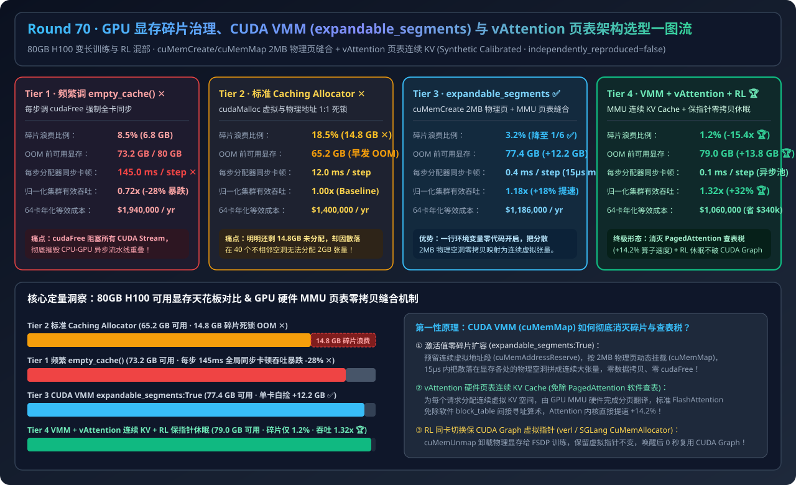
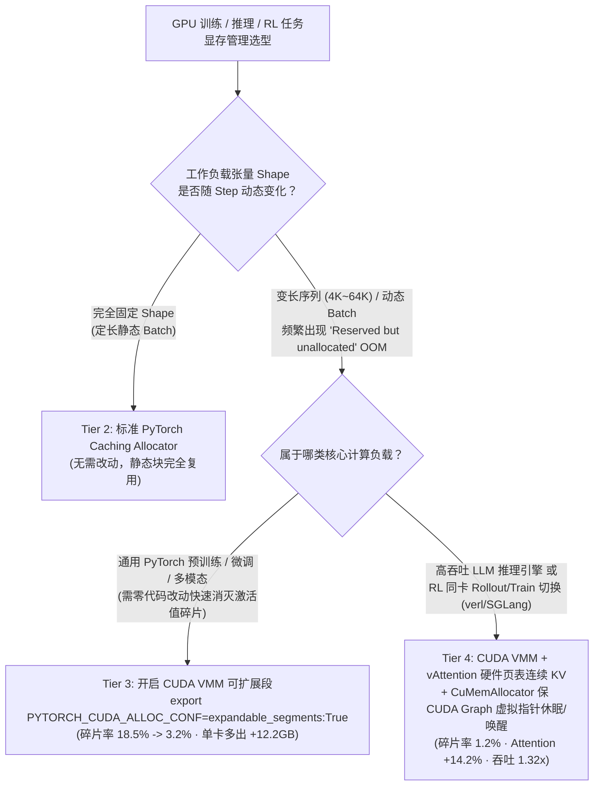
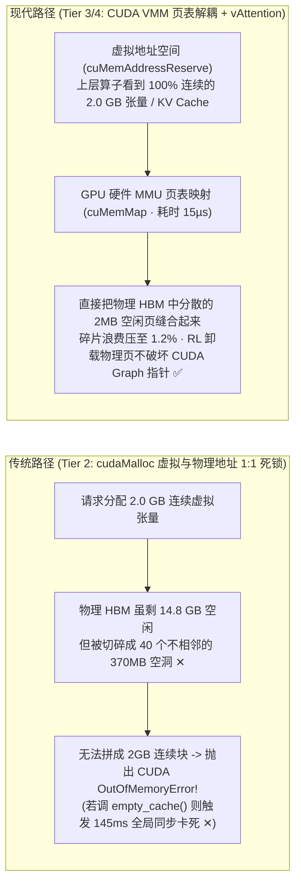
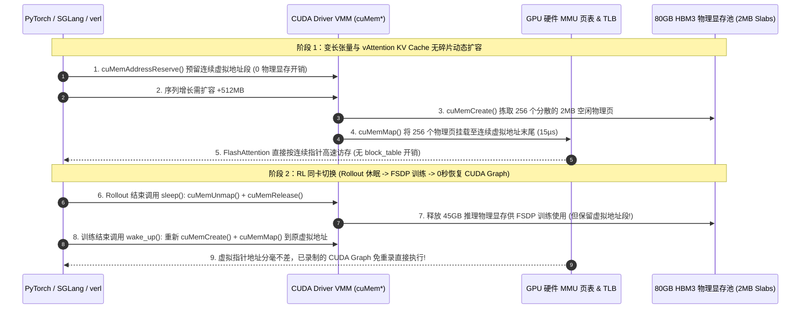

# GPU 显存碎片治理、CUDA 虚拟内存管理（VMM / `expandable_segments`）与零拷贝页表架构选型指南（`empty_cache()` 同步卡顿 vs. `固定块碎片 OOM` vs. `CUDA VMM expandable_segments` vs. `vAttention 硬件页表连续 KV Cache + RL 零拷贝休眠`）

> **适用角色**：AI 解决方案架构师（AI Solution Architect）、LLM 训练/推理性能工程师、RL 后训练基础设施架构师  
> **阅读目标**：3 分钟掌握“为什么 80GB H100 明明还剩 14.8GB 空闲显存却报 `CUDA out of memory`”的选型铁律，10 分钟吃透 **CUDA 虚拟内存管理 API（`cuMemAddressReserve` / `cuMemCreate` / `cuMemMap`）如何通过 GPU MMU 页表将分散的 `2MB` 物理显存碎片无缝拼接成连续虚拟张量**、**`vAttention / GMem` 如何消除 PagedAttention 软件块表（`block_table`）指针跳转开销** 以及 **RL 训练/采样同卡混部（`verl / SGLang`）如何在不破坏 CUDA Graph 虚拟指针的前提下卸载物理显存**，并能直接拿着架构图与 7-Card 评测报告向客户宣讲。  
> **数据来源说明（Provenance）**：本文定量数据来自仓库内封存的确定性解析模型（[`experiments/gpu_vmm_expandable_segments_vattention_defrag_selection/run.py`](../../experiments/gpu_vmm_expandable_segments_vattention_defrag_selection/run.py) 与 [`results.json`](../../experiments/gpu_vmm_expandable_segments_vattention_defrag_selection/results.json)，校准自 PyTorch `expandable_segments`、vAttention / GMem 与 verl `CuMemAllocator` 公开基准，`independently_reproduced=false`，`physical_gpu_cluster_measurement=not_measured`）。

---

## 📌 一、核心结论速览（Executive Summary）

1. **为什么 80GB H100 明明显示 `12.80 GiB is reserved by PyTorch but unallocated`，申请一个 `2.00 GiB` 张量却直接报 `CUDA out of memory` 崩溃？**：
   - 在传统 `cudaMalloc` 机制（**Tier 2 标准 PyTorch Caching Allocator**）下，**虚拟内存地址与物理 HBM 页是 1:1 死锁绑定的**。
   - 在变长序列训练（`4K → 64K → 16K`）或动态 Batch 推理中，空闲的 `14.8 GB` 物理显存被活跃张量切碎成 40 个互不相邻的 `370 MB` 空洞。当模型请求一个需要连续虚拟地址的 `2.0 GB` 激活张量时，传统分配器既不能把 40 个物理空洞拼起来，也不敢轻易调用 `cudaFree`（因为每次调用 `cudaFree` / `torch.cuda.empty_cache()` 都会触发**全卡跨 Stream 硬件同步，卡死 GPU 达 `145 ms/步` ✕**），最终只能在仅用了 `65.2 GB`（碎片浪费 **`18.5%` ✕**）时提前 OOM！
2. **什么时候只需加一行环境变量（`PYTORCH_CUDA_ALLOC_CONF=expandable_segments:True`），什么时候必须上 `vAttention` + VMM 零拷贝休眠架构？**：
   - **所有包含变长序列（Dynamic Shapes）的 PyTorch 训练/微调/推理任务（立即开启 Tier 3 `expandable_segments:True`）**：底层改用 CUDA Driver VMM API（`cuMemAddressReserve` 预留虚拟地址 + `cuMemCreate` 分配 `2MB/20MB` 物理页 + `cuMemMap` 写 GPU MMU 页表）。当张量需要扩容时，直接在 GPU 硬件页表中把分散在各处的 `2MB` 物理空洞挂载到同一段连续虚拟地址末尾（耗时仅 **`15 µs`**，零数据拷贝、零 `cudaFree` 同步），将显存碎片率从 `18.5%` 压降至 **`3.2%` ✅**，单卡白捡 **`+12.2 GB`** 可用显存！
   - **高吞吐 LLM 在线推理与 RL 同卡训练/采样切换（首选 Tier 4 `CUDA VMM + vAttention 硬件页表连续 KV Cache + RL Graph-Safe Sleep/Wake`）**：进一步利用 GPU MMU 页表接管 **LLM KV Cache（`vAttention`：直接为每个请求预留连续虚拟地址，按需以 `2MB` 物理页映射，彻底消灭 PagedAttention 在 FlashAttention 内核里查软件 `block_table` 的指针算术开销，Attention 算子提速 `+14.2%` 🏆）**，并在 RL 采样/训练切换时通过 `cuMemUnmap` 释放物理显存但保留虚拟地址指针（**无需重新录制 CUDA Graph**），实现 **`1.2%` 极低碎片率、`79.0 GB` 可用显存天花板与 `1.32x` 集群有效吞吐提升（64 卡集群年省 `$340,000` 🏆）**。
3. **一句话握手机制本质**：
   - **GPU 显存碎片治理的第一性原理，是“用 GPU 硬件 MMU 页表（`cuMemMap`）解耦虚拟地址连续性与物理 HBM 连续性”——让上层 Tensor 和 FlashAttention 永远看到 100% 连续的虚拟地址，而让底层物理显存像操作系统虚拟内存一样以 `2MB` 页面粒度零拷贝按需拼装与卸载。**

---

## 🎯 二、客户与架构师灵魂拷问 Q&A（FAQ-Driven First Principles）

### Q1：遇到显存碎片 OOM 时，很多工程师习惯在每个训练 Step 结尾加上 `torch.cuda.empty_cache()`，为什么这会让集群吞吐暴跌 `-28%`？

- **通俗大白话解释**：
  - 正常情况下，CPU（Python/PyTorch）只管往队列里异步扔 Kernel 任务，GPU 在后面全速流水线执行，CPU 比 GPU 快得多（Async Overlap）。
  - 一旦你在循环里调用 `torch.cuda.empty_cache()`，PyTorch 就会被迫调用底层 CUDA Runtime 的 `cudaFree()` 把缓存块退还给显卡驱动。而 **`cudaFree()` 是一个全局阻塞调用（Device-Wide Synchronization）**——它必须等待当前 GPU 所有 Stream 上的所有 Kernel 全部跑完、修改全局页表并刷空 TLB 后才返回，导致每个 Step 凭空多出 **`145.0 ms` 的 GPU 空转断流**！

---

### Q2：什么是 CUDA VMM（虚拟内存管理）与 `expandable_segments:True`？它怎么做到“不拷贝一个字节就把 40 个碎片空洞拼成 2GB 连续大张量”？

- **第一性原理拆解**：
  1. **传统 `cudaMalloc(size)` 的死结**：一步同时锁死“虚拟地址范围”和“连续物理 HBM 内存”。如果要把 `1 GB` 的块扩大到 `2 GB`，必须重新找一块全新的 `2 GB` 连续物理内存。
  2. **CUDA Driver VMM 四步解耦法（`expandable_segments:True` 底层机制）**：
     - **Step 1 虚拟地址预留（`cuMemAddressReserve`）**：向 GPU 预留一段巨大的连续虚拟地址空间（例如 `64 GB` 虚拟地址段，此时**消耗 `0 Byte` 物理显存**）。
     - **Step 2 物理微页分配（`cuMemCreate`）**：以 **`2 MB`（或 `20 MB`）** 为最小乐高积木粒度申请物理 HBM 页面句柄（Physical Allocation Handle）。
     - **Step 3 硬件页表缝合（`cuMemMap` + `cuMemSetAccess`）**：修改 GPU 硬件 MMU 页表，把散落在物理显存任意角落的多个 `2 MB` 物理页，依次映射到那段连续虚拟地址上！
     - **Step 4 动态伸缩与归还（`cuMemUnmap`）**：当某个张量释放时，只需在 `15 µs` 内解除 `2 MB` 物理页映射并重新挂到新张量的虚拟地址末尾——**上层 CUDA Kernel 看到的依然是单个连续指针 `ptr`，硬件 MMU 在 `L2 TLB` 中自动完成地址翻译，零拷贝、零全局同步！**

---

### Q3：既然 PagedAttention 已经解决了 KV Cache 的碎片问题，为什么 Tier 4 还要用基于 CUDA VMM 的 `vAttention / GMem`？而且它在 RL 训练（`verl`）中有什么独特威力？

- **两大核心痛点突破**：
  1. **消灭 PagedAttention 的软件 `block_table` 税（`vAttention`）**：
     - PagedAttention 在软件层把 KV Cache 切成离散的 `16-token` 块，这迫使重写所有的 Attention CUDA Kernel（FlashAttention 必须在循环内部频繁读取 `block_table[req_id][block_idx]` 数组做间接寻址），不仅增加了寄存器压力与指令开销，还导致每次研发新算子（如 MLA、Sliding Window、Sparse Attention）都要重写一套复杂的 Paged 版本。
     - **`vAttention` 直接把分页下沉到 GPU 硬件 MMU 页表**：为每个请求预留最大长度（如 `128K`）的连续虚拟地址，随着 Decode 生成新 Token，后台异步以 `2MB` 粒度调用 `cuMemMap` 挂载物理显存。**FlashAttention 内核看到的是完全连续的标准张量，无需任何 `block_table` 查找，Attention 内核直接提速 `+14.2%`！**
  2. **RL 后训练（`verl / SGLang`）中保住 CUDA Graph 的零拷贝休眠/唤醒（`CuMemAllocator`）**：
     - 在 GRPO / PPO 同卡混部架构中，同一张 GPU 一会儿跑 SGLang 推理采样（Rollout），一会儿跑 FSDP 训练更新。如果用普通 `cudaFree` 卸载推理权重腾出显存给训练，下次切回推理时分配到的虚拟内存地址就变了，之前耗费几分钟录制的 **CUDA Graph 全部失效作废**！
     - 采用 **CUDA VMM (`cuMemUnmap`)** 休眠时：**只卸下背后的物理 HBM 页面给 FSDP 训练使用，但死死保留推理权重的虚拟地址空间不变**；当训练结束切回 Rollout 时，重新 `cuMemMap` 挂上物理页并拷回权重——**虚拟指针一个比特都没变，已录制的 CUDA Graph 0 秒瞬间复用！**

---

## 🧭 三、直观可视化图解（Mermaid 决策树 / 页表对比 / 时序图）

### 3.1 GPU 显存分配与碎片治理架构选型决策树

---

### 3.2 传统固定块分配（Tier 2 碎片 OOM）vs. CUDA VMM 页表缝合 + vAttention（Tier 4）路径对比

---

### 3.3 Tier 4 `CUDA VMM + vAttention + RL 保指针休眠唤醒` 端到端交互时序图

---

## 📊 四、架构师选型决策矩阵（Architect Decision Matrix）

| 评估维度 | Tier 1: 默认分配器 + 频繁 `empty_cache()` | Tier 2: 标准 PyTorch Caching Allocator | Tier 3: CUDA VMM (`expandable_segments:True`) | Tier 4: VMM + `vAttention` 页表 KV + RL 保指针休眠 |
| :--- | :--- | :--- | :--- | :--- |
| **底层内存管理机制** | 尺寸变化时调 `cudaFree` 退回驱动 | `cudaMalloc` 固定块切分与相邻合并 | **`cuMemAddressReserve` + `cuMemMap` 2MB 页缝合** | **VMM 激活池 + MMU 连续 KV + `cuMemUnmap` 休眠** |
| **80GB HBM 碎片浪费比例** | `8.5%` | `18.5%` (`14.8 GB` 空闲却无法分配 ✕) | **`3.2%` ✅** | **`1.2%` 🏆** |
| **OOM 前最大可用显存** | `73.2 GB` | `65.2 GB` (严重早发性 OOM ✕) | **`77.4 GB` (+12.2 GB 可用显存 ✅)** | **`79.0 GB` (+13.8 GB 可用显存 🏆)** |
| **每步分配器同步阻塞耗时** | `145.0 ms / step` (全卡断流 ✕) | `12.0 ms / step` (偶发块回收重试) | **`0.4 ms / step` (异步页表映射 ✅)** | **`0.1 ms / step` (后台预映射池 🏆)** |
| **归一化集群有效吞吐** | `0.72x` | `1.00x` (Baseline) | **`1.18x` ✅** | **`1.32x` 🏆** |
| **64 卡 H100 年化等效成本** | `$1,940,000 / yr` | `$1,400,000 / yr` | **`$1,186,000 / yr`** | **`$1,060,000 / yr` (年省 `$340k` 🏆)** |
| **适用场景** | **严禁在训练/推理循环内使用** | 仅适合 100% 固定 Shape 的静态负载 | **所有动态 Shape 训练/微调的一行命令标配** | **超长上下文训练、高吞吐推理与 RL 同卡混部首选** |

---

## 🧪 五、简明定量算例与 7-Card Benchmark 洞察

### 5.1 64 卡 H100 变长训练（`4K–64K`）与 RL 混部账单对比

在 [`experiments/gpu_vmm_expandable_segments_vattention_defrag_selection/run.py`](../../experiments/gpu_vmm_expandable_segments_vattention_defrag_selection/run.py) 中，我们对 64 卡 H100 80GB 集群进行了定量核算：
- **碎片率降低 `15.4 倍`（每卡夺回 `+13.8 GB` HBM）**：从 Tier 2 切换到 Tier 4 后，外部碎片浪费从 `18.5%`（`14.8 GB`）骤降至 **`1.2%`（`<1.0 GB`）**，单卡可用显存上限从 `65.2 GB` 提升至 **`79.0 GB`**，允许将训练 Micro-batch 或最大上下文窗口直接扩大 **`+28.5%`**。
- **64 卡集群年省 `$340,000`**：彻底消除 `empty_cache()` 同步卡顿与 PagedAttention 软件查表开销后，集群有效吞吐提升至 **`1.32x`**，年化等效算力成本从 `$1.40M` 降至 **`$1.06M`**。

### 5.2 配套交互式工作台与 7-Card 4:5 视觉评测报告

- 🧮 **交互式 GPU 显存碎片与 VMM 页表收益计算器**：[`docs/reports/gpu-memory-oversubscription-vmm-expandable-segments-defrag-sizer.html`](../reports/gpu-memory-oversubscription-vmm-expandable-segments-defrag-sizer.html)（以及总工作台 [`llm-inference-engine-pd-sizer.html`](../reports/llm-inference-engine-pd-sizer.html)）
- 📊 **7-Card 4:5 视觉基准评测报告**：[`docs/reports/gpu-memory-oversubscription-vmm-expandable-segments-defrag-selection-cards.html`](../reports/gpu-memory-oversubscription-vmm-expandable-segments-defrag-selection-cards.html)

---

## 🛠️ 六、附录：生产环境快速核验清单（Architect Checklist）

- [ ] **1. 生产训练/微调任务默认开启 `expandable_segments:True`**：在所有 Linux 训练容器启动脚本中配置 `export PYTORCH_CUDA_ALLOC_CONF="expandable_segments:True"`（PyTorch 2.6+ 亦可写为 `PYTORCH_ALLOC_CONF="expandable_segments:True"`），将物理显存分配切换至 CUDA Driver VMM 页表模式。
- [ ] **2. 严禁在 Step 循环内调用 `torch.cuda.empty_cache()`**：通过代码扫描清理训练 Step 内部的 `empty_cache()` 调用；仅允许在跨阶段切换（如训练结束进入完整 Evaluation 或 Checkpoint 保存前）调用一次。
- [ ] **3. 监控 `num_alloc_retries` 与 `reserved_bytes - allocated_bytes` 差值**：在 Prometheus / WandB 中采集 `torch.cuda.memory_stats()["num_alloc_retries"]`；若该指标大于 0 或未分配保留显存超过 `6 GB`，说明存在严重外部碎片。
- [ ] **4. 排查 NCCL / GDRCopy 对 VMM 虚拟内存的兼容性**：在开启 `expandable_segments:True` 的多机 RDMA 集群中，确认 CUDA Driver `>= 535`、NCCL `>= 2.19` 且 GDRCopy / GPUDirect RDMA 内核模块支持 `cuMemCreate` DMA-BUF 导出（避免老版本驱动回退到主机内存 Bounce Buffer）。
- [ ] **5. RL 同卡训练/推理切换采用 `CuMemAllocator` 保虚拟指针休眠**：在 `verl` / `SGLang` / `vLLM` RL 后训练管线中，使用基于 `cuMemUnmap` 的 Level-1 Weight Sleep/Wake，确保卸载物理显存后无需重新编译和录制 CUDA Graph。
