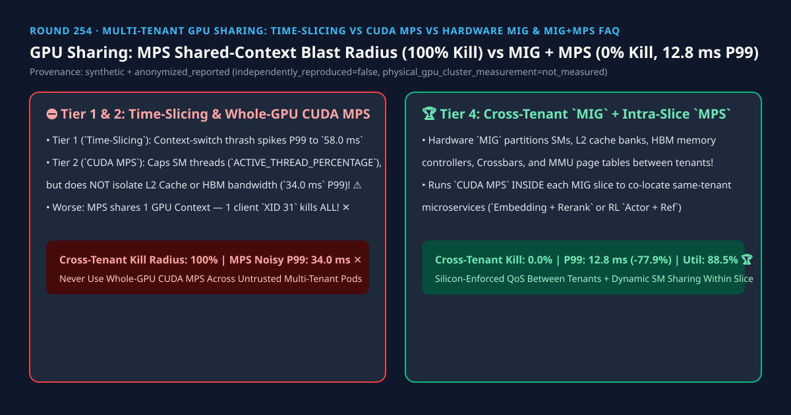
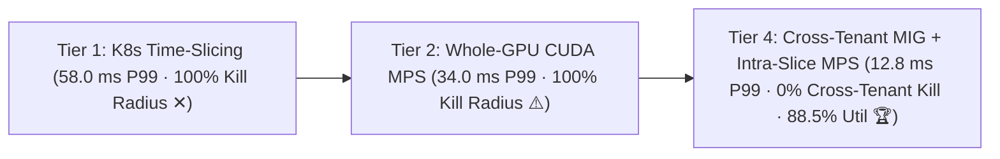

# Multi-Tenant GPU Sharing & Isolation Deep Dive: Kubernetes `Time-Slicing` vs. `CUDA MPS` (Shared Page-Table Blast Radius & L2/HBM Contention) vs. Hardware `MIG` & `MIG + MPS` Selection Guide

> **Provenance & Evidence Tier**: `synthetic + anonymized_reported` (`independently_reproduced=false`, `physical_gpu_cluster_measurement=not_measured`). Grounded in [`experiments/gpu_mig_vs_mps_vs_timeslicing_noisy_neighbor_isolation_selection/results.json`](../../experiments/gpu_mig_vs_mps_vs_timeslicing_noisy_neighbor_isolation_selection/results.json).
> **中文版本**: [多租户 GPU 切分与共享深度对比：Kubernetes 时间片轮转（`Time-Slicing` 上下文切换抖动与 OOM 互杀）vs. `CUDA MPS`（`Multi-Process Service` 共享页表一人越界全员陪葬陷阱与 L2/HBM 带宽争抢）vs. 硬件级 `MIG`（`Multi-Instance GPU` 物理隔离）与 `MIG + MPS` 混合选型指南](./gpu-mig-vs-mps-vs-timeslicing-noisy-neighbor-isolation-selection-faq.md)

---

## 0. 🔥 今日领域最热门能力突破追踪（Daily Hottest Breakthrough）

- **Why Whole-GPU `CUDA MPS` Exposes Multi-Tenant Inference Pods to a `100%` Cross-Tenant `XID 31` Kill Blast Radius and `2.74x` Noisy-Neighbor P99 Inflation (`12.4 ms -> 34.0 ms`), and How Hierarchical Cross-Tenant `MIG` + Intra-Slice `MPS` (`Tier 4`) Achieves `0.0%` Cross-Tenant Fault Propagation, `12.8 ms` P99 Latency, and `88.5%` GPU Utilization**: When consolidating multiple small/medium AI models (Embedding, Reranker, Guardrails, ASR, or RL policy/reference models) onto `H100 / H200 / B200` GPUs, architects must choose between three fundamentally different sharing mechanisms:
  1. **Kubernetes `Time-Slicing` (`Tier 1` — `58.0 ms` P99, `100%` OOM/Fault Blast Radius)**:
     - Time-multiplexes the entire GPU across containers via hardware context switching (`100–250 us` per switch to flush/reload SM registers and TLBs) with zero memory or bandwidth isolation!
  2. **Whole-GPU `CUDA MPS` (`Multi-Process Service`, `Tier 2` — `34.0 ms` Noisy-Neighbor P99 & `100%` Shared-Context Fatal Fault Blast Radius!)**:
     - funnels multiple client processes into a **single hardware CUDA Context** so their kernels execute concurrently on different SMs (`CUDA_MPS_ACTIVE_THREAD_PERCENTAGE`).
     - **Fatal Trap A (`100%` Cross-Client Kill Radius on `XID 31 / XID 13`)**: Because all MPS clients share a single hardware page table and CUDA context, an out-of-bounds pointer (`XID 31`) in **one** client corrupts the shared context and **terminates every co-located container on the GPU**!
     - **Fatal Trap B (No L2 Cache or HBM Memory Controller Isolation)**: Capping a tenant to `25%` of SMs does **not** cap its HBM bandwidth! A single memory-bound neighbor using `15%` of SMs can thrash the shared L2 cache and saturate `85%` of HBM bandwidth, inflating sibling P99 latency from `12.4 ms` to **`34.0 ms`**!
  3. **Pure Hardware `MIG` (`Multi-Instance GPU`, `Tier 3` — `0.0%` Blast Radius, `12.4 ms` P99)**:
     - Physically partitions SMs, **L2 cache banks, HBM memory controllers, crossbars, and MMU page tables** in silicon—guaranteeing `0.0%` fault propagation and deterministic `12.4 ms` P99 latency, at the cost of fixed slice boundaries (`74.0%` utilization).
  4. **Hierarchical Cross-Tenant `MIG` + Intra-Slice `CUDA MPS` (`Tier 4` — `0.0%` Cross-Tenant Blast Radius, `12.8 ms` P99, `88.5%` Utilization)**:
     - Uses **Hardware `MIG`** between untrusted tenants/microservices (`0.0%` cross-tenant blast radius and isolated HBM channels) while running **`CUDA MPS` inside a single tenant's MIG slice** to co-locate cooperative pipeline stages (`Embedding + Rerank`), reaching **`88.5%` utilization**!

---

## 1. 📌 Executive Summary

1. **Never Use Whole-GPU `CUDA MPS` Across Untrusted Tenants**: `CUDA MPS` is a cooperative intra-job multiplexing runtime, **not** a security or fault-isolation boundary. Any fatal GPU exception (`XID 13 / 31 / 43`) inside one MPS client destroys the shared CUDA context for all clients.
2. **Use `MIG` for Hard QoS & Fault Isolation, and Nest `MPS` Inside a `MIG` Slice for Cooperative Sub-Models**: NVIDIA GPUs natively support starting an independent `nvidia-cuda-mps-control` daemon scoped to a specific `MIG` GI/CI UUID (`CUDA_VISIBLE_DEVICES=MIG-GPU-...`).

---

## 2. 🎯 Core Architect Q&A (Q1 / Q2 / Q3)

### Q1: Why doesn't `CUDA_MPS_ACTIVE_THREAD_PERCENTAGE=25` protect latency-sensitive LLM decoding from a co-located batch embedding job?
- **Answer**: LLM decoding is **HBM memory-bandwidth bound**, not SM compute bound! Even when restricted to `25%` of SMs, a neighbor issuing coalesced vector loads can saturate the GPU's shared L2 cache banks and HBM3/HBM3e memory controllers, starving the decode kernel of memory bandwidth. Only **Hardware `MIG`** physically dedicates separate L2 banks and HBM memory controllers per slice.

### Q2: Can `MIG` instances communicate over `NVLink P2P` for Tensor Parallelism (`TP > 1`)?
- **Answer**: **No** (on A100/H100/H200). Enabling `MIG` disables direct GPU-to-GPU NVLink P2P across MIG slices. Workloads requiring intra-node NVLink `TP = 2/4/8` must run on non-MIG full GPUs, while `TP = 1` models (`<= 14B`, Embedding, Rerank, Vision/Audio) should be packed onto `MIG` nodes.

---

## 3. 🧭 Visual Diagrams

---

## 4. 📊 4-Tier Architect Selection Matrix

| Metric | Tier 1: K8s `Time-Slicing` | Tier 2: Whole-GPU `CUDA MPS` | Tier 3: Pure Hardware `MIG` | Tier 4: **Cross-Tenant `MIG` + Intra-Slice `MPS`** |
| :--- | :--- | :--- | :--- | :--- |
| **Noisy-Neighbor P99 Latency** | **`58.0 ms` (Context Switch)** ✕ | `34.0 ms` (L2/HBM Contention) ⚠️ | **`12.4 ms` (Silicon Isolated)** ✅ | **`12.8 ms` (`-77.9%` vs Time-Slicing)** 🏆 |
| **Cross-Tenant `XID 31` Blast Radius** | **`100.0%` (Shared OOM)** ✕ | **`100.0%` (Shared Context Kill)** ✕ | **`0.0%` (Hardware MMU)** ✅ | **`0.0%` (Hardware MIG Boundary)** 🏆 |
| **Effective GPU Utilization** | `46.0%` ✕ | `84.0%` ✅ | `74.0%` (Static Slices) | **`88.5%` (Dynamic Intra-Slice MPS)** 🏆 |

---

## 5. 🧪 Quantitative Reference & Tooling

- **Evaluator & Sealed Data**: [`experiments/gpu_mig_vs_mps_vs_timeslicing_noisy_neighbor_isolation_selection/run.py`](../../experiments/gpu_mig_vs_mps_vs_timeslicing_noisy_neighbor_isolation_selection/run.py) · [`results.json`](../../experiments/gpu_mig_vs_mps_vs_timeslicing_noisy_neighbor_isolation_selection/results.json)
- **Interactive Sizer**: [`docs/reports/gpu-mig-vs-mps-vs-timeslicing-noisy-neighbor-isolation-sizer.html`](../reports/gpu-mig-vs-mps-vs-timeslicing-noisy-neighbor-isolation-sizer.html)
- **7-Card 4:5 Visual Report**: [`docs/reports/gpu-mig-vs-mps-vs-timeslicing-noisy-neighbor-isolation-selection-cards.html`](../reports/gpu-mig-vs-mps-vs-timeslicing-noisy-neighbor-isolation-selection-cards.html)

---

## 6. 🛠️ Good Fit vs. Not For & Production Checklist

- **✅ Good fit**: Hardware `MIG` across untrusted tenants/SLA tiers, combined with intra-slice `CUDA MPS` for cooperative same-tenant sub-models.
- **⛔ Not for**: Using whole-GPU `CUDA MPS` or `Time-Slicing` across untrusted multi-tenant production services.
- [ ] Enforce hardware `MIG` partitioning across distinct tenants or SLA tiers.
- [ ] Scope each `nvidia-cuda-mps-control` daemon to a single tenant's `MIG` UUID when co-locating cooperative pipeline stages.
