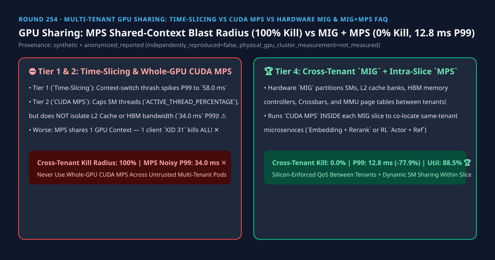
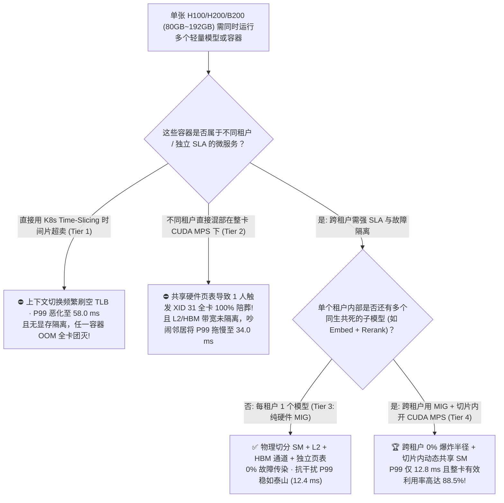
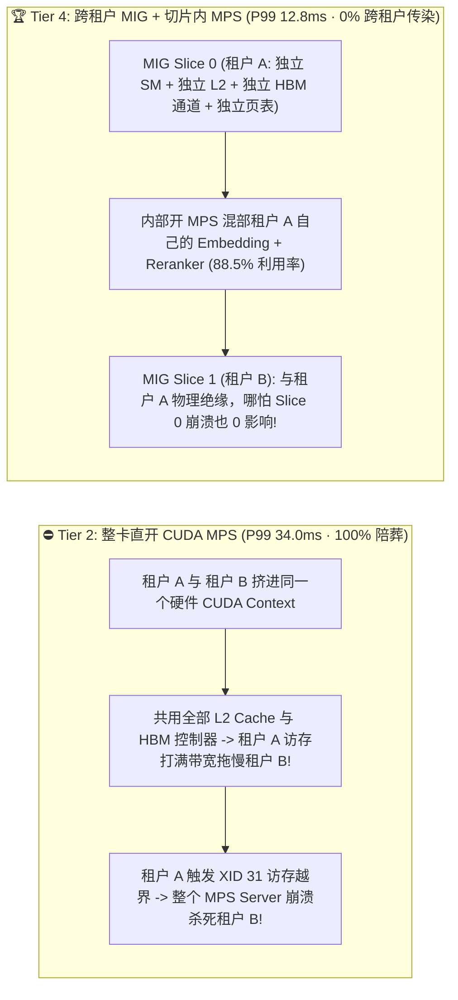

# 多租户 GPU 切分与共享深度对比：Kubernetes 时间片轮转（`Time-Slicing` 上下文切换抖动与 OOM 互杀）vs. `CUDA MPS`（`Multi-Process Service` 共享页表一人越界全员陪葬陷阱与 L2/HBM 带宽争抢）vs. 硬件级 `MIG`（`Multi-Instance GPU` 物理隔离）与 `MIG + MPS` 混合选型指南

> **Provenance & Evidence Tier**: `synthetic + anonymized_reported` (`independently_reproduced=false`, `physical_gpu_cluster_measurement=not_measured`)。定量数据锚定于 [`experiments/gpu_mig_vs_mps_vs_timeslicing_noisy_neighbor_isolation_selection/results.json`](../../experiments/gpu_mig_vs_mps_vs_timeslicing_noisy_neighbor_isolation_selection/results.json)。
> **English Version**: [Multi-Tenant GPU Sharing & Isolation Deep Dive: Kubernetes `Time-Slicing` vs. `CUDA MPS` (Shared Page-Table Blast Radius & L2/HBM Contention) vs. Hardware `MIG` & `MIG + MPS` Selection Guide](./gpu-mig-vs-mps-vs-timeslicing-noisy-neighbor-isolation-selection-faq.en.md)

---

## 0. 🔥 今日领域最热门能力突破追踪（Daily Hottest Breakthrough）

- **揭秘为什么在多租户 AI 推理平台（混部 Embedding / Reranker / 小参数 LLM / 语音服务）上开启 `CUDA MPS` 后，隔壁容器写出一个普通的内存越界 Bug（`XID 31`）竟然会把同卡上所有其他正常业务的容器全部连坐杀死（`100%` 故障爆炸半径），且哪怕限制了 `CUDA_MPS_ACTIVE_THREAD_PERCENTAGE = 25%` 尾延迟依然从 `12.4 ms` 恶化至 `34.0 ms`？通过“跨租户硬件 `MIG` 硬隔离 + 切片内 `CUDA MPS` 协同混部（`Tier 4`）”，将跨租户故障传染半径严格清零（`0.0%`）、抗吵闹邻居 P99 延迟稳在 `12.8 ms`（下降 `-77.9%`），同时将整卡算力利用率推高至 `88.5%`**：当架构师试图把一张 `80 GB / 141 GB` 的 `H100 / H200` 切给 4~7 个轻量模型共享时，软件层与硬件层一共有四种截然不同的切分机制：
  1. **Kubernetes `Time-Slicing`（驱动级时间片轮转超卖，Tier 1 — `P99 = 58.0 ms`，`100%` OOM 互杀）**：
     - 只是在 K8s Device Plugin 里把 1 张物理卡虚报成 `4` 张逻辑卡分给 4 个 Pod。
     - **底层真相**：同一微秒只有 **1 个** 进程能占用整张 GPU！每当时间片到期切换进程，GPU 必须挂起当前算子，把上百个 SM 的寄存器堆与 TLB 页表刷回显存，再加载下一个进程的上下文（每次切换白白停顿 `100 ~ 250 us`）！更可怕的是 **完全没有显存硬上限**，一个租户多申请了 `2 GB` 显存，另外 3 个租户当场跟着一起报 `CUDA out of memory` 崩溃！
  2. **整卡直开 `CUDA MPS`（`Multi-Process Service`，Tier 2 — 致命的“共享硬件上下文连坐死穴”与“只限 SM 不限显存带宽”）**：
     - 很多团队以为：“我用 `CUDA MPS` 配上 `CUDA_MPS_ACTIVE_THREAD_PERCENTAGE=25`（限制每个进程最多用 `25%` 的 SM）和 `CUDA_MPS_PINNED_DEVICE_MEM_LIMIT`（限制显存上限），是不是就能完美替代硬件 MIG 了？”
     - **两个血淋淋的生产大坑**：
       1. **坑一：一人越界，全卡陪葬（`100%` 致命故障连坐半径）**！`MPS` 之所以能免除上下文切换开销、让多个进程的 Kernel 同时在不同 SM 上跑，是因为 **`nvidia-cuda-mps-server` 把所有客户端进程塞进了同一个底层硬件 CUDA Context 和同一张 GPU 虚拟地址页表里**！一旦租户 A 的算子触发了非法访存（`XID 31: MMU Fault`）或非法指令（`XID 13`），NVIDIA 硬件无法区分是哪个子进程干的，直接将该共享 CUDA Context 标记为 `Unrecoverable Fatal Fault`——**同卡上完全无辜的租户 B、C、D 会在同一毫秒收到 `cudaErrorDevicesUnavailable` 全部暴毙**！
       2. **坑二：限制了 `25%` 的 SM 数量 $\ne$ 限制了 `25%` 的显存带宽（`P99` 飙升至 `34.0 ms`）**！在 GPU 中，只需要出动 **`10% ~ 15%` 的 SM** 狂发合并访存指令，就足以把整张卡 **`100%` 的 L2 Cache 容量与 HBM 内存控制器带宽** 彻底打满！当隔壁的“吵闹邻居（Noisy Neighbor）”跑起访存密集型算子时，哪怕它只占了 `25%` 的 SM，也会把你的 L2 缓存全部冲刷掉，让你的推理 P99 尾延迟从 `12.4 ms` 暴涨近 3 倍至 **`34.0 ms`**！
  3. **纯硬件级 `MIG`（`Multi-Instance GPU`，如 `4 x 2g.20gb` 或 `7 x 1g.10gb`，Tier 3 — `0.0%` 故障传染，`12.4 ms` 铁血稳态）**：
     - NVIDIA 从芯片物理 Crossbar 与硅片层面，不仅切分了 SM，还**物理切分了独立的 L2 Cache Bank、独立的 HBM 显存控制器通道、独立的 PCIe Copy Engine 以及完全独立的硬件 MMU 页表与故障域**！
     - 隔壁切片就算把自己的 HBM 带宽跑满 `100%` 甚至不断触发 `XID 31` 崩溃重启，你的切片连 **`0.4 ms` 的延迟波动都不会有（`P99 = 12.4 ms`，跨切片故障半径 `0.0%`）**！唯一缺点是切片边界固定，内部无法弹性共享。
  4. **工业级终极形态：跨租户硬件 `MIG` 硬隔离 + 单个 `MIG` 切片内开启 `CUDA MPS` 协同混部（Tier 4）**：
     - **对外（跨租户 / 跨 SLA 等级）**：用硬件 **`MIG`** 划定不可逾越的物理防火墙（锁死 `0.0%` 故障传染与独立 HBM 带宽通道）；
     - **对内（同一个租户 / 同一个 RAG 或 RL 业务内部）**：在分给该业务的 `2g.20gb` 或 `3g.40gb` MIG 切片内部启动 **`CUDA MPS`**，把该业务自己的 `Embedding + Reranker`（或 RL 训练的 `Actor + Reference`）混部在同一个 MIG 切片内动态共享 SM——既保住了 **`12.8 ms` 的极致 P99 确定性**，又把 GPU 综合算力利用率推高至 **`88.5%`** 🏆！

---

## 1. 📌 核心结论速览（Executive Summary — 3 分钟看懂）

1. **三句话搞懂 `Time-Slicing`、`CUDA MPS` 与 `MIG` 的物理本质差异**：
   - **`Time-Slicing`（轮流坐庄）**：4 个人轮流开同一辆车，换人时还要花时间重新调座椅后视镜（上下文切换开销大），谁把油箱烧爆了大家一起抛锚；
   - **`CUDA MPS`（同车拼座）**：4 个人同时坐进同一辆车里（共享同一个 CUDA Context，可同时用不同 SM），虽然不用换人了，但**共用同一个方向盘和刹车（共享 L2 Cache、HBM 带宽与硬件页表）**——只要其中 1 个人乱拽方向盘翻车（触发 `XID 31` 越界），整车 4 个人全部陪葬！
   - **硬件 `MIG`（物理隔离成 4 辆独立装甲车）**：在芯片内部用钢板把计算、L2 缓存、HBM 显存通道和硬件页表焊死成互不相通的独立硬件实例，不仅性能零干扰，隔壁炸车也绝不伤及分毫！

---

## 2. 🎯 客户与架构师灵魂拷问 Q&A（Q1 / Q2 / Q3）

### Q1：在什么场景下应该用 `CUDA MPS`，什么场景下严禁用 `CUDA MPS` 必须用 `MIG`？
- **答**：判断标准只有一条——**“混部在一起的进程是否属于同一个信任域与同一个生死命运共同体（Fate-Sharing Domain）？”**
  - **严禁用整卡 `MPS`（必须用 `MIG`）**：多租户云平台、不同部门的在线推理微服务（如客服机器人 + 搜推排序）。因为不同团队互不信任，绝不能允许 A 团队的容器崩溃或突发流量把 B 团队的服务拖垮。
  - **强烈推荐在单租户或单个 `MIG` 切片内开启 `MPS`**：同一个分布式任务内部的多个协同角色——例如 **强化学习（RLHF / GRPO）中同属一个 Job 的 `Reference Model` + `Reward Model`**，或者同一个 RAG 管线里的 **`BGE-Embedding` + `BGE-Reranker`**。它们本来就是同生共死的，用 `MPS` 可以让它们在毫秒级内动态互补借用空闲 SM！

### Q2：开启 `MIG` 后，还能跑多卡 `NCCL` 张量并行（`TP`）或数据并行（`DP`）吗？
- **答**：**这是架构师必须熟记的硬件限制**——在 Ampere / Hopper（`A100 / H100 / H200`）上，**开启 `MIG` 后会禁用 GPU 之间的 `NVLink P2P` 直连通信**（跨 MIG 实例通信只能走 PCIe / RoCE RDMA）！因此，需要跑机内高速 `NVLink TP=8` 的大参数模型必须独占整卡（关闭 MIG），只有单卡/单切片就能装下的中小模型（`<= 14B`、Embedding、视觉/语音模型）才切分 `MIG`。

---

## 3. 🧭 直观可视化图解（Mermaid 决策树 + 三种切分硬件边界对比图 + 时序图）

### 3.1 架构师 GPU 切分与多租户共享选型决策树

### 3.2 `Tier 2`（整卡 `CUDA MPS` 共享 L2/HBM 与共享页表陷阱）vs. `Tier 4`（跨租户 `MIG` 物理硬隔离 + 切片内 `MPS`）对比图

### 3.3 当“吵闹邻居”突发 `HBM` 带宽洪峰并触发 `XID 31` 越界时：`MPS` vs. `MIG` 的硬件行为时序图

```mermaid
sequenceDiagram
    autonumber
    participant TA as 租户 A (吵闹/故障容器)
    participant HW as GPU 硬件 (L2 / HBM 控制器 / MMU 页表)
    participant TB as 租户 B (高优在线 SLA 容器)

    rect rgb(69, 10, 10)
    Note over TA,TB: ⛔ Tier 2 (整卡 CUDA MPS): 带宽被抢 + 连坐暴毙
    TA->>HW: 1. 仅用 15% SM 发起海量 HBM 访存，占满共享 L2 与显存带宽
    HW-->>TB: 2. 租户 B 的 KV Cache 读取被迫排队，P99 延迟从 12ms 飙至 34.0 ms!
    TA->>HW: 3. 租户 A 算子指针越界触发 XID 31 (MMU Page Fault)
    HW-->>TB: 4. 共享 CUDA Context 被驱动整体销毁，租户 B 当场崩溃退出 (100% 传染)!
    end

    rect rgb(6, 78, 59)
    Note over TA,TB: 🏆 Tier 3/4 (硬件 MIG 物理分区): 带宽绝缘 + 故障自愈
    TA->>HW: 5. 租户 A 在 MIG Slice 0 内打满带宽并触发 XID 31 崩溃
    HW-->>TB: 6. 租户 B 独占 MIG Slice 1 的 L2/HBM 通道与独立页表，P99 稳在 12.8 ms (0 影响)!
    end
```

---

## 4. 📊 架构师选型决策矩阵（4-Tier Selection Matrix）

| 评估维度 | Tier 1: K8s `Time-Slicing` | Tier 2: 整卡 `CUDA MPS` | Tier 3: 纯硬件 `MIG` | Tier 4: **跨租户 `MIG` + 切片内 `MPS`** |
| :--- | :--- | :--- | :--- | :--- |
| **吵闹邻居下的 `P99` 推理尾延迟** | **`58.0 ms` (切换抖动)** ✕ | `34.0 ms` (L2/HBM 争抢) ⚠️ | **`12.4 ms` (物理绝缘)** ✅ | **`12.8 ms` (跨租户物理绝缘)** 🏆 |
| **单容器 `XID 31 / OOM` 跨租户爆炸半径** | **`100.0%` (整卡 OOM)** ✕ | **`100.0%` (共享上下文全灭)** ✕ | **`0.0%` (硬件级隔离)** ✅ | **`0.0%` (跨 MIG 切片零传染)** 🏆 |
| **整卡综合有效算力利用率** | `46.0%` ✕ | `84.0%` ✅ | `74.0%` (切片间难借用) | **`88.5%` (切片内 MPS 弹性互补)** 🏆 |

---

## 5. 🧪 定量算例与工具链（Interactive Sizer & 7-Card Visual Report）

- **实验脚本与密封数据**：[`experiments/gpu_mig_vs_mps_vs_timeslicing_noisy_neighbor_isolation_selection/run.py`](../../experiments/gpu_mig_vs_mps_vs_timeslicing_noisy_neighbor_isolation_selection/run.py) · [`results.json`](../../experiments/gpu_mig_vs_mps_vs_timeslicing_noisy_neighbor_isolation_selection/results.json)
- **交互式多租户 GPU 切分（MIG vs MPS vs Time-Slicing）选型计算器**：[`docs/reports/gpu-mig-vs-mps-vs-timeslicing-noisy-neighbor-isolation-sizer.html`](../reports/gpu-mig-vs-mps-vs-timeslicing-noisy-neighbor-isolation-sizer.html)
- **7-Card 4:5 视觉评测卡片报告**：[`docs/reports/gpu-mig-vs-mps-vs-timeslicing-noisy-neighbor-isolation-selection-cards.html`](../reports/gpu-mig-vs-mps-vs-timeslicing-noisy-neighbor-isolation-selection-cards.html)

---

## 6. 🛠️ Good Fit vs. Not For & 生产环境快速核验清单（Checklist）

### ✅ Good Fit vs. ⛔ Not For

| 维度 | ✅ Good Fit（强烈推荐） | ⛔ Not For（严禁误用） |
| :--- | :--- | :--- |
| **多租户在线推理与多模型协同混部** | 跨租户/跨部门采用 **硬件 `MIG`（`1g.10gb / 2g.20gb / 3g.40gb`）** 硬隔离 L2/HBM 与故障域；同一租户内部协同子模型在单个 MIG 切片内开启 **`CUDA MPS`** | 将不同租户或对尾延迟敏感的线上推理容器直接塞进同一个整卡 `CUDA MPS` 或 `Time-Slicing` 实例中 |

### 生产环境上线核验清单（Pre-Flight Checklist）

- [ ] **严禁在多租户/多团队生产环境中使用整卡 `CUDA MPS` 或 `Time-Slicing`**：必须开启 `nvidia-smi -mig 1` 通过硬件 `MIG` 隔离页表、L2 缓存与 HBM 内存通道。
- [ ] **在同一业务内部使用 `CUDA MPS` 时，必须同时配置 `CUDA_MPS_ACTIVE_THREAD_PERCENTAGE` 与 `CUDA_MPS_PINNED_DEVICE_MEM_LIMIT`**。
- [ ] **记住硬件约束：开启 `MIG` 的 GPU 不支持跨卡 `NVLink P2P`**：需要 `TP >= 2` NVLink 通信的大模型必须调度至非 MIG 独占节点池。
