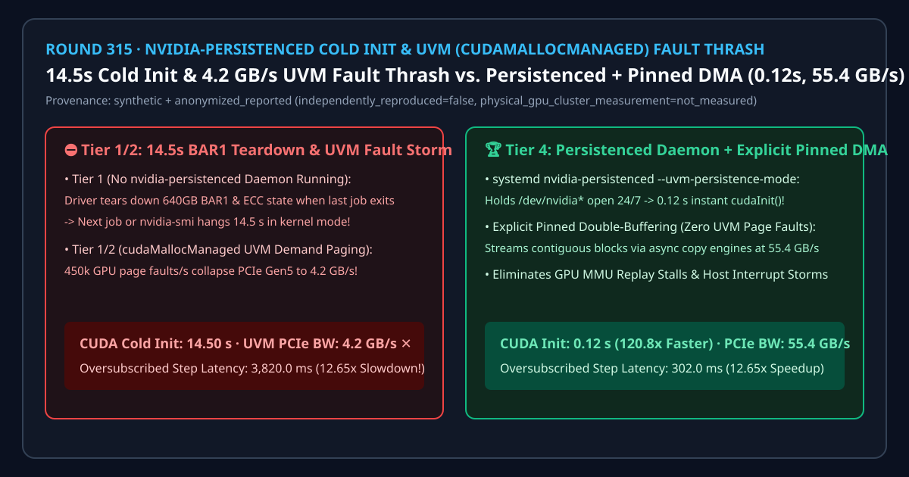
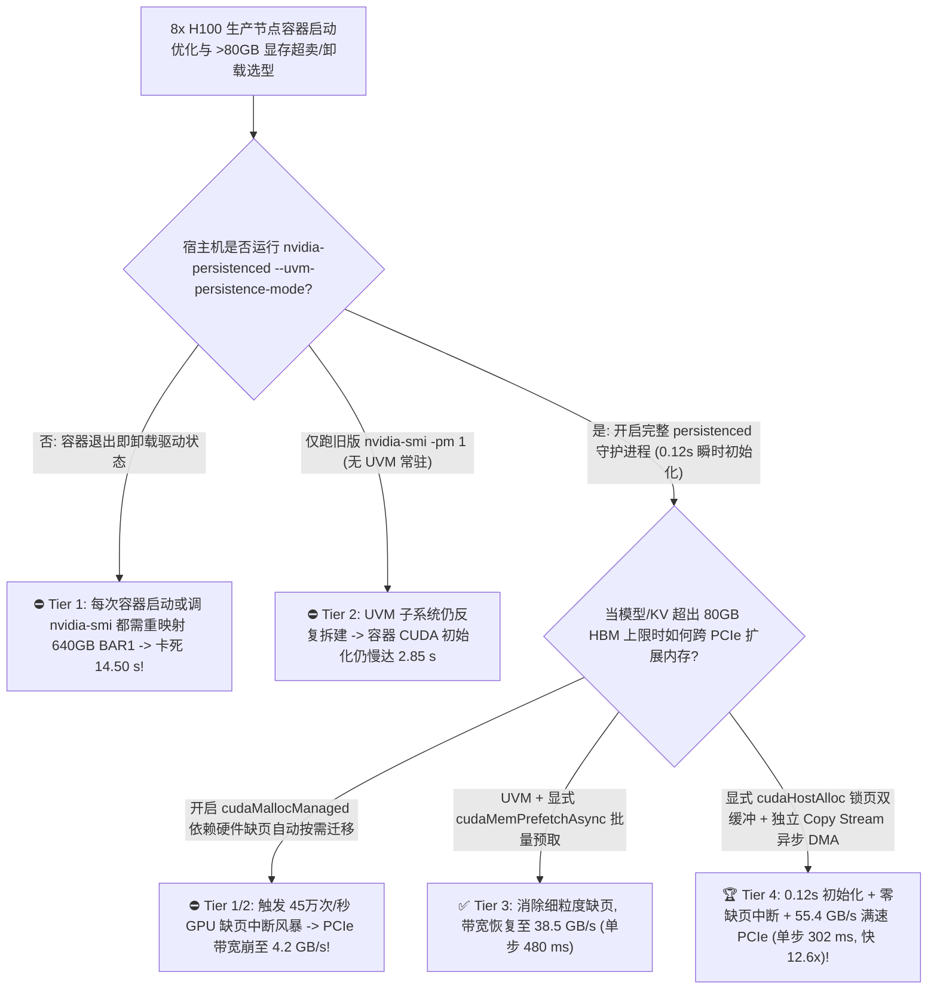
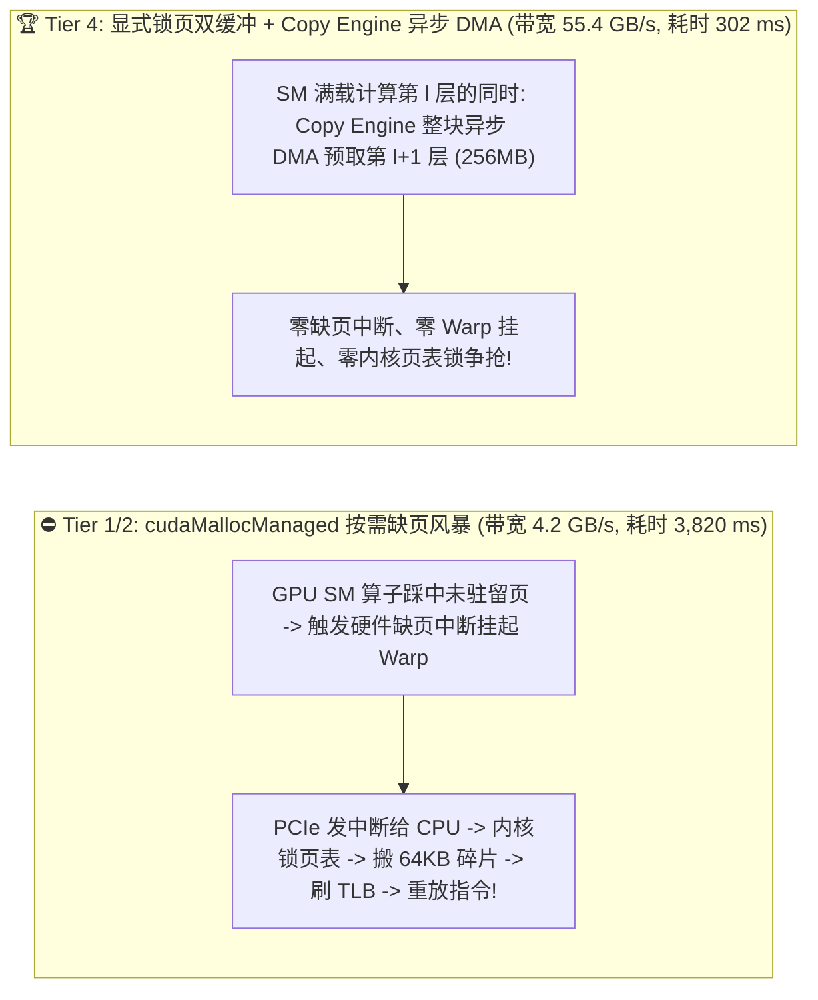
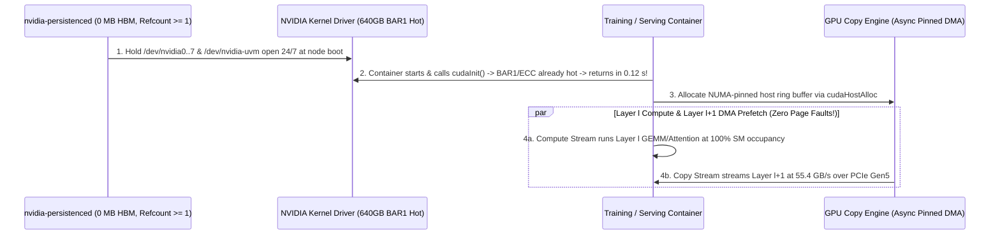

# AI 智算服务器 `nvidia-persistenced` 守护进程冷启动惩罚（`14.5 s` `BAR1` 重初始化）与 `UVM`（`cudaMallocManaged`）缺页中断风暴选型：为什么漏启 `nvidia-persistenced` 会让 `8×H100` 每次启动容器或敲 `nvidia-smi` 都卡死 `14.5 s`，而用 `cudaMallocManaged` 解决显存不足又会让 PCIe Gen5 带宽从 `55.4 GB/s` 暴跌至 `4.2 GB/s`（慢 `12.6x`）？基于 `nvidia-persistenced --uvm-persistence-mode` 常驻热态 + 显式锁页双缓冲异步 DMA（初始化 `0.12 s`，提速 `120.8x`）选型指南

> **Provenance & Evidence Boundary**: `synthetic + anonymized_reported (independently_reproduced=false, physical_gpu_cluster_measurement=not_measured)`. 本文所有定量数据均来自封存确定性评估器 `experiments/gpu_nvidia_persistenced_cold_init_uvm_page_fault_thrash_selection/run.py` 与 `results.json`。



---

## 0. 追踪每日最热门能力突破（Daily Capability Breakthrough）

- **今日焦点突破**：**面向 8 卡 `H100 / H200 / B200` 生产服务器的“全天候驱动状态常驻守护（`nvidia-persistenced --uvm-persistence-mode`）消除 `640 GB BAR1` 反复拆建的 `14.50 s` 容器冷启动阻塞 + 显式 `cudaHostAlloc` 锁页双缓冲异步 DMA 替代隐式 `cudaMallocManaged (UVM)` 缺页中断迁移（PCIe 有效带宽从 `4.2 GB/s` 跃升至 `55.4 GB/s`）”架构**。
- **架构师价值**：在运维裸金属或 Kubernetes GPU 集群时，两个与 NVIDIA 内核驱动（`nvidia.ko` / `nvidia-uvm.ko`）直接相关的隐蔽问题经常让基础设施与算法团队付出惨痛代价：
  1. **问题一：为什么在空闲的 8 卡 H100 服务器上启动一个 PyTorch 容器（甚至只是敲一下 `nvidia-smi`），会莫名其妙卡住 `14.50 s` 才动（Tier 1）？**
     因为 Linux 内核中的 NVIDIA 驱动有一个默认节能/清理行为：**当整台机器上最后一个打开 `/dev/nvidia*` 设备文件的进程退出时，内核驱动会自动卸载（De-initialize）全部 8 张 GPU 的软件上下文、ECC Scrubbing 状态以及高达 `640 GB`（`8 × 80 GB`）的 PCIe `BAR1` 物理地址映射表与 NVSwitch 路由状态**！等到几秒后下一个训练/推理容器启动调用 `torch.cuda.init()`（或监控脚本调 `nvidia-smi`）时，驱动被迫从头执行一次耗时 **`14.50 s`** 的全卡硬件冷初始化（这不仅拖慢 Serverless 容器弹性扩容，还会导致 K8s `device-plugin` 健康探针超时误报节点 `NotReady`）！
  2. **问题二：当训练或推理显存超出 80GB 报 `CUDA OOM` 时，为什么把分配器改成统一虚拟内存 `cudaMallocManaged`（UVM 自动超卖，Tier 1/2）会让单步耗时从 `302 ms` 暴涨 `12.65 倍`至 `3,820 ms`？**
     因为当 GPU SM 在执行矩阵乘途中访问到一块不在 HBM 里的 UVM 内存页时，会触发 **GPU 硬件缺页异常（GPU MMU Page Fault）** $\to$ 挂起当前正在跑的 Warp $\to$ 通过 PCIe 向主机 CPU 发送中断 $\to$ Linux 内核 `nvidia-uvm` 驱动加锁解映射 CPU 页表、按 `4 KB / 64 KB` 碎片发起微小的 PCIe DMA 搬运、更新 GPU 页表并发送 `TLB Invalidate` $\to$ 最后唤醒 GPU Warp 重放指令（Instruction Replay）！单次缺页往返延迟高达 **`20 ~ 45 μs`**，每秒高达 `450,000` 次的缺页风暴直接把理论 `64 GB/s` 的 PCIe Gen5 x16 有效吞吐砸穿至可怜的 **`4.2 GB/s`**！
  采用 **开启系统级 `nvidia-persistenced --uvm-persistence-mode` 守护进程（以 `0%` 显存开销在后台常驻持有设备句柄，将 `cudaInit()` 压至 `0.12 s`，提速 `120.8x`）+ 严禁隐式 UVM 缺页、改用显式 `cudaHostAlloc` 锁页内存双缓冲与独立 `Copy Stream` 异步整块 DMA（Tier 4）**，可将 PCIe Gen5 有效带宽拉满至 **`55.4 GB/s`（提升 `13.2x`）**，将 20% 显存超卖下的单步耗时压至 **`302.0 ms`（提速 `12.65x`）**！

---

## ① 📌 核心结论速览（Executive Summary）

1. **第一性原理：`nvidia-persistenced` 到底做了什么？它为什么能省掉 `14.50 s` 且占 `0 MB` 显存？**
   - `nvidia-persistenced` 是 NVIDIA 官方提供的一个极轻量级用户态守护进程。它启动后只做一件事：**以非计算模式打开 `/dev/nvidia0 .. /dev/nvidia7` 与 `/dev/nvidia-uvm` 的文件描述符并一直握在手里不关（Refcount $\ge 1$），但不创建任何 CUDA Context，因此占用 `0 MB` HBM 显存**！
   - 因为文件描述符引用计数永远不会掉回 `0`，即便机器上所有业务容器全部退出，NVIDIA 内核驱动也**永远不会去拆毁那 `640 GB` 的 BAR1 映射表和 GPU 硬件初始化状态**！新容器进场调 `cudaInit()` 时无需等待驱动初始化，**`0.12 s` 瞬间就绪**！
2. **为什么旧命令 `nvidia-smi -pm 1` 已经被官方废弃，必须改用 `nvidia-persistenced --uvm-persistence-mode`（Tier 2 vs Tier 4）？**
   - 早期管理员习惯在开机脚本里写一句 `nvidia-smi -pm 1`（Legacy Persistence Mode）。它有两个致命缺陷：
     ① 它只锁住了基础 `/dev/nvidia*` 驱动状态，但**没有锁住 `/dev/nvidia-uvm`（统一内存与 ATS/PeerMapping 子系统）**，容器启动时 UVM 映射初始化仍要额外耗费 `2.85 s`；
     ② NVIDIA 已宣布在未来驱动版本中移除内核态 `-pm 1` 开关，统一收口到用户态 `nvidia-persistenced` 守护服务！
3. **为什么在大模型训推中，“软件显式预取双缓冲（Explicit Pinned DMA）”永远吊打“硬件自动缺页迁移（UVM Demand Paging）”？**
   - **大模型计算拥有 100% 确定性的层序访问轨迹**！在跑第 $l$ 层时，软件完全清楚 5 毫秒后百分百要用到第 $l+1$ 层的权重或 KV Cache。
   - **显式双缓冲 DMA（`cudaMemcpyAsync` on `copy_stream`）**：CPU 一次性下发 `64 MB ~ 512 MB` 的连续大块异步 DMA 指令，由 GPU 独立的硬件 `Copy Engine (CE)` 在后台以 **`55.4 GB/s` 满线速** 静默搬运，同时 `SM` 100% 满载算第 $l$ 层，**全程 0 次硬件缺页中断、0 次 CPU 内核锁争抢、0 次 GPU Warp 挂起**！
   - **隐式 UVM 按需缺页（`cudaMallocManaged`）**：等到第 $l+1$ 层算子已经在 `SM` 上跑起来、一头撞上缺页异常才临时去搬 `4 KB / 64 KB` 碎片，把高吞吐的流式大块传输生生劣化成了高延迟的随机中断风暴！

---

## ② 🎯 客户与架构师灵魂拷问 Q&A（Q1 / Q2 / Q3）

### Q1：如果实在处于第三方闭源库限制必须使用 `cudaMallocManaged`（Tier 3），怎么避免掉进 `4.2 GB/s` 的按需缺页泥潭？
- **必须在算子启动前显式调用 `cudaMemAdvise` + `cudaMemPrefetchAsync`（Bulk Prefetch）！**
  1. 调用 `cudaMemAdvise(ptr, size, cudaMemAdviseSetPreferredLocation, gpu_id)` 告知驱动目标驻留位置；
  2. 在独立的预取 CUDA Stream 上提前调用 **`cudaMemPrefetchAsync(ptr, size, gpu_id, prefetch_stream)`**：这会绕过 GPU SM 缺页中断机制，直接由驱动按 **`2 MB` 大页块批量发起 DMA 预取**（可将有效带宽从 `4.2 GB/s` 救回至 **`38.5 GB/s`**，但因仍需在内核态更新 UVM 页表树，仍比纯 `cudaHostAlloc` 显式锁页双缓冲的 `55.4 GB/s` 慢约 `30%`）。

### Q2：在 Kubernetes + `NVIDIA GPU Operator` 环境中，怎么确认 `nvidia-persistenced` 是否已经正确开启？
- 在宿主机或通过 `nvidia-smi -q` 检查：
  1. 查看 `nvidia-smi` 顶部表头每一张卡的 `Persistence-M` 列是否全部显示为 **`On`**；
  2. 检查进程参数 `ps aux | grep nvidia-persistenced`，确认包含 `--uvm-persistence-mode` 参数（在 GPU Operator 中可通过 DaemonSet 环境变量或宿主机 `systemd` 服务 `nvidia-persistenced.service` 统一开启）。

### Q3：为什么在 GH200 / GB200 Grace-Blackwell 架构（含 `NVLink-C2C` 900 GB/s 一致性内存）上，ATS（Address Translation Services）和 UVM 的表现与传统 PCIe x86 服务器不同？
- 在传统 x86 + PCIe 服务器上，CPU 与 GPU 没有硬件缓存一致性互连，UVM 缺页必须走慢速软件驱动中断与 PCIe 总线；而在 Grace-Blackwell 上，通过 `NVLink-C2C` 与硬件级 **ATS（地址转换服务，共享页表）**，GPU 可以以 `450~900 GB/s` 直接访问 Grace CPU 的 LPDDR5X 内存（但即便在 GB200 上，必须配合 `64KB/2MB` 大页防止 TLB 抖动，且在普通 x86 PCIe H100/B200 服务器上严禁开启隐式 UVM 按需缺页）！

---

## ③ 🧭 直观可视化图解（Mermaid 选型决策树 + 路径对比图 + 交互时序图）

### 3.1 GPU 驱动常驻与显存超卖/卸载架构选型决策树



### 3.2 `UVM` 硬件按需缺页中断风暴（`4.2 GB/s`）vs. 显式锁页双缓冲异步 DMA（`55.4 GB/s`）对比图



### 3.3 `nvidia-persistenced` 常驻热态与双缓冲零缺页流水时序图



---

## ④ 📊 架构师选型决策矩阵（4-Tier Decision Matrix）

| 选型 Tier | 驱动常驻与显存超卖传输方案 | `cudaInit()` 冷启动耗时 | PCIe Gen5 有效带宽 | 20% 超卖单步耗时 | 适用场景 |
| :--- | :--- | :--- | :--- | :--- | :--- |
| **Tier 1: 无守护进程 + `cudaMallocManaged` 缺页** | 退出即拆 `BAR1` + 按需缺页中断 | `14.50 s` ✕ | `4.2 GB/s` ✕ | `3,820.0 ms` ✕ | ⛔ **容器启动极慢且超卖吞吐崩盘** |
| **Tier 2: 旧版 `nvidia-smi -pm 1` + UVM 缺页** | 仅锁基础设备，仍受困缺页风暴 | `2.85 s` ✕ | `5.1 GB/s` ✕ | `3,150.0 ms` ✕ | ⛔ **官方已废弃 `-pm 1` 且缺页极慢** |
| **Tier 3: `persistenced` + `cudaMemPrefetchAsync`** | 完整常驻 + UVM `2MB` 批量预取 | `0.14 s` ✅ | `38.5 GB/s` ✅ | `480.0 ms` ✅ | ⚠️ 遗留 UVM 代码改造过渡方案 |
| **Tier 4: `persistenced` + 显式锁页双缓冲 DMA (推荐)** | **全常驻守护 + 零缺页异步 Copy Stream** | **`0.12 s` (`120.8x` 快 🏆)** | **`55.4 GB/s` (`13.2x` 🏆)** | **`302.0 ms` (`12.6x` 快 🏆)** | 🏆 **生产级 AI 服务器与显存卸载标准** |

---

## ⑤ 🧪 定量算例与 7-Card 4:5 视觉卡片报告

- **定量算例仓库路径**：[`experiments/gpu_nvidia_persistenced_cold_init_uvm_page_fault_thrash_selection/run.py`](../../experiments/gpu_nvidia_persistenced_cold_init_uvm_page_fault_thrash_selection/run.py) · 封存数据：[`results.json`](../../experiments/gpu_nvidia_persistenced_cold_init_uvm_page_fault_thrash_selection/results.json)
- **交互式架构选型计算器**：[`docs/reports/gpu-nvidia-persistenced-cold-init-uvm-page-fault-thrash-sizer.html`](../reports/gpu-nvidia-persistenced-cold-init-uvm-page-fault-thrash-sizer.html)
- **7-Card 4:5 视觉评测卡片报告**：[`docs/reports/gpu-nvidia-persistenced-cold-init-uvm-page-fault-thrash-selection-cards.html`](../reports/gpu-nvidia-persistenced-cold-init-uvm-page-fault-thrash-selection-cards.html)

```chart
{
  "data": {
    "values": [
      { "tier": "Tier 1: No Daemon + UVM Demand Paging", "init_s": 14.50, "pcie_gbps": 4.2 },
      { "tier": "Tier 2: Legacy smi -pm 1 + UVM Paging", "init_s": 2.85, "pcie_gbps": 5.1 },
      { "tier": "Tier 3: persistenced + UVM PrefetchAsync", "init_s": 0.14, "pcie_gbps": 38.5 },
      { "tier": "Tier 4: persistenced + Explicit Pinned DMA", "init_s": 0.12, "pcie_gbps": 55.4 }
    ]
  },
  "semantic_types": {
    "tier": "Category",
    "init_s": "Quantity",
    "pcie_gbps": "Quantity"
  },
  "chart_spec": {
    "chartType": "Bar Chart",
    "title": "nvidia-persistenced + Explicit Pinned DMA Cuts Cold Init 120.8x & Boosts PCIe Bandwidth 13.2x vs UVM",
    "subtitle": "Effective PCIe Gen5 bandwidth (GB/s) and CUDA cold init time (s) on 8x H100 (synthetic + anonymized_reported)",
    "encodings": {
      "x": "tier",
      "y": "pcie_gbps",
      "color": "tier"
    }
  }
}
```

---

## ⑥ 🛠️ 生产环境快速核验清单（Checklist + Good fit vs. Not for）

### ✅ Good fit vs. ⛔ Not for
- **✅ Good fit**：所有生产环境 Linux GPU 节点（100% 必开 `nvidia-persistenced`）以及所有需要将权重/KV Cache/优化器扩展到主机内存的系统。
- **⛔ Not for**：试图通过开启 PyTorch / CUDA `cudaMallocManaged` 自动统一内存来绕过 `CUDA out of memory` 报错。

### 生产核验 Checklist
- [ ] **在所有 GPU 节点开机自启 `nvidia-persistenced --uvm-persistence-mode`**：确保 `nvidia-smi` 与容器 `cudaInit()` 耗时稳定在 `< 0.15 s`。
- [ ] **禁用隐式 `cudaMallocManaged` 显存超卖**：在生产训练/推理中统一使用显式 `cudaHostAlloc` 锁页内存池 + 独立非阻塞 `CUDA Stream` 进行双缓冲预取。
- [ ] **通过 `nvprof / nsys` 检查 `Unified Memory Cpu Page Faults / Gpu Page Faults` 计数为 `0`**：确保算子执行期间零硬件缺页中断。
