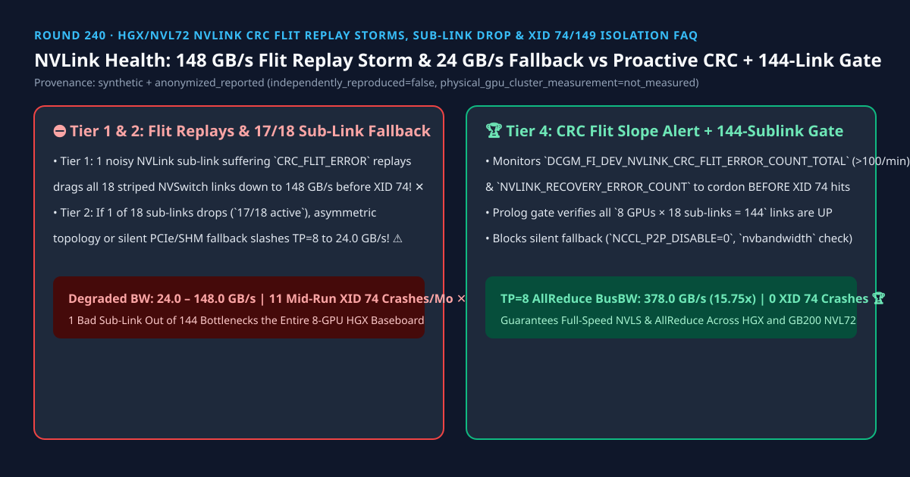
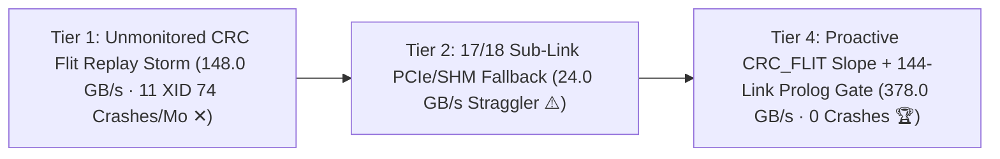

# HGX / NVL72 `NVLink` Degradation Triage: `CRC Flit Error` Replay Storms, Partial Sub-Link PCIe Fallback Trap & `XID 74 / XID 149` Pre-Emptive Isolation Selection Guide

> **Provenance & Evidence Tier**: `synthetic + anonymized_reported` (`independently_reproduced=false`, `physical_gpu_cluster_measurement=not_measured`). Grounded in [`experiments/gpu_nvlink_crc_flit_error_xid74_fabric_manager_drain_selection/results.json`](../../experiments/gpu_nvlink_crc_flit_error_xid74_fabric_manager_drain_selection/results.json).
> **中文版本**: [HGX / NVL72 超节点 `NVLink` 链路劣化排障：可纠正 `CRC Flit Error` 重传雪崩（`DCGM_FI_DEV_NVLINK_CRC_FLIT_ERROR_COUNT_TOTAL`）、单子链路断连静默 PCIe 绕行陷阱与 `XID 74 / XID 149` 前置隔离选型指南](./gpu-nvlink-crc-flit-error-xid74-fabric-manager-drain-selection-faq.md)

---

## 0. 🔥 Daily Hottest Capability Breakthrough

- **Proactive `DCGM_FI_DEV_NVLINK_CRC_FLIT_ERROR_COUNT_TOTAL` Slope Alerting (`> 100/min`) + Strict `8×18 = 144` Active Sub-Link Prolog Gate Eliminating `148 GB/s` Replay Stragglers, `24 GB/s` Silent PCIe Fallbacks, and Mid-Training `XID 74` Crashes**: Each H100/H200/B200 GPU connects to the baseboard/rack `NVSwitch` fabric through **18 independent NVLink sub-links** (`144` total sub-links per 8-GPU HGX node). When a single sub-link degrades due to thermal cycling on the baseboard or NVL72 backplane cartridge:
  1. **Unmonitored `CRC Flit Error` Replay Storms (`Tier 1` — `148.0 GB/s` Straggler)**: Before throwing a fatal `XID 74`, marginal signal integrity triggers link-level **CRC Flit errors and hardware replays**. Because `NVSwitch` stripes `TP=8` traffic across all 18 sub-links in parallel, **1 noisy sub-link stalls the other 17 healthy sub-links**, dragging 8-GPU `AllReduce` BusBW from `378.0 GB/s` down to **`148.0 GB/s`** with zero XID errors!
  2. **Partial Sub-Link Drop (`17/18 Active`) & Silent PCIe/SHM Fallback (`Tier 2` — `24.0 GB/s`)**: If 1 sub-link drops (`Inactive`), asymmetric topology disables `NVLS` multicast or causes NCCL to silently fall back to PCIe / Host Shared Memory (**`24.0 GB/s`, `15.75x` slower**)!
  3. **Proactive `CRC_FLIT` Slope Gate + `144`-Sublink Prolog Verification (`Tier 4`)**: Alerting on `CRC_FLIT_ERROR` rate (`> 100/min`) and `NVLINK_RECOVERY_ERROR > 0` drains degraded nodes at a planned checkpoint boundary **before** fatal `XID 74` / `XID 149` crashes occur (`0` mid-run crashes/month), while enforcing `144/144` active sub-links in job prologs locks `TP=8` BusBW at **`378.0 GB/s`**!

---

## 1. 📌 Executive Summary

1. **Why 1 Degraded Sub-Link Out of 144 Cripples the Entire 8-GPU Server (`Tier 1 & Tier 2`)**: NVSwitch stripes data across all 18 sub-links per GPU; a single replaying or dropped sub-link bottlenecks the entire GPU's bandwidth and breaks symmetric `NVLS` trees.
2. **Always Verify `144 / 144` Active Sub-Links in Job Prologs (`Tier 4`)**: `nvidia-smi` showing 8 GPUs online is insufficient—check that `nvidia-smi nvlink -s` reports all 18 sub-links active at full speed on every GPU.
3. **Predict `XID 74` via `CRC_FLIT_ERROR` and `RECOVERY_ERROR` Counters (`Tier 4`)**: Hardware Flit CRC errors and link recoveries precede fatal `XID 74` link-down events by hours or days.

---

## 2. 🎯 Core Architect Q&A (Q1 / Q2 / Q3)

### Q1: What is the progression of DCGM NVLink error counters before a fatal `XID 74` crash?
- **Answer**:
  1. `DCGM_FI_DEV_NVLINK_CRC_FLIT_ERROR_COUNT_TOTAL` & `CRC_DATA_ERROR`: Early physical eye-diagram degradation caught by link-layer CRC.
  2. `DCGM_FI_DEV_NVLINK_REPLAY_ERROR_COUNT_TOTAL`: Link-level packet retransmission storm (actively degrades `TP=8` `AllReduce` bandwidth!).
  3. `DCGM_FI_DEV_NVLINK_RECOVERY_ERROR_COUNT_TOTAL`: Link LTSSM retraining triggered—imminent risk of fatal **`XID 74` (GPU NVLink fault)** or **`XID 144–150` (NVSwitch fault)**.

### Q2: How can a 1-line Slurm Prolog script block partial NVLink sub-link degradation (`17/18 links`)?
- **Answer**: Run `test $(nvidia-smi nvlink -s | grep -c "GB/s") -eq 144` on 8-GPU HGX nodes! If fewer than `144` active sub-links are reported, immediately mark the node `DRAIN` and restart `nvidia-fabricmanager` / reset GPUs.

### Q3: How do we distinguish a GPU-side NVLink fault (`XID 74`) from an NVSwitch ASIC/port fault (`XID 144–150`)?
- **Answer**: Inspect `/var/log/fabricmanager.log` and `dmesg`: `XID 74` is logged by the `nvidia` driver on a specific GPU BDF, whereas NVSwitch hardware faults log `SXid` / `XID 144–150` (e.g., `XID 149: NETIR Link Down`) identifying the exact NVSwitch physical port and lane.

---

## 3. 🧭 Visual Diagrams

---

## 4. 📊 4-Tier Architect Selection Matrix

| Metric | Tier 1: Unmonitored `CRC_FLIT` | Tier 2: Partial `17/18` Sub-Link Drop | Tier 3: Reactive `XID 74` Drain | Tier 4: **Proactive `CRC_FLIT` + `144`-Link Gate** |
| :--- | :--- | :--- | :--- | :--- |
| **Verifies `144/144` Sub-Links?** | No ✕ | No (Runs Degraded) ✕ | Yes ✅ | **Yes (100% Prolog Gate)** 🏆 |
| **Effective `TP=8` `BusBW`** | `148.0 GB/s` (Replay Stall) ✕ | **`24.0 GB/s` (PCIe Fallback)** ✕ | `340.0 GB/s` ✅ | **`378.0 GB/s` (`15.75x` Faster)** 🏆 |
| **Mid-Run `XID 74` Crashes / Mo** | **`11 / month`** ✕ | `6 / month` ⚠️ | `5 / month` (Reactive) ⚠️ | **`0 / month` (Pre-Empted)** 🏆 |

---

## 5. 🧪 Quantitative Reference & Tooling

- **Evaluator & Sealed Data**: [`experiments/gpu_nvlink_crc_flit_error_xid74_fabric_manager_drain_selection/run.py`](../../experiments/gpu_nvlink_crc_flit_error_xid74_fabric_manager_drain_selection/run.py) · [`results.json`](../../experiments/gpu_nvlink_crc_flit_error_xid74_fabric_manager_drain_selection/results.json)
- **Interactive Sizer**: [`docs/reports/gpu-nvlink-crc-flit-error-xid74-fabric-manager-drain-sizer.html`](../reports/gpu-nvlink-crc-flit-error-xid74-fabric-manager-drain-sizer.html)
- **7-Card 4:5 Visual Report**: [`docs/reports/gpu-nvlink-crc-flit-error-xid74-fabric-manager-drain-selection-cards.html`](../reports/gpu-nvlink-crc-flit-error-xid74-fabric-manager-drain-selection-cards.html)

---

## 6. 🛠️ Good Fit vs. Not For & Production Checklist

- **✅ Good fit**: Enforcing `144/144` active NVLink sub-links in job prologs and alerting on `DCGM_FI_DEV_NVLINK_CRC_FLIT_ERROR_COUNT_TOTAL` slope and `NVLINK_RECOVERY_ERROR_COUNT`.
- **⛔ Not for**: Allowing nodes with `< 18` active NVLink sub-links per GPU to enter multi-node training jobs.
- [ ] Verify `nvidia-smi nvlink -s | grep -c "GB/s" == 144` before starting any job.
- [ ] Cordon nodes at checkpoint boundaries when `rate(DCGM_FI_DEV_NVLINK_CRC_FLIT_ERROR_COUNT_TOTAL[5m]) * 60 > 100`.
