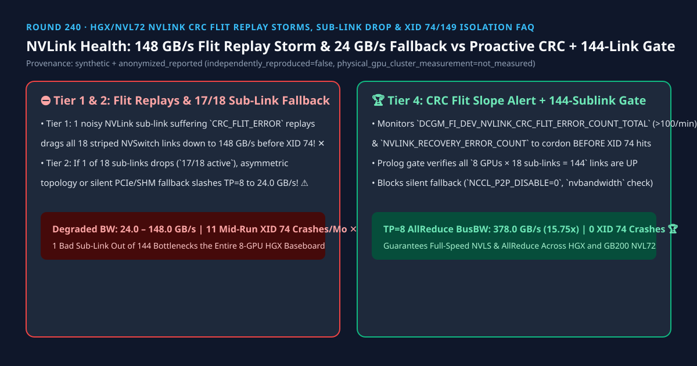
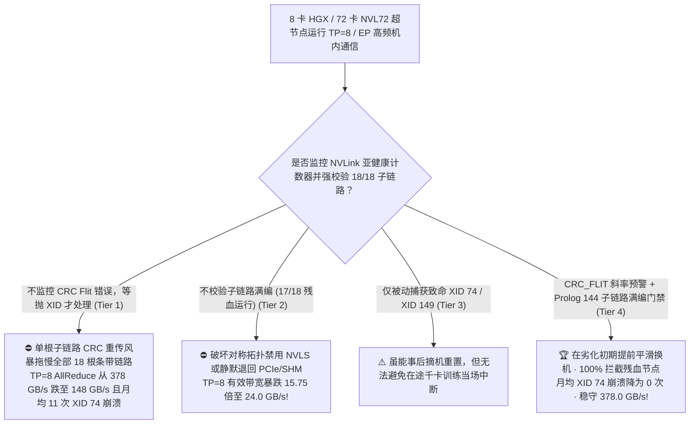
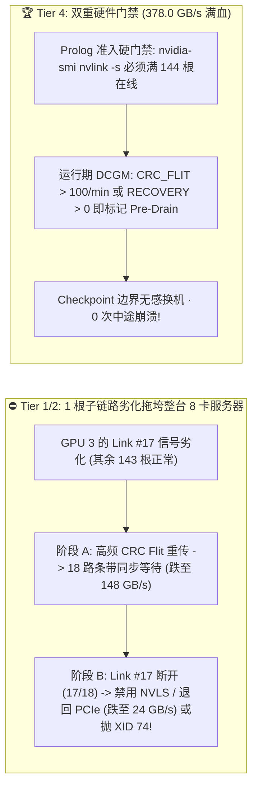
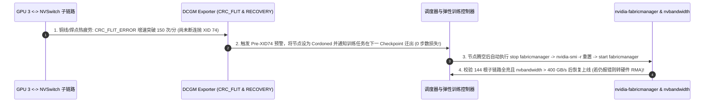

# HGX / NVL72 超节点 `NVLink` 链路劣化排障：可纠正 `CRC Flit Error` 重传雪崩（`DCGM_FI_DEV_NVLINK_CRC_FLIT_ERROR_COUNT_TOTAL`）、单子链路断连静默 PCIe 绕行陷阱与 `XID 74 / XID 149` 前置隔离选型指南

> **Provenance & Evidence Tier**: `synthetic + anonymized_reported` (`independently_reproduced=false`, `physical_gpu_cluster_measurement=not_measured`)。定量数据锚定于 [`experiments/gpu_nvlink_crc_flit_error_xid74_fabric_manager_drain_selection/results.json`](../../experiments/gpu_nvlink_crc_flit_error_xid74_fabric_manager_drain_selection/results.json)。
> **English Version**: [HGX / NVL72 `NVLink` Degradation Triage: `CRC Flit Error` Replay Storms, Partial Sub-Link PCIe Fallback Trap & `XID 74 / XID 149` Pre-Emptive Isolation Selection Guide](./gpu-nvlink-crc-flit-error-xid74-fabric-manager-drain-selection-faq.en.md)

---

## 0. 🔥 今日领域最热门能力突破追踪（Daily Hottest Breakthrough）

- **通过监控 `DCGM_FI_DEV_NVLINK_CRC_FLIT_ERROR_COUNT_TOTAL` 斜率（`> 100/min`）与任务准入期 `8×18 = 144` 根子链路满编强校验，彻底终结“144 根 NVLink 子链路仅坏 1 根就导致整机 8 卡 `TP=8` 带宽从 `378.0 GB/s` 暴跌至 `148.0 / 24.0 GB/s`”的灰故障陷阱，并将训练中途 `XID 74` 崩溃清零**：在一台 8 卡 H100/H200/B200 HGX 服务器（或 GB200 NVL72 机柜）中，每张 GPU 拥有 **18 根独立的 NVLink 高速串行子链路（Sub-links，整机共 $8 \times 18 = \mathbf{144}$ 根子链路）** 连接到 NVSwitch 芯片。当底板铜走线、BGA 焊点或 NVL72 背板连接器因热胀冷缩发生微米级形变时，集群会遭遇两个极具欺骗性的性能黑洞：
  1. **黑洞一（未触发 `XID 74` 前的 `CRC Flit Error` 链路层重传风暴，Tier 1）**：NVLink 协议在物理层之上以微片（`Flit`）为单位做硬件 CRC 校验与链路级自动重传（Link-Level Replay）。当 144 根子链路里哪怕只有 **1 根子链路** 眼图劣化，每秒产生成千上万次 `CRC_FLIT_ERROR` 和硬件重传时，由于 **NVSwitch 会将 `TP=8` 的集合通信流量均匀条带化（Striping）打散到全部 18 根子链路上**，另外 17 根健康的子链路必须停下来等这 1 根重传慢链路的报文凑齐！结果是：**内核没有任何 XID 报错，但整台机器的 `AllReduce` 算法带宽从 `378.0 GB/s` 腰斩至 `148.0 GB/s`**！
  2. **黑洞二（18 根子链路掉线 1~2 根引发非对称拓扑或静默回退 `PCIe / SHM`，Tier 2）**：如果某根子链路重训练失败变成 `Inactive`（每张卡只剩 `16~17` 根在线），或者 `nvidia-fabricmanager` 因单个 NVSwitch 端口异常未能建立对称多播组（`NVLS`），NCCL 在构建机内拓扑时会因为带宽不对称而禁用 `NVLS`，甚至对故障卡对**静默退回走主机共享内存（`SHM / PCIe`，有效带宽暴跌 15.75 倍至 `24.0 GB/s`）**！
  3. **主动防御闭环（`CRC_FLIT_ERROR` 导数预警 + `144` 子链路满编门禁，Tier 4）**：实时监控 `DCGM_FI_DEV_NVLINK_CRC_FLIT_ERROR_COUNT_TOTAL`（`> 100/min`）与 `NVLINK_RECOVERY_ERROR_COUNT`（`> 0`），在子链路彻底断连抛出致命 **`XID 74`（GPU 端 NVLink 错误）或 `XID 144~150`（NVSwitch 硬件错误）** 之前，于下一个 Checkpoint 边界自动无感换机，并在 Slurm Prolog 中硬性核验全机 `144` 根子链路 100% 满速率在线，实现 **`0` 次中途掉卡崩溃** 与 **`378.0 GB/s` 满血机内带宽**！

---

## 1. 📌 核心结论速览（Executive Summary — 3 分钟看懂）

1. **为什么 1 台机器上 144 根 NVLink 线里只断了 1 根，不会只慢 $1/144$（`0.7%`），而是会慢 `60% ~ 90%`？**
   - **通俗大白话 + 第一性原理**：
     - 把每张 GPU 连向 NVSwitch 的 **18 根 NVLink 子链路** 想象成一条 **18 车道的并排齐步走方阵**。
     - 当 GPU 发送一个张量时，硬件为了跑出 `450 GB/s` 的单向极速，会把每一个数据块横着切碎，让 **18 条车道同时并排往前运**。
     - 如果第 18 号车道坑洼不平（发生 `CRC Flit Error` 不断退回重跑，Tier 1），前面 17 条车道就算一秒钟跑完也没用，必须站在终点线等第 18 号车道把货补齐！
     - 更惨的是，如果第 18 号车道直接封路关闭了（只剩 17 条车道，Tier 2），NCCL 一看：“哎呀，这张卡只有 17 条道，别的卡有 18 条道，没法对齐跑 `NVLS` 硬件多播了！”于是直接把整台机器的通信降级，甚至把那张卡踢去走乡间土路（**`24 GB/s` 的 PCIe / 主机内存绕行**），整机速度当场崩盘 **15 倍**！

---

## 2. 🎯 客户与架构师灵魂拷问 Q&A（Q1 / Q2 / Q3）

### Q1：在任务启动前（Prolog），如何用一行命令在 0.5 秒内确认整台 8 卡机器的全部 144 根 NVLink 子链路 100% 满血在线？
- **答**：运行 **`nvidia-smi nvlink -s`**！
  - 在健康的 8 卡 H100 / H200（NVLink 4.0）机器上，`nvidia-smi nvlink -s | grep -c "25.781 GB/s"`（在 B200 NVLink 5.0 上为 `"50." GB/s`）的输出结果 **必须严格等于 `144`（即 $8\text{ GPUs} \times 18\text{ Links}$）**！
  - 只要输出的数字是 `143`、`142` 或者包含任何 `Inactive / Off` 字样，说明已经有子链路断连，**必须立即拦截该节点禁止上线**！

### Q2：在 DCGM 的四个 NVLink 错误指标（`CRC_FLIT`、`CRC_DATA`、`REPLAY`、`RECOVERY`）中，各自代表什么严重等级？
- **答**：按劣化生命周期从早到晚排列：
  1. **`DCGM_FI_DEV_NVLINK_CRC_FLIT_ERROR_COUNT_TOTAL` & `CRC_DATA_ERROR`（早期预警灯）**：物理信号眼图开始变差，偶发位翻转被 CRC 校验捕获；当速率 `> 100 次/分钟` 时，应标记为“亚健康（Pre-Drain）”，等当前任务存完 Checkpoint 后下线检修。
  2. **`DCGM_FI_DEV_NVLINK_REPLAY_ERROR_COUNT_TOTAL`（中度降速灯）**：CRC 错误已密集到频繁触发链路层回退重传（Link Replay），此时机内 `TP=8` 通信带宽已经开始明显下滑！
  3. **`DCGM_FI_DEV_NVLINK_RECOVERY_ERROR_COUNT_TOTAL`（高危红灯）**：重传失败触发了 NVLink 物理层重训练恢复（Link Recovery）——距离彻底断连抛出 **`XID 74 / XID 149`** 只剩一步之遥，必须立即隔离！

### Q3：如果节点已经报了 `XID 74 (NVLink Error)` 或 `XID 149 (NVSwitch Link Down)`，怎么自动化修复？
- **答**：首先清空该节点上的任务，随后依次执行：
  1. 停止 `systemctl stop nvidia-fabricmanager`；
  2. 执行 `nvidia-smi -r`（重置全部 GPU 与 NVLink 端口状态；若失败则调 BMC 执行冷断电 `power cycle`）；
  3. 重新启动 `systemctl start nvidia-fabricmanager`，并跑一遍 `nvidia-smi nvlink -s`（确认恢复 `144` 根在线）+ `nvbandwidth -t device_to_device_memcpy_read_ce`（确认点对点带宽 `> 400 GB/s`）后才允许解封（Uncordon）！

---

## 3. 🧭 直观可视化图解（Mermaid 决策树 + 18 子链路木桶效应图 + 主动预测隔离时序图）

### 3.1 架构师 HGX / NVL72 超节点 `NVLink` 健康监控与容错选型决策树

### 3.2 `Tier 1/2`（单根子链路重传/掉线引发整机崩盘）vs. `Tier 4`（144 链路门禁 + CRC 斜率前置隔离）

### 3.3 `Tier 4` 基于 `NVLINK_CRC_FLIT_ERROR` 的零中断换机与 `FabricManager` 闭环修复时序图

---

## 4. 📊 架构师选型决策矩阵（4-Tier Selection Matrix）

| 评估维度 | Tier 1: 不监控 `CRC Flit` 重传 | Tier 2: 漏检 `17/18` 残血回退 | Tier 3: 仅被动捕获 `XID 74/149` | Tier 4: **`CRC_FLIT` 斜率预警 + `144` 链路门禁** |
| :--- | :--- | :--- | :--- | :--- |
| **是否强校验 `8×18=144` 子链路在线** | 否 ✕ | 否（允许 `17/18` 残血运行） ✕ | 是 ✅ | **是（Prolog 硬性准入门禁）** 🏆 |
| **故障机 `TP=8 AllReduce` 带宽** | `148.0 GB/s` (重传木桶效应) ✕ | **`24.0 GB/s` (退回 PCIe/SHM)** ✕ | `340.0 GB/s` ✅ | **`378.0 GB/s` (`NVLS` 满血，快 `15.75x`)** 🏆 |
| **月均 `XID 74` 训练中断次数** | **`11 次/月`** ✕ | `6 次/月` ⚠️ | `5 次/月` (事后恢复) ⚠️ | **`0 次/月` (事前预测平滑换机)** 🏆 |

---

## 5. 🧪 定量算例与工具链（Interactive Sizer & 7-Card Visual Report）

- **实验脚本与密封数据**：[`experiments/gpu_nvlink_crc_flit_error_xid74_fabric_manager_drain_selection/run.py`](../../experiments/gpu_nvlink_crc_flit_error_xid74_fabric_manager_drain_selection/run.py) · [`results.json`](../../experiments/gpu_nvlink_crc_flit_error_xid74_fabric_manager_drain_selection/results.json)
- **交互式 NVLink 亚健康与 XID 74 防护计算器**：[`docs/reports/gpu-nvlink-crc-flit-error-xid74-fabric-manager-drain-sizer.html`](../reports/gpu-nvlink-crc-flit-error-xid74-fabric-manager-drain-sizer.html)
- **7-Card 4:5 视觉评测卡片报告**：[`docs/reports/gpu-nvlink-crc-flit-error-xid74-fabric-manager-drain-selection-cards.html`](../reports/gpu-nvlink-crc-flit-error-xid74-fabric-manager-drain-selection-cards.html)

---

## 6. 🛠️ Good Fit vs. Not For & 生产环境快速核验清单（Checklist）

### ✅ Good Fit vs. ⛔ Not For

| 维度 | ✅ Good Fit（强烈推荐） | ⛔ Not For（严禁误用） |
| :--- | :--- | :--- |
| **超节点机内互连健康管理** | 在任务启动前硬性校验 **`144` 根子链路全部 Active**，并在运行期告警 `DCGM_FI_DEV_NVLINK_CRC_FLIT_ERROR_COUNT_TOTAL` 增速与 `RECOVERY_ERROR > 0` | 只看 `nvidia-smi` 8 张卡在不在，却不检查 `nvidia-smi nvlink -s` 是否有子链路掉线或 `fabricmanager` 是否报非对称降级 |

### 生产环境上线核验清单（Pre-Flight Checklist）

- [ ] **在 Slurm Prolog / K8s InitContainer 中加入 `nvidia-smi nvlink -s` 满编检查**：确认 Active 高速子链路总数严格等于 `8 × 18 = 144`。
- [ ] **配置 Prometheus 告警 `rate(DCGM_FI_DEV_NVLINK_CRC_FLIT_ERROR_COUNT_TOTAL[5m]) * 60 > 100` 或 `increase(DCGM_FI_DEV_NVLINK_RECOVERY_ERROR_COUNT_TOTAL[5m]) > 0`**：提前锁定亚健康背板。
- [ ] **确认 `systemctl is-active nvidia-fabricmanager` 为 `active`**：防止多播归约（`NVLS`）因 Fabric Manager 挂死而静默失效。
