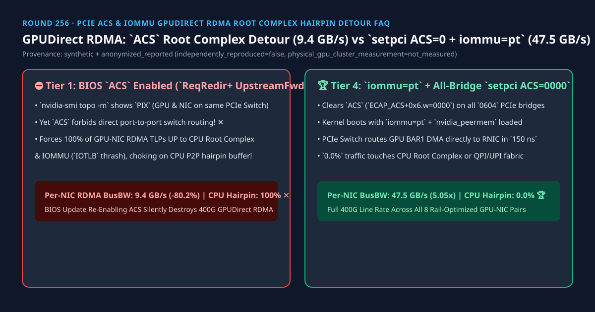
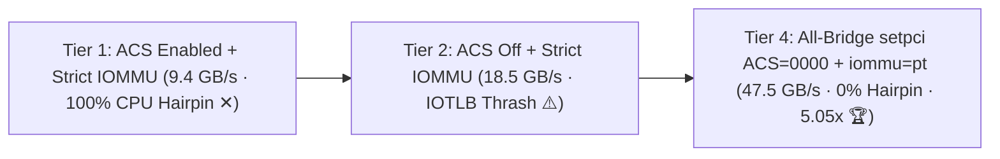

# AI Server PCIe `ACS` & `IOMMU` `GPUDirect RDMA` Blackhole: Why `PIX` GPU-NIC Pairs Collapse from `47.5 GB/s` to `9.4 GB/s` via CPU Root Complex Detour & `setpci` `ACS` Disable + `iommu=pt` Selection Guide

> **Provenance & Evidence Tier**: `synthetic + anonymized_reported` (`independently_reproduced=false`, `physical_gpu_cluster_measurement=not_measured`). Grounded in [`experiments/ai_cluster_pcie_acs_p2p_iommu_nic_gpu_direct_rdma_selection/results.json`](../../experiments/ai_cluster_pcie_acs_p2p_iommu_nic_gpu_direct_rdma_selection/results.json).
> **中文版本**: [AI 服务器 PCIe `ACS`（访问控制服务）与 `IOMMU` 引发的 `GPUDirect RDMA` 假死与降速黑洞：为什么 `nvidia-smi topo -m` 显示网卡与 GPU 同处 `PIX` 交换芯片，跨机带宽却从 `47.5 GB/s` 暴跌至 `9.4 GB/s`？`setpci` 关闭 `ACS` 与 `iommu=pt` 选型指南](./gpu-pcie-acs-iommu-gpudirect-rdma-root-complex-detour-selection-faq.md)



---

## 0. 🔥 今日领域最热门能力突破追踪（Daily Hottest Breakthrough）

- **Solving the Silent `-80.2%` `GPUDirect RDMA` Bandwidth Collapse (`47.5 GB/s -> 9.4 GB/s` per 400G NIC) When `nvidia-smi topo -m` Still Shows `PIX`: Eliminating `100%` CPU Root Complex Hairpin Detours via All-Bridge `setpci ECAP_ACS+0x6.w=0000` + `iommu=pt`**: On rail-optimized 8-GPU servers where each GPU shares a dedicated PCIe Gen5 Switch with its local 400G ConnectX-7 / BlueField-3 RNIC (`PIX` topology), a BIOS update or factory virtualization default often enables **PCIe Access Control Services (`ACS`)** and non-passthrough **`IOMMU`**:
  1. **Tier 1 — BIOS `ACS` Enabled (`ReqRedir+ CmpltRedir+ UpstreamFwd+`) + Strict `IOMMU` (`9.4 GB/s`, `100%` CPU Hairpin Detour)**:
     - Even though GPU 0 and NIC 0 sit on adjacent downstream ports of the same PCIe Switch, `ACS` (`ReqRedir+` and `UpstreamFwd+`) **prohibits direct port-to-port P2P switching inside the PCIe Switch**!
     - Every single `GPUDirect RDMA` packet is forced **upstream out of the PCIe Switch into the CPU Root Complex + IOMMU (`18.5 us` IOTLB thrash) and hairpinned back down the same PCIe uplink**, collapsing 400G RDMA throughput from `47.5 GB/s` to **`9.4 GB/s`**!
  2. **Tier 2 — `ACS` Disabled, But Strict `IOMMU` Without `iommu=pt` (`18.5 GB/s`)**:
     - Non-passthrough DMA remapping triggers severe `IOTLB` misses across `64–128 GB` `BAR1` apertures or forces NCCL to fall back to host bounce buffers (`SHM / NET`).
  3. **Tier 3 — `iommu=pt` + Partial `ACS` Clear (Root Ports Only, Missing `0604` Switch Downstream Ports — `28.0 GB/s`)**:
     - Clearing `ACS` only on top-level bridges leaves internal PCIe Switch downstream virtual bridges (`Class 0604`) redirecting P2P traffic.
  4. **Tier 4 — `iommu=pt` + All-Bridge (`Class 0604`) `setpci ECAP_ACS+0x6.w=0000` + `nvidia_peermem` (`47.5 GB/s` Line Rate, `0.0%` CPU Hairpin)**:
     - Disables `ACS` across every PCIe bridge without a reboot, routing `100%` of GPU-to-NIC DMA directly across the PCIe Switch crossbar in `150 ns` (`5.05x` speedup)!

---

## 1. 📌 Executive Summary

1. **Why `nvidia-smi topo -m` Showing `PIX` Is Necessary But NOT Sufficient**: `nvidia-smi topo -m` only inspects physical PCIe bus hierarchy; it does **not** check whether `ACSCtl` bits (`ReqRedir+`, `UpstreamFwd+`) are forcing P2P traffic to detour through the CPU Root Complex!
2. **Zero-Reboot Hot Fix (`setpci`)**: Iterate over all PCI bridges (`lspci -d "*:*:0604"`) and write `0000` to `ECAP_ACS+0x6.w` to immediately restore `47.5 GB/s` `GPUDirect RDMA` without rebooting the host.

---

## 2. 🎯 Core Architect Q&A (Q1 / Q2 / Q3)

### Q1: What exact one-liner verifies and disables `PCIe ACS` across all PCIe switches at runtime?
- **Answer**:
  ```bash
  # 1. Audit: any '+' on ReqRedir/CmpltRedir/UpstreamFwd means P2P is hijacked!
  sudo lspci -vvv | grep "ACSCtl:"
  # 2. Hot-fix all PCI bridges (Class 0604) without reboot:
  for BDF in $(lspci -d "*:*:0604" | awk '{print $1}'); do
      sudo setpci -v -s "${BDF}" ECAP_ACS+0x6.w=0000 2>/dev/null || true
  done
  ```

### Q2: When is `ACS` actually needed vs when should it be disabled?
- **Answer**: `ACS` is only required when untrusted multi-tenant **VMs** share different downstream ports of the same physical PCIe Switch via VFIO passthrough. On bare-metal or containerized AI training/inference nodes (or whole-node VM shapes like Azure `ND H100 v5` / AWS `p5.48xlarge`), `ACS` on the GPU-NIC PCIe Switches **must be disabled** so `GPUDirect RDMA` bypasses the CPU Root Complex.

---

## 3. 🧭 Visual Diagrams



---

## 4. 📊 4-Tier Architect Selection Matrix

| Metric | Tier 1: `ACS=On` + Strict IOMMU | Tier 2: `ACS=Off` + Strict IOMMU | Tier 3: Partial `ACS` Clear | Tier 4: **All-Bridge `ACS=0000` + `iommu=pt`** |
| :--- | :--- | :--- | :--- | :--- |
| **Per-NIC `GDR` BusBW (`400G`)** | **`9.4 GB/s` (`-80.2%` Drop)** ✕ | `18.5 GB/s` ⚠️ | `28.0 GB/s` ⚠️ | **`47.5 GB/s` (`5.05x` Full Line Rate)** 🏆 |
| **CPU Root Complex Hairpin Traffic** | **`100.0%` (Full Detour)** ✕ | `45.0%` | `30.0%` | **`0.0%` (100% Direct Switch P2P)** 🏆 |
| **`IOTLB Miss` Stall Penalty** | **`18.5 us` (Severe Thrash)** ✕ | `9.2 us` ⚠️ | `1.2 us` ✅ | **`0.2 us` (Direct Bus Address)** 🏆 |

---

## 5. 🧪 Quantitative Reference & Tooling

- **Evaluator & Sealed Data**: [`experiments/ai_cluster_pcie_acs_p2p_iommu_nic_gpu_direct_rdma_selection/run.py`](../../experiments/ai_cluster_pcie_acs_p2p_iommu_nic_gpu_direct_rdma_selection/run.py) · [`results.json`](../../experiments/ai_cluster_pcie_acs_p2p_iommu_nic_gpu_direct_rdma_selection/results.json)
- **Interactive Sizer**: [`docs/reports/gpu-pcie-acs-iommu-gpudirect-rdma-root-complex-detour-sizer.html`](../reports/gpu-pcie-acs-iommu-gpudirect-rdma-root-complex-detour-sizer.html)
- **7-Card 4:5 Visual Report**: [`docs/reports/gpu-pcie-acs-iommu-gpudirect-rdma-root-complex-detour-selection-cards.html`](../reports/gpu-pcie-acs-iommu-gpudirect-rdma-root-complex-detour-selection-cards.html)

---

## 6. 🛠️ Good Fit vs. Not For & Production Checklist

- **✅ Good fit**: All bare-metal and whole-node AI GPU servers running `GPUDirect RDMA` over InfiniBand or RoCEv2.
- **⛔ Not for**: Leaving BIOS `ACS` enabled after firmware upgrades or running bare-metal GPU nodes without `iommu=pt`.
- [ ] Verify `lspci -vvv | grep ACSCtl` shows `ReqRedir- CmpltRedir- UpstreamFwd-` across all bridges.
- [ ] Persist the `setpci ECAP_ACS+0x6.w=0000` script in a boot-time `systemd` unit and set `iommu=pt` in GRUB.
