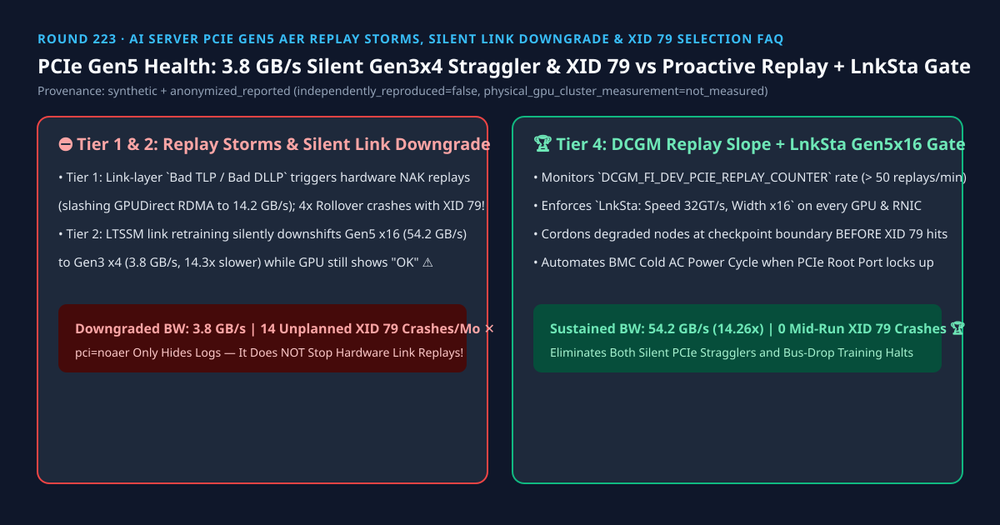
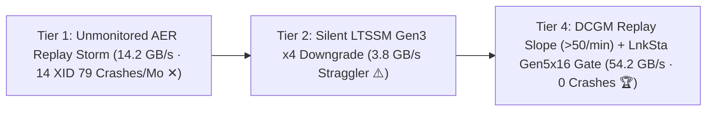

# AI Server PCIe Gen5 Signal Integrity, `AER` Correctable Replay Storms, Silent Link Width/Speed Downgrade & `XID 79` (`Fallen Off the Bus`) Selection Guide

> **Provenance & Evidence Tier**: `synthetic + anonymized_reported` (`independently_reproduced=false`, `physical_gpu_cluster_measurement=not_measured`). Grounded in [`experiments/gpu_pcie_aer_correctable_replay_link_retrain_xid79_selection/results.json`](../../experiments/gpu_pcie_aer_correctable_replay_link_retrain_xid79_selection/results.json).
> **中文版本**: [AI 服务器 PCIe Gen5 信号完整性、`AER` 可纠正错包重传风暴（`Replay Rollover`）、链路静默降级（`Gen5 x16 -> Gen3 x4`）与 `XID 79`（掉卡 `Fallen Off the Bus`）选型指南](./gpu-pcie-aer-correctable-replay-timer-nak-link-retrain-xid79-selection-faq.md)

---

## 0. 🔥 Daily Hottest Capability Breakthrough

- **Proactive `DCGM_FI_DEV_PCIE_REPLAY_COUNTER` Rate Alerting (`> 50/min`) + `LnkSta` (`32GT/s x16`) Enforcement Eliminating Both `3.8 GB/s` Silent Link-Downgrade Stragglers and Mid-Training `XID 79` (`GPU has fallen off the bus`) Crashes**: Operating PCIe Gen5 x16 at `32 GT/s` per lane leaves minimal signal integrity margin across risers, retimers, and OAM baseboards. When a lane degrades:
  1. **Link-Layer `NAK` Replay Storms (`Tier 1`)**: Before a fatal crash occurs, the PCIe Data Link Layer catches LCRC errors (`Bad TLP / Bad DLLP`) and replays packets from hardware retry buffers, slashing GPUDirect RDMA bandwidth from `54.2 GB/s` to **`14.2 GB/s`**. Suppressing kernel logs with `pci=noaer` hides the warning while hardware keeps replaying!
  2. **Silent LTSSM Link Speed/Width Downgrade (`Tier 2`)**: During link retraining (`LTSSM Recovery`), hardware can silently downshift a degraded `Gen5 x16` (`54.2 GB/s`) link to **`Gen3 x4` (`3.8 GB/s`, `14.26x` slower)** to keep the device alive. Basic health checks still see 8 GPUs online, turning the node into a severe cluster-wide straggler!
  3. **Pre-Emptive Isolation (`Tier 4`)**: By alerting on `DCGM_FI_DEV_PCIE_REPLAY_COUNTER` slope (`> 50 replays/min`) and enforcing `LnkSta: Speed 32GT/s, Width x16` in pre-flight gates, degraded nodes are cordoned and drained at a planned checkpoint boundary **before** 4 consecutive replay failures (`Replay Number Rollover`) trigger a fatal **`XID 79`** bus drop—reducing unplanned `XID 79` job crashes from **`14/month` to `0`**!

---

## 1. 📌 Executive Summary

1. **Never Use `pci=noaer` in Production AI Clusters (`Tier 1`)**: `pci=noaer` only silences OS reporting; hardware `NAK` replays continue unabated and eventually culminate in `XID 79`.
2. **Always Check Current Link Width (`x16`) and Active Speed (`32GT/s`, `Tier 2`)**: A GPU or RNIC that trains down to `x8` or `x4` stays visible in `nvidia-smi` / `ibstat` but bottlenecks all-to-all and RDMA traffic.
3. **`XID 79` Requires a Cold BMC AC Power Cycle (`Tier 3 & Tier 4`)**: A standard Linux warm `reboot` does not reset a latched PCIe Root Port / Retimer fault; automate `ipmitool chassis power cycle` after draining.

---

## 2. 🎯 Core Architect Q&A (Q1 / Q2 / Q3)

### Q1: How can we distinguish normal PCIe idle power-saving downclocking from a broken PCIe link?
- **Answer**: When a GPU is idle (P8 state), PCIe **link speed (`gen.current`)** may legitimately drop to Gen1 (`2.5 GT/s`) to save power, but **link width (`pcie.link.width.current`) should NEVER drop below `16`**! Furthermore, under active workload (P0 state), both `gen.current == 5` (`32 GT/s`) and `width.current == 16` must hold.

### Q2: Why does `DCGM_FI_DEV_PCIE_REPLAY_COUNTER` predict `XID 79` hours before the crash?
- **Answer**: `XID 79` is triggered when the PCIe link fails 4 consecutive replays of the same TLP (`Replay Number Rollover`) or hits a `Completion Timeout`. Before 4 consecutive failures happen simultaneously, marginal signal integrity produces thousands of single-retry `NAK` replays per hour.

### Q3: Why doesn't `sudo reboot` recover a GPU after `XID 79: GPU has fallen off the bus`?
- **Answer**: Because the GPU's PCIe endpoint or upstream switch port is stuck in a hardware `Link Down` state powered by the standby/main power rail. Only a full BMC cold power cycle (`ipmitool chassis power cycle`) drains the rails and re-initializes LTSSM link training.

---

## 3. 🧭 Visual Diagrams

---

## 4. 📊 4-Tier Architect Selection Matrix

| Metric | Tier 1: Unmonitored / `pci=noaer` | Tier 2: Silent `Gen3 x4` Downgrade | Tier 3: Reactive `XID 79` Drain | Tier 4: **Proactive Replay Slope + `LnkSta` Gate** |
| :--- | :--- | :--- | :--- | :--- |
| **Effective PCIe Bandwidth** | `14.2 GB/s` (Replay Storm) ✕ | **`3.8 GB/s` (`Gen3 x4` Straggler)** ✕ | `48.5 GB/s` ✅ | **`54.2 GB/s` (Full `Gen5 x16`)** 🏆 |
| **Catches Silent Downgrade?** | No ✕ | No ✕ | Yes ✅ | **Yes (100% Pre-Flight Gate)** 🏆 |
| **Mid-Run `XID 79` Crashes / Mo** | **`14 / month`** ✕ | `6 / month` ⚠️ | `5 / month` (Reactive) ⚠️ | **`0 / month` (Pre-Empted)** 🏆 |

---

## 5. 🧪 Quantitative Reference & Tooling

- **Evaluator & Sealed Data**: [`experiments/gpu_pcie_aer_correctable_replay_link_retrain_xid79_selection/run.py`](../../experiments/gpu_pcie_aer_correctable_replay_link_retrain_xid79_selection/run.py) · [`results.json`](../../experiments/gpu_pcie_aer_correctable_replay_link_retrain_xid79_selection/results.json)
- **Interactive Sizer**: [`docs/reports/gpu-pcie-aer-correctable-replay-timer-nak-link-retrain-xid79-sizer.html`](../reports/gpu-pcie-aer-correctable-replay-timer-nak-link-retrain-xid79-sizer.html)
- **7-Card 4:5 Visual Report**: [`docs/reports/gpu-pcie-aer-correctable-replay-timer-nak-link-retrain-xid79-selection-cards.html`](../reports/gpu-pcie-aer-correctable-replay-timer-nak-link-retrain-xid79-selection-cards.html)

---

## 6. 🛠️ Good Fit vs. Not For & Production Checklist

- **✅ Good fit**: Monitoring `DCGM_FI_DEV_PCIE_REPLAY_COUNTER` rate, checking `pcie.link.width.current == 16` in job prologs, and automating BMC cold power cycles for `XID 79` remediation.
- **⛔ Not for**: Setting `pci=noaer` in kernel boot parameters or attempting warm OS reboots on `XID 79` nodes.
- [ ] Alert and cordon when `rate(DCGM_FI_DEV_PCIE_REPLAY_COUNTER[5m]) * 60 > 50`.
- [ ] Verify `LnkSta` speed and width (`x16`) on all GPUs and RDMA NICs before job admission.
