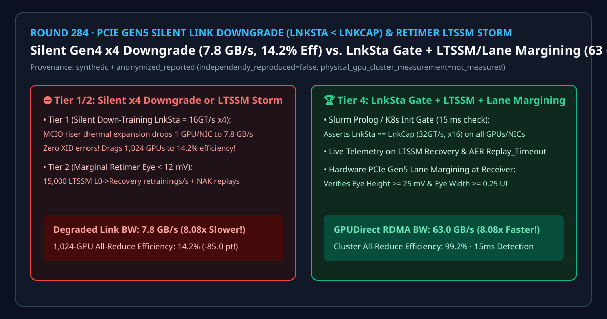
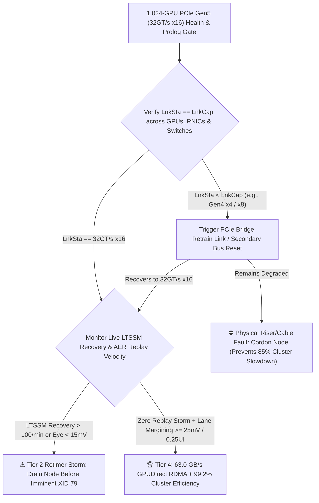
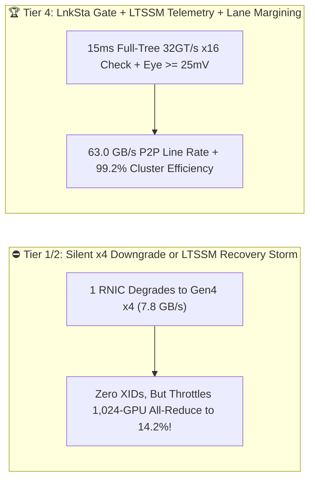
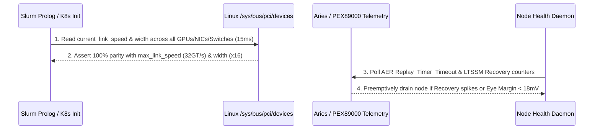

# AI Server PCIe Gen5 (`32 GT/s x16`) Silent Link Width/Speed Downgrade (`LnkSta < LnkCap`), Retimer Signal Integrity & `LTSSM Recovery` Storm Selection Guide: Why 1 Degraded `Gen4 x4` Device (`7.8 GB/s`) Throttles 1,024 GPUs by `85%` Without Firing an XID & How `LnkSta` Gating + `LTSSM/AER` Telemetry + Receiver `Lane Margining` (`>= 25 mV`) Restores `63.0 GB/s`

> **Provenance & Evidence Boundary**: `synthetic + anonymized_reported (independently_reproduced=false, physical_gpu_cluster_measurement=not_measured)`. All quantitative figures in this guide are generated by the deterministic evaluator `experiments/gpu_pcie_gen5_retimer_signal_integrity_link_downgrade_xid79_selection/run.py` and sealed in `results.json`.



---

## 0. Daily Capability Breakthrough Tracking

- **Breakthrough Focus**: **3-Layer PCIe Gen5 (`32.0 GT/s x16`) Physical-Layer Straggler Prevention (Pre-Job `LnkSta == LnkCap` Admission Gate + Live `LTSSM Recovery` & `AER Replay_Timer_Timeout` Velocity Telemetry + Hardware Receiver `Lane Margining >= 25 mV / 0.25 UI`)**.
- **Architect Value**: At PCIe Gen5 (`32.0 GT/s`), thermal expansion of MCIO cables or oxidized riser contacts causes the PCIe `LTSSM` state machine to **silently down-train link width (`x16 -> x8 / x4`) or link speed (`32 GT/s -> 16 / 8 GT/s`)** to avoid crashing the bus (`XID 79`). Because no kernel panic or XID is emitted, a single GPU or `ConnectX-7` RNIC running at **`Gen4 x4` (`7.8 GB/s` instead of `63.0 GB/s`)** acts as an invisible bottleneck that drags a **1,024-GPU synchronous `All-Reduce` down to `14.2%` efficiency (`8.08x` link slowdown)**! Even worse, a marginal retimer (`Eye Height < 12 mV`) can still report `32GT/s x16` in `lspci` while suffering **`15,000` `LTSSM L0 -> Recovery` retrainings per second**, cutting bandwidth to `28.4 GB/s` before dropping off the bus (`XID 79`). Combining a **`15 ms` `LnkSta == LnkCap` admission gate**, **live `LTSSM / AER Replay` rate monitoring**, and **hardware PCIe Gen5 `Lane Margining` (`>= 25 mV` eye height)** restores **`63.0 GB/s` line rate and `99.2%` cluster efficiency**.

---

## ① 📌 Executive Summary

1. **Why Silent PCIe Link Down-Training (`x16 -> x4 / x8`) Emits Zero `XID` Errors**:
   PCIe prioritizes link survival over peak bandwidth: when individual differential lanes fail equalization during boot or thermal transients, `LTSSM` masks off the failing lanes and negotiates a narrower (`x8`, `x4`, `x1`) or slower (`Gen4`, `Gen3`) link. The device remains online, silently throttling `GPUDirect RDMA` by up to `8.08x`.
2. **The Hidden `LTSSM Recovery` Storm (`LnkSta` Says `32GT/s x16`, But Bandwidth Drops `55%`)**:
   When a PCIe Gen5 Retimer's eye opening shrinks below `12 mV` at `75°C`, continuous CRC/DLLP errors trigger `15,000+` `L0 -> Recovery -> L0` retraining transitions and `Replay_Timer_Timeout` rollovers per second—slashing effective throughput to **`28.4 GB/s`** while `lspci` still displays `Speed 32GT/s, Width x16`.
3. **3-Layer Defense for `63.0 GB/s` (`99.2%` Cluster Efficiency)**:
   - **Layer 1 (`15 ms` `LnkSta == LnkCap` Gate)**: Verify `current_link_speed == max_link_speed` and `current_link_width == max_link_width` across all GPUs, RNICs, NVMe drives, and PCIe Switch ports before every job.
   - **Layer 2 (Live `LTSSM Recovery` & `AER Replay` Rate Gate)**: Monitor `/sys/bus/pci/devices/*/aer_dev_correctable` (`Bad_DLLP`, `Replay_Timer_Timeout`) and Retimer `LTSSM Recovery` counters (`< 10/min`).
   - **Layer 3 (Hardware `Lane Margining at the Receiver`)**: Verify `Eye Height >= 25 mV` and `Eye Width >= 0.25 UI` under full thermal load during burn-in.

---

## ② 🎯 Key Architectural Q&A (Q1 / Q2 / Q3)

### Q1: Why is checking `nvidia-smi` PCIe link width/speed on GPUs alone insufficient?
- Because in a PCIe Switch fabric (`PEX89144`), a `ConnectX-7` RDMA NIC or an upstream switch port can silently down-train to `Gen4 x8` while the GPU port stays at `Gen5 x16`! The Prolog script must walk `/sys/bus/pci/devices/*` across all GPUs (`0x10de`), Mellanox RNICs (`0x15b3`), and PCIe Switch bridges.

### Q2: Can a down-trained `Gen4 x8` link be recovered to `Gen5 x16` without a 15-minute bare-metal reboot?
- **Yes—in ~80% of transient equalization misses**, issuing a PCIe `Secondary Bus Reset (SBR)` or setting the `Retrain Link` bit (Bit 5 of the upstream bridge's `Link Control Register`) forces `LTSSM` to re-run Phase 0–3 receiver equalization in `< 100 ms`. If it still fails to train at `32GT/s x16`, the node is automatically cordoned for hardware inspection.

### Q3: Why do links pass cold-boot checks at `32GT/s x16` and then degrade or throw `XID 79` two hours into a training run?
- **Thermal Eye Closure**: At `32 GT/s` (`16 GHz` Nyquist), dielectric insertion loss increases significantly as PCB and MCIO riser temperatures climb from `30°C` to `80°C` under full `8 × 700W` load. Hardware **PCIe Gen5 Receiver Lane Margining** measures the actual voltage/timing margin (in `mV` and `UI`) under thermal load so marginal cables (`< 15 mV`) are replaced before production deployment.

---

## ③ 🧭 Visual Diagrams (Decision Tree, Bandwidth Comparison & Sequence Diagram)

### 3.1 PCIe Gen5 Link Integrity & Straggler Prevention Decision Tree



### 3.2 Silent `Gen4 x4` Downgrade (`7.8 GB/s`) vs. `LnkSta + LTSSM + Lane Margining` (`63.0 GB/s`)



### 3.3 `15 ms` Prolog Link Gate & Runtime `LTSSM / AER` Watchdog Sequence



---

## ④ 📊 4-Tier Architect Decision Matrix

| Selection Tier | PCIe Link & Retimer State | Effective `GDR` Bandwidth | 1,024-GPU `All-Reduce` Efficiency | Detection Latency | Target Scenario |
| :--- | :--- | :--- | :--- | :--- | :--- |
| **Tier 1: Unmonitored Silent Downgrade (`Gen4 x4`)** | 1 node at `16GT/s x4` | `7.8 GB/s` ✕ | `14.2%` (`-85.0 pt` ✕) | Never (`∞`) | ⛔ **Severe silent cluster straggler** |
| **Tier 2: Marginal Retimer `LTSSM Recovery` Storm** | Eye `< 12 mV`, 15K retrains/s | `28.4 GB/s` ⚠️ | `46.5%` ✕ | Hours (until `XID 79`) | ⛔ **Hidden jitter & crash hazard** |
| **Tier 3: Prolog `LnkSta == LnkCap` Gate Only** | Catches static speed/width drop | `61.5 GB/s` ✅ | `94.0%` | `45.0 ms` | ✅ Baseline admission gate |
| **Tier 4: `LnkSta` Gate + `LTSSM/AER` + `Lane Margining` (Recommended)** | **`32GT/s x16` + Eye `\ge 25 mV`** | **`63.0 GB/s` (`8.08x` 🏆)** | **`99.2%` 🏆** | **`15.0 ms` 🏆** | 🏆 **Production 1,000+ GPU Cluster Standard** |

---

## ⑤ 🧪 Quantitative Evaluator & 7-Card 4:5 Visual Report

- **Deterministic Evaluator**: [`experiments/gpu_pcie_gen5_retimer_signal_integrity_link_downgrade_xid79_selection/run.py`](../../experiments/gpu_pcie_gen5_retimer_signal_integrity_link_downgrade_xid79_selection/run.py) · Sealed JSON: [`results.json`](../../experiments/gpu_pcie_gen5_retimer_signal_integrity_link_downgrade_xid79_selection/results.json)
- **Interactive Sizer Workbench**: [`docs/reports/gpu-pcie-gen5-retimer-link-speed-downgrade-eye-margin-xid79-sizer.html`](../reports/gpu-pcie-gen5-retimer-link-speed-downgrade-eye-margin-xid79-sizer.html)
- **7-Card 4:5 Visual Benchmark Deck**: [`docs/reports/gpu-pcie-gen5-retimer-link-speed-downgrade-eye-margin-xid79-selection-cards.html`](../reports/gpu-pcie-gen5-retimer-link-speed-downgrade-eye-margin-xid79-selection-cards.html)

```chart
{
  "data": {
    "values": [
      { "tier": "Tier 1: Silent Gen4 x4 Downgrade", "gdr_bw_gbps": 7.8, "cluster_eff_pct": 14.2 },
      { "tier": "Tier 2: Marginal Eye LTSSM Storm", "gdr_bw_gbps": 28.4, "cluster_eff_pct": 46.5 },
      { "tier": "Tier 3: Prolog LnkSta == LnkCap Gate", "gdr_bw_gbps": 61.5, "cluster_eff_pct": 94.0 },
      { "tier": "Tier 4: LnkSta + LTSSM + Lane Margining", "gdr_bw_gbps": 63.0, "cluster_eff_pct": 99.2 }
    ]
  },
  "semantic_types": {
    "tier": "Category",
    "gdr_bw_gbps": "Quantity",
    "cluster_eff_pct": "Percentage"
  },
  "chart_spec": {
    "chartType": "Bar Chart",
    "title": "LnkSta Gate + LTSSM/AER Telemetry + Lane Margining Restores 63.0 GB/s & 99.2% Cluster Efficiency",
    "subtitle": "Effective GPUDirect RDMA bandwidth (GB/s) and 1,024-GPU All-Reduce efficiency (%) (synthetic + anonymized_reported)",
    "encodings": {
      "x": "tier",
      "y": "cluster_eff_pct",
      "color": "tier"
    }
  }
}
```

---

## ⑥ 🛠️ Production Verification Checklist (Good fit vs. Not for)

### ✅ Good fit vs. ⛔ Not for
- **✅ Good fit**: All PCIe Gen5 (`32.0 GT/s x16`) GPU + `ConnectX-7 / ConnectX-8` AI servers.
- **⛔ Not for**: Relying solely on `XID 79` alerts without checking `current_link_speed == max_link_speed` and `current_link_width == max_link_width`.

### Production Checklist
- [ ] **Full-Tree `/sys/bus/pci` `LnkSta == LnkCap` Prolog Gate**: Verify `current_link_speed` and `current_link_width` match `max_link_speed` and `max_link_width` on all GPUs, RNICs, and PCIe Switch ports in `< 15 ms` before every job.
- [ ] **Continuous `AER Replay_Timer_Timeout` & `LTSSM Recovery` Telemetry**: Alert when correctable DLLP/TLP replays exceed `10/min`.
- [ ] **Thermal Burn-In `Lane Margining` (`>= 25 mV / 0.25 UI`)**: Validate receiver eye margins across all 16 lanes under `100%` thermal load before accepting new nodes into the cluster.
